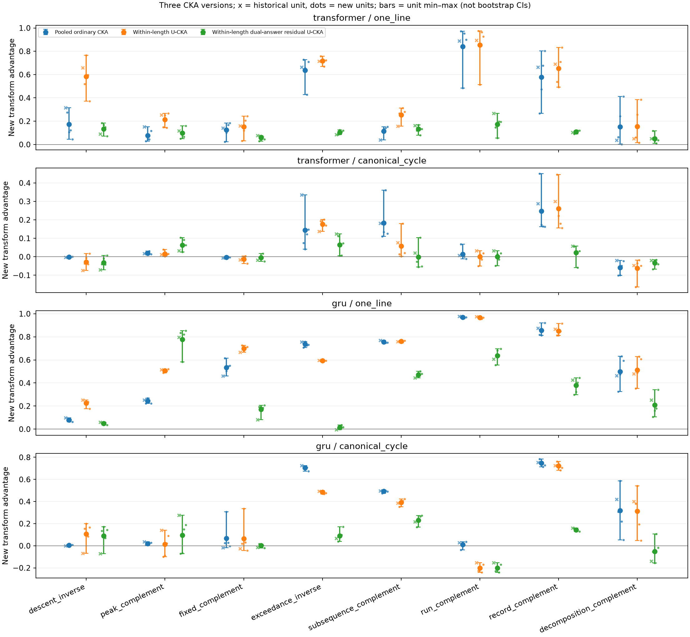
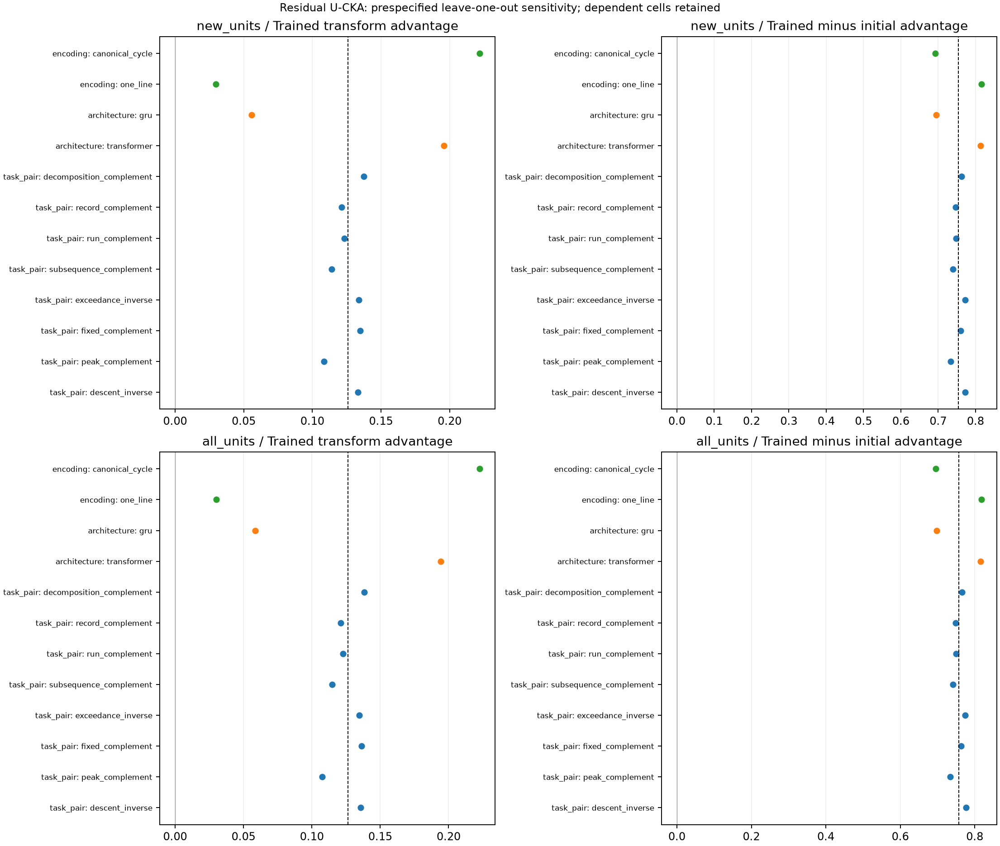
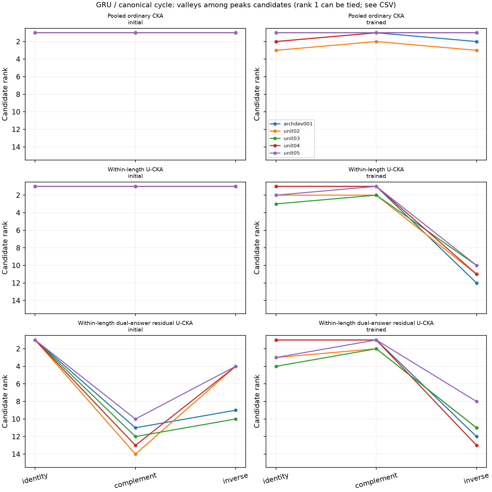

# What remains after length and answer controls?

The prescribed answer-residual analysis retains positive transform selectivity, but its magnitude depends strongly on encoding and model configuration. It does **not** establish an answer-independent mathematical mechanism. Training changes relative pairing preferences; it does not generally increase the absolute similarity of the mathematically correct pair.

This is an exploratory analysis of **320 existing 20k specialists in five units**, with **ten genuine saved step-0 snapshots**. No eligible checkpoint is missing. Each unit uses its original **10,752 held-out anchors: 512 at each length 10–30**. Data, exclusions, representation position, and transformations are unchanged. The four newer units are reported separately from the historical unit; the new analysis is not retroactively described as a confirmation experiment.

## The contrast is stricter than the old Bt

For each designated task pair, the transform advantage here is correct-transform CKA minus the **largest** CKA under any other eligible transform, including identity. This is distinct from the paper's old Bt, which subtracts one fixed wrong transform. Its trained-minus-initial increment is also distinct from the old Delta. The formula audit found no second exact transform for the designated pair among the three tested actions.

The old primary analysis was already within length and joint-answer stratified, rather than pooled. It was independently reproduced before the new scores: all **228,480 score checks** and the original aggregate counts/ranks passed, with maximum absolute difference **2.89e-15**. Thus this diagnostic supplements the old analysis rather than silently replacing its definitions.

## Does selectivity survive the requested controls?

| CKA version | New-four mean advantage | Task-pair bootstrap 95% interval | Cells positive in every new unit |
|---|---:|---:|---:|
| Pooled ordinary CKA | 0.317309 | [0.184564, 0.449421] | 26/32 |
| Within-length U-CKA | 0.343678 | [0.250223, 0.446950] | 25/32 |
| Within-length dual-answer residual U-CKA | 0.125783 | [0.078508, 0.175252] | 22/32 |

Including the historical unit gives residual advantage **0.126393 [0.075537, 0.179627]**, with **20/32** cells positive in all five units. All 86,400 aggregate scores are defined; no required length was dropped or reweighted.

Length separation alone does not remove the aggregate advantage. The ordinary-CKA bridge gives **0.341582** within length, versus **0.317309** pooled; changing the within-length estimator to U-CKA gives **0.343678**. Adding the specified answer regressors then reduces it to **0.125783**. These score differences are not a causal decomposition into fractions explained by length or answers.

Each bootstrap draw resamples the **eight task-pair blocks**, retaining their architectures, encodings, and units together. The 32 cells and their many model pairs are not independent replications. These exploratory intervals are conditional on the selected task catalog and its two transform families.

Figure 1. Bars show unit minima and maxima, not confidence intervals; crosses mark the historical unit. The final layer and all fixed conditions are retained.

## Is the result confined to a few combinations?

All eight task-pair averages are positive in the newer units, but averaging conceals substantial heterogeneity. Residual advantage averages **0.221953 for one-line** and **0.029613 for cycles**; it averages **0.195874 for GRU** and **0.055691 for Transformer**. These are configuration-specific descriptions, not isolated architecture effects or evidence of matched capacity/mastery.

All 16 one-line cells are positive in every newer unit; only six cycle cells meet that criterion. Across the full grid, 22 cells are consistently positive, two consistently negative, and eight change sign. A substantial negative example is **GRU/cycle increasing-run–decreasing-run**, mean **−0.212312**, range **[−0.241309, −0.170428]**. Transformer/cycle global-descents–components is also consistently negative, mean **−0.035842**. These are retained as results rather than dismissed as noise.

Deleting any one task pair leaves the residual mean between **0.108430 and 0.137363**. Deleting either architecture or either encoding also retains a positive mean, although removing one-line leaves only **0.029613**. The effect is consequently broader than one successful task pair, while its magnitude is strongly concentrated by encoding/configuration. Full 32-cell means, medians, ranges, and per-unit values remain in [cell_summary.csv](summary/cell_summary.csv).

## What did training change, and does simplicity explain it?

The residual advantage increases relative to initialization in all 32 cells and all four newer units. The large average increment requires careful interpretation:

| New-four residual score | Initial | Trained | Change |
|---|---:|---:|---:|
| Designated-transform CKA | 0.371658 | 0.219127 | −0.152531 |
| Strongest eligible alternative CKA | 1.000000 | 0.093344 | −0.906656 |
| Transform advantage | −0.628342 | 0.125783 | +0.754125 |

The positive increment is therefore mainly a loss of the initial identity similarity, rather than an overall rise in correct-pair CKA. An increment above initialization alone does not establish positive trained selectivity in every condition.

The frozen coding hypothesis receives **qualified support**: simple minus scrambling is **+0.184336 [0.076233, 0.304712]** for trained residual selectivity, but **−0.523980 [−0.659520, −0.384751]** for its training increment. Simple denotes one-line complement or cycle inverse; the opposite combinations are scrambling. The comparison pairs encodings within each task pair, architecture, and unit. It does not imply that these operations have matched network computation costs, or that simple encodings cause greater learning gains. Identity is a reference action and is not included in this simplicity contrast.

## GRU/cycle peaks–valleys: a strong rank is not uniform transform preference

For the four newer units, after both length and additive-answer controls:

| Unit | Valleys rank under identity | Under complement | Under inverse | Complement minus strongest alternative |
|---|---:|---:|---:|---:|
| unit02 | 3 | 2 | 11 | −0.070032 |
| unit03 | 4 | 2 | 11 | −0.064361 |
| unit04 | 1 | 1 | 13 | +0.148778 |
| unit05 | 3 | 1 | 8 | +0.187756 |

Valleys remains near the top under complement, but it is uniquely first in **two of four** newer units, rather than uniformly first. Identity also gives high ranks, while inverse becomes much weaker after length separation. Complement does not beat identity in unit02/unit03. In the pooled version, even inverse ranks valleys 1–3, illustrating the sensitivity to length handling. The historical unit has residual complement rank one and positive advantage **0.276389**; it is not substituted for the newer-unit variation.

These models are not adequately described as merely predicting a length mode: all ten GRU/cycle peaks/valleys summaries have lower full NLL than the fixed training-frequency length prior, by **0.011143–0.064664 nats**, and positive within-length expectation–truth Spearman **0.127914–0.329735**. Accuracy improvements are only **0.0930–2.7530 percentage points**. NLL alone can reflect calibration; the positive within-length correlation supplies the additional input-associated ordering evidence. This does not establish sufficient mastery, baseline equivalence, or a mathematical mechanism. Learning diagnostics use identity inputs.

Across the 32 newer-unit condition means, residual trained advantage correlates descriptively with pair-mean learning Spearman (**rho = 0.499633**) and model-minus-prior full NLL (**rho = −0.484971**). Its initialization-relative increment has little corresponding rank association with learning Spearman (**rho = 0.015396**). These shared-condition correlations do not isolate learning degree, capacity, encoding, or causal mediation; no independent-cell p-values are attached.

Figure 3. At shared initialization, all candidates analytically tie for raw scores at every transform. After candidate-specific answer residualization, the identity comparison still analytically ties, whereas other transforms need not. Strict floating-point ranks can be misleading at a tie: the independent bounded audit found an apparent rank 13 caused by differences below **6e-16** in one single-length initial-identity case. Original numeric ranks are retained; they are not evidence of initial task identification.

## Limits and next question

The measured contrast does not disappear under the requested length separation and additive-answer-mean control. This is **not** a full exclusion of answer-based, input, or initialization explanations: covariance, joint-answer interactions, confidence, and errors can remain. Moreover, same-sample residual fitting uses a shared projector on both sides and introduces row dependence; different candidates/transforms also have different answer designs, ranks, and leverage. U-centered HSIC components do not make this an unbiased conditional-independence test; [METHOD_NOTES.md](METHOD_NOTES.md) gives the explicit shared-projector caveat.

The useful next question is whether the retained selectivity survives controls for confidence/error structure and same-sample projection effects, particularly in the consistently positive cells. Any later probe should distinguish that question from task mastery or functional use. No probe, new unit, training, or new-world evaluation was launched here.

## Files and verification

- [Reproduction commands and definitions](README.md); [frozen protocol](protocol.json); [checkpoint/seed inventory](checkpoint_inventory.csv); [missing-artifact audit](missing_checkpoints.json).
- [All 86,400 aggregate scores](cka_results.csv); [candidate ranks](summary/candidate_ranks.csv); [per-unit advantages and initialization decomposition](summary/transform_advantage_by_unit.csv); [bootstrap](summary/task_pair_bootstrap.csv); [deletions](summary/leave_one_out.csv); [simplicity](summary/simplicity_summary.csv).
- [Learning summaries](learning_summary.csv) and [independent learning review](learning_review.md): 320 models, 6,720 length rows, zero audit failures.
- [Independent numerical verification](independent_verification.json): 36 fixed NumPy checks from saved activations, maximum discrepancy **2.61e-14**, plus aggregate uniqueness/range checks. This is bounded verification, not an independent scientific replication.
- Per-length scores, OLS ranks/df/energy, forward arrays, earlier failed attempts, and logs remain at `/mnt/yangx-projects-f/20261109/permworld_answer_controls`. The original arrays are unchanged; probability-mass precision repair and axis-adapter repair are recorded in the engineering amendments. Eighteen targeted tests pass.

## Endpoint protection audit

All **1,449 explicitly named protected old files** match their start SHA-256, and Git HEAD is unchanged. All **960 activation payload files covering 640 logical test-feature records** match their recorded SHA-256. This is an endpoint audit of the named scope, not continuous monitoring or a claim that every repository file was checked. The prior manuscript, reports, protocols, and source artifacts were not edited by this diagnostic. See [protection_end.json](protection_end.json) and [activation_payload_end.json](activation_payload_end.json). No upload or publication was performed.
