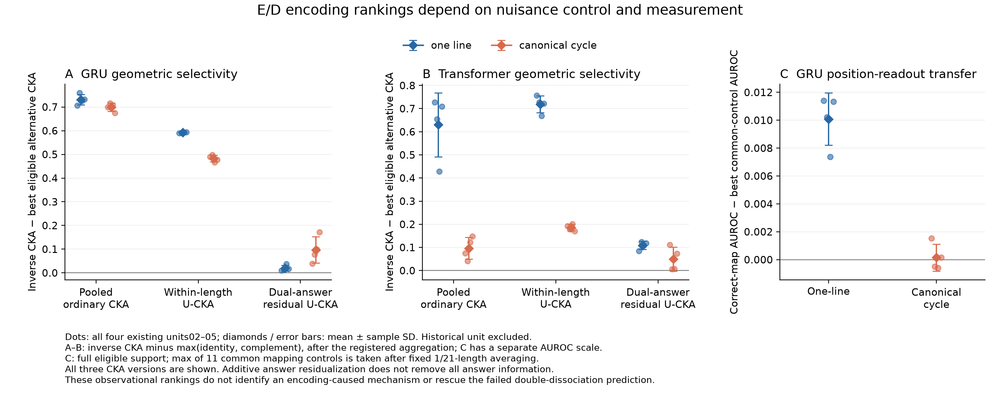

# PermWorld closing checks: evidence for writing

All three checks are complete. This is an **exploratory post-result audit and supplementary diagnosis**, with rules frozen before the newly requested calculations. It is not a retrospectively preregistered confirmation experiment. Four new units define every primary mean/SD/range; the historical unit is separate. No base model or probe was fitted, no direction/layer/time/dose was selected, and no new task/world was evaluated. Only ten missing target-control orthogonal maps were fitted by the original procedure.

## 1. Same trained-source probe, three target representations

|Unit|Trained valleys|Saved step-0 target|Trained fixed_points|Valleys − step-0|Valleys − fixed_points|
|---|---|---|---|---|---|
|unit02|0.644224|0.502008|0.500754|0.142217|0.143470|
|unit03|0.607053|0.505579|0.501368|0.101474|0.105684|
|unit04|0.638056|0.500797|0.505106|0.137259|0.132950|
|unit05|0.643224|0.501291|0.503634|0.141933|0.139590|
|archdev001|0.638166|0.501916|0.502314|0.136249|0.135852|

The last row is historical reference only. Full-test four-unit AUROCs are trained valleys **0.633139 ± 0.017600**, saved step-0 target **0.502419 ± 0.002165**, and trained fixed_points **0.502716 ± 0.002018**. Paired differences are **0.130721 ± 0.019630** and **0.130424 ± 0.017055**, both positive in 4/4 units. The common mapping-control margin is **0.113813 ± 0.019549**. Each target uses its own fit-only mean and map, but the exact trained peaks probe/scaler and original fit/test IDs are identical throughout. The old initial-phase result used an initial source probe and has been retained as a different comparison, not substituted for this control.

This supports a training-task-related extra transferable position readout for this setting. It does not establish a naturally shared decoder, discovered relation, shared computation or causal use. [All unit routes](alignment/by_unit.csv), [paired contrasts](alignment/contrasts_by_unit.csv), [full/matched summary](alignment/four_unit_summary.csv), [all eleven common mapping controls](alignment/common_mapping_controls_by_unit.csv), [source audit](alignment/README.md). Undefined per-example AUROCs and all denominators remain in per-length/per-sample outputs.

## 2. Raw-coordinate edit and local behavior gradient

Here h is the actual unnormalized L1 recurrent state after the right-neighbor value token. The normalized axis is the saved ridge coefficient divided by its saved scaler scale, then normalized in the **raw Euclidean metric**. The ideal edit is `(d·v)v`; the actual FP32 displacement is saved separately, including rounding differences. The upper current-token update is recomputed from the recipient's preceding upper states, and the original suffix remains on the differentiable path. Model parameters remain frozen and all dropout remains in eval mode.

The target scalar is `m=z[c+s]−z[c]`, using the true recipient count c and the original local sign s, including count-matched pairs. It is already goal-oriented and is not multiplied by s again. Values below are four-unit mean ± sample SD; `main` means local-only, `matched` means cumulative-count-matched.

|Expert|Construction|Sign|Donor-difference norm|Actual edit norm|Projection energy fraction|
|---|---|---|---|---|---|
|peaks|main|-1|3.672 ± 0.1829|0.238 ± 0.03298|0.006305 ± 0.001143|
|peaks|main|1|3.672 ± 0.1829|0.238 ± 0.03298|0.006305 ± 0.001143|
|peaks|matched|-1|3.673 ± 0.1902|0.2398 ± 0.03318|0.006416 ± 0.001159|
|peaks|matched|1|3.673 ± 0.1902|0.2398 ± 0.03318|0.006416 ± 0.001159|
|valleys|main|-1|3.962 ± 0.1331|0.2618 ± 0.0608|0.007056 ± 0.003067|
|valleys|main|1|3.962 ± 0.1331|0.2618 ± 0.0608|0.007056 ± 0.003067|
|valleys|matched|-1|3.967 ± 0.1282|0.264 ± 0.06047|0.007195 ± 0.003088|
|valleys|matched|1|3.967 ± 0.1282|0.264 ± 0.06047|0.007195 ± 0.003088|

|Expert|Construction|Sign|Gradient norm|g·actual edit|Angle (degrees)|Baseline margin|Cached actual margin change|Equal-norm random signed mean|
|---|---|---|---|---|---|---|---|---|
|peaks|main|-1|0.2461 ± 0.04044|0.002015 ± 0.001856|88.39 ± 1.583|-9.731 ± 0.2341|0.002065 ± 0.001897|0.000176 ± 0.0005807|
|peaks|main|1|0.3795 ± 0.04604|-0.001792 ± 0.0007449|91.63 ± 0.7472|-9.219 ± 0.3133|-0.001746 ± 0.0007767|0.0002225 ± 0.0008489|
|peaks|matched|-1|0.2577 ± 0.04631|0.002053 ± 0.002018|88.48 ± 1.867|-9.954 ± 0.1605|0.002107 ± 0.002069|7.74e-05 ± 0.0006304|
|peaks|matched|1|0.3794 ± 0.0449|-0.001274 ± 0.001332|91.19 ± 0.9042|-9.332 ± 0.2788|-0.001214 ± 0.001389|0.0003329 ± 0.0006751|
|valleys|main|-1|0.2396 ± 0.008543|7.904e-05 ± 0.001469|89.86 ± 1.445|-9.509 ± 0.2592|9.805e-05 ± 0.001484|-0.0003832 ± 0.000611|
|valleys|main|1|0.3456 ± 0.05579|0.000566 ± 0.001236|89.82 ± 1.217|-9.188 ± 0.3538|0.00064 ± 0.001235|-0.0004096 ± 0.001055|
|valleys|matched|-1|0.2639 ± 0.0132|0.0001773 ± 0.001666|89.74 ± 1.422|-9.651 ± 0.359|0.0001983 ± 0.00168|-0.0003565 ± 0.0007654|
|valleys|matched|1|0.395 ± 0.09604|0.001253 ± 0.0008309|89.66 ± 0.9568|-9.339 ± 0.4223|0.001331 ± 0.0008111|-0.0003107 ± 0.001407|

Formal undefined angle observations: **0**; undefined donor projection-energy observations: **0**. The complete per-pair vectors, both signed directions, every random direction and finite/undefined support remain saved. The displayed random derivative averages eight signed values within pair and can cancel; it is not a statement that every random direction is weak or strong. A mean angle also does not establish per-example orthogonality.

The zero selected-count response is **not zero local sensitivity**: the eight cell-mean gradient norms span 0.2396–0.3950. Actual cached margin responses span -0.001746 to 0.002107 in cell means, while the corresponding baseline goal margins are -9.9544 to -9.1883. These are small, direction-dependent logit responses without a selected-count change. They are not uniformly in the requested direction. Projection energy spans 0.6305–0.7195% in cell means; this alone does not explain the count null or establish distributed causal information.

The original early/late one-dimensional modal-count change remains zero in every formal condition; whole-L1 replacement is the positive interface control. The derivative audit answers only local sensitivity of this edit near the recipient state. Small projection/derivative values cannot show that local information is unused or must be distributed. Primary gradients use the native FP32 recurrent graph while endpoint changes reuse cached FP32 logits; the original 1e−4 cross-backend logit guard can exceed these small changes. A cached-endpoint-minus-linearized discrepancy must not be called curvature, nonlinear mechanism or unexplained causal effect. FP64 finite differences validate the nominal smooth graph and fixed-weight wiring, not FP32 rounding.

[Per-unit gradient table](gradient/all_units.csv), [mean/SD/range](gradient/four_unit_summary.csv), [detailed diagnostic report](gradient/README.md), [independent arithmetic and wiring audit](gradient/independent_verification.json). The fixed old centers, all 21 lengths and original weights are retained; undefined entries are not filled with zero or silently reweighted.

## 3. E/D encoding comparison remains control- and metric-specific

|Architecture|Encoding|Initial advantage|Trained advantage|Trained range|
|---|---|---|---|---|
|gru|one_line|-0.943004 ± 0.007073|0.019517 ± 0.012050|[0.010580, 0.037189]|
|gru|canonical_cycle|-0.155573 ± 0.009342|0.096787 ± 0.055379|[0.039588, 0.171300]|
|transformer|one_line|-0.955232 ± 0.009901|0.108908 ± 0.017582|[0.084486, 0.124298]|
|transformer|canonical_cycle|-0.194517 ± 0.093915|0.049600 ± 0.051862|[0.005937, 0.111837]|

|Architecture|Version|Cycle − one-line|Positive units /4|
|---|---|---|---|
|gru|pooled_raw|-0.031561 ± 0.023468|0|
|gru|within_length_debiased|-0.108743 ± 0.015890|0|
|gru|within_length_dual_answer_debiased|0.077271 ± 0.053919|4|
|transformer|pooled_raw|-0.533444 ± 0.155871|0|
|transformer|within_length_debiased|-0.532464 ± 0.043968|0|
|transformer|within_length_dual_answer_debiased|-0.059307 ± 0.065513|1|

The reference means are reproduced at their displayed rounding. For GRU, residual CKA favors cycle in 4/4 new units, while the raw and length-only advantages favor one-line in 4/4. Transformer has a negative residual cycle-minus-one-line mean but only 3/4 negative units; unit02 is positive. The already completed E/D probe comparison instead has mean common-control margins 0.01008156 (one-line) and 0.00014951 (cycle); the cycle margin changes sign across units. These are different metrics and controls, not subtractable effect sizes. The original cross-pair encoding double-dissociation prediction failed and is **not rewritten as a success**.

Answer residualization removes the specified additive answer means; it does not erase covariance, confidence, joint-answer interactions or all answer information. These configuration/coding comparisons do not isolate a causal encoding effect. [All three CKA versions and initial scores](ed/report.md), [unit contrasts](ed/encoding_contrasts_by_unit.csv), [probe comparison](ed/probe_per_unit.csv), [Transformer clarification](ed/reader_clarification.md).

## Writing deliverables and scope

* [Claim–evidence–scope table](writing/claim_evidence_scope.md), with a [machine-readable CSV](writing/claim_evidence_scope.csv).
* [TMLR main-text structure](writing/tmlr_structure.md).
* [Ready-to-edit English results paragraphs](writing/results_draft.md), with [paragraph-only TeX](writing/results_draft.tex).
* [Three-check status/source/missing-material table](status_and_missing.csv).
* [Frozen protocol](protocol.json), [source/spec bindings](freeze.json), [reproduction commands](reproduce.sh), and final delivery/source-protection receipts.

Geometry, readout transfer, explicit composition and model-internal intervention represent increasingly demanding questions with different measurements. They are not one numerical effect shrinking at each stage. Within-model intervention does not directly test computation shared across models. No mechanism explanation is claimed to be complete.

All stages preserve the original splits, anchors, 21 fixed length weights and undefined-value handling. The four data/initialization/training bundles are the repeat units; shared tasks/models, lengths, positions, controls and paired edits are dependent. This round introduces no inferential significance or equivalence test. All input/output manifests state their exact scope rather than claiming continuous monitoring of every disk file. No existing manuscript, F17 artifact, DMLR direction, old report or dataset was rewritten; no upload/publication or further experiment is launched.
