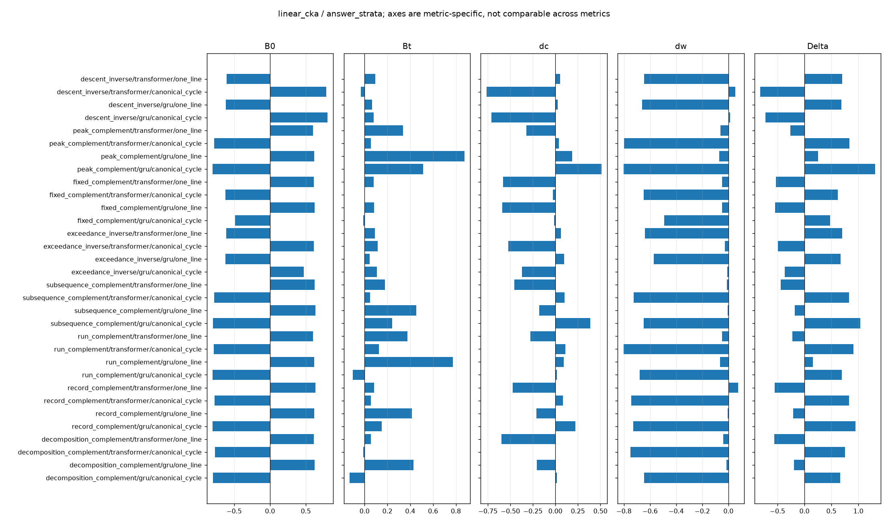
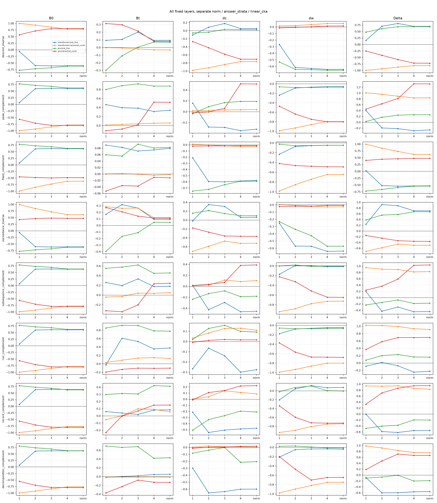
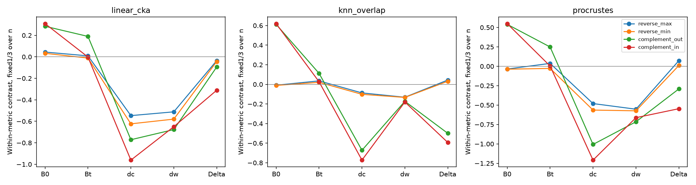

# PermWorld eight-relation results: a readable review

**Mathematical correspondence often accompanies geometric pairing selectivity, but its direction and size depend on encoding, initialization, layer, control, and task.** In the main answer-controlled analysis, trained selectivity is positive in **26 of 32** PermWorld conditions; the change relative to initialization is positive in **18 of 32**. These are different statements. Neither establishes a mathematical encoding mechanism or a functional benefit.

**Study and source-review date:** October 11, 2026.

**Readable-format edition:** October 19, 2026.

**Status:** exploratory review of the existing results; this edition reorganizes the [original text](root_result_review.txt) without new experiments or metrics.

## What was completed

| System | Completed scope | How to interpret the count |
| --- | --- | --- |
| PermWorld | **64 genuine 20k-update endpoints:** 16 reused and 48 added | Eight relations × two encodings × two model configurations = **32 dependent relation cells** |
| GraphWorld pilot | **Four added 20k-update endpoints** and four relations | Four dependent relations, rather than four independent replications |
| Formal additions | **52 models; 1,040,000 updates** | Engineering trials are separate and are not these endpoints |

No seeds, tasks, or budgets were added beyond that study's fixed scope. The historical study ended without automatic publication. Its stopping and archival statements describe that completed execution, rather than a restriction on publishing this readable edition.

## Read the scores before interpreting the counts

For each fixed relation and condition, compare the mathematically correct input pairing with the protocol's wrong input pairing. The symbols below refer to the same similarity measure and aggregation at initialization and after training.

| Symbol | Definition | Question answered |
| --- | --- | --- |
| `B0` | `S_correct(initial) − S_wrong(initial)` | Which pairing does initialization prefer? |
| `Bt` | `S_correct(trained) − S_wrong(trained)` | Which pairing does the trained model prefer? |
| `delta_correct` | `S_correct(trained) − S_correct(initial)` | Did similarity for the correct pairing rise or fall? |
| `delta_wrong` | `S_wrong(trained) − S_wrong(initial)` | Did similarity for the wrong pairing rise or fall? |
| `Delta` (Δ) | `Bt − B0 = delta_correct − delta_wrong` | How did the relative pairing preference change through training? |

A positive `Delta` can result from a decline in wrong-pair similarity. It does **not** guarantee positive trained preference (`Bt`), or an increase in correct-pair similarity.

The **main PermWorld analysis** means answer stratification, the final-normalization representation, ordinary CKA computed separately by length, and equal weighting across lengths. Counts below retain this scope; they are not a tally across every layer, control, and metric.

## 1. Trained selectivity is common; positive training increments are less common

| Main PermWorld result | Positive | Negative |
| --- | ---: | ---: |
| Trained pairing selectivity, `Bt` | **26/32** | **6/32** |
| Change relative to initialization, `Delta` | **18/32** | **14/32** |

All six negative-`Bt` conditions are retained. They occur with cycle encoding:

| Model configuration | Relations with negative trained selectivity |
| --- | --- |
| Transformer | Descents / inverse descents; fixed / anti-fixed points; global descents / components |
| GRU | Fixed / anti-fixed points; consecutive runs; global descents / components |

The decomposition matters. For the two one-line Transformer inversion relations:

| Inversion relation | `Delta` | Change in correct CKA | Change in wrong CKA |
| --- | ---: | ---: | ---: |
| Descents / inverse descents | +0.6980 | +0.0531 | −0.6449 |
| Exceedances / deficiencies | +0.7014 | +0.0623 | −0.6391 |

The large positive increments mainly reflect **reduced similarity under wrong pairing**, rather than a comparably large convergence under correct pairing. The appropriate description is that training reshaped pairing selectivity.

**Inspect:** [all 32 final-CKA conditions](permworld/main32_final_cka_readout.csv), [original contrast summary](../contrast_summary.csv), and the decomposition plot below.

## 2. Encoding changes the starting preference and the training increment

There are 16 matched encoding comparisons across relations and model configurations.

| Quantity compared between one-line and cycle encoding | Direction reversals |
| --- | ---: |
| Initialization preference, `B0` | **16/16** |
| Training increment, `Delta` | **14/16** |
| Trained preference, `Bt` | **6/16** |
| `Delta` reverses while `Bt` does not | **9 pairs** |

Thus, a reversal in `Delta` need not mean that the trained model's preferred pairing reversed. Initialization geometry is central to interpreting the increment.

Learning differences are relevant, but do not explain every encoding difference. Both cycle-encoded GRU exceedance/deficiency sources achieve **100% analysis accuracy**; their one-line counterparts are also near 100%. Nevertheless, `Delta` reverses between encodings while `Bt` remains positive in both.

Other cycle-encoded tasks learn substantially less well. Overall, **61/64** sources exceed their training-defined length-mode baselines and three do not. Exceeding the baseline does not establish comprehensive task mastery, and mastery is not comprehensively matched across encodings. Model capacities are also unmatched, so these comparisons do not identify a pure architecture effect.

**Inspect:** [16 encoding decompositions](permworld/encoding16_decomposition.csv), [all 64 source accuracies and baselines](permworld/source64_learning_and_baseline.csv), and [learning curves](permworld/source_learning_curves.csv).

## 3. Metrics often agree, while layers and lengths still matter

| Check | Observed result | Limit on interpretation |
| --- | --- | --- |
| Three primary metrics: direction of `Bt` | **32/32 agree** | They share samples and activations; this is not independent replication |
| Three primary metrics: direction of `Delta` | **30/32 agree** | The exceptions are one-line GRU peaks/valleys and consecutive runs; neighborhood `Delta` disagrees with the other two metrics |
| U-centered versus ordinary CKA | Both primary `Bt` and `Delta` directions agree in **32/32** | Agreement concerns these specified readouts |
| Lower layers versus layer 4 | **19 `Bt` reversal records across ten cells** | Layer choice can change the observed preference |
| Final normalization versus layer 4 | No change in primary `Bt` direction | This does not remove the lower-layer differences |

The equal-weight mean also does not describe every length:

| Quantity | Positive at all 21 lengths | Negative at all 21 lengths | Mixed across lengths |
| --- | ---: | ---: | ---: |
| `Bt` | **22 cells** | **2 cells** | **8 cells** |
| `Delta` | **18 cells** | **13 cells** | **1 cell** |

Input-end token embeddings are constant within fixed lengths, so their similarities remain **undefined**, rather than zero. No best-performing layer, length, or metric was selected.

**Inspect:** [three-metric directions](permworld/three_metric_directions32.csv), [all-layer directions](permworld/all_layer_directions.csv), [per-length results](../per_length_results.csv), and [undefined/component coverage](permworld/supplementary_component_coverage.csv).

## 4. Answer and output explanations remain unresolved

Answer control changes the result:

| Hidden-representation comparison | Positive `Delta` cells |
| --- | ---: |
| Original version, before answer stratification | **25/32** |
| After answer stratification | **18/32** |

There are **seven direction changes** between these controls. Output probabilities also exhibit initial and trained relation preferences. True-label stratification does not remove confidence, prediction error, or nonlinear answer information. Subtracting output `Delta` from hidden `Delta` does not identify an additional mechanism.

The same caution applies when comparing Transformer and GRU representations of the same task:

| Control for the 32 same-task Transformer–GRU pairings | Positive changes | Negative changes |
| --- | ---: | ---: |
| Raw | **23** | **9** |
| Answer-controlled | **9** | **23** |
| U-centered, answer-controlled | **10** | **22** |

The earlier 16 sources still lack task-specific initial cross-entropy; that information remains missing. Undefined components are fully listed, with **no zero imputation or redistribution of length weights**.

**Inspect:** [cross-architecture summary](../cross_arch_same_task_summary.csv), [component coverage](permworld/supplementary_component_coverage.csv), and [complete original report](combined_report.html).

## 5. GraphWorld is a pilot with informative counterexamples

The four source models all exceed their training-defined per-`n` mode baselines. Full-188-token analysis answer accuracies are:

| Source task | Analysis answer accuracy |
| --- | ---: |
| Maximum out-degree | **100%** |
| Minimum out-degree | **100%** |
| Maximum in-degree | **100%** |
| Minimum in-degree | **95.1172%** |

Without answer control, ordinary-CKA mean `Bt` and `Delta` are positive for all four relations. After answer control, only reverse maximum degree and complement out-degree retain positive `Bt`; **all four `Delta` values are negative**.

| Graph relation | Answer-controlled `Delta` | With exact edge-count control: `Bt` | With exact edge-count control: `Delta` |
| --- | ---: | ---: | ---: |
| Reverse maximum degree | −0.0352 | +0.01885 | +0.07920 |
| Reverse minimum degree | −0.0439 | −0.00413 | +0.11217 |
| Complement out-degree | −0.0944 | See full table | −0.52365 |
| Complement in-degree | −0.3108 | See full table | −0.74762 |

These control versions should be distinguished. They do not provide cross-system replication of a universally positive rule.

Size-specific results also differ. Answer-controlled complement out-degree has `Delta = +0.2746` at `n = 6`, but approximately **−0.279** at `n = 7` and `n = 8`. Answer-controlled reverse maximum-degree `Bt` is negative at `n = 7` despite a positive three-size mean. Every size retains its original **1/3 weight**; no size is removed based on performance.

Three further limits matter:

- In the **random mathematical audit**, the wrong transform `W` accidentally satisfies the specified answer formula in **51.9%–65.57%** of samples. All such samples remain included. This is the random audit, not a claim about a separately evaluated actual-anchor analysis.
- Specified `<R,C,W>` orbits have **zero cross-split overlap**. This does not mean that every graph isomorphism is excluded.
- The prespecified positional binary one-hot input kernel is isometric under these transformations. It does not distinguish correct from wrong pairing, and no training increment is fabricated for it.

**Inspect:** [four-relation readout](graphworld/graph_main4_readout.csv), [source learning](graphworld/graph_source4_learning.csv), [three-metric directions](graphworld/graph_three_metric_directions4.csv), [component coverage](graphworld/graph_component_coverage.csv), and the [GraphWorld mathematical audit](../../graphworld_pilot_20261010/mathematics_audit.json).

## What this study supports

The results support an exploratory observation: **mathematical pairing can accompany detectable representational selectivity, with substantial dependence on encoding, initial geometry, layer, control version, and task.**

The eight PermWorld relations cover only inversion and complement. A single world with shared initialization does not establish a universal rule. CKA alone cannot identify a mathematical encoding mechanism, and these geometric results are not evidence of functional benefit.

Two specific open questions remain: whether the observations reproduce at comparable task mastery in independent worlds and initializations, and whether the geometry contains information beyond answers and confidence. Recording those questions did not automatically start another experimental stage.

## Data and navigation

- [Original plain-text review](root_result_review.txt)
- [Complete combined HTML report](combined_report.html): original scores, decompositions, figures, tables, and provenance
- [Current research entry point](../../../CURRENT_RESEARCH.txt)
- [Completed PermWorld checkpoint manifest](../completed_checkpoint_manifest.csv)
- [PermWorld coverage status](../coverage_status.csv) and [GraphWorld coverage status](../../graphworld_pilot_20261010/coverage_status.csv)
- [PermWorld completion record](../completion.json)
- [Machine-readable root review](root_result_review.json)

<strong>Verification and provenance: what was checked, and what was not</strong>

The **48 independent actual-small-batch PermWorld metric checks** have a maximum difference of **1.325e−15**.

The **864 fixed saved-activation/extraction-path checks** have zero difference. Their scope is the 48 new models, initialization and trained states, fixed test batches at `n = 10, 20, 30`, and three transformations. This does **not** mean that every vector at every length was independently recomputed.

Of **154 independent actual GraphWorld checks**, **151 pass** and **three are consistently undefined under both frozen implementations**. There are no failures or unavailable checks. They must not be described as 154 finite passes.

SHA checks pass for **1,223 earlier protected files**. Final tracked files and the index match the specified HEAD. A bytewise pre-training diff snapshot was not found, so unchanged diffs throughout execution are not inferred.

Provenance indices cover genuine initializations and starting RNG, **68 endpoints**, **256/16 logical cache records**, and **14 successful phases**.

Supporting records: [final audit](final_audit.json), [audit resource record](final_audit_resource.json), [source endpoint validation](source_endpoint_validation.csv), and [current-entry manifest](current_entry_manifest.csv).

<strong>Recorded costs and limits on time/storage accounting</strong>

| Measurement | Recorded value | Interpretation |
| --- | ---: | --- |
| Monotonic process times, 48 new PermWorld sources | **10.14985 hours** | Includes validation and saving; not GPU-active hours |
| Monotonic process times, four GraphWorld sources | **0.71226 hours** | Includes validation and saving; not GPU-active hours |
| PermWorld queue record | **11.97263 hours** | A distinct elapsed-time record |
| Realtime/monotonic offset seen in monitoring | **Approximately 6,411.47 seconds** | Clock adjustment versus virtual-environment suspension was not distinguished |
| GPU-kernel / GPU-active time | **Unknown** | The timing gap was not inferred to be GPU idleness or deleted |
| Final external CPU-audit wall time | **283.64 seconds** | Separate audit cost |
| Final external CPU-audit user / system time | **17.03 / 17.97 seconds** | Separate accounting components |
| Final external CPU-audit RSS | **714,612 KiB** | Reported process memory |
| New F-drive roots at audit time | **18,764,069,698 apparent bytes**, approximately **17.476 GiB** | `stat` sizes, not allocated filesystem blocks |

Phase CPU user/system time, RSS, PyTorch allocated-memory peaks, and final CPU-audit costs are stored separately. Overlapping definitions are not summed. Storage accounting avoids repeated counting of earlier aliases or overlapping groups.

Supporting records: [actual training costs](../actual_training_cost.csv), [resource-monitor audit](../resource_monitor_audit.json), and [final audit resource record](final_audit_resource.json).

<strong>Engineering exceptions and archival repairs retained in the record</strong>

**Graph evaluation dependency repair.** The first GraphWorld evaluation stopped after extracting **16 caches** because `threadpoolctl` was missing. That attempt took **17.262815 seconds**. Only the fixed version **threadpoolctl 3.6.0** was installed, without dependency upgrades; the remaining five fixed phases then ran. All four checkpoints and all 16 caches were byte-identical before and after repair. There was no retraining or repeated extraction. Failed logs and CPU records remain available; **14 successful phases does not imply only 14 attempts**.

**PermWorld completion-sidecar repair.** This repair did not change the 20k weights or training trajectories and added **zero training updates**.

**Logical archival.** Classification indices were appended. Earlier artifacts and F17 retained their original paths, without deletion, movement, or upload as part of that historical closure. The study stopped after closing its authorized scope.

**Archive-metadata repair.** The first logical-index attempt stopped while collecting closed-log references because `graph_driver` was missing, before writing the index. The failure note and pre-repair state were retained. Only `scope_bridge_state.json`, which was not locked by a scientific-audit hash, received the actual reference to the existing successful recovery-driver log. Frozen archival source, protocols, and scientific results were unchanged. Failure duration was not independently measured and remains **Unknown**.

Supporting record: [archive-update audit](archive_update_audit.json).

