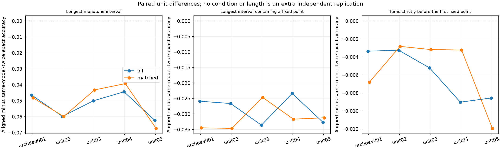
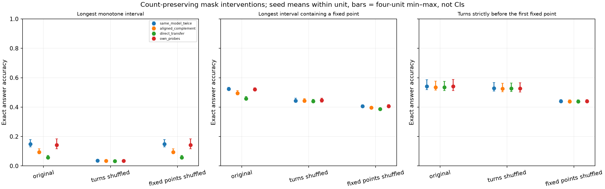

# Frozen readouts on new composition questions

The orthogonally aligned two-specialist route **did not outperform the same-model-twice baseline**. Every one of the four new units scored lower on all three questions, on both full and original count-matched test supports. Alignment did improve the two interval questions over unaligned cross-model transfer. The frozen position readouts were reusable in the specified algorithms, but this does not establish an advantage from cross-specialist composition.

| Question | Aligned | Same model twice | Difference | Difference SD | Difference range |
|---|---|---|---|---|---|
| Longest monotone interval | 9.43% | 14.84% | -5.41 pp | 0.84 pp | -6.22 to -4.44 pp |
| Longest interval containing a fixed point | 49.39% | 52.29% | -2.90 pp | 0.49 pp | -3.36 to -2.33 pp |
| Turns before the first fixed point | 53.50% | 54.15% | -0.65 pp | 0.28 pp | -0.90 to -0.33 pp |

These are four-unit means of exact-answer accuracy, with equal weight for each of the 21 lengths (n=10–30). SD is the sample SD of the four paired differences. Each unit changes the data, model initialization and training randomization together; those sources of variation are not separately identified. The historical unit is an implementation/reference case and is excluded from the primary four-unit summary.

## Individual units

Each cell is **aligned / same model twice**, full-test exact-answer accuracy. Full precision, matched-support results and interval errors are in [main_comparison_by_unit.csv](main_comparison_by_unit.csv).

| Unit | Longest monotone interval | Longest interval containing a fixed point | Turns before the first fixed point |
|---|---|---|---|
| archdev001 | 9.09% / 13.73% | 48.98% / 51.56% | 56.77% / 57.11% |
| unit02 | 9.42% / 15.40% | 48.88% / 51.54% | 51.48% / 51.80% |
| unit03 | 8.21% / 13.22% | 48.26% / 51.62% | 51.61% / 52.13% |
| unit04 | 8.43% / 12.86% | 51.16% / 53.50% | 57.73% / 58.63% |
| unit05 | 11.65% / 17.88% | 49.26% / 52.52% | 53.17% / 54.03% |

The aligned-minus-direct-transfer mean gain was +3.67 pp for the unconstrained interval and +3.64 pp for the fixed-point-constrained interval; both were positive in all four new units. For turns before the first fixed point, the gain was only +0.03 pp, with two positive and two negative units. Unconstrained endpoint MAE was 4.610 positions for alignment versus 4.469 for the stronger baseline; interval-length MAE was 0.884 versus 0.869. Exact endpoint recovery remains difficult despite the upstream AUROC improvement.

## What is reused and what is provided by the experimenter?

The question input is pi=C(x), using the existing complement-action caches. The first mask is the peaks readout on peaks(pi). The aligned second mask is the **same peaks probe** on valleys(pi), transformed by the previously saved complement target-to-source orthogonal map. The strong baseline applies the same peaks probe to peaks(pi) and peaks(C(pi)); the latter supplies the valley positions of pi. Both use two cached activations and the same composition rule. Fixed-point questions add the same third activation and fixed-point readout to every route.

All probe coefficients are fixed within unit and length across downstream questions. The new fixed-point probe is fitted only to its own source-validation position labels, including the endpoints. Per-task/per-length thresholds maximize micro-F1 on the original source tuning split; ties choose the higher threshold. The peaks threshold is shared across all mapping conditions. No true-count top-k, downstream labels, or new-task accuracy is used for fitting or threshold selection. The own-valley-probe reference has its own source-only threshold.

There are 15 routes: same-model-twice, complement alignment, direct transfer, means-only, identity and inverse mappings, all eight original shuffled-pair mappings, and independently fitted source position probes. **Every map is evaluated on the same valleys(pi) test activation**, not on its own transform. The original validation orbit split, source fit/tuning assignments and test exclusion are retained. Saved map arrays are reused unchanged; source probe reconstruction reproduces all registered previous trained one-line AUROC cells within absolute tolerance 1e-12.

The formal composer receives only predicted Boolean turn/fixed-point masks and length. It adds interval endpoints, returns inclusive 1-based positions, and breaks ties to the left. Endpoints are not counted as turns. A fixed point on a shared interval boundary belongs to both intervals. Both fixed-point questions return NONE if the predicted fixed-point mask is empty. Prediction arrays were saved and hashed before downstream truth was computed.

These are **analyst-supplied algorithms applied to supervised readouts**. The counting specialists were not trained to output these interval endpoints or fixed-point-conditioned answers. The result does not show that the networks themselves invoke a reusable lemma or that decoded positions cause their original counting behavior.

## Do the decoded positions matter beyond their predicted counts?

Each intervention permutes one mask's positions within each input, preserving its predicted count. Turning positions are permuted among interior positions; fixed points may include endpoints. Eight registered realizations are averaged within each unit, followed by a summary across four units. They are controls, not extra repetitions.

| Question | Drop after turn-position shuffle | Drop after fixed-point shuffle |
|---|---|---|
| Longest monotone interval | 5.99 pp | 0.00 pp |
| Longest interval containing a fixed point | 5.11 pp | 9.76 pp |
| Turns before the first fixed point | 0.98 pp | 9.59 pp |

All nonzero mean drops above had the same direction in all four units. Fixed-point shuffling left the unconstrained answer bit-identical. This supports the usefulness of the decoded spatial arrangement **in this composition pipeline**, relative to these count-preserving controls. It does not by itself identify a mathematical representation mechanism inside the specialists.

## NONE cases and the nontrivial fixed-point subset

The overall fixed-point scores include correct NONE answers and should not be read as conditional answer accuracy when a fixed point exists. Among true-fixed-point-present inputs, alignment scored **19.99%** on the constrained interval and **26.52%** on turns before the first fixed point. On the subset where a true fixed point exists and the constraint actually changes the longest interval, accuracy was **25.18%**, versus **29.42%** for same-model-twice. Full and matched versions, presence errors and denominators are retained.

| Unit | All test anchors | Original matched anchors | True NONE | Predicted NONE |
|---|---|---|---|---|
| archdev001 | 10752 | 1757 | 4004 | 4860 |
| unit02 | 10752 | 1707 | 3941 | 4792 |
| unit03 | 10752 | 1675 | 3914 | 4753 |
| unit04 | 10752 | 1753 | 3944 | 4724 |
| unit05 | 10752 | 1755 | 4018 | 4689 |

Count-preserving shuffles necessarily preserve predicted NONE status. On true-no-fixed-point examples, exact correctness is therefore unchanged by either shuffle. The true-present and answer-changing strata avoid mistaking this invariance for evidence that position information is irrelevant.

## Files, checks and reproduction

- [Full numerical report and four figures](summary/report.md): all primary comparisons, control drops and scoring definitions.
- [Every original route](original_routes_by_unit.csv): full and matched supports, all strata, endpoint/length errors and coverage. [All raw shuffle results](summary/per_unit_metrics.csv) and [per-length results](summary/per_length/) retain every registered control.
- [Per-anchor CSV exporter](export_saved_predictions.py) reads each saved array once; primary-route CSVs for all five units are under `/mnt/yangx-projects-f/20261110/permworld_lemma_composition/exports/`. All routes and interventions remain in the NPZ prediction files.
- [Cross-unit statistics](summary/cohort_summary.csv): four-new and all-five summaries, sample SD, range and raw unit values. The all-five view is supplementary.
- [Frozen protocol](protocol.json), [code freeze](freeze.json), [cache and checkpoint audit](cache_audit.json), [source calibration](results/) and [launch record](launch.json).
- [Independent saved-result audit](saved_results_audit.json) and [named-file protection comparison](protection_end.json). Protection is a start/end hash check of the recorded file set, not continuous monitoring of every file.
- [Reproduction commands](reproduce.sh). Large predictions, masks, readout coefficients, source tuning arrays and shuffle permutations are retained under `/mnt/yangx-projects-f/20261110/permworld_lemma_composition/units/`. Their exact paths and SHA-256 hashes are recorded in each unit's `results/<unit>/completion.json`.

Per unit there are 10,752 test anchors (512 at every length). The matched set is the original saved criterion on anchor x, **not recomputed on pi=C(x)**. Truth is used only for scoring and strata. The source audit records the actual checkpoint, cached activation field, action order, dtype, data hashes and alignment archive binding.

The independent Python oracle is checked exhaustively on all 46,233 permutations through n=8; a brute-force interval enumerator checks n<=6. Scalar/batched composers and source-only threshold calibration have 41 passing tests. Further saved-array checks validate parameter reuse, threshold selection, count preservation and representative predictions without refitting. No model forward passes, base-model training or new alignment fitting were needed.

This is an exploratory functional test of a fixed readout/composition procedure. The four independent units are the statistical repetitions; lengths, questions, shared models and shuffle seeds are dependent observations. No extra significance, equivalence, or population-wide mechanism claim is made. All negative results are retained. The paper, F17 artifacts, upstream reports and source caches are unchanged within the recorded protection scope. This round stops here; nothing was automatically published.

