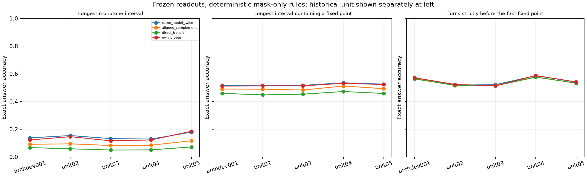
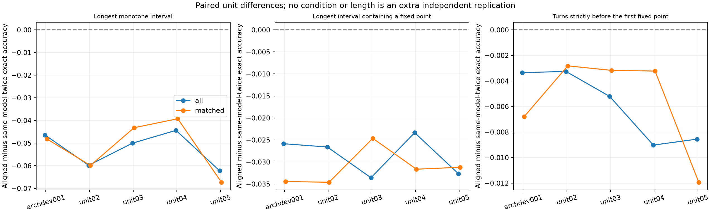
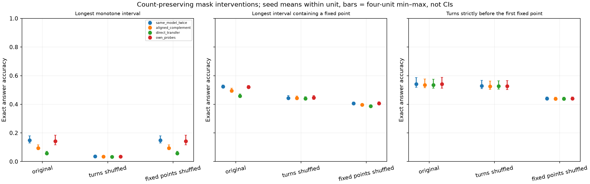
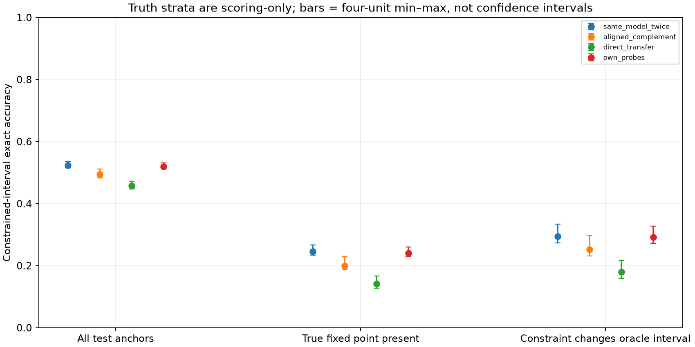

# Frozen position-readout composition results

The original masks and source-only thresholds are reused across all three downstream questions. Formal composers receive predicted Boolean masks and length only. New-task truths define scoring and diagnostic strata; they never select probes, maps, thresholds or routes. The historical unit is an engineering reference; four newer units are the repetition units.

## Aligned route versus the same-model-twice baseline

| Cohort | Task | Support | Stratum | Mean aligned-minus-baseline | Sample SD | Range | Positive units |
|---|---|---|---|---:|---:|---:|---:|
| new_units | longest | all | all | -0.054106 | 0.008362 | -0.062221 to -0.044364 | 0/4 |
| new_units | longest | matched | all | -0.052390 | 0.013354 | -0.067273 to -0.039230 | 0/4 |
| new_units | fixed_longest | all | all | -0.029041 | 0.004898 | -0.033575 to -0.023344 | 0/4 |
| new_units | fixed_longest | all | constraint_changes | -0.042395 | 0.011764 | -0.057218 to -0.030462 | 0/4 |
| new_units | fixed_longest | matched | all | -0.030517 | 0.004208 | -0.034602 to -0.024625 | 0/4 |
| new_units | fixed_longest | matched | constraint_changes | -0.046358 | 0.006863 | -0.052128 to -0.036714 | 0/4 |
| new_units | turns_before_fixed | all | all | -0.006510 | 0.002756 | -0.009022 to -0.003255 | 0/4 |
| new_units | turns_before_fixed | matched | all | -0.005286 | 0.004433 | -0.011931 to -0.002818 | 0/4 |
| all_units | longest | all | all | -0.052567 | 0.008018 | -0.062221 to -0.044364 | 0/5 |
| all_units | longest | matched | all | -0.051538 | 0.011721 | -0.067273 to -0.039230 | 0/5 |
| all_units | fixed_longest | all | all | -0.028404 | 0.004474 | -0.033575 to -0.023344 | 0/5 |
| all_units | fixed_longest | all | constraint_changes | -0.041185 | 0.010541 | -0.057218 to -0.030462 | 0/5 |
| all_units | fixed_longest | matched | all | -0.031302 | 0.004046 | -0.034602 to -0.024625 | 0/5 |
| all_units | fixed_longest | matched | constraint_changes | -0.047783 | 0.006744 | -0.053486 to -0.036714 | 0/5 |
| all_units | turns_before_fixed | all | all | -0.005878 | 0.002774 | -0.009022 to -0.003255 | 0/5 |
| all_units | turns_before_fixed | matched | all | -0.005590 | 0.003899 | -0.011931 to -0.002818 | 0/5 |

Every original unit value and contrast is retained in `aligned_minus_same_model.csv`. A high upstream position AUROC does not by itself establish better exact composition answers. Negative, small and mixed contrasts are retained.

## Exact-answer accuracy, four newer units

| Route | Task | Support | Mean | Sample SD | Range |
|---|---|---|---:|---:|---:|
| same_model_twice | longest | all | 0.148391 | 0.023150 | 0.128627 to 0.178757 |
| same_model_twice | longest | matched | 0.153239 | 0.027366 | 0.131413 to 0.191443 |
| same_model_twice | fixed_longest | all | 0.522949 | 0.009161 | 0.515439 to 0.534970 |
| same_model_twice | fixed_longest | matched | 0.526639 | 0.008754 | 0.516202 to 0.537096 |
| same_model_twice | turns_before_fixed | all | 0.541481 | 0.031452 | 0.518043 to 0.586310 |
| same_model_twice | turns_before_fixed | matched | 0.545383 | 0.021654 | 0.526635 to 0.575800 |
| aligned_complement | longest | all | 0.094285 | 0.015742 | 0.082124 to 0.116536 |
| aligned_complement | longest | matched | 0.100849 | 0.015585 | 0.092183 to 0.124170 |
| aligned_complement | fixed_longest | all | 0.493908 | 0.012505 | 0.482608 to 0.511626 |
| aligned_complement | fixed_longest | matched | 0.496123 | 0.006331 | 0.491577 to 0.505456 |
| aligned_complement | turns_before_fixed | all | 0.534970 | 0.029241 | 0.514788 to 0.577288 |
| aligned_complement | turns_before_fixed | matched | 0.540097 | 0.022013 | 0.523817 to 0.572574 |
| direct_transfer | longest | all | 0.057547 | 0.010138 | 0.049479 to 0.071522 |
| direct_transfer | longest | matched | 0.058647 | 0.013659 | 0.042264 to 0.074040 |
| direct_transfer | fixed_longest | all | 0.457520 | 0.010511 | 0.447545 to 0.471912 |
| direct_transfer | fixed_longest | matched | 0.462172 | 0.008483 | 0.452388 to 0.470832 |
| direct_transfer | turns_before_fixed | all | 0.534668 | 0.028562 | 0.512928 to 0.575428 |
| direct_transfer | turns_before_fixed | matched | 0.543909 | 0.013157 | 0.534365 to 0.563145 |
| own_probes | longest | all | 0.142299 | 0.031174 | 0.116071 to 0.184896 |
| own_probes | longest | matched | 0.151789 | 0.034361 | 0.122577 to 0.198877 |
| own_probes | fixed_longest | all | 0.519857 | 0.008890 | 0.512835 to 0.531343 |
| own_probes | fixed_longest | matched | 0.525544 | 0.004143 | 0.522033 to 0.531370 |
| own_probes | turns_before_fixed | all | 0.541062 | 0.033063 | 0.512556 to 0.587426 |
| own_probes | turns_before_fixed | matched | 0.546111 | 0.019976 | 0.527518 to 0.574379 |

## Count-preserving position-shuffle drops

The table gives original exact accuracy minus the mean of the eight registered mask-shuffle realizations **within each unit**, then summarizes across four units. The seeds are not extra scientific repetitions. A negative value means the shuffled prediction scores better.

| Route | Task | Intervention | Stratum | Mean accuracy drop | Sample SD | Range |
|---|---|---|---|---:|---:|---:|
| same_model_twice | longest | turn_shuffle_mean | all | 0.112639 | 0.021263 | 0.094169 to 0.139858 |
| same_model_twice | fixed_longest | turn_shuffle_mean | all | 0.079160 | 0.007000 | 0.072080 to 0.087426 |
| same_model_twice | fixed_longest | turn_shuffle_mean | fixed_present | 0.125415 | 0.011542 | 0.113934 to 0.139875 |
| same_model_twice | fixed_longest | turn_shuffle_mean | constraint_changes | 0.135112 | 0.007372 | 0.128293 to 0.145592 |
| same_model_twice | turns_before_fixed | turn_shuffle_mean | all | 0.012533 | 0.004653 | 0.007743 to 0.018915 |
| same_model_twice | turns_before_fixed | turn_shuffle_mean | fixed_present | 0.019916 | 0.007462 | 0.011968 to 0.029994 |
| same_model_twice | longest | fixed_shuffle_mean | all | 0.000000 | 0.000000 | 0.000000 to 0.000000 |
| same_model_twice | fixed_longest | fixed_shuffle_mean | all | 0.116673 | 0.011879 | 0.107399 to 0.133196 |
| same_model_twice | fixed_longest | fixed_shuffle_mean | fixed_present | 0.184715 | 0.018749 | 0.168986 to 0.210951 |
| same_model_twice | fixed_longest | fixed_shuffle_mean | constraint_changes | 0.242633 | 0.027614 | 0.221568 to 0.281247 |
| same_model_twice | turns_before_fixed | fixed_shuffle_mean | all | 0.101034 | 0.032406 | 0.079020 to 0.149228 |
| same_model_twice | turns_before_fixed | fixed_shuffle_mean | fixed_present | 0.160262 | 0.051157 | 0.124389 to 0.236142 |
| aligned_complement | longest | turn_shuffle_mean | all | 0.059858 | 0.014606 | 0.048363 to 0.080369 |
| aligned_complement | fixed_longest | turn_shuffle_mean | all | 0.051121 | 0.008208 | 0.038946 to 0.056885 |
| aligned_complement | fixed_longest | turn_shuffle_mean | fixed_present | 0.081094 | 0.013026 | 0.061680 to 0.089474 |
| aligned_complement | fixed_longest | turn_shuffle_mean | constraint_changes | 0.095098 | 0.015388 | 0.072398 to 0.105525 |
| aligned_complement | turns_before_fixed | turn_shuffle_mean | all | 0.009801 | 0.004074 | 0.006394 to 0.014904 |
| aligned_complement | turns_before_fixed | turn_shuffle_mean | fixed_present | 0.015504 | 0.006473 | 0.009815 to 0.023632 |
| aligned_complement | longest | fixed_shuffle_mean | all | 0.000000 | 0.000000 | 0.000000 to 0.000000 |
| aligned_complement | fixed_longest | fixed_shuffle_mean | all | 0.097630 | 0.013373 | 0.087693 to 0.117315 |
| aligned_complement | fixed_longest | fixed_shuffle_mean | fixed_present | 0.154577 | 0.021011 | 0.140215 to 0.185716 |
| aligned_complement | fixed_longest | fixed_shuffle_mean | constraint_changes | 0.208945 | 0.029889 | 0.185952 to 0.252888 |
| aligned_complement | turns_before_fixed | fixed_shuffle_mean | all | 0.095866 | 0.031284 | 0.075951 to 0.142543 |
| aligned_complement | turns_before_fixed | fixed_shuffle_mean | fixed_present | 0.151990 | 0.049309 | 0.119639 to 0.225476 |
| own_probes | longest | turn_shuffle_mean | all | 0.107309 | 0.028491 | 0.082241 to 0.145717 |
| own_probes | fixed_longest | turn_shuffle_mean | all | 0.073905 | 0.008136 | 0.064558 to 0.081985 |
| own_probes | fixed_longest | turn_shuffle_mean | fixed_present | 0.117082 | 0.013128 | 0.101962 to 0.130975 |
| own_probes | fixed_longest | turn_shuffle_mean | constraint_changes | 0.126729 | 0.009904 | 0.113649 to 0.134758 |
| own_probes | turns_before_fixed | turn_shuffle_mean | all | 0.014305 | 0.005927 | 0.010103 to 0.022763 |
| own_probes | turns_before_fixed | turn_shuffle_mean | fixed_present | 0.022688 | 0.009506 | 0.015875 to 0.036115 |
| own_probes | longest | fixed_shuffle_mean | all | 0.000000 | 0.000000 | 0.000000 to 0.000000 |
| own_probes | fixed_longest | fixed_shuffle_mean | all | 0.114150 | 0.011252 | 0.105620 to 0.129976 |
| own_probes | fixed_longest | fixed_shuffle_mean | fixed_present | 0.180692 | 0.017744 | 0.167839 to 0.205897 |
| own_probes | fixed_longest | fixed_shuffle_mean | constraint_changes | 0.240487 | 0.025791 | 0.219360 to 0.276727 |
| own_probes | turns_before_fixed | fixed_shuffle_mean | all | 0.101624 | 0.033532 | 0.079706 to 0.151483 |
| own_probes | turns_before_fixed | fixed_shuffle_mean | fixed_present | 0.161161 | 0.053044 | 0.126216 to 0.239848 |

Fixed-position shuffling must leave the unconstrained task bit-identical. Every count-preserving intervention must preserve predicted NONE decisions. On true-no-fixed-point examples the two fixed-point questions therefore have unchanged exact correctness; their fixed-present and constraint-change strata are reported to avoid treating this algebraic invariance as evidence of useless position information.

## Scoring and uncertainty

Primary accuracy is the fixed equal-1/21 mean of exact-answer rates within each registered length. All-test and the original count-matched support remain separate. Missing/empty length components propagate as undefined; they are not zero-filled or silently reweighted. Pooled sample-weighted accuracy is an explicitly separate supplementary column.

Intervals use inclusive 1-based endpoints. Raw start/end/endpoint MAE and length error are conditional on both true and predicted intervals being present, with coverage and presence mistakes recorded. Normalized unconditional errors divide finite interval errors by length, assign penalty 1 to a presence mismatch and 0 when both answers are NONE. Count MAE is similarly conditional on both finite answers; normalized count error uses the same explicit NONE convention.

The diagnostic constraint-change subset requires a true fixed point and a constrained oracle interval different from the unconstrained oracle interval; absent fixed points are not counted as a trivial constraint change. False/missed fixed-point presence can dominate aggregate scores, so true-present/true-absent results remain explicit. No new significance, equivalence test, bootstrap confidence interval, task-pair generality or neural causal-use claim is introduced. Mask interventions test the specified analytic composition pipeline.

## Files and figures

`per_unit_metrics.csv` retains every original and shuffled seed; `per_unit_condition_summary.csv` averages seeds only within each unit. `cohort_summary.csv` contains four-new/all-five means, sample SDs, ranges and raw unit values. Length tables are separate under `per_length/`. Per-sample predictions remain in their hash-bound source NPZ files.

