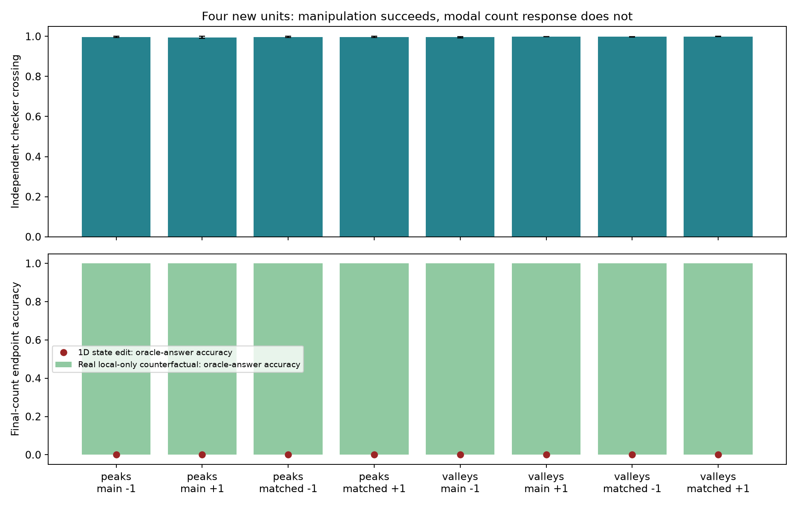

# Local peak/valley readout intervention: first stage

**The local readout was reliably changed, but the final modal count never changed under the specified 1D edit.** This holds in every new unit, both specialists, both signs, and both the simple and cumulative-count-matched groups. The experiment stops at the within-model first stage; no cross-model exchange or new composition task is started.

## The three questions

1. **Was the target signal changed?** Yes, as measured by a separately fitted local checker. The 32 formal unit × task × pair-group × sign averages have true boundary-crossing rates from 98.8159% to 100%, with positive directed score shifts. Crossing requires a correct original local classification and an edited score on the intended opposite side of the fixed 0.5 boundary. It is not just the defining edit probe copying its own donor score.
2. **Did the final count follow?** No observed modal count response: exact +1/−1 displacements and all other modal count changes are zero for every formal local-edit case. Signed conditional numeric-expectation changes are minute: the largest absolute unit/group/task/sign mean is 1.355e-6 count units. These small, mixed numerical effects are not rounded into a positive counting benefit or treated as proof of equivalence.
3. **Does a counting effect remain when cumulative count is matched?** No counting effect appeared there either. Local checker manipulation remains strong, but the intended local-only count endpoint is never reached. In the matched group the real donor's complete count equals the recipient's; it is **not** substituted for the recipient-plus-sign target.

| Task | Pair group | Intended change | Checker crossing mean ± SD | Exact ±1 modal change | Signed expected-count shift | Actual-CF oracle accuracy |
|---|---|---|---|---|---|---|
| peaks | main | -1 | 99.698% ± 0.258% | 0.000% | +1.129e-07 | 100.000% |
| peaks | main | +1 | 99.507% ± 0.499% | 0.000% | -3.599e-07 | 100.000% |
| peaks | matched | -1 | 99.719% ± 0.281% | 0.000% | +4.313e-08 | 100.000% |
| peaks | matched | +1 | 99.716% ± 0.320% | 0.000% | -4.525e-07 | 99.993% |
| valleys | main | -1 | 99.623% ± 0.312% | 0.000% | -1.603e-07 | 99.994% |
| valleys | main | +1 | 99.859% ± 0.050% | 0.000% | -1.072e-07 | 99.994% |
| valleys | matched | -1 | 99.828% ± 0.096% | 0.000% | -9.226e-08 | 99.994% |
| valleys | matched | +1 | 99.938% ± 0.058% | 0.000% | -1.576e-07 | 99.981% |

The table uses four-unit means, sample SD and fixed equal-length/equal-center weighting. [headline_table.csv](summary/headline_table.csv) retains each of the four values, SD and range for all eight task/group/sign rows; [exact modal displacements](exact_modal_delta_by_unit.csv) separately distinguishes relative prediction changes from oracle-answer accuracy. Same-label and the eight norm-matched random-direction controls also show no useful modal response; treatment-minus-control tables preserve paired differences before aggregation. All-pair results are primary; baseline-checker-correct, baseline-final-correct and common-position sensitivities remain separately labeled.

## Wiring and positive controls

Actual local-only counterfactual **inputs** produce the corresponding true count with approximately 99.95–100% accuracy across individual formal cells (99.9806–100% in the four-unit cell means). Full four-layer state exchange reproduces the donor's native continuation within the fixed 1e-4 logit tolerance; observed maximum discrepancy is 9.537e-6. Full-swap donor-oracle accuracy is approximately 99.97–100%.

In the cumulative-count-matched group a full-state donor swap correctly carries the donor's unchanged total count. Its failure to hit the *different* recipient-plus-sign endpoint is expected, not failed wiring. Real local-only counterfactual inputs are the separate positive control for that local-only endpoint. Unmodified prefix/continuation runs also reproduce the original model outputs; all model parameter hashes match before and after.

## What was actually patched

The common selected point is **layer1's raw recurrent h_n immediately after reading pi(i+1)**, at zero-based token index 4+2i. A component of dimension one is replaced with its true donor value at dose1:

`h_edit = h_recipient + v * dot(v, h_donor - h_recipient)`.

The other three layers retain the recipient's states at that time. All four carried states then seed their corresponding recurrent layers at the next token, with unchanged absolute positions and recipient suffix. No normalized final readout is fed back as recurrence.

The direction is the normalized raw coefficient of a scalar Ridge classifier fitted only on count-matched FIT_A prefixes. A component-disjoint FIT_B classifier checks local manipulation, and a FIT_B prefix-count decoder is a diagnostic readout only. All use fixed Float64 scaling/Ridge alpha10. Their raw coefficients, scales, biases and fit IDs are saved. Layer selection used historical-development checker geometry only: maximize the minimum crossing rate across the two tasks, groups and signs. Dose1 was fixed; final count responses were never part of selection. All new units use this same layer/time/dose and refit only their own source/checker probes under that fixed rule.

Controls retain real same-label donors with matched prefix count, total count and post-cut suffix; eight fixed random 1D directions have the same planned perturbation norm, with actual FP32 norms checked at atol/rtol1e-5. Same-label edits are natural donor projections and are **not** artificially magnitude-matched; their norms remain visible. Full-state swaps and real counterfactual inputs are positive controls, separately reported from the partial-state experiment.

## Pair construction and coverage

An ascending quartet `(L,a,b,R)` with `L<a<b<R` is changed to `(L,b,a,R)`. Only peak i changes; complementing the entire input produces the corresponding valley-i pair. Both increase and decrease directions are retained. For count matching, a disjoint earlier quartet centered at k=2 changes in the opposite direction: target i differs, but resolved and complete counts agree. The intended local-only counterfactual changes only target i and has count recipient±1. An independent oracle checks all masks, counts and suffixes before model use.

There are 228,480 bounded candidates and 46,384 selected families across five units. Every unit has complete fit and test quotas: 12 and 8 families per registered (n,i) cell. A total of 26 development families are missing and explicitly recorded; no fit/test cell was missing. Each specialist has 5,712 simple and 4,368 matched directed test cases per unit. Formal local edits therefore cover **80,640 cases** across the four new units/two tasks; all thirteen conditions produce 1,048,320 formal CSV rows, with 262,080 additional historical-reference rows.

Lengths are n=10–30. Main targets are i=2..n−2; matched targets require i≥6. Position i=n−1 is not covered by this quartet construction because it requires an outer right neighbor. Endpoints are not extrema. [position_scope.csv](position_scope.csv) explicitly marks registered and excluded positions, while [data coverage](data_preparation_summary.csv) and per-unit `data/<unit>/coverage.csv` record actual quotas and missingness.

Complete family components join original anchors, generated donor/recipient/control/local-only-CF inputs and their complements before splitting. Any component touching original training p or C(p) is excluded. FIT_A/B and development/test full nodes/components are disjoint; observed actual prefixes involving FIT_A or FIT_B are also disjoint. A few development/test prefixes repeat despite distinct full inputs; this is documented in [split review](causal_review_split_metadata.json). Formal development rows do not choose the layer, and historical test results are reference only. The independent repetition unit is one data/initialization/training bundle, not a pair, position, condition or task.

## Interpretation boundary

This result supports **control of a local readout without a useful count change at this layer, time and dose**. It does not show that the model never used the information. The upper layers have already consumed the original right-neighbor update; the edit does not retroactively change those states. Other times, layers or intervention directions remain untested.

The quartet also couples peak/valley status to adjacent order and incoming-token rank. Even a positive count effect here would not uniquely identify an abstract predicate channel. Count matching reduces literal existing-count transport but does not make a mixed state natural or make its direction orthogonal to all count information. The auxiliary prefix-count decoder cannot certify that all answer information was removed or preserved. No claim of natural lemma use, general compositional inference, neural necessity, or statistical equivalence is made.

## Files and reproduction

- [Frozen formal protocol](protocol.json), [source freeze](freeze.json), [historical selection](selection.json), [development geometry](development_geometry.csv), [mathematical audit](math_audit.md), [source/checkpoint audit](source_audit.json).
- [Full numerical report](summary/report.md), [four-unit summaries](summary/four_unit_summary.csv), [paired unit effects](summary/paired_unit_effects.csv), [paired four-unit statistics](summary/four_unit_paired_summary.csv). Signs/tasks remain separate.
- Each `results/<unit>/pair_results.csv` is a local link to the physical F-drive file; every condition, label, counter reference, score, probability mass and prediction is retained. Cell NPZ archives retain all 188 logits, state/donor IDs, directions, actual states and source bindings.
- Large generated inputs, states, probes, raw logits and CSVs are under `/mnt/yangx-projects-f/20261110/permworld_local_causal/`. Every unit receipt records exact paths and hashes.
- [Reproduction commands](reproduce.sh), [causal interpretation review](causal_interpretation_review.md), [independent saved-result checks](saved_results_audit.json), [named-file protection audit](protection_end.json).

Thirty-two math/recurrent tests pass. The final audit has 118,376 technical checks, zero failures, unchanged model parameters and unchanged hashes for the named protected prior files. This is an endpoint audit of the specified set, not continuous monitoring of every file. No base training, old scientific-report/F17 edit, automatic publication or second-stage experiment occurred.
