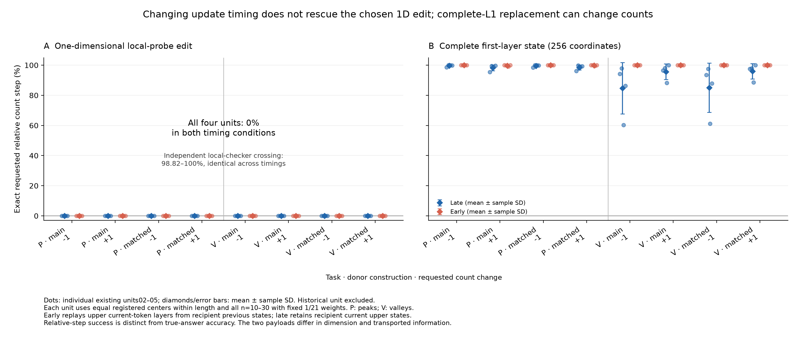

# Does current-token upper-layer replay rescue the local edit?

Completed: **no rescue of the chosen one-dimensional edit**. In each of `unit02`–`unit05`, both experts, both directions and both donor constructions had **zero changes to the selected output count**, under both timings. The independent local checker nevertheless crossed toward the donor on 98.8159–100.0000% of cases after the registered within-unit weighting. Whole-L1 replacement produced large expected count changes at the same interface. This separates a successful local readout manipulation from a successful count intervention.

This is an exploratory follow-up on the **same existing models and pairs**. Prior late-edit results were known. The new protocol and executable/summary sources were hash-frozen before the new formal timing results. The historical `archdev001` is shown separately and never included in four-unit statistics. This is not a fresh independent scientific replication.

## What changed between the two timings?

At the right-neighbor value token, let the recipient states before that token be `h_l(t−1)`, and let the registered donor edit produce `h1_edit(t)`.

* **Late:** carry `(h1_edit(t), h2(t), h3(t), h4(t))` into the original suffix.
* **Early:** keep exactly the same FP32 `h1_edit(t)`; compute layers 2–4 sequentially at the current token, each from its own recipient `h_l(t−1)` and the edited current output of the layer below. Carry these recomputed states into the same suffix.

The value token is **not rerun through layer 1**. Early and late inject byte-identical L1 states, so their checker readings and injected L1 norms are equal. The total four-layer carried-state norm can change under upper replay; it is reported separately and was not rescaled to erase the intended upper-layer effect.

The original dose 1, edit axis, independent checker, eight random directions (seeds 1026–1033), same-label donors, pairs, signs and output scoring were loaded from the previous stage. No probe, direction, threshold or model was fitted. Production model parameters were checked before and after every expert. All 21 lengths, n=10–30, remain included. Registered target positions are i=2…n−2 for local-only pairs and i=6…n−2 for count-matched pairs; this does not cover every possible interior position.

## Primary paired comparison

An **exact relative step** means the numeric output argmax changes from the recipient model's original prediction by exactly the requested +1 or −1. An **oracle goal hit** instead means the edited prediction equals the recipient's true count plus that sign. Their full-precision columns are separate; an initially incorrect model can already predict the oracle goal before any edit.

|Expert|Pair construction|Direction|Late exact step (%)|Early exact step (%)|Paired early−late (pp)|DiD vs same label (pp)|DiD vs random (pp)|Checker crossing, mean ± SD (%)|
|---|---|---|---|---|---|---|---|---|
|peaks|local-only|-1|0.000|0.000|0.000|0.000|0.000|99.698 ± 0.258|
|peaks|local-only|+1|0.000|0.000|0.000|0.000|0.000|99.507 ± 0.499|
|peaks|count-matched|-1|0.000|0.000|0.000|0.000|0.000|99.719 ± 0.281|
|peaks|count-matched|+1|0.000|0.000|0.000|0.000|0.000|99.716 ± 0.320|
|valleys|local-only|-1|0.000|0.000|0.000|0.000|0.000|99.623 ± 0.312|
|valleys|local-only|+1|0.000|0.000|0.000|0.000|0.000|99.859 ± 0.050|
|valleys|count-matched|-1|0.000|0.000|0.000|0.000|0.000|99.828 ± 0.096|
|valleys|count-matched|+1|0.000|0.000|0.000|0.000|0.000|99.938 ± 0.058|

All displayed relative hit rates, paired timing effects and differences-in-differences are exactly zero, including every raw formal unit. Any other numeric count change and any full-vocabulary argmax-token change are also zero for the main one-dimensional edit. Numeric argmax coverage is 100%. This is a bounded negative observation, not an equivalence test or proof that this information was never used elsewhere.

Small probability shifts remain: the largest absolute formal **unit × expert × construction × sign** mean signed change in conditional numeric expectation under the early edit is 4.358729e-06 count units. Directions are not uniformly positive. These shifts do not satisfy the protocol's criterion of a count-changing rescue. Full-vocabulary numeric mass, expectation contrasts and all raw control conditions remain in the detailed summary.

For valleys −1, oracle goal hits have tiny nonzero four-unit means (local-only 0.00551146%, count-matched 0.00646998%); these are already present before editing in unit04 and are unchanged across timing. They must not be described as successful count changes. See [the full primary table](headlines/main_eight_cells.csv), [all four units](headlines/main_by_unit.csv), and [paired timing/control contrasts](summary/timing_contrasts_by_unit.csv).

## Whole-layer diagnostics

Entries below are exact relative-step hit rates. Whole-L1 columns and their paired difference show four-unit mean ± **sample SD**; late L2–L4 entries show the four-unit mean. A whole recurrent layer has 256 coordinates and can move more than the selected local feature.

|Expert|Pair construction|Direction|Whole L1 late (%)|Whole L1 early (%)|Paired early−late (pp)|Late L2 (%)|Late L3 (%)|Late L4 (%)|
|---|---|---|---|---|---|---|---|---|
|peaks|local-only|-1|99.620 ± 0.642|100.000 ± 0.000|0.380 ± 0.642|1.404|0.000|0.000|
|peaks|local-only|+1|98.269 ± 1.927|99.743 ± 0.398|1.474 ± 2.039|0.220|0.000|0.000|
|peaks|count-matched|-1|99.548 ± 0.735|100.000 ± 0.000|0.452 ± 0.735|0.640|0.000|0.000|
|peaks|count-matched|+1|98.492 ± 1.667|99.853 ± 0.272|1.360 ± 1.726|0.175|0.000|0.000|
|valleys|local-only|-1|84.667 ± 17.011|99.989 ± 0.022|15.321 ± 16.990|2.045|0.000|0.006|
|valleys|local-only|+1|95.700 ± 5.192|99.983 ± 0.021|4.284 ± 5.172|4.345|0.006|0.006|
|valleys|count-matched|-1|85.066 ± 16.392|99.987 ± 0.026|14.921 ± 16.367|1.743|0.000|0.000|
|valleys|count-matched|+1|96.007 ± 5.101|99.987 ± 0.015|3.980 ± 5.091|3.561|0.000|0.006|

Complete first-layer replacement is effective under both timings, including the count-matched construction. Early replay raises its eight cell means to 99.743–100%, versus 84.667–99.620% late. The largest late variability is valleys decrease: its local-only four-unit SD is about 17.01 percentage points, so the raw unit results below matter. These findings show that the tested interface can transport the expected local count change. They do not isolate a unique counter layer or show that the one-dimensional probe axis is a naturally used mathematical predicate.

Low expected-step success for upper-layer swaps must not be confused with no output effect. **Count-matched L3 and L4 swaps frequently produce other changes**, often in the direction opposite the registered local goal. Their donor histories include the compensating earlier change; this diagnostic mixes state histories rather than intervening on an abstract local fact alone.

|Expert|Pair construction|Direction|L2 other change (%)|L3 other change (%)|L4 other change (%)|
|---|---|---|---|---|---|
|peaks|local-only|-1|0.000|0.000|0.000|
|peaks|local-only|+1|0.000|0.000|0.000|
|peaks|count-matched|-1|0.047|23.577|76.366|
|peaks|count-matched|+1|0.025|16.504|60.704|
|valleys|local-only|-1|0.000|0.000|0.000|
|valleys|local-only|+1|0.000|0.000|0.000|
|valleys|count-matched|-1|0.000|17.329|72.196|
|valleys|count-matched|+1|0.000|7.327|68.485|

“Other” means a nonzero numeric count change different from the requested signed step. The signed conditional expectation, every nonnumeric outcome, oracle goal hit and count change remain available in [the auxiliary table](headlines/auxiliary_eight_cells.csv) and [all auxiliary unit results](headlines/auxiliary_by_unit.csv). Single-layer swaps establish sufficiency for a change in these mixed states; they do not locate when or where natural accumulation occurs.

### Whole-L1 results in each formal unit

|Unit|Expert|Pair construction|Direction|Whole L1 late (%)|Whole L1 early (%)|Paired early−late (pp)|
|---|---|---|---|---|---|---|
|unit02|peaks|local-only|-1|98.663|100.000|1.337|
|unit02|peaks|local-only|+1|95.474|100.000|4.526|
|unit02|peaks|count-matched|-1|98.457|100.000|1.543|
|unit02|peaks|count-matched|+1|96.068|100.000|3.932|
|unit02|valleys|local-only|-1|94.229|100.000|5.771|
|unit02|valleys|local-only|+1|96.470|99.978|3.508|
|unit02|valleys|count-matched|-1|93.547|100.000|6.453|
|unit02|valleys|count-matched|+1|97.576|100.000|2.424|
|unit03|peaks|local-only|-1|100.000|100.000|0.000|
|unit03|peaks|local-only|+1|99.405|99.812|0.407|
|unit03|peaks|count-matched|-1|100.000|100.000|0.000|
|unit03|peaks|count-matched|+1|99.749|99.965|0.216|
|unit03|valleys|local-only|-1|97.983|100.000|2.017|
|unit03|valleys|local-only|+1|98.111|100.000|1.889|
|unit03|valleys|count-matched|-1|97.565|100.000|2.435|
|unit03|valleys|count-matched|+1|97.926|99.974|2.048|
|unit04|peaks|local-only|-1|99.978|100.000|0.022|
|unit04|peaks|local-only|+1|98.525|99.162|0.636|
|unit04|peaks|count-matched|-1|99.974|100.000|0.026|
|unit04|peaks|count-matched|+1|98.760|99.445|0.685|
|unit04|valleys|local-only|-1|60.234|99.956|39.722|
|unit04|valleys|local-only|+1|88.218|99.956|11.738|
|unit04|valleys|count-matched|-1|61.199|99.948|38.750|
|unit04|valleys|count-matched|+1|88.526|99.974|11.448|
|unit05|peaks|local-only|-1|99.840|100.000|0.160|
|unit05|peaks|local-only|+1|99.672|100.000|0.328|
|unit05|peaks|count-matched|-1|99.760|100.000|0.240|
|unit05|peaks|count-matched|+1|99.391|100.000|0.609|
|unit05|valleys|local-only|-1|86.224|100.000|13.776|
|unit05|valleys|local-only|+1|100.000|100.000|0.000|
|unit05|valleys|count-matched|-1|87.952|100.000|12.048|
|unit05|valleys|count-matched|+1|100.000|100.000|0.000|

The early−late whole-L1 contrast is nonnegative in all 32 listed unit cells. Historical values are kept in `headlines/auxiliary_historical_reference.csv`; full mean/SD/minimum/maximum and raw values are preserved in the eight-cell CSV.

The [PDF figure](headlines/timing_payload_comparison.pdf) and [plot script](plot_headlines.py) use these same saved per-unit tables, with all eight cells shown.

## Positive references have different targets

The real local-only counterfactual is scored against recipient true count ±1. The full-four-layer swap is a wiring check against the donor's actual continuation and true full count. In count-matched pairs the donor's count equals the recipient's count, so it is **not** the local-only ±1 goal. These references were kept separate; previously verified native counterfactual outputs were reused, while the full-state swap continuation was rerun and checked against the saved native donor output.

|Expert|Pair construction|Direction|Full-four-layer donor oracle (%)|Full-four-layer local goal (%)|Real local counterfactual oracle (%)|
|---|---|---|---|---|---|
|peaks|local-only|-1|100.0000|100.0000|100.0000|
|peaks|local-only|+1|100.0000|100.0000|100.0000|
|peaks|count-matched|-1|99.9929|0.0071|100.0000|
|peaks|count-matched|+1|100.0000|0.0000|99.9929|
|valleys|local-only|-1|99.9945|99.9945|99.9945|
|valleys|local-only|+1|99.9945|99.9945|99.9945|
|valleys|count-matched|-1|99.9871|0.0129|99.9935|
|valleys|count-matched|+1|99.9935|0.0000|99.9806|

These are oracle accuracies or local-goal hit rates as explicitly labeled, not inferred causal success. No-edit replay causes no count-category drift. See [reference results](headlines/positive_controls_eight_cells.csv) and [per-unit references](headlines/positive_controls_by_unit.csv).

## Coverage, weights and interpretation

|Unit|Role|Directed cases|Saved intervention rows|Production seconds|
|---|---|---|---|---|
|archdev001|reference|20160|584640|121.125|
|unit02|formal|20160|584640|118.486|
|unit03|formal|20160|584640|119.834|
|unit04|formal|20160|584640|119.131|
|unit05|formal|20160|584640|118.042|

There are 80,640 formal directed cases and 20,160 historical cases. Each saves 29 rows: 11 common conditions at each timing, four late whole-layer swaps, early whole-L1 replay, and the two distinct positive references. The total is 2,923,200 production rows. These are dependent comparisons, **not independent statistical replicates**.

Every primary metric first averages registered cases within a center, then equally weights the registered centers within a length, then uses the original fixed 1/21 length weights. Tasks, constructions and signs remain separate. Timing differences are computed within each case before aggregation. The eight random directions are averaged within case, never selected by maximum. Four-unit mean, sample SD, range and all raw unit values are retained. Original-baseline-correct, checker-baseline-correct, common-position, available-cell and pooled summaries are explicitly labeled sensitivities; none replaces the primary weights.

The protocol's second outcome applies: **the whole-layer interface can convey changes that the tested one-dimensional edit does not reproduce**. The early-vs-late hypothesis did not rescue the local edit, including cumulative-count-matched donors. This does not establish that a natural counting computation ignores local extrema, that all one-dimensional interventions would fail, or that the exact accumulation time has been located. Probe readability, token rank/adjacent-order confounds, mixed-state distribution shifts and potential distributed encodings remain distinct issues.

## Validation and provenance

* Protocol SHA256: `148d7741b659493c345c6e3ed5ec68ec6faede15cce7e300e8b2fec4bc7b3107`; original Git HEAD: `6d745815c0a1a2a41ad5fc8c0aa6e018f9bab249`. This follow-up adds separate untracked directories; the frozen production source, old studies and tracked repository contents were not rewritten.
* Input audit: 249,547 checks, no failures; 4,498 named physical input files freshly hashed at start, including all ten actually used old test-state payloads. A fixed old-cache subset also passed 90 byte comparisons. [Input audit](input_audit.json), [initial protection scope](protection_start.json).
* Replay tests: seven focused synthetic tests. The historical no-edit preflight had maximum logit error 2.861023e−6 under the original FP32/TF32-off flags, below the original 1e−4 tolerance. An initial default-TF32 preflight failed and was corrected by restoring the original numerical flags **before formal runs**, without loosening tolerance. [Preflight record](replay_preflight.json).
* All-run guard maxima: no-edit current-state error 0; early no-edit vs native query error 1.52587891e-05; rerun late vs original late error 1.71661377e-05; full-state swap vs native donor error 1.52587891e-05. Logit tolerance remains 1e−4; state tolerance 2e−5. L1 paired state/readout differences are zero. All ten expert parameter hashes are unchanged; no no-op or late-rerun argmax mismatch occurred.
* The independent saved-result audit passed 307,041 checks: 180 fixed cases, 5,220 CSV rows and 2,160 manual NumPy GRU gate-equation comparisons. Maximum independent gate-equation error was 5.677393e−7; metric/probe arithmetic error 1.776357e−14. This is a bounded implementation audit, not an independent scientific experiment. [Saved-result audit](saved_results_audit.json).
* The end audit rehashed 4,507 named physical dependencies, with matching endpoints and unchanged HEAD/clean tracked state. This covers the explicitly listed files; it is **not** continuous monitoring or a claim that every file on the disks was checked. Unused fit/dev payloads and the old 40-GB token cache were not reread. [End protection audit](protection_end.json).
* Frozen aggregation and derived headline receipts are in [summary/completion.json](summary/completion.json) and [headlines/completion.json](headlines/completion.json); 2,048 independent headline scalar checks exactly matched the frozen summary.

## Reproduction and files

Run `bash diagnostics/permworld_local_timing_20261110/reproduce.sh` from this repository. It uses the existing local environment/vendor path and old frozen caches; it never calls the parent stage's calibration or fitting commands. Completed production units are hash-checked and reused. See [the command script](reproduce.sh) for individual stages. Missing old inputs are errors, not authorization to regenerate or refit them.

* Executable timing/replay sources: [`experiments/permworld_local_timing_20261110/`](../../experiments/permworld_local_timing_20261110/).
* Raw production rows and cell states: `/mnt/yangx-projects-f/20261110/permworld_local_timing/<unit>/`. Each `results/<unit>/pair_results.csv` is a symlink to that unit's physical CSV. Cell NPZs store all condition logits, the recipient previous states, injected L1 states, early recomputed upper states, IDs and old-source/checkpoint/data/protocol bindings.
* [Main eight-cell table](headlines/main_eight_cells.csv), [auxiliary table](headlines/auxiliary_eight_cells.csv), [positive references](headlines/positive_controls_eight_cells.csv); each includes mean, sample SD, range and raw unit values. Their `*_by_unit.csv` and `*_historical_reference.csv` files preserve the four formal units and historical reference separately.
* Detailed [summary tables](summary/) include `by_length.csv`, `by_position.csv.gz`, `scored_pairs.csv.gz`, complete control conditions and paired contrasts. The summary has 3,729,600 scored rows because it additionally materializes within-case random means and contrasts; these are **not extra interventions**.
* The delivery audit additionally verifies every new physical production CSV/cell hash and writes a checkpoint/seed manifest. The final delivery manifest inventories only this new experiment and links the protected-input audits.

This completed round ends here. DAS, cross-model swaps, new-task generalization, additional fitting/training and publication are outside this delivery.
