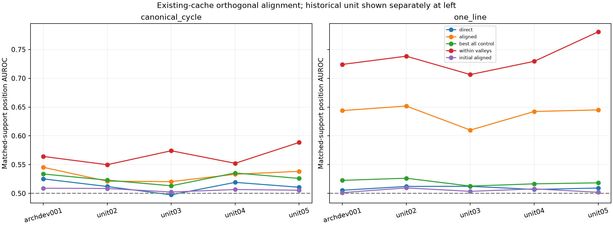
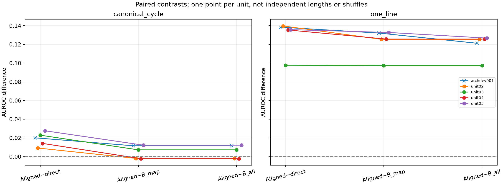

# Orthogonal-alignment replication: peaks to valleys

**The one-line recovery reproduces in all four newer units.** With the supplied validation-only alignment and the same held-out source probe, mean matched-support AUROC rises from **0.510173 to 0.637309**. Mean gain is **0.127135**, sample SD **0.019732**, range **0.097680–0.139691**. Every unit exceeds direct transfer and the prespecified strict best control. Recovery is partial: target-own readout still averages **0.738785**.

Canonical-cycle recovery is smaller and depends on the support/control comparison. It improves over direct transfer in all four units, but beats the strict best control in only **2/4** on the matched support. It passes that aggregate criterion in **4/4** on the full eligible test support. Both results are retained.

## Four-unit results

All entries below are equal-weight means across the original 21 lengths, on each unit's common-count matched anchors. Source probes, target complement inputs, centering and peak-position labels are identical across mapping controls within each phase/length.

| Unit | Matched anchors | One-line direct | Aligned | Gain | Cycle direct | Aligned | Gain |
|---|---:|---:|---:|---:|---:|---:|---:|
| unit02 | 1707 | 0.512101 | 0.651792 | +0.139691 | 0.511994 | 0.521195 | +0.009200 |
| unit03 | 1675 | 0.512351 | 0.610032 | +0.097680 | 0.497532 | 0.520471 | +0.022939 |
| unit04 | 1753 | 0.506927 | 0.642336 | +0.135408 | 0.519190 | 0.533309 | +0.014119 |
| unit05 | 1755 | 0.509314 | 0.645075 | +0.135761 | 0.510730 | 0.538346 | +0.027615 |

The historical unit is a separate reference: one-line **0.505526→0.643920**, cycle **0.525270→0.545359**, on 1,757 matched anchors. Its cache-based reproduction passes all 184 supplied summary comparisons within **0.0001164 AUROC**, below the fixed pre-run tolerance of **0.001**. Across every unit, all 36 original direct/own/prior baseline checks match the previous completed probe results exactly.

| New-four encoding / support | Aligned mean | Sample SD | Aligned range | Mean gain | Gain SD | Gain range | Above direct and strict best |
|---|---:|---:|---:|---:|---:|---:|---:|
| One-line / matched | 0.637309 | 0.018614 | 0.610032–0.651792 | 0.127135 | 0.019732 | 0.097680–0.139691 | 4/4 |
| One-line / full | 0.633139 | 0.017600 | 0.607053–0.644224 | 0.129968 | 0.018696 | 0.102467–0.142899 | 4/4 |
| Cycle / matched | 0.528330 | 0.008903 | 0.520471–0.538346 | 0.018468 | 0.008336 | 0.009200–0.027615 | 2/4 |
| Cycle / full | 0.532766 | 0.007469 | 0.525944–0.540644 | 0.021361 | 0.006478 | 0.013645–0.028374 | 4/4 |

One-line exceeds direct transfer and its strict best control at **21/21 lengths in each new unit**, on both supports. These length-level counts describe correlated conditions, not 84 independent replications. Cycle is heterogeneous: its matched-support aligned score falls slightly below the best shuffled map in unit02 and unit04. The four data/initialization/training bundles are the repetition units; only one task pair and GRU are studied here. No new significance, equivalence, or confidence-interval procedure is introduced.

## Exact tables and controls

- [Four-unit comprehensive table](four_unit_comparison.csv): both encodings and supports, direct/aligned/gain, means-only, identity/inverse, **each of eight shuffles**, their mean/min/max, step-0, model-own readouts, oracle prior, one-line descents/recoils direct/aligned controls, and all success margins.
- [Four-unit matched table](four_unit_matched.csv), [four-unit full-test table](four_unit_full_test.csv), and [historical reference](historical_reference.csv).
- [Four-unit mean/SD/range for every field](four_unit_statistics.csv); [complete four-new/all-five summaries](summary/cohort_summary.csv).
- [Full reader report and four figures](summary/report.md), [all length-specific alignment results](summary/all_alignment_by_length.csv), [length-level contrasts](summary/per_length_comparison.csv), and [length-specific task controls](summary/other_specialists_by_length.csv).
- [Per-unit raw outputs](results/) and [unaltered supplied historical pilot](supplied_historical/).

The **common map-control maximum, B_map**, is the maximum of means-only, identity-map, inverse-map, and **each individual shuffled-complement map**. It never substitutes the shuffle mean for the strongest shuffle. The **strict B_all** also includes aligned step-0 complement, the oracle-count position prior, and, for one-line, both direct and aligned descents/recoils. Model-own probes are positive references rather than negative controls and are excluded from these maxima. Cycle task-control entries remain missing because the supplied task-control experiment is one-line only. Use B_map when comparing a common control set across encodings.

The requested one-line success count requires **aligned > direct and aligned > B_all**. Maxima are taken after the fixed equal-length mean; this is distinct from averaging lengthwise maxima. All native-transform and own-valley auxiliary scores remain available but do not replace the common-complement comparison.

## What was fitted

All previous schema-adapted feature files were reused byte-for-byte. They contain raw FP32 `final_norm` states, not globally standardized features. The added files take `prefix_final[:,1]` and `prefix_final[:,2]` from the existing validation caches, retain original anchor order and checkpoint identity, and perform no further normalization.

Within each unit/phase/encoding/fit condition, the unchanged supplied script fits one global target-to-source orthogonal map in raw coordinates. It centers each length using probe-fit validation means and averages cross-products equally across lengths. The original per-length peaks scaler, ridge fit and source-only alpha selection are retained. Every main map is evaluated on the same held-out valleys complement features with the same complement/source means and the same source peak labels. Initial and trained phases refit separate probes.

The eight shuffled fits preserve length and true source peak count. Their individual results are retained. Descents/recoils use the same complement inputs but are not task/mastery-matched random controls. The position prior conditions on the true test count and is an oracle-count baseline.

This supports **out-of-sample recovery of part of the position readout by an explicitly fitted isometry**. It does not establish that the model naturally uses a common decoder, discovered the relation, or uses decoded positions causally in counting. The map itself is fitted to feature pairs without position targets; the source probe uses position labels. Differences in task mastery across encodings remain relevant. Lengths 10–30 are present in both fitting and scoring; new inputs, rather than new lengths, are held out.

## Reproduce on the original machine

Source: [experiments/permworld_orthogonal_alignment_20261110](../../experiments/permworld_orthogonal_alignment_20261110/). The three supplied scripts in `vendor/` are unchanged. `extract_validation.py` is preserved as provenance and **was not executed**. Dependencies are the existing isolated probe environment, recorded in [runtime_environment.json](runtime_environment.json) and [requirements-alignment.txt](requirements-alignment.txt).

From `/home/yangx/ICML`:

```bash
PYTHONPATH=/home/yangx/ICML/experiments/permworld_peaks_probe_20261109/vendor:/mnt/yangx-projects-f/20261109/permworld_peaks_probe/dependencies \
OMP_NUM_THREADS=2 OPENBLAS_NUM_THREADS=2 MKL_NUM_THREADS=2 \
.venv/bin/python -m experiments.permworld_orthogonal_alignment_20261110.run all
```

The runner first reproduces the historical cached pilot, then runs unit02–unit05. It reuses completed units only after their protocol/result hashes and baseline checks pass. Missing new-unit schema copies can be rebuilt with the original importer into a **new** output folder; existing copies are not overwritten. No reconstruction was needed in this run.

To invoke the supplied scripts directly for a new unit:

```bash
unit=unit02
repetition_root=/mnt/yangx-projects-f/20261106/permworld_repetition
probe_root=/mnt/yangx-projects-f/20261109/permworld_peaks_probe/features
alignment_root=/mnt/yangx-projects-f/20261110/permworld_orthogonal_alignment
probe_pythonpath=/home/yangx/ICML/experiments/permworld_peaks_probe_20261109/vendor:/mnt/yangx-projects-f/20261109/permworld_peaks_probe/dependencies

PYTHONPATH="$probe_pythonpath" .venv/bin/python experiments/permworld_orthogonal_alignment_20261110/vendor/alignment.py \
  --data "$repetition_root/$unit/data.npz" --features "$probe_root/$unit" \
  --validation "$alignment_root/validation/$unit" --out "$alignment_root/direct_rerun/$unit"
PYTHONPATH="$probe_pythonpath" .venv/bin/python experiments/permworld_orthogonal_alignment_20261110/vendor/other_specialists.py \
  --data "$repetition_root/$unit/data.npz" --features "$probe_root/$unit" \
  --validation "$alignment_root/validation/$unit" --out "$alignment_root/direct_rerun/$unit"
```

This optional direct rerun writes to a separate directory and omits the wrapper's map instrumentation. To regenerate scalar summaries and endpoint verification, use the same `PYTHONPATH` with `diagnostics/permworld_orthogonal_alignment_20261110/summarize_alignment.py` and `finalize_alignment_audit.py`.

## Provenance and checks

- [Frozen protocol](protocol.json), [source SHA](freeze.json), [original ZIP manifest](imported_archive_manifest.json), and [cache audit](cache_audit.json).
- [Adapter verification](adapter_verification.json): all 30 adapted validation files and 50 exported action arrays are bit-identical to raw source slices, with exact order and data/checkpoint bindings.
- [Independent saved-result audit](saved_results_audit.json): 106,023 checks, zero failures, maximum scalar arithmetic difference **1.11e-16**. It verifies all 21 lengths, old per-length baselines, 290 actual saved orthogonal matrices and 4,200 fixed-seed count-preserving permutations. Maximum **entrywise** error in `R.T @ R - I` is **3.55e-15**, checked at `atol=2e-12, rtol=0`.
- [Protection audit](protection_end.json): 471 named files match SHA and the analysis-time Git HEAD is unchanged. This is a bounded endpoint audit, not continuous monitoring or a claim about every repository file. Prior scientific reports, model checkpoints, caches and the working manuscript were not edited.

Adapted activations, actual fitted map/permutation arrays and logs are under `/mnt/yangx-projects-f/20261110/permworld_orthogonal_alignment`. The source cache files remain in their original locations. This round ends after the specified replication, summaries and checks; no further experiment or automatic publication is started.




