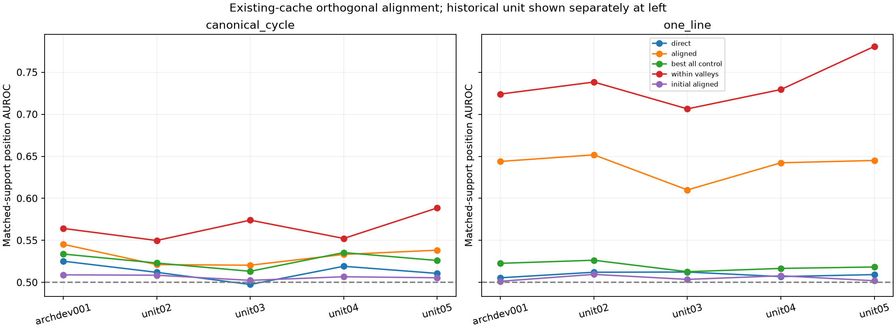
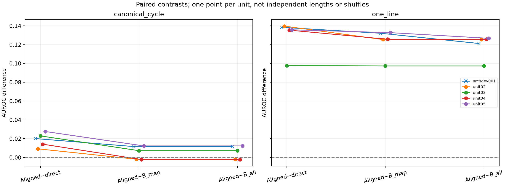
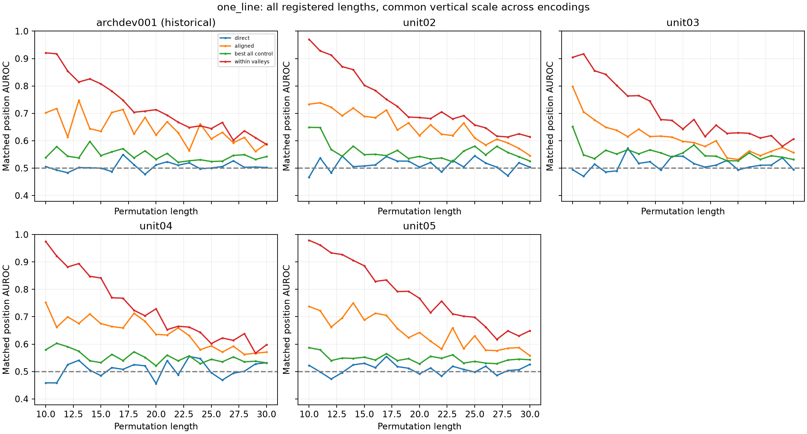
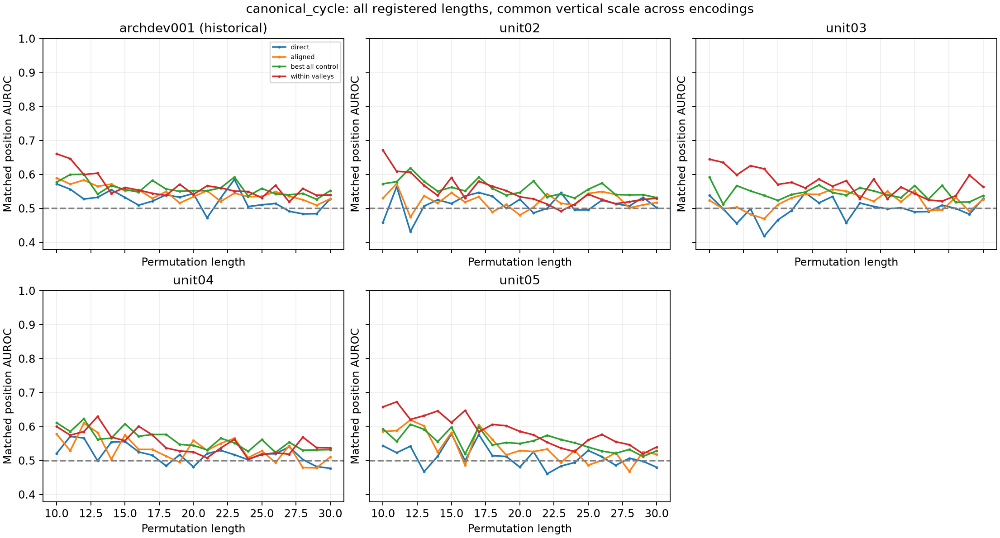

# Orthogonal-alignment cached-unit results

All original position-probe splits, scalers, source-only alpha selection, held-out complement inputs and peak-position labels are retained. A global target-to-source orthogonal map per phase/encoding/fit condition is fitted from validation-only raw final_norm features, with per-length means and equal-length covariance weighting. The source probe is fixed across mapping controls within each phase/length. No model forward or base training is performed.

## Per-unit comparison (common-count matched support)

| Unit | Encoding | Direct | Aligned C | Gain | B_map | B_all | Aligned−B_all | Initial aligned C | Within peaks | Within valleys |
|---|---|---:|---:|---:|---:|---:|---:|---:|---:|---:|
| archdev001 | canonical_cycle | 0.525270 | 0.545359 | 0.020089 | 0.533762 | 0.533762 | 0.011597 | 0.509022 | 0.553337 | 0.564229 |
| archdev001 | one_line | 0.505526 | 0.643920 | 0.138395 | 0.511812 | 0.522715 | 0.121206 | 0.501350 | 0.742316 | 0.724081 |
| unit02 | canonical_cycle | 0.511994 | 0.521195 | 0.009200 | 0.523057 | 0.523057 | -0.001862 | 0.508564 | 0.512883 | 0.549863 |
| unit02 | one_line | 0.512101 | 0.651792 | 0.139691 | 0.526383 | 0.526383 | 0.125409 | 0.509564 | 0.756211 | 0.738394 |
| unit03 | canonical_cycle | 0.497532 | 0.520471 | 0.022939 | 0.513234 | 0.513234 | 0.007237 | 0.502458 | 0.517666 | 0.574081 |
| unit03 | one_line | 0.512351 | 0.610032 | 0.097680 | 0.512729 | 0.512729 | 0.097303 | 0.503598 | 0.729240 | 0.706457 |
| unit04 | canonical_cycle | 0.519190 | 0.533309 | 0.014119 | 0.535509 | 0.535509 | -0.002200 | 0.506727 | 0.542735 | 0.552303 |
| unit04 | one_line | 0.506927 | 0.642336 | 0.135408 | 0.516656 | 0.516656 | 0.125680 | 0.507898 | 0.729427 | 0.729485 |
| unit05 | canonical_cycle | 0.510730 | 0.538346 | 0.027615 | 0.526074 | 0.526074 | 0.012272 | 0.505538 | 0.532278 | 0.588587 |
| unit05 | one_line | 0.509314 | 0.645075 | 0.135761 | 0.512336 | 0.518363 | 0.126712 | 0.501987 | 0.759137 | 0.780804 |

The complete wide table contains both matched and eligible/full-test supports, each of the eight shuffle scores, their mean/minimum/maximum, means-only, identity and inverse maps, the oracle-count prior, and direct/aligned descents/recoils controls. Cycle task controls are not evaluated, rather than filled with zero.

**B_map** is the maximum of means-only, identity-map, inverse-map, and each of eight shuffled-complement maps. **B_all** additionally includes initial aligned complement, oracle-count position prior, and (for one-line) both direct and aligned descents/recoils. Within-model probes are positive readout references and are excluded. Native-transform/own-valley rows remain auxiliary; all main map comparisons score the same complement features and peak labels.

The control maximum is taken after each original equal-1/21 length aggregation. It is not the mean of per-length maxima. Both lengthwise margins and the aggregate margin are retained separately.

## Four-new versus all-five summaries

| Cohort | Encoding | Support | Metric | Mean | Sample SD | Minimum | Maximum |
|---|---|---|---|---:|---:|---:|---:|
| new_units | canonical_cycle | matched | direct_auc | 0.509862 | 0.009025 | 0.497532 | 0.519190 |
| new_units | canonical_cycle | matched | aligned_auc | 0.528330 | 0.008903 | 0.520471 | 0.538346 |
| new_units | canonical_cycle | matched | gain_vs_direct | 0.018468 | 0.008336 | 0.009200 | 0.027615 |
| new_units | canonical_cycle | matched | aligned_minus_best_all | 0.003862 | 0.007109 | -0.002200 | 0.012272 |
| new_units | canonical_cycle | eligible | direct_auc | 0.511406 | 0.009029 | 0.498470 | 0.518829 |
| new_units | canonical_cycle | eligible | aligned_auc | 0.532766 | 0.007469 | 0.525944 | 0.540644 |
| new_units | canonical_cycle | eligible | gain_vs_direct | 0.021361 | 0.006478 | 0.013645 | 0.028374 |
| new_units | canonical_cycle | eligible | aligned_minus_best_all | 0.008303 | 0.004967 | 0.002949 | 0.014775 |
| new_units | one_line | matched | direct_auc | 0.510173 | 0.002565 | 0.506927 | 0.512351 |
| new_units | one_line | matched | aligned_auc | 0.637309 | 0.018614 | 0.610032 | 0.651792 |
| new_units | one_line | matched | gain_vs_direct | 0.127135 | 0.019732 | 0.097680 | 0.139691 |
| new_units | one_line | matched | aligned_minus_best_all | 0.118776 | 0.014326 | 0.097303 | 0.126712 |
| new_units | one_line | eligible | direct_auc | 0.503172 | 0.001413 | 0.501325 | 0.504586 |
| new_units | one_line | eligible | aligned_auc | 0.633139 | 0.017600 | 0.607053 | 0.644224 |
| new_units | one_line | eligible | gain_vs_direct | 0.129968 | 0.018696 | 0.102467 | 0.142899 |
| new_units | one_line | eligible | aligned_minus_best_all | 0.111387 | 0.019352 | 0.083157 | 0.124837 |
| all_units | canonical_cycle | matched | direct_auc | 0.512943 | 0.010419 | 0.497532 | 0.525270 |
| all_units | canonical_cycle | matched | aligned_auc | 0.531736 | 0.010837 | 0.520471 | 0.545359 |
| all_units | canonical_cycle | matched | gain_vs_direct | 0.018793 | 0.007255 | 0.009200 | 0.027615 |
| all_units | canonical_cycle | matched | aligned_minus_best_all | 0.005409 | 0.007062 | -0.002200 | 0.012272 |
| all_units | canonical_cycle | eligible | direct_auc | 0.513721 | 0.009378 | 0.498470 | 0.522982 |
| all_units | canonical_cycle | eligible | aligned_auc | 0.534793 | 0.007897 | 0.525944 | 0.542899 |
| all_units | canonical_cycle | eligible | gain_vs_direct | 0.021072 | 0.005647 | 0.013645 | 0.028374 |
| all_units | canonical_cycle | eligible | aligned_minus_best_all | 0.008644 | 0.004368 | 0.002949 | 0.014775 |
| all_units | one_line | matched | direct_auc | 0.509244 | 0.003042 | 0.505526 | 0.512351 |
| all_units | one_line | matched | aligned_auc | 0.638631 | 0.016389 | 0.610032 | 0.651792 |
| all_units | one_line | matched | gain_vs_direct | 0.129387 | 0.017815 | 0.097680 | 0.139691 |
| all_units | one_line | matched | aligned_minus_best_all | 0.119262 | 0.012455 | 0.097303 | 0.126712 |
| all_units | one_line | eligible | direct_auc | 0.503276 | 0.001246 | 0.501325 | 0.504586 |
| all_units | one_line | eligible | aligned_auc | 0.634145 | 0.015407 | 0.607053 | 0.644224 |
| all_units | one_line | eligible | gain_vs_direct | 0.130869 | 0.016316 | 0.102467 | 0.142899 |
| all_units | one_line | eligible | aligned_minus_best_all | 0.112501 | 0.016943 | 0.083157 | 0.124837 |

## Prespecified success counts

| Cohort | Encoding | Support | Units | Aligned > direct and B_map | Aligned > direct and B_all |
|---|---|---|---:|---:|---:|
| new_units | canonical_cycle | matched | 4 | 2 | 2 |
| new_units | canonical_cycle | eligible | 4 | 4 | 4 |
| new_units | one_line | matched | 4 | 4 | 4 |
| new_units | one_line | eligible | 4 | 4 | 4 |
| all_units | canonical_cycle | matched | 5 | 3 | 3 |
| all_units | canonical_cycle | eligible | 5 | 5 | 5 |
| all_units | one_line | matched | 5 | 5 | 5 |
| all_units | one_line | eligible | 5 | 5 | 5 |

The requested one-line count uses the stricter B_all rule, with the map-only count also reported. B_all contains different task-control availability across encodings; use B_map for a common control set. Four newer data/initialization/training bundles are the new repetition units. The historical exploratory pilot is retained separately. The 21 lengths and eight shuffle realizations are dependent conditions, not extra independent repetitions. No new significance/equivalence test, confidence interval or practical-zero threshold is introduced.

## Per-length descriptions

| Unit | Encoding | Support | Gain positive | Above B_map | Above B_all | Joint direct/B_all | Gain range |
|---|---|---|---:|---:|---:|---:|---:|
| archdev001 | canonical_cycle | matched | 17/21 | 7/21 | 6/21 | 6/21 | -0.040549 to 0.079893 |
| archdev001 | canonical_cycle | eligible | 21/21 | 7/21 | 6/21 | 6/21 | 0.001501 to 0.054663 |
| archdev001 | one_line | matched | 21/21 | 21/21 | 21/21 | 21/21 | 0.044658 to 0.245325 |
| archdev001 | one_line | eligible | 21/21 | 21/21 | 21/21 | 21/21 | 0.067029 to 0.251995 |
| unit02 | canonical_cycle | matched | 13/21 | 2/21 | 2/21 | 2/21 | -0.046480 to 0.071013 |
| unit02 | canonical_cycle | eligible | 17/21 | 4/21 | 4/21 | 4/21 | -0.013589 to 0.082343 |
| unit02 | one_line | matched | 21/21 | 21/21 | 21/21 | 21/21 | 0.042288 to 0.266487 |
| unit02 | one_line | eligible | 21/21 | 21/21 | 21/21 | 21/21 | 0.068159 to 0.231456 |
| unit03 | canonical_cycle | matched | 15/21 | 4/21 | 4/21 | 4/21 | -0.015961 to 0.092778 |
| unit03 | canonical_cycle | eligible | 20/21 | 8/21 | 8/21 | 8/21 | -0.010126 to 0.062977 |
| unit03 | one_line | matched | 21/21 | 21/21 | 21/21 | 21/21 | 0.008652 to 0.304333 |
| unit03 | one_line | eligible | 21/21 | 21/21 | 21/21 | 21/21 | 0.046296 to 0.264237 |
| unit04 | canonical_cycle | matched | 15/21 | 3/21 | 3/21 | 3/21 | -0.050595 to 0.083344 |
| unit04 | canonical_cycle | eligible | 19/21 | 9/21 | 9/21 | 9/21 | -0.004506 to 0.062147 |
| unit04 | one_line | matched | 21/21 | 21/21 | 21/21 | 21/21 | 0.032305 to 0.294294 |
| unit04 | one_line | eligible | 21/21 | 21/21 | 21/21 | 21/21 | 0.062609 to 0.247845 |
| unit05 | canonical_cycle | matched | 17/21 | 7/21 | 7/21 | 7/21 | -0.043184 to 0.134969 |
| unit05 | canonical_cycle | eligible | 18/21 | 6/21 | 6/21 | 6/21 | -0.025684 to 0.113642 |
| unit05 | one_line | matched | 21/21 | 21/21 | 21/21 | 21/21 | 0.031672 to 0.226058 |
| unit05 | one_line | eligible | 21/21 | 21/21 | 21/21 | 21/21 | 0.038338 to 0.251458 |

## Interpretation limits

Recovery of a linear readout after fitting an isometry is a coordinate-recovery result. It does not show that the model discovered or uses the mathematical relation, nor that decoded positions are causally used in counting. Alignment itself uses paired validation features without position targets; source probes use position labels and shuffled controls use true peak counts. Initial and trained phases refit separate probes. The map is orthogonal in raw final_norm coordinates, not after source-standardization, and may include a reflection. The wrong maps intentionally share the complement centering at test time. The oracle-count prior uses the true test count. Descents/recoils are same-input specialist controls, not task/mastery-matched random controls.

## Figures

