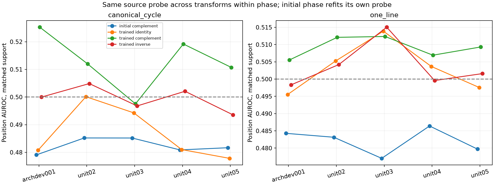
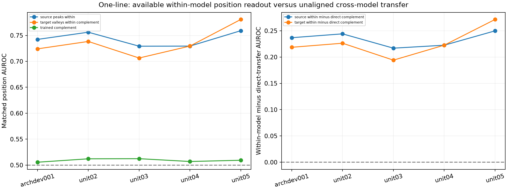

# Peaks-to-valleys position probes: four newer units

The four newer units retain a small, consistently positive **relative** complement preference for GRU/canonical-cycle inputs. Its magnitude is lower than the historical pilot, and one unit's complement AUROC is below random ordering. This is a bounded readout result for one task pair, not evidence of a general mathematical mechanism or causal use of positions in counting.

| New unit | Matched anchors | Cycle complement | Identity | Inverse | Initial complement | Complement minus best alternative |
|---|---:|---:|---:|---:|---:|---:|
| unit02 | 1707 | 0.511994 | 0.500124 | 0.504867 | 0.485197 | +0.007128 |
| unit03 | 1675 | 0.497532 | 0.494270 | 0.496781 | 0.485178 | +0.000751 |
| unit04 | 1753 | 0.519190 | 0.480992 | 0.502086 | 0.480872 | +0.017104 |
| unit05 | 1755 | 0.510730 | 0.477820 | 0.493574 | 0.481662 | +0.017157 |

Cycle complement averages **0.509862**, sample SD **0.009025**, versus the historical **0.525270**. Complement minus the stronger alternative averages **0.010535** (SD **0.008049**); trained minus initial complement averages **0.026634**. Both aggregate differences are positive in all four newer units, but unit03's advantage is only **0.000751** and its absolute AUROC is **0.497532**. The historical value is higher than all four new values.

One-line complement averages **0.510173**, essentially the same absolute readout level as cycle. Its best-alternative advantage is positive in **3/4**, averaging **0.003787**. One-line's mean within-source peaks AUROC is **0.743504**, and its target-own valleys/complement readout is **0.738785**, while direct source-probe transfer is **0.510173**. Thus strong task performance and within-model decodability do not imply a shared linear readout in the original coordinates. This does not show that one-line representations lack position information.

All units use all 21 lengths with fixed equal weights. Cycle complement beats both alternatives in **13, 11, 12, 15** lengths, respectively; these are descriptive counts, not independent replication units. The four worlds are the replication units, and they jointly vary data sampling, initialization, and training randomness. No new significance or equivalence test is introduced.

## Reports and files

- [Full tables, controls, learning summaries and four figures](summary/report.md).
- [Unit-level contrasts](summary/primary_contrasts_by_unit.csv), [cohort mean/SD/range](summary/cohort_summary.csv), [all scalar scores](summary/all_scores.csv), and [all per-length scores](summary/all_by_length.csv).
- [Raw results for each unit](results/), including the cache-reproduced historical unit; [original supplied historical package](supplied_historical/) is preserved separately.
- [Original pilot reproduction](historical_reproduction.json): all 104 scalar summaries reproduced within **0.0000402 AUROC**, below the prespecified **0.0005** numerical tolerance. Split/matched counts match exactly; the supplied CKA/count/AUROC verifier also passes. Cached GPU-origin features need not be bit-identical to the pilot's CPU-forward features.
- [Frozen protocol](protocol.json), [source freeze](freeze.json), [math/split audit](math_split_audit.md), [checkpoint/cache audit](cache_audit.md), and [runtime](runtime_environment.json).
- [Endpoint protection audit](protection_end.json) and [independent saved-table audit](saved_results_audit.json): 410 named file hashes match; 102,452 scalar checks pass with maximum discrepancy **3.34e-16**. These are bounded engineering checks, not scientific replications or proof of a mechanism.

## What is and is not held fixed

The supplied `analyze.py` and importer are unchanged, with their original SHA-256 recorded. Each phase/length/encoding fits a peaks probe only on probe-fit rows from the original specialist validation set; alpha is chosen from **1, 10, 100, 1000** on source-only probe-tuning rows. The same fitted source scaler/probe is applied to all target transformations without a target-space alignment. Initial and trained phases **refit separate probes**, so their difference is not a fixed-readout causal intervention across training.

Within each unit, both encodings and all actions share the unit-specific matched support. Different units legitimately have different match counts; historical anchor IDs are not reused. The matched mask equates extrema counts, not position labels. Fit/tuning/test orbit exclusions are retained. The count-conditioned position-prior control uses the true test count and is therefore an **oracle-count** control, rather than a deployable length-only baseline.

All saved count predictions are reused; no checkpoint is forwarded and no base parameters are updated. NLL and expected-answer correlations in the report are joined from the earlier identity-input diagnostic, rather than newly measured here. They support modest input-associated information in cycle models despite small mode-accuracy gains; near-mode accuracy alone does not establish baseline-only behavior. Probe success does not show that a counting computation uses the decoded positions. Only one relation and GRU have been tested in this round.

## Reproduce on the original machine

The implementation is at [experiments/permworld_peaks_probe_20261109](../../experiments/permworld_peaks_probe_20261109/). Its `vendor/` directory preserves the supplied scripts byte-for-byte. The frozen protocol points to the existing original and repetition cache paths. Probe dependencies were installed into a separate target directory; the existing model-training environment was not changed. Recorded versions are in [requirements-probe.txt](requirements-probe.txt).

From the repository root:

```bash
PYTHONPATH=/mnt/yangx-projects-f/20261109/permworld_peaks_probe/dependencies \
  OMP_NUM_THREADS=2 OPENBLAS_NUM_THREADS=2 MKL_NUM_THREADS=2 \
  .venv/bin/python -m experiments.permworld_peaks_probe_20261109.run all
```

Completed units are reused only after result hashes, the protocol binding, and finite-length guards pass. The runner reproduces the historical pilot first, then runs only unit02–unit05. Logs and derived feature copies are under `/mnt/yangx-projects-f/20261109/permworld_peaks_probe`; original checkpoint and activation bytes remain in place. No next probe, unit, training or world is started automatically.

To regenerate the derived tables/figures and then audit the saved results, use the same temporary `PYTHONPATH` with:

```bash
.venv/bin/python diagnostics/permworld_peaks_probe_20261109/summarize_probe.py
.venv/bin/python diagnostics/permworld_peaks_probe_20261109/finalize_probe_audit.py
```

The start/end protection receipt describes the analysis-time Git HEAD and named file contents. A later authorized publication changes repository indexes and HEAD; it does not retroactively change that historical snapshot.

To use the original user-supplied commands independently, install the probe requirements in a separate environment and run the unchanged vendor importer/analyzer with your original data/cache root. That route must retain the same frozen splits, all 21 lengths, and source-only tuning. The original `verify.py` has historical accuracy references and is not a new-unit verifier.




