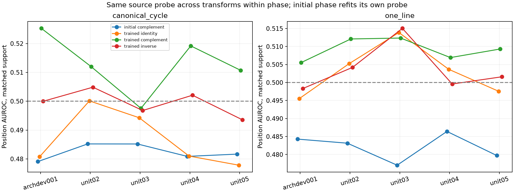
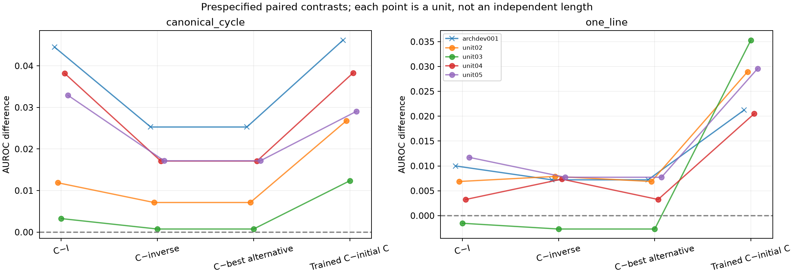
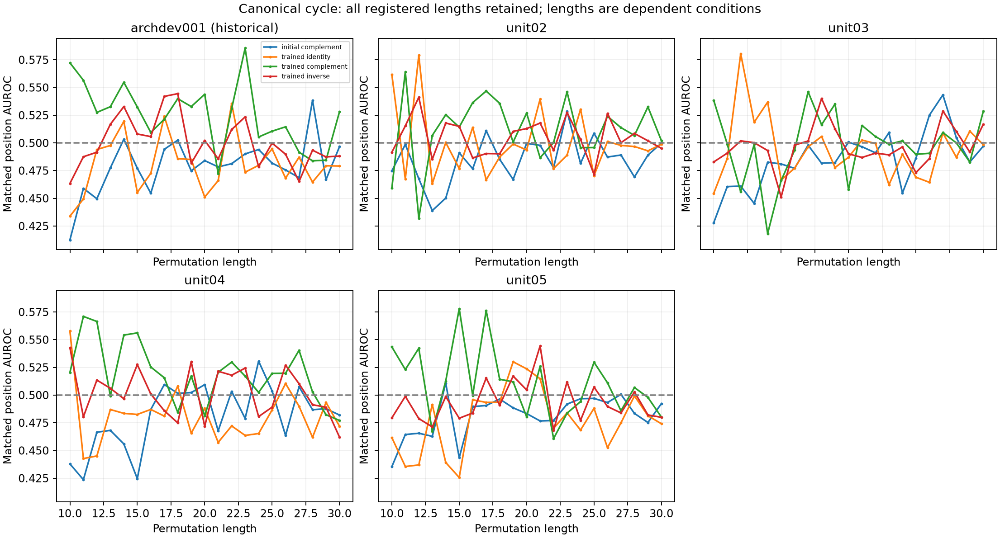
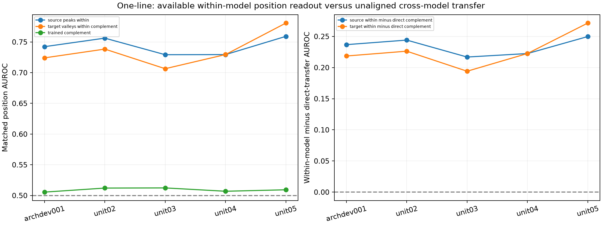

# Saved position-probe results

The historical pilot and four newer independent units use the supplied probe protocol unchanged. All 21 lengths are required. The primary quantity is an equal-length mean of within-example position AUROC on each unit's own common-count test support. Models and encodings share these anchors within a unit; they are not new independent observations.

| Unit | Encoding | Initial C | Trained C | Trained I | Trained inverse | C−best alternative | Trained C−initial C |
|---|---|---:|---:|---:|---:|---:|---:|
| archdev001 | canonical_cycle | 0.479076 | 0.525270 | 0.480754 | 0.499980 | 0.025290 | 0.046193 |
| archdev001 | one_line | 0.484280 | 0.505526 | 0.495531 | 0.498321 | 0.007204 | 0.021245 |
| unit02 | canonical_cycle | 0.485197 | 0.511994 | 0.500124 | 0.504867 | 0.007128 | 0.026797 |
| unit02 | one_line | 0.483147 | 0.512101 | 0.505233 | 0.504211 | 0.006868 | 0.028953 |
| unit03 | canonical_cycle | 0.485178 | 0.497532 | 0.494270 | 0.496781 | 0.000751 | 0.012354 |
| unit03 | one_line | 0.477033 | 0.512351 | 0.513887 | 0.515044 | -0.002693 | 0.035318 |
| unit04 | canonical_cycle | 0.480872 | 0.519190 | 0.480992 | 0.502086 | 0.017104 | 0.038318 |
| unit04 | one_line | 0.486413 | 0.506927 | 0.503674 | 0.499584 | 0.003253 | 0.020515 |
| unit05 | canonical_cycle | 0.481662 | 0.510730 | 0.477820 | 0.493574 | 0.017157 | 0.029068 |
| unit05 | one_line | 0.479722 | 0.509314 | 0.497584 | 0.501593 | 0.007720 | 0.029592 |

## Unit-level summaries

| Cohort | Encoding | Contrast | Mean | Sample SD | Minimum | Maximum | Positive units |
|---|---|---|---:|---:|---:|---:|---:|
| new_units | canonical_cycle | complement_minus_best_alternative | 0.010535 | 0.008049 | 0.000751 | 0.017157 | 4/4 |
| new_units | canonical_cycle | trained_complement_minus_initial_complement | 0.026634 | 0.010745 | 0.012354 | 0.038318 | 4/4 |
| new_units | one_line | complement_minus_best_alternative | 0.003787 | 0.004734 | -0.002693 | 0.007720 | 3/4 |
| new_units | one_line | trained_complement_minus_initial_complement | 0.028595 | 0.006100 | 0.020515 | 0.035318 | 4/4 |
| all_units | canonical_cycle | complement_minus_best_alternative | 0.013486 | 0.009598 | 0.000751 | 0.025290 | 5/5 |
| all_units | canonical_cycle | trained_complement_minus_initial_complement | 0.030546 | 0.012771 | 0.012354 | 0.046193 | 5/5 |
| all_units | one_line | complement_minus_best_alternative | 0.004471 | 0.004375 | -0.002693 | 0.007720 | 4/5 |
| all_units | one_line | trained_complement_minus_initial_complement | 0.027125 | 0.006222 | 0.020515 | 0.035318 | 5/5 |

No significance/equivalence test or confidence interval is introduced. The four newer units are the new repetition units; the historical pilot is exploratory and is retained separately. One task pair cannot establish generality across mathematical relationships.

## Per-length directions

| Unit | Encoding | C>I | C>inverse | C>both | Trained C>initial C |
|---|---|---:|---:|---:|---:|
| archdev001 | canonical_cycle | 19/21 | 16/21 | 15/21 | 19/21 |
| archdev001 | one_line | 13/21 | 17/21 | 12/21 | 14/21 |
| unit02 | canonical_cycle | 17/21 | 13/21 | 13/21 | 17/21 |
| unit02 | one_line | 12/21 | 14/21 | 10/21 | 16/21 |
| unit03 | canonical_cycle | 15/21 | 12/21 | 11/21 | 12/21 |
| unit03 | one_line | 9/21 | 5/21 | 5/21 | 20/21 |
| unit04 | canonical_cycle | 17/21 | 14/21 | 12/21 | 16/21 |
| unit04 | one_line | 12/21 | 13/21 | 10/21 | 15/21 |
| unit05 | canonical_cycle | 16/21 | 15/21 | 15/21 | 15/21 |
| unit05 | one_line | 17/21 | 15/21 | 13/21 | 18/21 |

The primary best-alternative contrast takes the maximum **after** equal-length aggregation. It is not the mean of lengthwise maxima; both values are explicitly retained in the direction table. Lengthwise direction counts are descriptive.

## Identity-input specialist learning

| Unit | Encoding | Task | Count accuracy | Train-length mode | Accuracy gap | Full NLL gap | Expected-answer Spearman |
|---|---|---|---:|---:|---:|---:|---:|
| archdev001 | canonical_cycle | peaks | 0.406901 | 0.398158 | 0.008743 | -0.042960 | 0.271547 |
| archdev001 | canonical_cycle | valleys | 0.410900 | 0.393136 | 0.017764 | -0.043558 | 0.277039 |
| archdev001 | one_line | peaks | 1.000000 | 0.398158 | 0.601842 | -1.376598 | 0.946291 |
| archdev001 | one_line | valleys | 0.999907 | 0.393136 | 0.606771 | -1.372944 | 0.946760 |
| unit02 | canonical_cycle | peaks | 0.409784 | 0.406622 | 0.003162 | -0.011143 | 0.127914 |
| unit02 | canonical_cycle | valleys | 0.410621 | 0.393508 | 0.017113 | -0.043046 | 0.275279 |
| unit02 | one_line | peaks | 1.000000 | 0.406622 | 0.593378 | -1.359785 | 0.943208 |
| unit02 | one_line | valleys | 1.000000 | 0.393508 | 0.606492 | -1.370784 | 0.946097 |
| unit03 | canonical_cycle | peaks | 0.404855 | 0.403925 | 0.000930 | -0.015520 | 0.157747 |
| unit03 | canonical_cycle | valleys | 0.426525 | 0.413690 | 0.012835 | -0.064664 | 0.322559 |
| unit03 | one_line | peaks | 0.999907 | 0.403925 | 0.595982 | -1.356149 | 0.944144 |
| unit03 | one_line | valleys | 1.000000 | 0.413690 | 0.586310 | -1.354411 | 0.942563 |
| unit04 | canonical_cycle | peaks | 0.418806 | 0.406994 | 0.011812 | -0.031920 | 0.234755 |
| unit04 | canonical_cycle | valleys | 0.410063 | 0.395554 | 0.014509 | -0.036309 | 0.251119 |
| unit04 | one_line | peaks | 1.000000 | 0.406994 | 0.593006 | -1.358542 | 0.943579 |
| unit04 | one_line | valleys | 1.000000 | 0.395554 | 0.604446 | -1.359378 | 0.945568 |
| unit05 | canonical_cycle | peaks | 0.411179 | 0.398531 | 0.012649 | -0.036764 | 0.247612 |
| unit05 | canonical_cycle | valleys | 0.426804 | 0.399275 | 0.027530 | -0.062086 | 0.329735 |
| unit05 | one_line | peaks | 1.000000 | 0.398531 | 0.601469 | -1.363397 | 0.945752 |
| unit05 | one_line | valleys | 1.000000 | 0.399275 | 0.600725 | -1.361604 | 0.944992 |

Full NLL and expected-answer Spearman are reused from the completed existing-checkpoint diagnostic, not newly measured by this probe. These identity-input quantities distinguish modest input-associated predictive information from exact-mode-only behavior; neither near-mode accuracy nor a small NLL difference proves baseline equivalence or task mastery. NLL alone can reflect probability calibration.

## Readout interpretation

The same source probe is applied across target models/actions within each phase, length and encoding. Initial and trained phases independently refit and retune their probes. Weak direct transfer can coexist with strong within-model readout because transfer depends on the coordinate basis. Successful decoding does not show that the counting computation uses decoded position features. The position-prior baseline conditions on the true test count and is an oracle-count control, not a length-only baseline. Initial/source/target own-label controls, all-anchor support, non-designated specialist controls, alphas and every negative or mixed result remain in the CSVs. No target-space alignment was fitted.

## Figures

