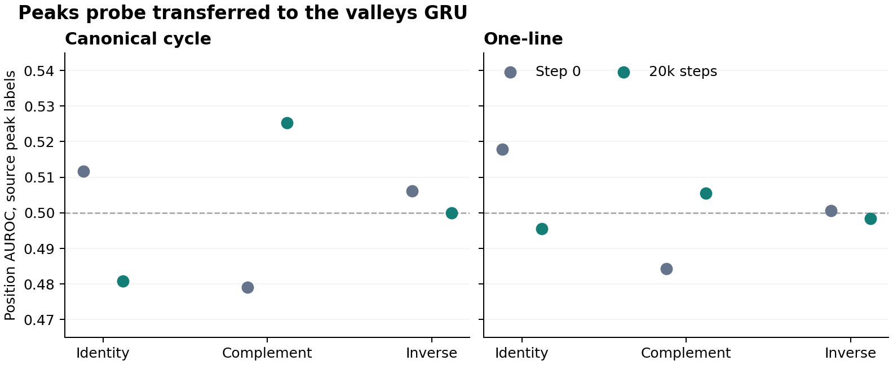

# PermWorld peaks-to-valleys probe

Exploratory position-readout pilot on the historical unit `archdev001`. It covers GRU with canonical-cycle and one-line inputs, a genuine shared step-zero checkpoint, eight completed specialists, and all 21 registered lengths. The four newer units' public tables contain scalar scores. Running this probe on those units requires the validation and test activation files saved by the repetition pipeline. The cache adapter below reads those files directly.

## Results

All reported AUROCs compare positive with negative positions within each sample and then average the sample means equally across lengths. The main comparison uses the 1,757 test anchors on which the original peak count and the valley counts under all three actions agree. All 21 lengths are represented. The source probe is fitted only on peaks hidden states and applied directly to the target without fitting any target-space map.

| Encoding | Step-zero complement | Trained complement | Trained identity | Trained inverse | Trained peaks within model | Trained valleys within model, complement |
| --- | ---: | ---: | ---: | ---: | ---: | ---: |
| Canonical cycle | 0.4791 | 0.5253 | 0.4808 | 0.5000 | 0.5533 | 0.5642 |
| One-line | 0.4843 | 0.5055 | 0.4955 | 0.4983 | 0.7423 | 0.7241 |

The first four score columns use the original peak positions as labels. The last column uses a separately trained valleys probe and the target's true valley positions. Canonical cycle's trained complement exceeds both of its alternatives in 15 of 21 lengths and exceeds step-zero complement in 19 of 21 lengths. These length counts are descriptive and the trained models belong to a single unit.

For canonical cycle, the trained source probe scored 0.5304 against the true valley positions of the identity input and 0.5237 against the true valley positions of the inverse input. Complement has the exact mathematical property of mapping the source's peak positions to the target's valley positions. The own-label controls show that some transferred position information can be read under all three actions.

The two same-input non-designated specialists, descents and recoils, scored 0.4956 and 0.4961 on canonical cycle and 0.5001 and 0.5111 on one-line. The length/count/position-frequency baseline on the common peak mask scored 0.4942. Requiring all three actions to share counts restricts the anchor support. The all-anchor counterpart is provided separately.

On the original 10,752 test anchors, canonical-cycle count accuracy is 40.69% for peaks and 41.09% for valleys. The training-frequency length baselines are 39.82% and 39.31%. One-line count accuracy is 100.00% and 99.99%. One-line has strong within-model position readout but little direct, unaligned cross-model transfer under this probe.

This pilot is evidence of modest direct transfer of position information in one cycle unit. It tests readout at saved endpoints. Claims about time of emergence, replication across the four newer units, or the causal contribution of these features to counting require their own evidence. Direct probe transfer also depends on the coordinate basis. Similar geometry under CKA can coexist with weak direct transfer.



## Data and implementation

- Original released anchor data and checkpoints are selected by their exact paths and verified against the release manifest. All eight endpoint receipts bind to the same saved GRU initialization and the same dataset. Only probes are fitted.
- Features are the original `final_norm` state at the input end before the task token. The inference script loads the released GRU class, prompt-batching function, and token IDs from pinned source included in `code/`. Full-vocabulary count accuracy and training length-mode baseline were reproduced for both canonical-cycle tasks. `results/verification.json` records raw CKA and label-oracle checks.
- The original specialist test split is reserved for scoring. The original specialist validation split is divided into probe fit and tuning subsets by a fixed hash of the complement/inverse orbit key. Groups shared between validation and test or intersecting specialist training are excluded. The actual historical run retains 4,295 probe-fit, 1,081 probe-tuning, and 10,752 test examples.
- One standardized multi-output ridge probe is fitted per length, phase, and source model. Regularization is selected on the source tuning split from 1, 10, 100, 1000. The same fit transform is applied to all target scores. Prediction targets are original one-line indices with endpoints excluded.
- `summary.csv` is the equal-length summary. `by_length.csv` and `by_length_and_count.csv` give sample counts and scores on both supports. `learning_by_length.csv` records exact count and baseline accuracies. `coverage.csv` gives split and match counts.

## Reproduce the historical pilot

Use Python 3.12 with NumPy, SciPy, pandas, scikit-learn, threadpoolctl, and PyTorch. Run commands from the package root. Obtain the release manifest from the pinned commit. Download the four release objects whose names contain `permworld-main-data`, `permworld-main-metadata`, and `permworld-main-weights` into a `downloads` directory. Their URLs and SHA-256 hashes are in the manifest.

```sh
curl -fL -o artifacts_manifest.json https://raw.githubusercontent.com/XuanyuYang223/2026TMLR/4e3558ac13a635d780d1801978986fd195555177/artifacts_manifest.json
mkdir -p downloads probe_inputs
python code/restore.py
python code/infer.py --inputs probe_inputs --features probe_features
python code/analyze.py --data probe_inputs/data.npz --features probe_features --out reproduced
python code/verify.py --data probe_inputs/data.npz --features probe_features --published results/released_cka_reference.csv --learning reproduced/learning_by_length.csv --out reproduced/verification.json
```

## Run on the four completed newer units

On the machine with the saved repetition payloads, set `REPETITION_ROOT` to the root containing `unit02` through `unit05`. This path uses the existing hash-checked feature caches and does not require a new GRU forward or specialist fitting. Its adapter follows the November 9 source layout. The historical run used the release data rather than these four local payloads.

```sh
for unit in unit02 unit03 unit04 unit05; do
  python code/import_repetition.py --unit-dir "$REPETITION_ROOT/$unit" --features "features/$unit"
  python code/analyze.py --data "$REPETITION_ROOT/$unit/data.npz" --features "features/$unit" --unit "$unit" --out "results/$unit"
done
```
