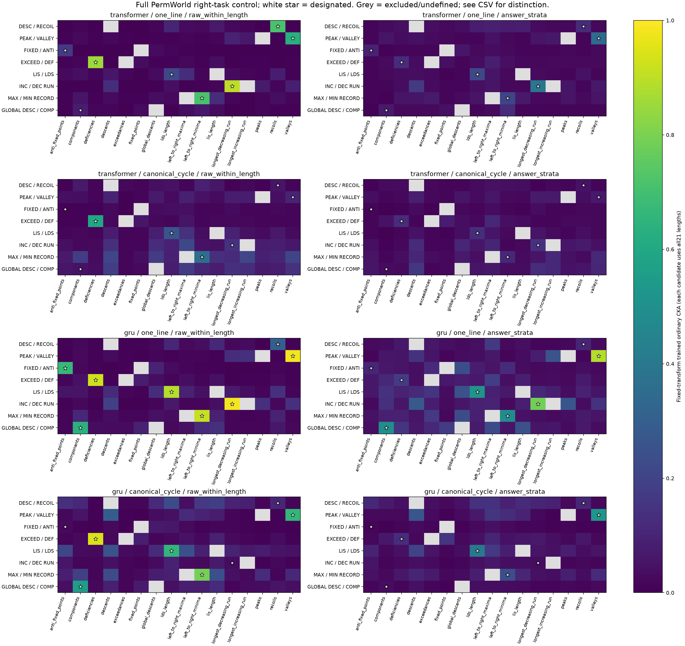
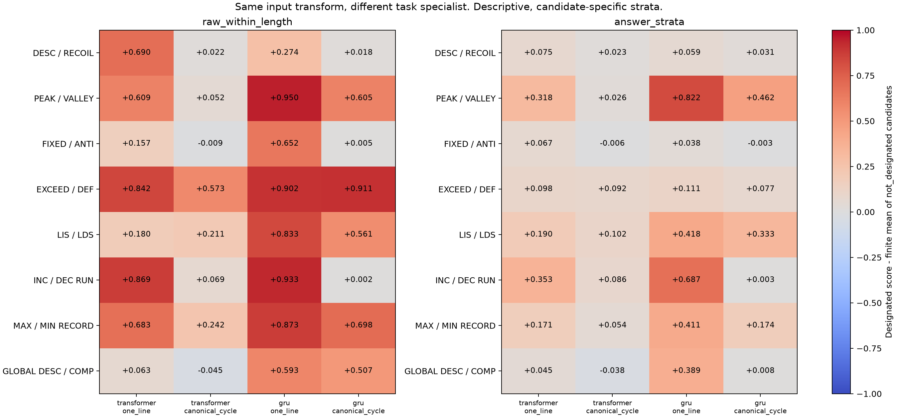
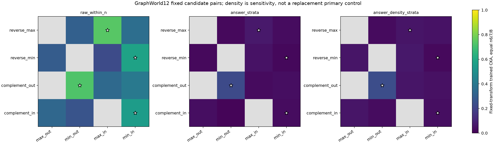

# PermWorld / GraphWorld: what the representation-pairing review shows

**Correct mathematical correspondences often accompany geometric pairing selectivity, but the observations depend on encoding and answer control. They do not, by themselves, identify a mathematical-structure mechanism or a functional benefit.**

> **Scope.** This is a GitHub-readable edition of the review dated **2026-10-11**, formatted on **2026-10-19**. The original review used existing models, inputs, and saved activations; it performed no new training or forward passes. This edition changes presentation only. The [original HTML](reader_report.html), [original text](reader_report.txt), numerical files, and scientific protocol remain unchanged.

## Main results at a glance

| Question | Result in the original review | What the result means |
| --- | --- | --- |
| For a fixed task pair, is the correct input pairing more similar than the wrong one? | **26/32 positive `Bt`** in the PermWorld primary analysis | Trained pairing selectivity; not a claim about all layers or controls |
| Did that correct-minus-wrong preference increase relative to initialization? | **18/32 positive `Delta`** in the same analysis | A different question: the training increment depends on the initial preference |
| Under a fixed input transformation, is the designated right task more similar than the other candidates on average? | **29/32** PermWorld conditions after answer stratification; **30/32** without it | Descriptive task-correspondence evidence; exceeding the candidate mean does not mean ranking first |
| Does the fixed-transformation observation extend to GraphWorld? | **3/4** after answer stratification; **4/4** without it; **2/4** with the additional exact-edge-count sensitivity control | Answer and density controls change the observation |
| Do the original wrong transformations always break the answer formula? | **No.** On the actual GraphWorld analysis inputs, formula-preservation rates are **54.818%–59.701%** | The original comparison has limited discrimination; matching samples and original results were retained |

These are counts of **coupled conditions**, not independent replications. PermWorld and GraphWorld each still contain one data world, with a genuine shared step-0 initialization within each model configuration.

## 1. Two comparisons answer different questions

| | Comparison A: change the input pairing | Comparison B: change the right task |
| --- | --- | --- |
| Held fixed | Left and right task models | Left task model, original correct transformation `T`, encoding/configuration, inputs, and final extraction point |
| Varied | Correct versus original wrong input transformation | Right specialist `g` |
| Main reading | Does this trained task pair prefer the correct pairing? | Under this same `T`, is the designated correspondence more similar than the prespecified candidate category? |
| Score names | `B0`, `Bt`, `delta_correct`, `delta_wrong`, `Delta` | `fixed_transform_score_initial`, `fixed_transform_score_trained`, and designated-minus-category contrasts |
| Initialization | Correct-minus-wrong preference need not be zero | Raw candidate scores coincide under shared initial parameters; answer-stratified candidate scores need not coincide |

### Comparison A: trained selectivity and its increment

```text
B0 = S_correct(initial) - S_wrong(initial)
Bt = S_correct(trained) - S_wrong(trained)

delta_correct = S_correct(trained) - S_correct(initial)
delta_wrong   = S_wrong(trained)   - S_wrong(initial)
Delta = Bt - B0 = delta_correct - delta_wrong
```

For a fixed trained result, changing the initialization reference **cannot change `Bt`**. It changes `Delta` and its interpretation. This review does not have multiple independent initializations with which to identify an initialization effect on `Bt`.

The **26 positive / 6 negative `Bt`** and **18 positive / 14 negative `Delta`** counts refer specifically to the **answer-stratified, input-end hidden state before the task token (`prefix_final`, `final_norm`), ordinary linear CKA analysis**, computed separately for lengths **10–30** and aggregated with fixed weights **1/21**. They are not an overall count across every layer, control, or metric.

### Comparison B: a fixed transformation and candidate right tasks

For PermWorld, each of the eight original directed relations is evaluated in four encoding/configuration conditions, with **15 possible right tasks** excluding the left task itself: **480 candidate pairs**, including **32 designated correspondences**. GraphWorld has **12 candidate pairs**, including **4 designated correspondences**. These are additional comparisons of existing models, not additional models.

The score is `S(h_f(x), h_g(T(x)))`. The new analysis uses only the original final extraction point and ordinary linear CKA. It does not expand to all layers, all metrics, or new wrong transformations. Length weights remain **1/21** for PermWorld and **1/3** for GraphWorld sizes **6/7/8**. If any required length is undefined, its candidate aggregate is undefined: no zero filling or weight redistribution.

Candidate classes were fixed before the new CKA computation:

| Category | Meaning in this review |
| --- | --- |
| `designated` | The original, mathematically verified task correspondence |
| `other_known_exact` | Another proved exact correspondence; this category is empty in the present catalog |
| `not_designated` | Not listed for this correspondence; **not** a claim that the tasks have no mathematical relationship |

Complete raw anchors are shared. Answer control retains the original joint-answer key, including answers for the original right-task input roles, without computing new wrong-role CKA. Candidate-specific answer grouping and support can differ; see [pair masks and support metadata](pair_masks.csv).

**Why the initialization qualification matters.** Genuine initial parameters are shared within configuration, so raw initial right-task scores coincide. Answer-stratified initial contrasts may differ because grouping and support depend on the candidate, even with identical weights. The raw equality must not be extended to answer-stratified results.

For a category's candidates finite in both phases, the new training-relative contrast is:

```text
C = candidates with finite, complete-length aggregates in both phases

Gcat = [S_designated(trained) - mean_{g in C} S_g(trained)]
     - [S_designated(initial) - mean_{g in C} S_g(initial)]
```

`Gcat` is **not** the original `Delta`. The common support is saved explicitly in [common-support comparisons](common_support_training_comparisons.csv). Differences between designated and other tasks are descriptive: task identity, labels, mastery, and stratification support are not isolated causal factors.

## 2. What the original 32-condition comparison shows

All six negative primary `Bt` conditions use **canonical-cycle encoding**:

| Configuration | Relation ID | Task pair |
| --- | --- | --- |
| Transformer | `descent_inverse` | Descents / inverse descents |
| Transformer | `fixed_complement` | Fixed / anti-fixed points |
| Transformer | `decomposition_complement` | Global descents / components |
| GRU | `fixed_complement` | Fixed / anti-fixed points |
| GRU | `run_complement` | Increasing / decreasing consecutive runs |
| GRU | `decomposition_complement` | Global descents / components |

Concentration in one encoding is a descriptive observation, not proof that encoding alone caused the differences. The [complete 32-condition table](recomputed_main32.csv) and [six negative cells](six_negative_bt.csv) retain the accuracy, training-defined per-length mode baseline, full score decomposition, and per-length signs. Exact values from the original HTML are also preserved in the collapsed tables below.

The three primary metrics agree on **`Bt` direction in 32/32 cells** and **`Delta` direction in 30/32**. The exceptions are **one-line GRU peaks/valleys and runs**: kNN `Delta` is negative while CKA and Procrustes `Delta` are positive. These are geometric readings of shared activations, not independent replications or functional tests. See [metric disagreements](metric_disagreements.csv), [direction checks](three_metric_directions.csv), and [layer sensitivity](layer_sensitivity.csv).

Weak tasks and unmatched model capacity remain relevant, but they do not explain every observation. Canonical-cycle GRU global-descents/components source accuracies are approximately **99.414% / 99.991%**, while `Bt` is negative. GRU exceedances/deficiencies are nearly perfect in both encodings, with positive `Bt` in both and a reversal in `Delta`: **`Gamma0 = 1.09407`, `Gamma_t = 0.06432`, `Gamma_Delta = -1.02975`**. Here each `Gamma` is the canonical-cycle value minus the one-line value of the corresponding quantity. This is not a reversal of trained pairing preference. Exceeding a length-mode baseline does not, by itself, establish mastery. See the [exceedance encoding case](gru_exceedance_encoding_case.csv) and [control sensitivity](control_sensitivity.csv).

## 3. What changes when the transformation is fixed

The following counts ask whether the trained designated score exceeds the mean finite, complete-length score of `not_designated` candidates.

| Domain | Control | Positive | Negative | Zero | Undefined | Coupled conditions |
| --- | --- | ---: | ---: | ---: | ---: | ---: |
| PermWorld | `raw_within_length` | 30 | 2 | 0 | 0 | 32 |
| PermWorld | `answer_strata` | 29 | 3 | 0 | 0 | 32 |
| GraphWorld | `raw_within_n` | 4 | 0 | 0 | 0 | 4 |
| GraphWorld | `answer_strata` | 3 | 1 | 0 | 0 | 4 |
| GraphWorld | `answer_density_strata` | 2 | 2 | 0 | 0 | 4 |

**Above the mean does not mean first in the candidate ranking.** The three negative new answer-controlled PermWorld contrasts are canonical-cycle **Transformer fixed/anti-fixed points, GRU fixed/anti-fixed points, and Transformer global-descents/components**. They are not the same set as the six negative `Bt` cells in Comparison A.

For GraphWorld, `reverse_min` changes from raw **+0.31530** to answer-controlled **-0.01319**. `complement_in` changes from answer-controlled **+0.00901** to **-0.00845** under the additional density sensitivity control. Near-zero signs do not establish significant positive or negative effects. The exact-edge-count control is a separate sensitivity analysis, not a replacement for the primary answer control.

Positive `Gcat` counts are separate from both `Bt` and `Delta`:

| Domain | Control | Positive `Gcat` conditions |
| --- | --- | ---: |
| PermWorld | Raw | 30/32 |
| PermWorld | Answer strata | 27/32 |
| GraphWorld | Raw | 4/4 |
| GraphWorld | Answer strata | 2/4 |
| GraphWorld | Answer + exact edge count | 2/4 |

The all-candidate summary has **996 rows**, including control versions, and **0 rows undefined in either phase**. All candidate scores, category means/medians/finite counts, and phase-specific support lists remain available; this does not create 996 independent observations.

### Figures from the original review

**PermWorld: all candidate scores.** The full-size image retains the original panel labels and values.

[](perm_all_candidate_scores.png)

**PermWorld: designated-minus-category contrasts.**

[](perm_designated_contrasts.png)

**GraphWorld: all candidate scores.**

[](graph_all_candidate_scores.png)

## 4. How discriminating are the original wrong transformations?

On the **actual original analysis anchors**, the fixed-equal-size-weight GraphWorld accidental formula-preservation rates are:

| Original relation | Rate on actual raw analysis anchors |
| --- | ---: |
| `reverse_max` | 56.771% |
| `reverse_min` | 54.818% |
| `complement_out` | 56.771% |
| `complement_in` | 59.701% |

Rates are approximately **57.8%–61.6%** under the original answer control and **66.9%–76.5%** under the original density control. These are different inputs from the previous random-mathematics audit, which reported **51.9%–65.57%**; the two audits must remain separate.

The wrong transformation `W` does not guarantee breaking the formula on every sample. This limits discrimination without invalidating the original experiment. Matching rows, `W`, and all original results were retained.

All **1,536 raw Boolean events** for `reverse_max` and `complement_out` coincide: both test `max_out(A) = max_out(W(A))`. They are therefore not independent relations, even though their answer selectors differ. For PermWorld global-descents/components, original inverse-mismatch preservation is approximately **77.0%** under raw equal weights.

[Per-anchor events](W_actual_per_anchor.csv) contain **92,160 relation–input rows**, with **10,752 distinct underlying PermWorld objects** and **1,536 GraphWorld objects**. **372** original stratified sample-count checks passed. Equal-weight rates and pooled numerator/denominator fractions are reported separately in the [per-length](W_actual_per_length.csv) and [summary](W_actual_summary.csv) files.

## 5. Evidence, unresolved questions, and the next step

This review resolves the coverage and arithmetic questions, adds a fixed-transformation comparison across task identities, and measures wrong-transformation formula preservation on the actual inputs. It supports **conditional geometric selectivity**, rather than a universal alignment or mechanism claim.

The main remaining limits are:

- Each system still has **one world** and a shared genuine step-0 initialization per configuration. Shared tasks, models, inputs, and transformations retain their dependencies.
- Configuration capacities are unmatched. Labels, confidence, prediction errors, and learning differences can still explain some geometric patterns.
- Candidate-specific answer strata and support differ. The new control is a descriptive comparison, not the pure causal effect of mathematical correspondence.
- Agreement between geometry metrics is not functional evidence. Permutation calibration concerns a specified null hypothesis, not task utility.

### Limited replication proposal — not executed

The review proposes only a small next-stage set: nearly mastered **GRU exceedances/deficiencies encoding pairs**, **GRU maxima/minima-record complement pairs**, and **Transformer fixed/anti-fixed-point pairs**, including canonical-cycle negative selectivity.

Each independent **world + true step-0** unit would contain **12 unique specialists**, paired encodings, the original fixed **20k** update budget, and the primary analysis. One- and two-unit scenarios correspond to historical matching-source process references of approximately **2.727 / 5.455 hours**, including validation I/O. These are **not active GPU hours, guarantees of runtime, or power estimates**. Future cache costs remain **Unknown** and separate.

Graph relation extensions, GroupWorld, and a third domain are next-phase candidates only. No new data preparation or execution occurred. There is no requirement for all domains to be positive and no automatic accuracy-target tuning of weak tasks. See [replication candidates](replication_candidates.txt), [budget scenarios](replication_budget_scenarios.csv), and [next-phase candidates](next_phase_candidates.txt).

## 6. Verification and protection audit

The original review independently verified **64 PermWorld + 4 GraphWorld genuine 20k endpoints**. Saved-table arithmetic had **maximum discrepancy 0** across **256,022 per-length** and **12,120 aggregate** comparisons.

New designated **32 + 4** phase/control/length values directly match the original correct scores. A further **40 independent Gram/covariance computations** cover the first length of **10 fixed pairs**. These checks used saved activations, without repeated forward passes. `result_reader_audit` additionally checks a fixed small set of aggregates, categories, and differences from saved scores; it is not an independent rerun of every metric.

The protocol was frozen before the new CKA calculation, **after previous training and geometry results had been inspected**. This is an exploratory analysis, not retrospective confirmation.

Start/end protection covered **2,580 explicitly named files**, all byte-identical, with unchanged Git HEAD and tracked worktree/index snapshots during that review. This is a scoped start/end check, not proof that every file remained unchanged throughout execution. F17, previous frozen reports/protocols/caches, the then-current entry point, and previous archives were preserved. Engineering repairs and executed SHA values are recorded separately.

The historical review stopped after its reporting and protection audits. Its no-training, no-forward-pass, no-upload, no-deletion, and no-movement statements describe **that review's execution scope**; this readable edition does not change the historical scientific claims.

## 7. Exact tables from the original HTML

The eight expandable sections below preserve **every original table header and data cell**, including full-precision numeric strings, support lists, signs, and empty fields. Empty cells remain empty; they are not zero. The compact summaries above do not replace these records. CSV links below provide the same analyses in a form suitable for filtering.

<details>
<summary>Six negative Bt conditions — original primary analysis (6 rows)</summary>

| architecture | encoding | relation | B0 | Bt | Delta | dc | dw | left_test_answer_accuracy | left_test_length_majority_accuracy | right_test_answer_accuracy | right_test_length_majority_accuracy | Bt_length_signs |
| --- | --- | --- | --- | --- | --- | --- | --- | --- | --- | --- | --- | --- |
| transformer | canonical_cycle | descent_inverse | 0.7845324607815962 | -0.032043767438747844 | -0.816576228220344 | -0.7645669201401878 | 0.0520093080801563 | 0.31882440476190477 | 0.30440848214285715 | 0.3064546130952381 | 0.29696800595238093 | --+++-------------+-- |
| transformer | canonical_cycle | fixed_complement | -0.6218753751265362 | -0.0015145575038602475 | 0.620360817622676 | -0.02657802474824424 | -0.6469388423709203 | 0.9993489583333334 | 0.37007068452380953 | 0.38504464285714285 | 0.36616443452380953 | -----++-+++-++-++---+ |
| transformer | canonical_cycle | decomposition_complement | -0.7654546796151578 | -0.012265812990137657 | 0.7531888666250202 | 0.0028485522448549083 | -0.7503403143801654 | 0.9671688988095238 | 0.8888578869047619 | 0.9997209821428571 | 0.8811383928571429 | +-+-----++-----++---- |
| gru | canonical_cycle | fixed_complement | -0.4874418388883435 | -0.012014584675250909 | 0.4754272542130926 | -0.014354388686027881 | -0.4897816428991205 | 1.0 | 0.37007068452380953 | 0.39220610119047616 | 0.36616443452380953 | --+-++--------------- |
| gru | canonical_cycle | run_complement | -0.7998249931770234 | -0.10374648335860921 | 0.6960785098184141 | 0.016454151779999086 | -0.6796243580384151 | 0.48939732142857145 | 0.49321056547619047 | 0.4929315476190476 | 0.49135044642857145 | --------------------- |
| gru | canonical_cycle | decomposition_complement | -0.7929723483498698 | -0.13108910946033428 | 0.6618832388895355 | 0.016544600634763956 | -0.6453386382547717 | 0.994140625 | 0.8888578869047619 | 0.9999069940476191 | 0.8811383928571429 | --------------------- |

</details>

<details>
<summary>Designated correspondence minus prespecified category, by condition (304 rows)</summary>

| domain | relation | architecture | encoding | control | phase | comparison_category | designated_score | finite_mean | finite_median | defined_count | total_count | designated_minus_category_mean_state | finite_support_right_tasks |
| --- | --- | --- | --- | --- | --- | --- | --- | --- | --- | --- | --- | --- | --- |
| permworld | descent_inverse | transformer | one_line | raw_within_length | initial | other_known_exact | 0.06675038205648487 |  |  | 0 | 0 |  |  |
| permworld | descent_inverse | transformer | one_line | raw_within_length | trained | other_known_exact | 0.7131805942449879 |  |  | 0 | 0 |  |  |
| permworld | descent_inverse | transformer | one_line | raw_within_length | initial | not_designated | 0.06675038205648487 | 0.06675038205648487 | 0.06675038205648487 | 14 | 14 | 0.0 | anti_fixed_points;components;deficiencies;exceedances;fixed_points;global_descents;lds_length;left_to_right_maxima;left_to_right_minima;lis_length;longest_decreasing_run;longest_increasing_run;peaks;valleys |
| permworld | descent_inverse | transformer | one_line | raw_within_length | trained | not_designated | 0.7131805942449879 | 0.023506811340783782 | 0.012827967585634089 | 14 | 14 | 0.6896737829042041 | anti_fixed_points;components;deficiencies;exceedances;fixed_points;global_descents;lds_length;left_to_right_maxima;left_to_right_minima;lis_length;longest_decreasing_run;longest_increasing_run;peaks;valleys |
| permworld | descent_inverse | transformer | one_line | answer_strata | initial | other_known_exact | 0.06597382232124731 |  |  | 0 | 0 |  |  |
| permworld | descent_inverse | transformer | one_line | answer_strata | trained | other_known_exact | 0.11911957159536814 |  |  | 0 | 0 |  |  |
| permworld | descent_inverse | transformer | one_line | answer_strata | initial | not_designated | 0.06597382232124731 | 0.08056035997070617 | 0.06871305719541095 | 14 | 14 | -0.014586537649458858 | anti_fixed_points;components;deficiencies;exceedances;fixed_points;global_descents;lds_length;left_to_right_maxima;left_to_right_minima;lis_length;longest_decreasing_run;longest_increasing_run;peaks;valleys |
| permworld | descent_inverse | transformer | one_line | answer_strata | trained | not_designated | 0.11911957159536814 | 0.044095128764074225 | 0.03285626789093931 | 14 | 14 | 0.07502444283129392 | anti_fixed_points;components;deficiencies;exceedances;fixed_points;global_descents;lds_length;left_to_right_maxima;left_to_right_minima;lis_length;longest_decreasing_run;longest_increasing_run;peaks;valleys |
| permworld | descent_inverse | transformer | canonical_cycle | raw_within_length | initial | other_known_exact | 0.8101069767877498 |  |  | 0 | 0 |  |  |
| permworld | descent_inverse | transformer | canonical_cycle | raw_within_length | trained | other_known_exact | 0.05361884074397216 |  |  | 0 | 0 |  |  |
| permworld | descent_inverse | transformer | canonical_cycle | raw_within_length | initial | not_designated | 0.8101069767877498 | 0.8101069767877498 | 0.8101069767877498 | 14 | 14 | 0.0 | anti_fixed_points;components;deficiencies;exceedances;fixed_points;global_descents;lds_length;left_to_right_maxima;left_to_right_minima;lis_length;longest_decreasing_run;longest_increasing_run;peaks;valleys |
| permworld | descent_inverse | transformer | canonical_cycle | raw_within_length | trained | not_designated | 0.05361884074397216 | 0.03143933217886426 | 0.01811039466629496 | 14 | 14 | 0.022179508565107905 | anti_fixed_points;components;deficiencies;exceedances;fixed_points;global_descents;lds_length;left_to_right_maxima;left_to_right_minima;lis_length;longest_decreasing_run;longest_increasing_run;peaks;valleys |
| permworld | descent_inverse | transformer | canonical_cycle | answer_strata | initial | other_known_exact | 0.8115096058957699 |  |  | 0 | 0 |  |  |
| permworld | descent_inverse | transformer | canonical_cycle | answer_strata | trained | other_known_exact | 0.04694268575558239 |  |  | 0 | 0 |  |  |
| permworld | descent_inverse | transformer | canonical_cycle | answer_strata | initial | not_designated | 0.8115096058957699 | 0.7612156305286016 | 0.790282436562417 | 14 | 14 | 0.05029397536716829 | anti_fixed_points;components;deficiencies;exceedances;fixed_points;global_descents;lds_length;left_to_right_maxima;left_to_right_minima;lis_length;longest_decreasing_run;longest_increasing_run;peaks;valleys |
| permworld | descent_inverse | transformer | canonical_cycle | answer_strata | trained | not_designated | 0.04694268575558239 | 0.0240267885289966 | 0.020547022593752573 | 14 | 14 | 0.022915897226585793 | anti_fixed_points;components;deficiencies;exceedances;fixed_points;global_descents;lds_length;left_to_right_maxima;left_to_right_minima;lis_length;longest_decreasing_run;longest_increasing_run;peaks;valleys |
| permworld | descent_inverse | gru | one_line | raw_within_length | initial | other_known_exact | 0.07626539191139065 |  |  | 0 | 0 |  |  |
| permworld | descent_inverse | gru | one_line | raw_within_length | trained | other_known_exact | 0.30445015228949746 |  |  | 0 | 0 |  |  |
| permworld | descent_inverse | gru | one_line | raw_within_length | initial | not_designated | 0.07626539191139065 | 0.07626539191139063 | 0.07626539191139065 | 14 | 14 | 1.3877787807814457e-17 | anti_fixed_points;components;deficiencies;exceedances;fixed_points;global_descents;lds_length;left_to_right_maxima;left_to_right_minima;lis_length;longest_decreasing_run;longest_increasing_run;peaks;valleys |
| permworld | descent_inverse | gru | one_line | raw_within_length | trained | not_designated | 0.30445015228949746 | 0.03033280338097537 | 0.020510997293184362 | 14 | 14 | 0.2741173489085221 | anti_fixed_points;components;deficiencies;exceedances;fixed_points;global_descents;lds_length;left_to_right_maxima;left_to_right_minima;lis_length;longest_decreasing_run;longest_increasing_run;peaks;valleys |
| permworld | descent_inverse | gru | one_line | answer_strata | initial | other_known_exact | 0.07912335408730585 |  |  | 0 | 0 |  |  |
| permworld | descent_inverse | gru | one_line | answer_strata | trained | other_known_exact | 0.10347294944431852 |  |  | 0 | 0 |  |  |
| permworld | descent_inverse | gru | one_line | answer_strata | initial | not_designated | 0.07912335408730585 | 0.09725203761541391 | 0.08612538369320846 | 14 | 14 | -0.018128683528108064 | anti_fixed_points;components;deficiencies;exceedances;fixed_points;global_descents;lds_length;left_to_right_maxima;left_to_right_minima;lis_length;longest_decreasing_run;longest_increasing_run;peaks;valleys |
| permworld | descent_inverse | gru | one_line | answer_strata | trained | not_designated | 0.10347294944431852 | 0.04432426665500139 | 0.030429075314563687 | 14 | 14 | 0.059148682789317134 | anti_fixed_points;components;deficiencies;exceedances;fixed_points;global_descents;lds_length;left_to_right_maxima;left_to_right_minima;lis_length;longest_decreasing_run;longest_increasing_run;peaks;valleys |
| permworld | descent_inverse | gru | canonical_cycle | raw_within_length | initial | other_known_exact | 0.8146488812152196 |  |  | 0 | 0 |  |  |
| permworld | descent_inverse | gru | canonical_cycle | raw_within_length | trained | other_known_exact | 0.10736910753941861 |  |  | 0 | 0 |  |  |
| permworld | descent_inverse | gru | canonical_cycle | raw_within_length | initial | not_designated | 0.8146488812152196 | 0.8146488812152196 | 0.8146488812152196 | 14 | 14 | 0.0 | anti_fixed_points;components;deficiencies;exceedances;fixed_points;global_descents;lds_length;left_to_right_maxima;left_to_right_minima;lis_length;longest_decreasing_run;longest_increasing_run;peaks;valleys |
| permworld | descent_inverse | gru | canonical_cycle | raw_within_length | trained | not_designated | 0.10736910753941861 | 0.08947450014289171 | 0.09314203979245411 | 14 | 14 | 0.0178946073965269 | anti_fixed_points;components;deficiencies;exceedances;fixed_points;global_descents;lds_length;left_to_right_maxima;left_to_right_minima;lis_length;longest_decreasing_run;longest_increasing_run;peaks;valleys |
| permworld | descent_inverse | gru | canonical_cycle | answer_strata | initial | other_known_exact | 0.8169134799244492 |  |  | 0 | 0 |  |  |
| permworld | descent_inverse | gru | canonical_cycle | answer_strata | trained | other_known_exact | 0.10908341888068598 |  |  | 0 | 0 |  |  |
| permworld | descent_inverse | gru | canonical_cycle | answer_strata | initial | not_designated | 0.8169134799244492 | 0.723406000730618 | 0.8071994889987434 | 14 | 14 | 0.09350747919383118 | anti_fixed_points;components;deficiencies;exceedances;fixed_points;global_descents;lds_length;left_to_right_maxima;left_to_right_minima;lis_length;longest_decreasing_run;longest_increasing_run;peaks;valleys |
| permworld | descent_inverse | gru | canonical_cycle | answer_strata | trained | not_designated | 0.10908341888068598 | 0.07806508224091535 | 0.08114428273076739 | 14 | 14 | 0.031018336639770633 | anti_fixed_points;components;deficiencies;exceedances;fixed_points;global_descents;lds_length;left_to_right_maxima;left_to_right_minima;lis_length;longest_decreasing_run;longest_increasing_run;peaks;valleys |
| permworld | peak_complement | transformer | one_line | raw_within_length | initial | other_known_exact | 0.6693246877774407 |  |  | 0 | 0 |  |  |
| permworld | peak_complement | transformer | one_line | raw_within_length | trained | other_known_exact | 0.6317549264966443 |  |  | 0 | 0 |  |  |
| permworld | peak_complement | transformer | one_line | raw_within_length | initial | not_designated | 0.6693246877774407 | 0.6693246877774407 | 0.6693246877774407 | 14 | 14 | 0.0 | anti_fixed_points;components;deficiencies;descents;exceedances;fixed_points;global_descents;lds_length;left_to_right_maxima;left_to_right_minima;lis_length;longest_decreasing_run;longest_increasing_run;recoils |
| permworld | peak_complement | transformer | one_line | raw_within_length | trained | not_designated | 0.6317549264966443 | 0.02238143025123348 | 0.010969008246565444 | 14 | 14 | 0.6093734962454108 | anti_fixed_points;components;deficiencies;descents;exceedances;fixed_points;global_descents;lds_length;left_to_right_maxima;left_to_right_minima;lis_length;longest_decreasing_run;longest_increasing_run;recoils |
| permworld | peak_complement | transformer | one_line | answer_strata | initial | other_known_exact | 0.672191460692452 |  |  | 0 | 0 |  |  |
| permworld | peak_complement | transformer | one_line | answer_strata | trained | other_known_exact | 0.3498411419443036 |  |  | 0 | 0 |  |  |
| permworld | peak_complement | transformer | one_line | answer_strata | initial | not_designated | 0.672191460692452 | 0.6798809271773092 | 0.6743060912909784 | 14 | 14 | -0.007689466484857244 | anti_fixed_points;components;deficiencies;descents;exceedances;fixed_points;global_descents;lds_length;left_to_right_maxima;left_to_right_minima;lis_length;longest_decreasing_run;longest_increasing_run;recoils |
| permworld | peak_complement | transformer | one_line | answer_strata | trained | not_designated | 0.3498411419443036 | 0.03138966200722787 | 0.025204732431928417 | 14 | 14 | 0.31845147993707573 | anti_fixed_points;components;deficiencies;descents;exceedances;fixed_points;global_descents;lds_length;left_to_right_maxima;left_to_right_minima;lis_length;longest_decreasing_run;longest_increasing_run;recoils |
| permworld | peak_complement | transformer | canonical_cycle | raw_within_length | initial | other_known_exact | 0.025625658504082976 |  |  | 0 | 0 |  |  |
| permworld | peak_complement | transformer | canonical_cycle | raw_within_length | trained | other_known_exact | 0.10076675817069936 |  |  | 0 | 0 |  |  |
| permworld | peak_complement | transformer | canonical_cycle | raw_within_length | initial | not_designated | 0.025625658504082976 | 0.025625658504082976 | 0.025625658504082976 | 14 | 14 | 0.0 | anti_fixed_points;components;deficiencies;descents;exceedances;fixed_points;global_descents;lds_length;left_to_right_maxima;left_to_right_minima;lis_length;longest_decreasing_run;longest_increasing_run;recoils |
| permworld | peak_complement | transformer | canonical_cycle | raw_within_length | trained | not_designated | 0.10076675817069936 | 0.048857946114032824 | 0.041034511916301565 | 14 | 14 | 0.05190881205666653 | anti_fixed_points;components;deficiencies;descents;exceedances;fixed_points;global_descents;lds_length;left_to_right_maxima;left_to_right_minima;lis_length;longest_decreasing_run;longest_increasing_run;recoils |
| permworld | peak_complement | transformer | canonical_cycle | answer_strata | initial | other_known_exact | 0.02802116650390916 |  |  | 0 | 0 |  |  |
| permworld | peak_complement | transformer | canonical_cycle | answer_strata | trained | other_known_exact | 0.06740999204310011 |  |  | 0 | 0 |  |  |
| permworld | peak_complement | transformer | canonical_cycle | answer_strata | initial | not_designated | 0.02802116650390916 | 0.0390842862767423 | 0.031462091535256975 | 14 | 14 | -0.011063119772833137 | anti_fixed_points;components;deficiencies;descents;exceedances;fixed_points;global_descents;lds_length;left_to_right_maxima;left_to_right_minima;lis_length;longest_decreasing_run;longest_increasing_run;recoils |
| permworld | peak_complement | transformer | canonical_cycle | answer_strata | trained | not_designated | 0.06740999204310011 | 0.041348616152061035 | 0.033793703752455814 | 14 | 14 | 0.026061375891039074 | anti_fixed_points;components;deficiencies;descents;exceedances;fixed_points;global_descents;lds_length;left_to_right_maxima;left_to_right_minima;lis_length;longest_decreasing_run;longest_increasing_run;recoils |
| permworld | peak_complement | gru | one_line | raw_within_length | initial | other_known_exact | 0.6948068855923533 |  |  | 0 | 0 |  |  |
| permworld | peak_complement | gru | one_line | raw_within_length | trained | other_known_exact | 0.980635040296684 |  |  | 0 | 0 |  |  |
| permworld | peak_complement | gru | one_line | raw_within_length | initial | not_designated | 0.6948068855923533 | 0.6948068855923533 | 0.6948068855923533 | 14 | 14 | 0.0 | anti_fixed_points;components;deficiencies;descents;exceedances;fixed_points;global_descents;lds_length;left_to_right_maxima;left_to_right_minima;lis_length;longest_decreasing_run;longest_increasing_run;recoils |
| permworld | peak_complement | gru | one_line | raw_within_length | trained | not_designated | 0.980635040296684 | 0.03082469629332939 | 0.012862737902326594 | 14 | 14 | 0.9498103440033546 | anti_fixed_points;components;deficiencies;descents;exceedances;fixed_points;global_descents;lds_length;left_to_right_maxima;left_to_right_minima;lis_length;longest_decreasing_run;longest_increasing_run;recoils |
| permworld | peak_complement | gru | one_line | answer_strata | initial | other_known_exact | 0.6979073751651889 |  |  | 0 | 0 |  |  |
| permworld | peak_complement | gru | one_line | answer_strata | trained | other_known_exact | 0.8860409659337933 |  |  | 0 | 0 |  |  |
| permworld | peak_complement | gru | one_line | answer_strata | initial | not_designated | 0.6979073751651889 | 0.7031008870482183 | 0.6994748872923475 | 14 | 14 | -0.005193511883029411 | anti_fixed_points;components;deficiencies;descents;exceedances;fixed_points;global_descents;lds_length;left_to_right_maxima;left_to_right_minima;lis_length;longest_decreasing_run;longest_increasing_run;recoils |
| permworld | peak_complement | gru | one_line | answer_strata | trained | not_designated | 0.8860409659337933 | 0.06399075460653499 | 0.04665239044102254 | 14 | 14 | 0.8220502113272583 | anti_fixed_points;components;deficiencies;descents;exceedances;fixed_points;global_descents;lds_length;left_to_right_maxima;left_to_right_minima;lis_length;longest_decreasing_run;longest_increasing_run;recoils |
| permworld | peak_complement | gru | canonical_cycle | raw_within_length | initial | other_known_exact | 0.014507561093356566 |  |  | 0 | 0 |  |  |
| permworld | peak_complement | gru | canonical_cycle | raw_within_length | trained | other_known_exact | 0.6627266606393869 |  |  | 0 | 0 |  |  |
| permworld | peak_complement | gru | canonical_cycle | raw_within_length | initial | not_designated | 0.014507561093356566 | 0.014507561093356566 | 0.014507561093356566 | 14 | 14 | 0.0 | anti_fixed_points;components;deficiencies;descents;exceedances;fixed_points;global_descents;lds_length;left_to_right_maxima;left_to_right_minima;lis_length;longest_decreasing_run;longest_increasing_run;recoils |
| permworld | peak_complement | gru | canonical_cycle | raw_within_length | trained | not_designated | 0.6627266606393869 | 0.05812152410256616 | 0.027924150099532905 | 14 | 14 | 0.6046051365368208 | anti_fixed_points;components;deficiencies;descents;exceedances;fixed_points;global_descents;lds_length;left_to_right_maxima;left_to_right_minima;lis_length;longest_decreasing_run;longest_increasing_run;recoils |
| permworld | peak_complement | gru | canonical_cycle | answer_strata | initial | other_known_exact | 0.01674300543856857 |  |  | 0 | 0 |  |  |
| permworld | peak_complement | gru | canonical_cycle | answer_strata | trained | other_known_exact | 0.5269608522335903 |  |  | 0 | 0 |  |  |
| permworld | peak_complement | gru | canonical_cycle | answer_strata | initial | not_designated | 0.01674300543856857 | 0.027949979926506118 | 0.020557822822814688 | 14 | 14 | -0.01120697448793755 | anti_fixed_points;components;deficiencies;descents;exceedances;fixed_points;global_descents;lds_length;left_to_right_maxima;left_to_right_minima;lis_length;longest_decreasing_run;longest_increasing_run;recoils |
| permworld | peak_complement | gru | canonical_cycle | answer_strata | trained | not_designated | 0.5269608522335903 | 0.06474453751137096 | 0.027342818540776463 | 14 | 14 | 0.46221631472221936 | anti_fixed_points;components;deficiencies;descents;exceedances;fixed_points;global_descents;lds_length;left_to_right_maxima;left_to_right_minima;lis_length;longest_decreasing_run;longest_increasing_run;recoils |
| permworld | fixed_complement | transformer | one_line | raw_within_length | initial | other_known_exact | 0.6693246877774407 |  |  | 0 | 0 |  |  |
| permworld | fixed_complement | transformer | one_line | raw_within_length | trained | other_known_exact | 0.16509731392266694 |  |  | 0 | 0 |  |  |
| permworld | fixed_complement | transformer | one_line | raw_within_length | initial | not_designated | 0.6693246877774407 | 0.6693246877774407 | 0.6693246877774407 | 14 | 14 | 0.0 | components;deficiencies;descents;exceedances;global_descents;lds_length;left_to_right_maxima;left_to_right_minima;lis_length;longest_decreasing_run;longest_increasing_run;peaks;recoils;valleys |
| permworld | fixed_complement | transformer | one_line | raw_within_length | trained | not_designated | 0.16509731392266694 | 0.008534898514296696 | 0.006213065086984745 | 14 | 14 | 0.15656241540837024 | components;deficiencies;descents;exceedances;global_descents;lds_length;left_to_right_maxima;left_to_right_minima;lis_length;longest_decreasing_run;longest_increasing_run;peaks;recoils;valleys |
| permworld | fixed_complement | transformer | one_line | answer_strata | initial | other_known_exact | 0.670442997114137 |  |  | 0 | 0 |  |  |
| permworld | fixed_complement | transformer | one_line | answer_strata | trained | other_known_exact | 0.09051745763118935 |  |  | 0 | 0 |  |  |
| permworld | fixed_complement | transformer | one_line | answer_strata | initial | not_designated | 0.670442997114137 | 0.6791979101004778 | 0.6746716275925676 | 14 | 14 | -0.00875491298634079 | components;deficiencies;descents;exceedances;global_descents;lds_length;left_to_right_maxima;left_to_right_minima;lis_length;longest_decreasing_run;longest_increasing_run;peaks;recoils;valleys |
| permworld | fixed_complement | transformer | one_line | answer_strata | trained | not_designated | 0.09051745763118935 | 0.023054937817105218 | 0.018164371061286724 | 14 | 14 | 0.06746251981408413 | components;deficiencies;descents;exceedances;global_descents;lds_length;left_to_right_maxima;left_to_right_minima;lis_length;longest_decreasing_run;longest_increasing_run;peaks;recoils;valleys |
| permworld | fixed_complement | transformer | canonical_cycle | raw_within_length | initial | other_known_exact | 0.025625658504082976 |  |  | 0 | 0 |  |  |
| permworld | fixed_complement | transformer | canonical_cycle | raw_within_length | trained | other_known_exact | 0.011422020618669168 |  |  | 0 | 0 |  |  |
| permworld | fixed_complement | transformer | canonical_cycle | raw_within_length | initial | not_designated | 0.025625658504082976 | 0.025625658504082976 | 0.025625658504082976 | 14 | 14 | 0.0 | components;deficiencies;descents;exceedances;global_descents;lds_length;left_to_right_maxima;left_to_right_minima;lis_length;longest_decreasing_run;longest_increasing_run;peaks;recoils;valleys |
| permworld | fixed_complement | transformer | canonical_cycle | raw_within_length | trained | not_designated | 0.011422020618669168 | 0.020818790528592777 | 0.01801911647216538 | 14 | 14 | -0.00939676990992361 | components;deficiencies;descents;exceedances;global_descents;lds_length;left_to_right_maxima;left_to_right_minima;lis_length;longest_decreasing_run;longest_increasing_run;peaks;recoils;valleys |
| permworld | fixed_complement | transformer | canonical_cycle | answer_strata | initial | other_known_exact | 0.0395234420218607 |  |  | 0 | 0 |  |  |
| permworld | fixed_complement | transformer | canonical_cycle | answer_strata | trained | other_known_exact | 0.012945417273616467 |  |  | 0 | 0 |  |  |
| permworld | fixed_complement | transformer | canonical_cycle | answer_strata | initial | not_designated | 0.0395234420218607 | 0.038804497113782914 | 0.03673299753740253 | 14 | 14 | 0.0007189449080777857 | components;deficiencies;descents;exceedances;global_descents;lds_length;left_to_right_maxima;left_to_right_minima;lis_length;longest_decreasing_run;longest_increasing_run;peaks;recoils;valleys |
| permworld | fixed_complement | transformer | canonical_cycle | answer_strata | trained | not_designated | 0.012945417273616467 | 0.018777816036090664 | 0.018190240608790417 | 14 | 14 | -0.005832398762474197 | components;deficiencies;descents;exceedances;global_descents;lds_length;left_to_right_maxima;left_to_right_minima;lis_length;longest_decreasing_run;longest_increasing_run;peaks;recoils;valleys |
| permworld | fixed_complement | gru | one_line | raw_within_length | initial | other_known_exact | 0.6948068855923533 |  |  | 0 | 0 |  |  |
| permworld | fixed_complement | gru | one_line | raw_within_length | trained | other_known_exact | 0.6701166082374028 |  |  | 0 | 0 |  |  |
| permworld | fixed_complement | gru | one_line | raw_within_length | initial | not_designated | 0.6948068855923533 | 0.6948068855923533 | 0.6948068855923533 | 14 | 14 | 0.0 | components;deficiencies;descents;exceedances;global_descents;lds_length;left_to_right_maxima;left_to_right_minima;lis_length;longest_decreasing_run;longest_increasing_run;peaks;recoils;valleys |
| permworld | fixed_complement | gru | one_line | raw_within_length | trained | not_designated | 0.6701166082374028 | 0.018211753806091392 | 0.010626438068278997 | 14 | 14 | 0.6519048544313114 | components;deficiencies;descents;exceedances;global_descents;lds_length;left_to_right_maxima;left_to_right_minima;lis_length;longest_decreasing_run;longest_increasing_run;peaks;recoils;valleys |
| permworld | fixed_complement | gru | one_line | answer_strata | initial | other_known_exact | 0.6966255518292156 |  |  | 0 | 0 |  |  |
| permworld | fixed_complement | gru | one_line | answer_strata | trained | other_known_exact | 0.10656969142938141 |  |  | 0 | 0 |  |  |
| permworld | fixed_complement | gru | one_line | answer_strata | initial | not_designated | 0.6966255518292156 | 0.7018127384176535 | 0.7002356243744278 | 14 | 14 | -0.005187186588437864 | components;deficiencies;descents;exceedances;global_descents;lds_length;left_to_right_maxima;left_to_right_minima;lis_length;longest_decreasing_run;longest_increasing_run;peaks;recoils;valleys |
| permworld | fixed_complement | gru | one_line | answer_strata | trained | not_designated | 0.10656969142938141 | 0.06814909061458545 | 0.046286740416274785 | 14 | 14 | 0.038420600814795966 | components;deficiencies;descents;exceedances;global_descents;lds_length;left_to_right_maxima;left_to_right_minima;lis_length;longest_decreasing_run;longest_increasing_run;peaks;recoils;valleys |
| permworld | fixed_complement | gru | canonical_cycle | raw_within_length | initial | other_known_exact | 0.014507561093356566 |  |  | 0 | 0 |  |  |
| permworld | fixed_complement | gru | canonical_cycle | raw_within_length | trained | other_known_exact | 0.025168156759790904 |  |  | 0 | 0 |  |  |
| permworld | fixed_complement | gru | canonical_cycle | raw_within_length | initial | not_designated | 0.014507561093356566 | 0.014507561093356566 | 0.014507561093356566 | 14 | 14 | 0.0 | components;deficiencies;descents;exceedances;global_descents;lds_length;left_to_right_maxima;left_to_right_minima;lis_length;longest_decreasing_run;longest_increasing_run;peaks;recoils;valleys |
| permworld | fixed_complement | gru | canonical_cycle | raw_within_length | trained | not_designated | 0.025168156759790904 | 0.020132229990112865 | 0.010457749171046433 | 14 | 14 | 0.00503592676967804 | components;deficiencies;descents;exceedances;global_descents;lds_length;left_to_right_maxima;left_to_right_minima;lis_length;longest_decreasing_run;longest_increasing_run;peaks;recoils;valleys |
| permworld | fixed_complement | gru | canonical_cycle | answer_strata | initial | other_known_exact | 0.02811722194893135 |  |  | 0 | 0 |  |  |
| permworld | fixed_complement | gru | canonical_cycle | answer_strata | trained | other_known_exact | 0.013762833262903472 |  |  | 0 | 0 |  |  |
| permworld | fixed_complement | gru | canonical_cycle | answer_strata | initial | not_designated | 0.02811722194893135 | 0.028465788833308487 | 0.026493614155431937 | 14 | 14 | -0.00034856688437713557 | components;deficiencies;descents;exceedances;global_descents;lds_length;left_to_right_maxima;left_to_right_minima;lis_length;longest_decreasing_run;longest_increasing_run;peaks;recoils;valleys |
| permworld | fixed_complement | gru | canonical_cycle | answer_strata | trained | not_designated | 0.013762833262903472 | 0.01723146669303469 | 0.013034357538112065 | 14 | 14 | -0.0034686334301312176 | components;deficiencies;descents;exceedances;global_descents;lds_length;left_to_right_maxima;left_to_right_minima;lis_length;longest_decreasing_run;longest_increasing_run;peaks;recoils;valleys |
| permworld | exceedance_inverse | transformer | one_line | raw_within_length | initial | other_known_exact | 0.06675038205648487 |  |  | 0 | 0 |  |  |
| permworld | exceedance_inverse | transformer | one_line | raw_within_length | trained | other_known_exact | 0.8549005749532367 |  |  | 0 | 0 |  |  |
| permworld | exceedance_inverse | transformer | one_line | raw_within_length | initial | not_designated | 0.06675038205648487 | 0.06675038205648487 | 0.06675038205648487 | 14 | 14 | 0.0 | anti_fixed_points;components;descents;fixed_points;global_descents;lds_length;left_to_right_maxima;left_to_right_minima;lis_length;longest_decreasing_run;longest_increasing_run;peaks;recoils;valleys |
| permworld | exceedance_inverse | transformer | one_line | raw_within_length | trained | not_designated | 0.8549005749532367 | 0.013355841874106142 | 0.008634848063355818 | 14 | 14 | 0.8415447330791306 | anti_fixed_points;components;descents;fixed_points;global_descents;lds_length;left_to_right_maxima;left_to_right_minima;lis_length;longest_decreasing_run;longest_increasing_run;peaks;recoils;valleys |
| permworld | exceedance_inverse | transformer | one_line | answer_strata | initial | other_known_exact | 0.0665766089414442 |  |  | 0 | 0 |  |  |
| permworld | exceedance_inverse | transformer | one_line | answer_strata | trained | other_known_exact | 0.12886151446876817 |  |  | 0 | 0 |  |  |
| permworld | exceedance_inverse | transformer | one_line | answer_strata | initial | not_designated | 0.0665766089414442 | 0.07748000670299215 | 0.0713867762717873 | 14 | 14 | -0.010903397761547959 | anti_fixed_points;components;descents;fixed_points;global_descents;lds_length;left_to_right_maxima;left_to_right_minima;lis_length;longest_decreasing_run;longest_increasing_run;peaks;recoils;valleys |
| permworld | exceedance_inverse | transformer | one_line | answer_strata | trained | not_designated | 0.12886151446876817 | 0.03104144322916953 | 0.026281644459304282 | 14 | 14 | 0.09782007123959864 | anti_fixed_points;components;descents;fixed_points;global_descents;lds_length;left_to_right_maxima;left_to_right_minima;lis_length;longest_decreasing_run;longest_increasing_run;peaks;recoils;valleys |
| permworld | exceedance_inverse | transformer | canonical_cycle | raw_within_length | initial | other_known_exact | 0.8101069767877498 |  |  | 0 | 0 |  |  |
| permworld | exceedance_inverse | transformer | canonical_cycle | raw_within_length | trained | other_known_exact | 0.5953461776338776 |  |  | 0 | 0 |  |  |
| permworld | exceedance_inverse | transformer | canonical_cycle | raw_within_length | initial | not_designated | 0.8101069767877498 | 0.8101069767877498 | 0.8101069767877498 | 14 | 14 | 0.0 | anti_fixed_points;components;descents;fixed_points;global_descents;lds_length;left_to_right_maxima;left_to_right_minima;lis_length;longest_decreasing_run;longest_increasing_run;peaks;recoils;valleys |
| permworld | exceedance_inverse | transformer | canonical_cycle | raw_within_length | trained | not_designated | 0.5953461776338776 | 0.022726962525126855 | 0.019281283802692624 | 14 | 14 | 0.5726192151087508 | anti_fixed_points;components;descents;fixed_points;global_descents;lds_length;left_to_right_maxima;left_to_right_minima;lis_length;longest_decreasing_run;longest_increasing_run;peaks;recoils;valleys |
| permworld | exceedance_inverse | transformer | canonical_cycle | answer_strata | initial | other_known_exact | 0.6502246890287006 |  |  | 0 | 0 |  |  |
| permworld | exceedance_inverse | transformer | canonical_cycle | answer_strata | trained | other_known_exact | 0.1280507908307805 |  |  | 0 | 0 |  |  |
| permworld | exceedance_inverse | transformer | canonical_cycle | answer_strata | initial | not_designated | 0.6502246890287006 | 0.7702729830058056 | 0.791856776306181 | 14 | 14 | -0.12004829397710504 | anti_fixed_points;components;descents;fixed_points;global_descents;lds_length;left_to_right_maxima;left_to_right_minima;lis_length;longest_decreasing_run;longest_increasing_run;peaks;recoils;valleys |
| permworld | exceedance_inverse | transformer | canonical_cycle | answer_strata | trained | not_designated | 0.1280507908307805 | 0.03577401016644515 | 0.024946171208912092 | 14 | 14 | 0.09227678066433534 | anti_fixed_points;components;descents;fixed_points;global_descents;lds_length;left_to_right_maxima;left_to_right_minima;lis_length;longest_decreasing_run;longest_increasing_run;peaks;recoils;valleys |
| permworld | exceedance_inverse | gru | one_line | raw_within_length | initial | other_known_exact | 0.07626539191139065 |  |  | 0 | 0 |  |  |
| permworld | exceedance_inverse | gru | one_line | raw_within_length | trained | other_known_exact | 0.9272878152092962 |  |  | 0 | 0 |  |  |
| permworld | exceedance_inverse | gru | one_line | raw_within_length | initial | not_designated | 0.07626539191139065 | 0.07626539191139063 | 0.07626539191139065 | 14 | 14 | 1.3877787807814457e-17 | anti_fixed_points;components;descents;fixed_points;global_descents;lds_length;left_to_right_maxima;left_to_right_minima;lis_length;longest_decreasing_run;longest_increasing_run;peaks;recoils;valleys |
| permworld | exceedance_inverse | gru | one_line | raw_within_length | trained | not_designated | 0.9272878152092962 | 0.02552780724358648 | 0.01488950605433258 | 14 | 14 | 0.9017600079657097 | anti_fixed_points;components;descents;fixed_points;global_descents;lds_length;left_to_right_maxima;left_to_right_minima;lis_length;longest_decreasing_run;longest_increasing_run;peaks;recoils;valleys |
| permworld | exceedance_inverse | gru | one_line | answer_strata | initial | other_known_exact | 0.07992517323192824 |  |  | 0 | 0 |  |  |
| permworld | exceedance_inverse | gru | one_line | answer_strata | trained | other_known_exact | 0.17716657898328889 |  |  | 0 | 0 |  |  |
| permworld | exceedance_inverse | gru | one_line | answer_strata | initial | not_designated | 0.07992517323192824 | 0.09454027748029913 | 0.09132116301550028 | 14 | 14 | -0.014615104248370883 | anti_fixed_points;components;descents;fixed_points;global_descents;lds_length;left_to_right_maxima;left_to_right_minima;lis_length;longest_decreasing_run;longest_increasing_run;peaks;recoils;valleys |
| permworld | exceedance_inverse | gru | one_line | answer_strata | trained | not_designated | 0.17716657898328889 | 0.06631918991698087 | 0.06614183505542681 | 14 | 14 | 0.11084738906630802 | anti_fixed_points;components;descents;fixed_points;global_descents;lds_length;left_to_right_maxima;left_to_right_minima;lis_length;longest_decreasing_run;longest_increasing_run;peaks;recoils;valleys |
| permworld | exceedance_inverse | gru | canonical_cycle | raw_within_length | initial | other_known_exact | 0.8146488812152196 |  |  | 0 | 0 |  |  |
| permworld | exceedance_inverse | gru | canonical_cycle | raw_within_length | trained | other_known_exact | 0.9423841045564858 |  |  | 0 | 0 |  |  |
| permworld | exceedance_inverse | gru | canonical_cycle | raw_within_length | initial | not_designated | 0.8146488812152196 | 0.8146488812152196 | 0.8146488812152196 | 14 | 14 | 0.0 | anti_fixed_points;components;descents;fixed_points;global_descents;lds_length;left_to_right_maxima;left_to_right_minima;lis_length;longest_decreasing_run;longest_increasing_run;peaks;recoils;valleys |
| permworld | exceedance_inverse | gru | canonical_cycle | raw_within_length | trained | not_designated | 0.9423841045564858 | 0.03139557165653574 | 0.02212812251595611 | 14 | 14 | 0.9109885328999501 | anti_fixed_points;components;descents;fixed_points;global_descents;lds_length;left_to_right_maxima;left_to_right_minima;lis_length;longest_decreasing_run;longest_increasing_run;peaks;recoils;valleys |
| permworld | exceedance_inverse | gru | canonical_cycle | answer_strata | initial | other_known_exact | 0.4994103793101123 |  |  | 0 | 0 |  |  |
| permworld | exceedance_inverse | gru | canonical_cycle | answer_strata | trained | other_known_exact | 0.13074703713410069 |  |  | 0 | 0 |  |  |
| permworld | exceedance_inverse | gru | canonical_cycle | answer_strata | initial | not_designated | 0.4994103793101123 | 0.7471395327793077 | 0.7872372283729143 | 14 | 14 | -0.24772915346919538 | anti_fixed_points;components;descents;fixed_points;global_descents;lds_length;left_to_right_maxima;left_to_right_minima;lis_length;longest_decreasing_run;longest_increasing_run;peaks;recoils;valleys |
| permworld | exceedance_inverse | gru | canonical_cycle | answer_strata | trained | not_designated | 0.13074703713410069 | 0.05372003204177284 | 0.046291917157016214 | 14 | 14 | 0.07702700509232785 | anti_fixed_points;components;descents;fixed_points;global_descents;lds_length;left_to_right_maxima;left_to_right_minima;lis_length;longest_decreasing_run;longest_increasing_run;peaks;recoils;valleys |
| permworld | subsequence_complement | transformer | one_line | raw_within_length | initial | other_known_exact | 0.6693246877774407 |  |  | 0 | 0 |  |  |
| permworld | subsequence_complement | transformer | one_line | raw_within_length | trained | other_known_exact | 0.21456044524056478 |  |  | 0 | 0 |  |  |
| permworld | subsequence_complement | transformer | one_line | raw_within_length | initial | not_designated | 0.6693246877774407 | 0.6693246877774407 | 0.6693246877774407 | 14 | 14 | 0.0 | anti_fixed_points;components;deficiencies;descents;exceedances;fixed_points;global_descents;left_to_right_maxima;left_to_right_minima;longest_decreasing_run;longest_increasing_run;peaks;recoils;valleys |
| permworld | subsequence_complement | transformer | one_line | raw_within_length | trained | not_designated | 0.21456044524056478 | 0.03466030994264651 | 0.02142465632761854 | 14 | 14 | 0.17990013529791826 | anti_fixed_points;components;deficiencies;descents;exceedances;fixed_points;global_descents;left_to_right_maxima;left_to_right_minima;longest_decreasing_run;longest_increasing_run;peaks;recoils;valleys |
| permworld | subsequence_complement | transformer | one_line | answer_strata | initial | other_known_exact | 0.670591959969428 |  |  | 0 | 0 |  |  |
| permworld | subsequence_complement | transformer | one_line | answer_strata | trained | other_known_exact | 0.21604391488224123 |  |  | 0 | 0 |  |  |
| permworld | subsequence_complement | transformer | one_line | answer_strata | initial | not_designated | 0.670591959969428 | 0.6807447081388823 | 0.6748137368983891 | 14 | 14 | -0.010152748169454329 | anti_fixed_points;components;deficiencies;descents;exceedances;fixed_points;global_descents;left_to_right_maxima;left_to_right_minima;longest_decreasing_run;longest_increasing_run;peaks;recoils;valleys |
| permworld | subsequence_complement | transformer | one_line | answer_strata | trained | not_designated | 0.21604391488224123 | 0.02624167132651193 | 0.02382528623068745 | 14 | 14 | 0.1898022435557293 | anti_fixed_points;components;deficiencies;descents;exceedances;fixed_points;global_descents;left_to_right_maxima;left_to_right_minima;longest_decreasing_run;longest_increasing_run;peaks;recoils;valleys |
| permworld | subsequence_complement | transformer | canonical_cycle | raw_within_length | initial | other_known_exact | 0.025625658504082976 |  |  | 0 | 0 |  |  |
| permworld | subsequence_complement | transformer | canonical_cycle | raw_within_length | trained | other_known_exact | 0.26039089253537184 |  |  | 0 | 0 |  |  |
| permworld | subsequence_complement | transformer | canonical_cycle | raw_within_length | initial | not_designated | 0.025625658504082976 | 0.025625658504082976 | 0.025625658504082976 | 14 | 14 | 0.0 | anti_fixed_points;components;deficiencies;descents;exceedances;fixed_points;global_descents;left_to_right_maxima;left_to_right_minima;longest_decreasing_run;longest_increasing_run;peaks;recoils;valleys |
| permworld | subsequence_complement | transformer | canonical_cycle | raw_within_length | trained | not_designated | 0.26039089253537184 | 0.04974230423380044 | 0.03387193321565516 | 14 | 14 | 0.2106485883015714 | anti_fixed_points;components;deficiencies;descents;exceedances;fixed_points;global_descents;left_to_right_maxima;left_to_right_minima;longest_decreasing_run;longest_increasing_run;peaks;recoils;valleys |
| permworld | subsequence_complement | transformer | canonical_cycle | answer_strata | initial | other_known_exact | 0.02656532305459352 |  |  | 0 | 0 |  |  |
| permworld | subsequence_complement | transformer | canonical_cycle | answer_strata | trained | other_known_exact | 0.13024295164261665 |  |  | 0 | 0 |  |  |
| permworld | subsequence_complement | transformer | canonical_cycle | answer_strata | initial | not_designated | 0.02656532305459352 | 0.03967851354935347 | 0.033638787465907816 | 14 | 14 | -0.013113190494759952 | anti_fixed_points;components;deficiencies;descents;exceedances;fixed_points;global_descents;left_to_right_maxima;left_to_right_minima;longest_decreasing_run;longest_increasing_run;peaks;recoils;valleys |
| permworld | subsequence_complement | transformer | canonical_cycle | answer_strata | trained | not_designated | 0.13024295164261665 | 0.028329604587372163 | 0.02363741420582722 | 14 | 14 | 0.10191334705524449 | anti_fixed_points;components;deficiencies;descents;exceedances;fixed_points;global_descents;left_to_right_maxima;left_to_right_minima;longest_decreasing_run;longest_increasing_run;peaks;recoils;valleys |
| permworld | subsequence_complement | gru | one_line | raw_within_length | initial | other_known_exact | 0.6948068855923533 |  |  | 0 | 0 |  |  |
| permworld | subsequence_complement | gru | one_line | raw_within_length | trained | other_known_exact | 0.8904330544091261 |  |  | 0 | 0 |  |  |
| permworld | subsequence_complement | gru | one_line | raw_within_length | initial | not_designated | 0.6948068855923533 | 0.6948068855923533 | 0.6948068855923533 | 14 | 14 | 0.0 | anti_fixed_points;components;deficiencies;descents;exceedances;fixed_points;global_descents;left_to_right_maxima;left_to_right_minima;longest_decreasing_run;longest_increasing_run;peaks;recoils;valleys |
| permworld | subsequence_complement | gru | one_line | raw_within_length | trained | not_designated | 0.8904330544091261 | 0.05784319955159003 | 0.04856785267036198 | 14 | 14 | 0.8325898548575361 | anti_fixed_points;components;deficiencies;descents;exceedances;fixed_points;global_descents;left_to_right_maxima;left_to_right_minima;longest_decreasing_run;longest_increasing_run;peaks;recoils;valleys |
| permworld | subsequence_complement | gru | one_line | answer_strata | initial | other_known_exact | 0.6980261593729206 |  |  | 0 | 0 |  |  |
| permworld | subsequence_complement | gru | one_line | answer_strata | trained | other_known_exact | 0.5172752703006612 |  |  | 0 | 0 |  |  |
| permworld | subsequence_complement | gru | one_line | answer_strata | initial | not_designated | 0.6980261593729206 | 0.704980944673842 | 0.7010264317272308 | 14 | 14 | -0.006954785300921418 | anti_fixed_points;components;deficiencies;descents;exceedances;fixed_points;global_descents;left_to_right_maxima;left_to_right_minima;longest_decreasing_run;longest_increasing_run;peaks;recoils;valleys |
| permworld | subsequence_complement | gru | one_line | answer_strata | trained | not_designated | 0.5172752703006612 | 0.09974936305127753 | 0.09044541465740599 | 14 | 14 | 0.4175259072493837 | anti_fixed_points;components;deficiencies;descents;exceedances;fixed_points;global_descents;left_to_right_maxima;left_to_right_minima;longest_decreasing_run;longest_increasing_run;peaks;recoils;valleys |
| permworld | subsequence_complement | gru | canonical_cycle | raw_within_length | initial | other_known_exact | 0.014507561093356566 |  |  | 0 | 0 |  |  |
| permworld | subsequence_complement | gru | canonical_cycle | raw_within_length | trained | other_known_exact | 0.659474144177097 |  |  | 0 | 0 |  |  |
| permworld | subsequence_complement | gru | canonical_cycle | raw_within_length | initial | not_designated | 0.014507561093356566 | 0.014507561093356566 | 0.014507561093356566 | 14 | 14 | 0.0 | anti_fixed_points;components;deficiencies;descents;exceedances;fixed_points;global_descents;left_to_right_maxima;left_to_right_minima;longest_decreasing_run;longest_increasing_run;peaks;recoils;valleys |
| permworld | subsequence_complement | gru | canonical_cycle | raw_within_length | trained | not_designated | 0.659474144177097 | 0.09808516617453743 | 0.07334621462696049 | 14 | 14 | 0.5613889780025596 | anti_fixed_points;components;deficiencies;descents;exceedances;fixed_points;global_descents;left_to_right_maxima;left_to_right_minima;longest_decreasing_run;longest_increasing_run;peaks;recoils;valleys |
| permworld | subsequence_complement | gru | canonical_cycle | answer_strata | initial | other_known_exact | 0.01573133014129941 |  |  | 0 | 0 |  |  |
| permworld | subsequence_complement | gru | canonical_cycle | answer_strata | trained | other_known_exact | 0.40366860458643816 |  |  | 0 | 0 |  |  |
| permworld | subsequence_complement | gru | canonical_cycle | answer_strata | initial | not_designated | 0.01573133014129941 | 0.02907450490845634 | 0.022779370196834257 | 14 | 14 | -0.013343174767156928 | anti_fixed_points;components;deficiencies;descents;exceedances;fixed_points;global_descents;left_to_right_maxima;left_to_right_minima;longest_decreasing_run;longest_increasing_run;peaks;recoils;valleys |
| permworld | subsequence_complement | gru | canonical_cycle | answer_strata | trained | not_designated | 0.40366860458643816 | 0.0706731250966086 | 0.05146563560659219 | 14 | 14 | 0.33299547948982955 | anti_fixed_points;components;deficiencies;descents;exceedances;fixed_points;global_descents;left_to_right_maxima;left_to_right_minima;longest_decreasing_run;longest_increasing_run;peaks;recoils;valleys |
| permworld | run_complement | transformer | one_line | raw_within_length | initial | other_known_exact | 0.6693246877774407 |  |  | 0 | 0 |  |  |
| permworld | run_complement | transformer | one_line | raw_within_length | trained | other_known_exact | 0.8985589113545145 |  |  | 0 | 0 |  |  |
| permworld | run_complement | transformer | one_line | raw_within_length | initial | not_designated | 0.6693246877774407 | 0.6693246877774407 | 0.6693246877774407 | 14 | 14 | 0.0 | anti_fixed_points;components;deficiencies;descents;exceedances;fixed_points;global_descents;lds_length;left_to_right_maxima;left_to_right_minima;lis_length;peaks;recoils;valleys |
| permworld | run_complement | transformer | one_line | raw_within_length | trained | not_designated | 0.8985589113545145 | 0.02909341645495994 | 0.008465022458084528 | 14 | 14 | 0.8694654948995546 | anti_fixed_points;components;deficiencies;descents;exceedances;fixed_points;global_descents;lds_length;left_to_right_maxima;left_to_right_minima;lis_length;peaks;recoils;valleys |
| permworld | run_complement | transformer | one_line | answer_strata | initial | other_known_exact | 0.6698404252092736 |  |  | 0 | 0 |  |  |
| permworld | run_complement | transformer | one_line | answer_strata | trained | other_known_exact | 0.39355797055735936 |  |  | 0 | 0 |  |  |
| permworld | run_complement | transformer | one_line | answer_strata | initial | not_designated | 0.6698404252092736 | 0.6784577489917157 | 0.6732192400264755 | 14 | 14 | -0.008617323782442177 | anti_fixed_points;components;deficiencies;descents;exceedances;fixed_points;global_descents;lds_length;left_to_right_maxima;left_to_right_minima;lis_length;peaks;recoils;valleys |
| permworld | run_complement | transformer | one_line | answer_strata | trained | not_designated | 0.39355797055735936 | 0.040678919076901486 | 0.025425523367596424 | 14 | 14 | 0.3528790514804579 | anti_fixed_points;components;deficiencies;descents;exceedances;fixed_points;global_descents;lds_length;left_to_right_maxima;left_to_right_minima;lis_length;peaks;recoils;valleys |
| permworld | run_complement | transformer | canonical_cycle | raw_within_length | initial | other_known_exact | 0.025625658504082976 |  |  | 0 | 0 |  |  |
| permworld | run_complement | transformer | canonical_cycle | raw_within_length | trained | other_known_exact | 0.14172062149186748 |  |  | 0 | 0 |  |  |
| permworld | run_complement | transformer | canonical_cycle | raw_within_length | initial | not_designated | 0.025625658504082976 | 0.025625658504082976 | 0.025625658504082976 | 14 | 14 | 0.0 | anti_fixed_points;components;deficiencies;descents;exceedances;fixed_points;global_descents;lds_length;left_to_right_maxima;left_to_right_minima;lis_length;peaks;recoils;valleys |
| permworld | run_complement | transformer | canonical_cycle | raw_within_length | trained | not_designated | 0.14172062149186748 | 0.07257712428708404 | 0.05705048027579847 | 14 | 14 | 0.06914349720478344 | anti_fixed_points;components;deficiencies;descents;exceedances;fixed_points;global_descents;lds_length;left_to_right_maxima;left_to_right_minima;lis_length;peaks;recoils;valleys |
| permworld | run_complement | transformer | canonical_cycle | answer_strata | initial | other_known_exact | 0.0274024602821957 |  |  | 0 | 0 |  |  |
| permworld | run_complement | transformer | canonical_cycle | answer_strata | trained | other_known_exact | 0.13732377616752833 |  |  | 0 | 0 |  |  |
| permworld | run_complement | transformer | canonical_cycle | answer_strata | initial | not_designated | 0.0274024602821957 | 0.036164431493300585 | 0.030752181311496242 | 14 | 14 | -0.008761971211104884 | anti_fixed_points;components;deficiencies;descents;exceedances;fixed_points;global_descents;lds_length;left_to_right_maxima;left_to_right_minima;lis_length;peaks;recoils;valleys |
| permworld | run_complement | transformer | canonical_cycle | answer_strata | trained | not_designated | 0.13732377616752833 | 0.05157486832762324 | 0.04342430359914035 | 14 | 14 | 0.0857489078399051 | anti_fixed_points;components;deficiencies;descents;exceedances;fixed_points;global_descents;lds_length;left_to_right_maxima;left_to_right_minima;lis_length;peaks;recoils;valleys |
| permworld | run_complement | gru | one_line | raw_within_length | initial | other_known_exact | 0.6948068855923533 |  |  | 0 | 0 |  |  |
| permworld | run_complement | gru | one_line | raw_within_length | trained | other_known_exact | 0.9831407614690355 |  |  | 0 | 0 |  |  |
| permworld | run_complement | gru | one_line | raw_within_length | initial | not_designated | 0.6948068855923533 | 0.6948068855923533 | 0.6948068855923533 | 14 | 14 | 0.0 | anti_fixed_points;components;deficiencies;descents;exceedances;fixed_points;global_descents;lds_length;left_to_right_maxima;left_to_right_minima;lis_length;peaks;recoils;valleys |
| permworld | run_complement | gru | one_line | raw_within_length | trained | not_designated | 0.9831407614690355 | 0.04968080727092591 | 0.020196151041497006 | 14 | 14 | 0.9334599541981096 | anti_fixed_points;components;deficiencies;descents;exceedances;fixed_points;global_descents;lds_length;left_to_right_maxima;left_to_right_minima;lis_length;peaks;recoils;valleys |
| permworld | run_complement | gru | one_line | answer_strata | initial | other_known_exact | 0.6964058213355012 |  |  | 0 | 0 |  |  |
| permworld | run_complement | gru | one_line | answer_strata | trained | other_known_exact | 0.7880250342695065 |  |  | 0 | 0 |  |  |
| permworld | run_complement | gru | one_line | answer_strata | initial | not_designated | 0.6964058213355012 | 0.7015085081625733 | 0.6999146131121714 | 14 | 14 | -0.005102686827072045 | anti_fixed_points;components;deficiencies;descents;exceedances;fixed_points;global_descents;lds_length;left_to_right_maxima;left_to_right_minima;lis_length;peaks;recoils;valleys |
| permworld | run_complement | gru | one_line | answer_strata | trained | not_designated | 0.7880250342695065 | 0.1009366861251809 | 0.08215406882104873 | 14 | 14 | 0.6870883481443256 | anti_fixed_points;components;deficiencies;descents;exceedances;fixed_points;global_descents;lds_length;left_to_right_maxima;left_to_right_minima;lis_length;peaks;recoils;valleys |
| permworld | run_complement | gru | canonical_cycle | raw_within_length | initial | other_known_exact | 0.014507561093356566 |  |  | 0 | 0 |  |  |
| permworld | run_complement | gru | canonical_cycle | raw_within_length | trained | other_known_exact | 0.0335610869337495 |  |  | 0 | 0 |  |  |
| permworld | run_complement | gru | canonical_cycle | raw_within_length | initial | not_designated | 0.014507561093356566 | 0.014507561093356566 | 0.014507561093356566 | 14 | 14 | 0.0 | anti_fixed_points;components;deficiencies;descents;exceedances;fixed_points;global_descents;lds_length;left_to_right_maxima;left_to_right_minima;lis_length;peaks;recoils;valleys |
| permworld | run_complement | gru | canonical_cycle | raw_within_length | trained | not_designated | 0.0335610869337495 | 0.031981597725464286 | 0.023942082641500717 | 14 | 14 | 0.0015794892082852119 | anti_fixed_points;components;deficiencies;descents;exceedances;fixed_points;global_descents;lds_length;left_to_right_maxima;left_to_right_minima;lis_length;peaks;recoils;valleys |
| permworld | run_complement | gru | canonical_cycle | answer_strata | initial | other_known_exact | 0.016191555092320193 |  |  | 0 | 0 |  |  |
| permworld | run_complement | gru | canonical_cycle | answer_strata | trained | other_known_exact | 0.03264570687231928 |  |  | 0 | 0 |  |  |
| permworld | run_complement | gru | canonical_cycle | answer_strata | initial | not_designated | 0.016191555092320193 | 0.025377742462444477 | 0.019856316881396698 | 14 | 14 | -0.009186187370124284 | anti_fixed_points;components;deficiencies;descents;exceedances;fixed_points;global_descents;lds_length;left_to_right_maxima;left_to_right_minima;lis_length;peaks;recoils;valleys |
| permworld | run_complement | gru | canonical_cycle | answer_strata | trained | not_designated | 0.03264570687231928 | 0.030060281106569216 | 0.027341224982028664 | 14 | 14 | 0.0025854257657500664 | anti_fixed_points;components;deficiencies;descents;exceedances;fixed_points;global_descents;lds_length;left_to_right_maxima;left_to_right_minima;lis_length;peaks;recoils;valleys |
| permworld | record_complement | transformer | one_line | raw_within_length | initial | other_known_exact | 0.6693246877774407 |  |  | 0 | 0 |  |  |
| permworld | record_complement | transformer | one_line | raw_within_length | trained | other_known_exact | 0.7123263328970846 |  |  | 0 | 0 |  |  |
| permworld | record_complement | transformer | one_line | raw_within_length | initial | not_designated | 0.6693246877774407 | 0.6693246877774407 | 0.6693246877774407 | 14 | 14 | 0.0 | anti_fixed_points;components;deficiencies;descents;exceedances;fixed_points;global_descents;lds_length;lis_length;longest_decreasing_run;longest_increasing_run;peaks;recoils;valleys |
| permworld | record_complement | transformer | one_line | raw_within_length | trained | not_designated | 0.7123263328970846 | 0.02912717773315649 | 0.01534244773901377 | 14 | 14 | 0.683199155163928 | anti_fixed_points;components;deficiencies;descents;exceedances;fixed_points;global_descents;lds_length;lis_length;longest_decreasing_run;longest_increasing_run;peaks;recoils;valleys |
| permworld | record_complement | transformer | one_line | answer_strata | initial | other_known_exact | 0.6857812117768254 |  |  | 0 | 0 |  |  |
| permworld | record_complement | transformer | one_line | answer_strata | trained | other_known_exact | 0.21063705079669287 |  |  | 0 | 0 |  |  |
| permworld | record_complement | transformer | one_line | answer_strata | initial | not_designated | 0.6857812117768254 | 0.6856971332034044 | 0.6823247621047648 | 14 | 14 | 8.407857342096481e-05 | anti_fixed_points;components;deficiencies;descents;exceedances;fixed_points;global_descents;lds_length;lis_length;longest_decreasing_run;longest_increasing_run;peaks;recoils;valleys |
| permworld | record_complement | transformer | one_line | answer_strata | trained | not_designated | 0.21063705079669287 | 0.03995222497413923 | 0.04064582509430674 | 14 | 14 | 0.17068482582255365 | anti_fixed_points;components;deficiencies;descents;exceedances;fixed_points;global_descents;lds_length;lis_length;longest_decreasing_run;longest_increasing_run;peaks;recoils;valleys |
| permworld | record_complement | transformer | canonical_cycle | raw_within_length | initial | other_known_exact | 0.025625658504082976 |  |  | 0 | 0 |  |  |
| permworld | record_complement | transformer | canonical_cycle | raw_within_length | trained | other_known_exact | 0.362326729519206 |  |  | 0 | 0 |  |  |
| permworld | record_complement | transformer | canonical_cycle | raw_within_length | initial | not_designated | 0.025625658504082976 | 0.025625658504082976 | 0.025625658504082976 | 14 | 14 | 0.0 | anti_fixed_points;components;deficiencies;descents;exceedances;fixed_points;global_descents;lds_length;lis_length;longest_decreasing_run;longest_increasing_run;peaks;recoils;valleys |
| permworld | record_complement | transformer | canonical_cycle | raw_within_length | trained | not_designated | 0.362326729519206 | 0.12034946239091841 | 0.11084856435595902 | 14 | 14 | 0.2419772671282876 | anti_fixed_points;components;deficiencies;descents;exceedances;fixed_points;global_descents;lds_length;lis_length;longest_decreasing_run;longest_increasing_run;peaks;recoils;valleys |
| permworld | record_complement | transformer | canonical_cycle | answer_strata | initial | other_known_exact | 0.02433666497766971 |  |  | 0 | 0 |  |  |
| permworld | record_complement | transformer | canonical_cycle | answer_strata | trained | other_known_exact | 0.10965771719115719 |  |  | 0 | 0 |  |  |
| permworld | record_complement | transformer | canonical_cycle | answer_strata | initial | not_designated | 0.02433666497766971 | 0.038570483190211946 | 0.033734215694232836 | 14 | 14 | -0.014233818212542236 | anti_fixed_points;components;deficiencies;descents;exceedances;fixed_points;global_descents;lds_length;lis_length;longest_decreasing_run;longest_increasing_run;peaks;recoils;valleys |
| permworld | record_complement | transformer | canonical_cycle | answer_strata | trained | not_designated | 0.10965771719115719 | 0.05539339949545487 | 0.04253945978033537 | 14 | 14 | 0.05426431769570232 | anti_fixed_points;components;deficiencies;descents;exceedances;fixed_points;global_descents;lds_length;lis_length;longest_decreasing_run;longest_increasing_run;peaks;recoils;valleys |
| permworld | record_complement | gru | one_line | raw_within_length | initial | other_known_exact | 0.6948068855923533 |  |  | 0 | 0 |  |  |
| permworld | record_complement | gru | one_line | raw_within_length | trained | other_known_exact | 0.9111611763933929 |  |  | 0 | 0 |  |  |
| permworld | record_complement | gru | one_line | raw_within_length | initial | not_designated | 0.6948068855923533 | 0.6948068855923533 | 0.6948068855923533 | 14 | 14 | 0.0 | anti_fixed_points;components;deficiencies;descents;exceedances;fixed_points;global_descents;lds_length;lis_length;longest_decreasing_run;longest_increasing_run;peaks;recoils;valleys |
| permworld | record_complement | gru | one_line | raw_within_length | trained | not_designated | 0.9111611763933929 | 0.0386473674581173 | 0.016957405640488754 | 14 | 14 | 0.8725138089352756 | anti_fixed_points;components;deficiencies;descents;exceedances;fixed_points;global_descents;lds_length;lis_length;longest_decreasing_run;longest_increasing_run;peaks;recoils;valleys |
| permworld | record_complement | gru | one_line | answer_strata | initial | other_known_exact | 0.6983184344947604 |  |  | 0 | 0 |  |  |
| permworld | record_complement | gru | one_line | answer_strata | trained | other_known_exact | 0.486817150865275 |  |  | 0 | 0 |  |  |
| permworld | record_complement | gru | one_line | answer_strata | initial | not_designated | 0.6983184344947604 | 0.7041185455582223 | 0.7013518559798635 | 14 | 14 | -0.005800111063461899 | anti_fixed_points;components;deficiencies;descents;exceedances;fixed_points;global_descents;lds_length;lis_length;longest_decreasing_run;longest_increasing_run;peaks;recoils;valleys |
| permworld | record_complement | gru | one_line | answer_strata | trained | not_designated | 0.486817150865275 | 0.07621856943199305 | 0.05225978129319258 | 14 | 14 | 0.41059858143328193 | anti_fixed_points;components;deficiencies;descents;exceedances;fixed_points;global_descents;lds_length;lis_length;longest_decreasing_run;longest_increasing_run;peaks;recoils;valleys |
| permworld | record_complement | gru | canonical_cycle | raw_within_length | initial | other_known_exact | 0.014507561093356566 |  |  | 0 | 0 |  |  |
| permworld | record_complement | gru | canonical_cycle | raw_within_length | trained | other_known_exact | 0.7907631509093517 |  |  | 0 | 0 |  |  |
| permworld | record_complement | gru | canonical_cycle | raw_within_length | initial | not_designated | 0.014507561093356566 | 0.014507561093356566 | 0.014507561093356566 | 14 | 14 | 0.0 | anti_fixed_points;components;deficiencies;descents;exceedances;fixed_points;global_descents;lds_length;lis_length;longest_decreasing_run;longest_increasing_run;peaks;recoils;valleys |
| permworld | record_complement | gru | canonical_cycle | raw_within_length | trained | not_designated | 0.7907631509093517 | 0.09261260544641374 | 0.08011185702564716 | 14 | 14 | 0.698150545462938 | anti_fixed_points;components;deficiencies;descents;exceedances;fixed_points;global_descents;lds_length;lis_length;longest_decreasing_run;longest_increasing_run;peaks;recoils;valleys |
| permworld | record_complement | gru | canonical_cycle | answer_strata | initial | other_known_exact | 0.015957189744696218 |  |  | 0 | 0 |  |  |
| permworld | record_complement | gru | canonical_cycle | answer_strata | trained | other_known_exact | 0.23646476727097424 |  |  | 0 | 0 |  |  |
| permworld | record_complement | gru | canonical_cycle | answer_strata | initial | not_designated | 0.015957189744696218 | 0.029300770672530247 | 0.023222568411547316 | 14 | 14 | -0.013343580927834029 | anti_fixed_points;components;deficiencies;descents;exceedances;fixed_points;global_descents;lds_length;lis_length;longest_decreasing_run;longest_increasing_run;peaks;recoils;valleys |
| permworld | record_complement | gru | canonical_cycle | answer_strata | trained | not_designated | 0.23646476727097424 | 0.062734504100398 | 0.05606149428021878 | 14 | 14 | 0.17373026317057622 | anti_fixed_points;components;deficiencies;descents;exceedances;fixed_points;global_descents;lds_length;lis_length;longest_decreasing_run;longest_increasing_run;peaks;recoils;valleys |
| permworld | decomposition_complement | transformer | one_line | raw_within_length | initial | other_known_exact | 0.6693246877774407 |  |  | 0 | 0 |  |  |
| permworld | decomposition_complement | transformer | one_line | raw_within_length | trained | other_known_exact | 0.08119218014807618 |  |  | 0 | 0 |  |  |
| permworld | decomposition_complement | transformer | one_line | raw_within_length | initial | not_designated | 0.6693246877774407 | 0.6693246877774407 | 0.6693246877774407 | 14 | 14 | 0.0 | anti_fixed_points;deficiencies;descents;exceedances;fixed_points;lds_length;left_to_right_maxima;left_to_right_minima;lis_length;longest_decreasing_run;longest_increasing_run;peaks;recoils;valleys |
| permworld | decomposition_complement | transformer | one_line | raw_within_length | trained | not_designated | 0.08119218014807618 | 0.01823729038662389 | 0.011495185157813883 | 14 | 14 | 0.06295488976145229 | anti_fixed_points;deficiencies;descents;exceedances;fixed_points;lds_length;left_to_right_maxima;left_to_right_minima;lis_length;longest_decreasing_run;longest_increasing_run;peaks;recoils;valleys |
| permworld | decomposition_complement | transformer | one_line | answer_strata | initial | other_known_exact | 0.673550126815094 |  |  | 0 | 0 |  |  |
| permworld | decomposition_complement | transformer | one_line | answer_strata | trained | other_known_exact | 0.07293806842743782 |  |  | 0 | 0 |  |  |
| permworld | decomposition_complement | transformer | one_line | answer_strata | initial | not_designated | 0.673550126815094 | 0.6778107225639661 | 0.6746588950035702 | 14 | 14 | -0.004260595748872165 | anti_fixed_points;deficiencies;descents;exceedances;fixed_points;lds_length;left_to_right_maxima;left_to_right_minima;lis_length;longest_decreasing_run;longest_increasing_run;peaks;recoils;valleys |
| permworld | decomposition_complement | transformer | one_line | answer_strata | trained | not_designated | 0.07293806842743782 | 0.02791035104171633 | 0.01700732034602213 | 14 | 14 | 0.045027717385721484 | anti_fixed_points;deficiencies;descents;exceedances;fixed_points;lds_length;left_to_right_maxima;left_to_right_minima;lis_length;longest_decreasing_run;longest_increasing_run;peaks;recoils;valleys |
| permworld | decomposition_complement | transformer | canonical_cycle | raw_within_length | initial | other_known_exact | 0.025625658504082976 |  |  | 0 | 0 |  |  |
| permworld | decomposition_complement | transformer | canonical_cycle | raw_within_length | trained | other_known_exact | 0.05024532265623776 |  |  | 0 | 0 |  |  |
| permworld | decomposition_complement | transformer | canonical_cycle | raw_within_length | initial | not_designated | 0.025625658504082976 | 0.025625658504082976 | 0.025625658504082976 | 14 | 14 | 0.0 | anti_fixed_points;deficiencies;descents;exceedances;fixed_points;lds_length;left_to_right_maxima;left_to_right_minima;lis_length;longest_decreasing_run;longest_increasing_run;peaks;recoils;valleys |
| permworld | decomposition_complement | transformer | canonical_cycle | raw_within_length | trained | not_designated | 0.05024532265623776 | 0.0951972174538167 | 0.08153213578523463 | 14 | 14 | -0.04495189479757893 | anti_fixed_points;deficiencies;descents;exceedances;fixed_points;lds_length;left_to_right_maxima;left_to_right_minima;lis_length;longest_decreasing_run;longest_increasing_run;peaks;recoils;valleys |
| permworld | decomposition_complement | transformer | canonical_cycle | answer_strata | initial | other_known_exact | 0.024994401791945443 |  |  | 0 | 0 |  |  |
| permworld | decomposition_complement | transformer | canonical_cycle | answer_strata | trained | other_known_exact | 0.027842954036800354 |  |  | 0 | 0 |  |  |
| permworld | decomposition_complement | transformer | canonical_cycle | answer_strata | initial | not_designated | 0.024994401791945443 | 0.031476022549688974 | 0.028319534549277388 | 14 | 14 | -0.0064816207577435316 | anti_fixed_points;deficiencies;descents;exceedances;fixed_points;lds_length;left_to_right_maxima;left_to_right_minima;lis_length;longest_decreasing_run;longest_increasing_run;peaks;recoils;valleys |
| permworld | decomposition_complement | transformer | canonical_cycle | answer_strata | trained | not_designated | 0.027842954036800354 | 0.06614304735051632 | 0.055971299203154856 | 14 | 14 | -0.03830009331371596 | anti_fixed_points;deficiencies;descents;exceedances;fixed_points;lds_length;left_to_right_maxima;left_to_right_minima;lis_length;longest_decreasing_run;longest_increasing_run;peaks;recoils;valleys |
| permworld | decomposition_complement | gru | one_line | raw_within_length | initial | other_known_exact | 0.6948068855923533 |  |  | 0 | 0 |  |  |
| permworld | decomposition_complement | gru | one_line | raw_within_length | trained | other_known_exact | 0.6401159530390186 |  |  | 0 | 0 |  |  |
| permworld | decomposition_complement | gru | one_line | raw_within_length | initial | not_designated | 0.6948068855923533 | 0.6948068855923533 | 0.6948068855923533 | 14 | 14 | 0.0 | anti_fixed_points;deficiencies;descents;exceedances;fixed_points;lds_length;left_to_right_maxima;left_to_right_minima;lis_length;longest_decreasing_run;longest_increasing_run;peaks;recoils;valleys |
| permworld | decomposition_complement | gru | one_line | raw_within_length | trained | not_designated | 0.6401159530390186 | 0.04719251084940861 | 0.028361186768627485 | 14 | 14 | 0.59292344218961 | anti_fixed_points;deficiencies;descents;exceedances;fixed_points;lds_length;left_to_right_maxima;left_to_right_minima;lis_length;longest_decreasing_run;longest_increasing_run;peaks;recoils;valleys |
| permworld | decomposition_complement | gru | one_line | answer_strata | initial | other_known_exact | 0.6945670950190601 |  |  | 0 | 0 |  |  |
| permworld | decomposition_complement | gru | one_line | answer_strata | trained | other_known_exact | 0.488850563314397 |  |  | 0 | 0 |  |  |
| permworld | decomposition_complement | gru | one_line | answer_strata | initial | not_designated | 0.6945670950190601 | 0.6992874761407302 | 0.6977657692413133 | 14 | 14 | -0.004720381121670059 | anti_fixed_points;deficiencies;descents;exceedances;fixed_points;lds_length;left_to_right_maxima;left_to_right_minima;lis_length;longest_decreasing_run;longest_increasing_run;peaks;recoils;valleys |
| permworld | decomposition_complement | gru | one_line | answer_strata | trained | not_designated | 0.488850563314397 | 0.10008329250260642 | 0.06699054436480054 | 14 | 14 | 0.38876727081179063 | anti_fixed_points;deficiencies;descents;exceedances;fixed_points;lds_length;left_to_right_maxima;left_to_right_minima;lis_length;longest_decreasing_run;longest_increasing_run;peaks;recoils;valleys |
| permworld | decomposition_complement | gru | canonical_cycle | raw_within_length | initial | other_known_exact | 0.014507561093356566 |  |  | 0 | 0 |  |  |
| permworld | decomposition_complement | gru | canonical_cycle | raw_within_length | trained | other_known_exact | 0.5596888564879935 |  |  | 0 | 0 |  |  |
| permworld | decomposition_complement | gru | canonical_cycle | raw_within_length | initial | not_designated | 0.014507561093356566 | 0.014507561093356566 | 0.014507561093356566 | 14 | 14 | 0.0 | anti_fixed_points;deficiencies;descents;exceedances;fixed_points;lds_length;left_to_right_maxima;left_to_right_minima;lis_length;longest_decreasing_run;longest_increasing_run;peaks;recoils;valleys |
| permworld | decomposition_complement | gru | canonical_cycle | raw_within_length | trained | not_designated | 0.5596888564879935 | 0.053077883343754344 | 0.0426440804189378 | 14 | 14 | 0.5066109731442392 | anti_fixed_points;deficiencies;descents;exceedances;fixed_points;lds_length;left_to_right_maxima;left_to_right_minima;lis_length;longest_decreasing_run;longest_increasing_run;peaks;recoils;valleys |
| permworld | decomposition_complement | gru | canonical_cycle | answer_strata | initial | other_known_exact | 0.015363654769944073 |  |  | 0 | 0 |  |  |
| permworld | decomposition_complement | gru | canonical_cycle | answer_strata | trained | other_known_exact | 0.03190825540470803 |  |  | 0 | 0 |  |  |
| permworld | decomposition_complement | gru | canonical_cycle | answer_strata | initial | not_designated | 0.015363654769944073 | 0.02106390675701254 | 0.0176073657948895 | 14 | 14 | -0.005700251987068467 | anti_fixed_points;deficiencies;descents;exceedances;fixed_points;lds_length;left_to_right_maxima;left_to_right_minima;lis_length;longest_decreasing_run;longest_increasing_run;peaks;recoils;valleys |
| permworld | decomposition_complement | gru | canonical_cycle | answer_strata | trained | not_designated | 0.03190825540470803 | 0.024327591312613996 | 0.019842549894507032 | 14 | 14 | 0.007580664092094031 | anti_fixed_points;deficiencies;descents;exceedances;fixed_points;lds_length;left_to_right_maxima;left_to_right_minima;lis_length;longest_decreasing_run;longest_increasing_run;peaks;recoils;valleys |
| graphworld | reverse_max | transformer | row_major_offdiagonal_binary | raw_within_n | initial | other_known_exact | 0.9784898318546883 |  |  | 0 | 0 |  |  |
| graphworld | reverse_max | transformer | row_major_offdiagonal_binary | raw_within_n | trained | other_known_exact | 0.7407059052946042 |  |  | 0 | 0 |  |  |
| graphworld | reverse_max | transformer | row_major_offdiagonal_binary | raw_within_n | initial | not_designated | 0.9784898318546883 | 0.9784898318546883 | 0.9784898318546883 | 2 | 2 | 0.0 | min_out;min_in |
| graphworld | reverse_max | transformer | row_major_offdiagonal_binary | raw_within_n | trained | not_designated | 0.7407059052946042 | 0.3328961110822628 | 0.3328961110822628 | 2 | 2 | 0.4078097942123414 | min_out;min_in |
| graphworld | reverse_max | transformer | row_major_offdiagonal_binary | answer_strata | initial | other_known_exact | 0.6170599312681556 |  |  | 0 | 0 |  |  |
| graphworld | reverse_max | transformer | row_major_offdiagonal_binary | answer_strata | trained | other_known_exact | 0.07016833975587654 |  |  | 0 | 0 |  |  |
| graphworld | reverse_max | transformer | row_major_offdiagonal_binary | answer_strata | initial | not_designated | 0.6170599312681556 | 0.4766903613845117 | 0.4766903613845117 | 2 | 2 | 0.1403695698836439 | min_out;min_in |
| graphworld | reverse_max | transformer | row_major_offdiagonal_binary | answer_strata | trained | not_designated | 0.07016833975587654 | 0.027563080246182654 | 0.027563080246182654 | 2 | 2 | 0.042605259509693884 | min_out;min_in |
| graphworld | reverse_max | transformer | row_major_offdiagonal_binary | answer_density_strata | initial | other_known_exact | 0.018418678377138554 |  |  | 0 | 0 |  |  |
| graphworld | reverse_max | transformer | row_major_offdiagonal_binary | answer_density_strata | trained | other_known_exact | 0.05566139976672008 |  |  | 0 | 0 |  |  |
| graphworld | reverse_max | transformer | row_major_offdiagonal_binary | answer_density_strata | initial | not_designated | 0.018418678377138554 | 0.012747632013121277 | 0.012747632013121277 | 2 | 2 | 0.005671046364017277 | min_out;min_in |
| graphworld | reverse_max | transformer | row_major_offdiagonal_binary | answer_density_strata | trained | not_designated | 0.05566139976672008 | 0.03897306628556863 | 0.03897306628556863 | 2 | 2 | 0.016688333481151445 | min_out;min_in |
| graphworld | reverse_min | transformer | row_major_offdiagonal_binary | raw_within_n | initial | other_known_exact | 0.9784898318546883 |  |  | 0 | 0 |  |  |
| graphworld | reverse_min | transformer | row_major_offdiagonal_binary | raw_within_n | trained | other_known_exact | 0.5748782582321191 |  |  | 0 | 0 |  |  |
| graphworld | reverse_min | transformer | row_major_offdiagonal_binary | raw_within_n | initial | not_designated | 0.9784898318546883 | 0.9784898318546883 | 0.9784898318546883 | 2 | 2 | 0.0 | max_out;max_in |
| graphworld | reverse_min | transformer | row_major_offdiagonal_binary | raw_within_n | trained | not_designated | 0.5748782582321191 | 0.2595771093466838 | 0.2595771093466838 | 2 | 2 | 0.3153011488854353 | max_out;max_in |
| graphworld | reverse_min | transformer | row_major_offdiagonal_binary | answer_strata | initial | other_known_exact | 0.6467186297939959 |  |  | 0 | 0 |  |  |
| graphworld | reverse_min | transformer | row_major_offdiagonal_binary | answer_strata | trained | other_known_exact | 0.02332931839551301 |  |  | 0 | 0 |  |  |
| graphworld | reverse_min | transformer | row_major_offdiagonal_binary | answer_strata | initial | not_designated | 0.6467186297939959 | 0.46551637036119964 | 0.46551637036119964 | 2 | 2 | 0.18120225943279622 | max_out;max_in |
| graphworld | reverse_min | transformer | row_major_offdiagonal_binary | answer_strata | trained | not_designated | 0.02332931839551301 | 0.03651857380235891 | 0.03651857380235891 | 2 | 2 | -0.013189255406845898 | max_out;max_in |
| graphworld | reverse_min | transformer | row_major_offdiagonal_binary | answer_density_strata | initial | other_known_exact | 0.008621764124597671 |  |  | 0 | 0 |  |  |
| graphworld | reverse_min | transformer | row_major_offdiagonal_binary | answer_density_strata | trained | other_known_exact | 0.023700582226025228 |  |  | 0 | 0 |  |  |
| graphworld | reverse_min | transformer | row_major_offdiagonal_binary | answer_density_strata | initial | not_designated | 0.008621764124597671 | 0.015962748023399614 | 0.015962748023399614 | 2 | 2 | -0.007340983898801943 | max_out;max_in |
| graphworld | reverse_min | transformer | row_major_offdiagonal_binary | answer_density_strata | trained | not_designated | 0.023700582226025228 | 0.06144624099871482 | 0.06144624099871482 | 2 | 2 | -0.037745658772689594 | max_out;max_in |
| graphworld | complement_out | transformer | row_major_offdiagonal_binary | raw_within_n | initial | other_known_exact | 0.9988522652470194 |  |  | 0 | 0 |  |  |
| graphworld | complement_out | transformer | row_major_offdiagonal_binary | raw_within_n | trained | other_known_exact | 0.7248193997584892 |  |  | 0 | 0 |  |  |
| graphworld | complement_out | transformer | row_major_offdiagonal_binary | raw_within_n | initial | not_designated | 0.9988522652470194 | 0.9988522652470194 | 0.9988522652470194 | 2 | 2 | 0.0 | max_in;min_in |
| graphworld | complement_out | transformer | row_major_offdiagonal_binary | raw_within_n | trained | not_designated | 0.7248193997584892 | 0.37185942588948745 | 0.37185942588948745 | 2 | 2 | 0.35295997386900174 | max_in;min_in |
| graphworld | complement_out | transformer | row_major_offdiagonal_binary | answer_strata | initial | other_known_exact | 0.9955290949201951 |  |  | 0 | 0 |  |  |
| graphworld | complement_out | transformer | row_major_offdiagonal_binary | answer_strata | trained | other_known_exact | 0.2243478542692722 |  |  | 0 | 0 |  |  |
| graphworld | complement_out | transformer | row_major_offdiagonal_binary | answer_strata | initial | not_designated | 0.9955290949201951 | 0.9954172090235778 | 0.9954172090235778 | 2 | 2 | 0.0001118858966173697 | max_in;min_in |
| graphworld | complement_out | transformer | row_major_offdiagonal_binary | answer_strata | trained | not_designated | 0.2243478542692722 | 0.03354277939903466 | 0.03354277939903466 | 2 | 2 | 0.19080507487023754 | max_in;min_in |
| graphworld | complement_out | transformer | row_major_offdiagonal_binary | answer_density_strata | initial | other_known_exact | 0.9983292839793277 |  |  | 0 | 0 |  |  |
| graphworld | complement_out | transformer | row_major_offdiagonal_binary | answer_density_strata | trained | other_known_exact | 0.23678928460310644 |  |  | 0 | 0 |  |  |
| graphworld | complement_out | transformer | row_major_offdiagonal_binary | answer_density_strata | initial | not_designated | 0.9983292839793277 | 0.9978820110836168 | 0.9978820110836168 | 2 | 2 | 0.0004472728957108929 | max_in;min_in |
| graphworld | complement_out | transformer | row_major_offdiagonal_binary | answer_density_strata | trained | not_designated | 0.23678928460310644 | 0.050413882942750336 | 0.050413882942750336 | 2 | 2 | 0.1863754016603561 | max_in;min_in |
| graphworld | complement_in | transformer | row_major_offdiagonal_binary | raw_within_n | initial | other_known_exact | 0.9988522652470194 |  |  | 0 | 0 |  |  |
| graphworld | complement_in | transformer | row_major_offdiagonal_binary | raw_within_n | trained | other_known_exact | 0.5510607806788818 |  |  | 0 | 0 |  |  |
| graphworld | complement_in | transformer | row_major_offdiagonal_binary | raw_within_n | initial | not_designated | 0.9988522652470194 | 0.9988522652470194 | 0.9988522652470194 | 2 | 2 | 0.0 | max_out;min_out |
| graphworld | complement_in | transformer | row_major_offdiagonal_binary | raw_within_n | trained | not_designated | 0.5510607806788818 | 0.2969308944147343 | 0.2969308944147343 | 2 | 2 | 0.25412988626414745 | max_out;min_out |
| graphworld | complement_in | transformer | row_major_offdiagonal_binary | answer_strata | initial | other_known_exact | 0.9953046524128508 |  |  | 0 | 0 |  |  |
| graphworld | complement_in | transformer | row_major_offdiagonal_binary | answer_strata | trained | other_known_exact | 0.03441852645283058 |  |  | 0 | 0 |  |  |
| graphworld | complement_in | transformer | row_major_offdiagonal_binary | answer_strata | initial | not_designated | 0.9953046524128508 | 0.9952569431681983 | 0.9952569431681983 | 2 | 2 | 4.770924465247184e-05 | max_out;min_out |
| graphworld | complement_in | transformer | row_major_offdiagonal_binary | answer_strata | trained | not_designated | 0.03441852645283058 | 0.02541057896203554 | 0.02541057896203554 | 2 | 2 | 0.009007947490795042 | max_out;min_out |
| graphworld | complement_in | transformer | row_major_offdiagonal_binary | answer_density_strata | initial | other_known_exact | 0.9979519163180846 |  |  | 0 | 0 |  |  |
| graphworld | complement_in | transformer | row_major_offdiagonal_binary | answer_density_strata | trained | other_known_exact | 0.03559517806773734 |  |  | 0 | 0 |  |  |
| graphworld | complement_in | transformer | row_major_offdiagonal_binary | answer_density_strata | initial | not_designated | 0.9979519163180846 | 0.9979764877882518 | 0.9979764877882518 | 2 | 2 | -2.457147016721173e-05 | max_out;min_out |
| graphworld | complement_in | transformer | row_major_offdiagonal_binary | answer_density_strata | trained | not_designated | 0.03559517806773734 | 0.044043689989623255 | 0.044043689989623255 | 2 | 2 | -0.008448511921885914 | max_out;min_out |

</details>

<details>
<summary>New training changes on shared finite support — not original Delta (152 rows)</summary>

| domain | relation | architecture | encoding | control | category | finite_common_pair_count | designated_minus_common_category_initial | designated_minus_common_category_trained | Gcat | common_support_right_tasks |
| --- | --- | --- | --- | --- | --- | --- | --- | --- | --- | --- |
| permworld | descent_inverse | transformer | one_line | raw_within_length | other_known_exact | 0 |  |  |  |  |
| permworld | descent_inverse | transformer | one_line | raw_within_length | not_designated | 14 | 0.0 | 0.6896737829042041 | 0.6896737829042041 | anti_fixed_points;components;deficiencies;exceedances;fixed_points;global_descents;lds_length;left_to_right_maxima;left_to_right_minima;lis_length;longest_decreasing_run;longest_increasing_run;peaks;valleys |
| permworld | descent_inverse | transformer | one_line | answer_strata | other_known_exact | 0 |  |  |  |  |
| permworld | descent_inverse | transformer | one_line | answer_strata | not_designated | 14 | -0.014586537649458858 | 0.07502444283129392 | 0.08961098048075278 | anti_fixed_points;components;deficiencies;exceedances;fixed_points;global_descents;lds_length;left_to_right_maxima;left_to_right_minima;lis_length;longest_decreasing_run;longest_increasing_run;peaks;valleys |
| permworld | descent_inverse | transformer | canonical_cycle | raw_within_length | other_known_exact | 0 |  |  |  |  |
| permworld | descent_inverse | transformer | canonical_cycle | raw_within_length | not_designated | 14 | 0.0 | 0.022179508565107905 | 0.022179508565107905 | anti_fixed_points;components;deficiencies;exceedances;fixed_points;global_descents;lds_length;left_to_right_maxima;left_to_right_minima;lis_length;longest_decreasing_run;longest_increasing_run;peaks;valleys |
| permworld | descent_inverse | transformer | canonical_cycle | answer_strata | other_known_exact | 0 |  |  |  |  |
| permworld | descent_inverse | transformer | canonical_cycle | answer_strata | not_designated | 14 | 0.05029397536716829 | 0.022915897226585793 | -0.027378078140582494 | anti_fixed_points;components;deficiencies;exceedances;fixed_points;global_descents;lds_length;left_to_right_maxima;left_to_right_minima;lis_length;longest_decreasing_run;longest_increasing_run;peaks;valleys |
| permworld | descent_inverse | gru | one_line | raw_within_length | other_known_exact | 0 |  |  |  |  |
| permworld | descent_inverse | gru | one_line | raw_within_length | not_designated | 14 | 1.3877787807814457e-17 | 0.2741173489085221 | 0.2741173489085221 | anti_fixed_points;components;deficiencies;exceedances;fixed_points;global_descents;lds_length;left_to_right_maxima;left_to_right_minima;lis_length;longest_decreasing_run;longest_increasing_run;peaks;valleys |
| permworld | descent_inverse | gru | one_line | answer_strata | other_known_exact | 0 |  |  |  |  |
| permworld | descent_inverse | gru | one_line | answer_strata | not_designated | 14 | -0.018128683528108064 | 0.059148682789317134 | 0.0772773663174252 | anti_fixed_points;components;deficiencies;exceedances;fixed_points;global_descents;lds_length;left_to_right_maxima;left_to_right_minima;lis_length;longest_decreasing_run;longest_increasing_run;peaks;valleys |
| permworld | descent_inverse | gru | canonical_cycle | raw_within_length | other_known_exact | 0 |  |  |  |  |
| permworld | descent_inverse | gru | canonical_cycle | raw_within_length | not_designated | 14 | 0.0 | 0.0178946073965269 | 0.0178946073965269 | anti_fixed_points;components;deficiencies;exceedances;fixed_points;global_descents;lds_length;left_to_right_maxima;left_to_right_minima;lis_length;longest_decreasing_run;longest_increasing_run;peaks;valleys |
| permworld | descent_inverse | gru | canonical_cycle | answer_strata | other_known_exact | 0 |  |  |  |  |
| permworld | descent_inverse | gru | canonical_cycle | answer_strata | not_designated | 14 | 0.09350747919383118 | 0.031018336639770633 | -0.062489142554060545 | anti_fixed_points;components;deficiencies;exceedances;fixed_points;global_descents;lds_length;left_to_right_maxima;left_to_right_minima;lis_length;longest_decreasing_run;longest_increasing_run;peaks;valleys |
| permworld | peak_complement | transformer | one_line | raw_within_length | other_known_exact | 0 |  |  |  |  |
| permworld | peak_complement | transformer | one_line | raw_within_length | not_designated | 14 | 0.0 | 0.6093734962454108 | 0.6093734962454108 | anti_fixed_points;components;deficiencies;descents;exceedances;fixed_points;global_descents;lds_length;left_to_right_maxima;left_to_right_minima;lis_length;longest_decreasing_run;longest_increasing_run;recoils |
| permworld | peak_complement | transformer | one_line | answer_strata | other_known_exact | 0 |  |  |  |  |
| permworld | peak_complement | transformer | one_line | answer_strata | not_designated | 14 | -0.007689466484857244 | 0.31845147993707573 | 0.326140946421933 | anti_fixed_points;components;deficiencies;descents;exceedances;fixed_points;global_descents;lds_length;left_to_right_maxima;left_to_right_minima;lis_length;longest_decreasing_run;longest_increasing_run;recoils |
| permworld | peak_complement | transformer | canonical_cycle | raw_within_length | other_known_exact | 0 |  |  |  |  |
| permworld | peak_complement | transformer | canonical_cycle | raw_within_length | not_designated | 14 | 0.0 | 0.05190881205666653 | 0.05190881205666653 | anti_fixed_points;components;deficiencies;descents;exceedances;fixed_points;global_descents;lds_length;left_to_right_maxima;left_to_right_minima;lis_length;longest_decreasing_run;longest_increasing_run;recoils |
| permworld | peak_complement | transformer | canonical_cycle | answer_strata | other_known_exact | 0 |  |  |  |  |
| permworld | peak_complement | transformer | canonical_cycle | answer_strata | not_designated | 14 | -0.011063119772833137 | 0.026061375891039074 | 0.037124495663872215 | anti_fixed_points;components;deficiencies;descents;exceedances;fixed_points;global_descents;lds_length;left_to_right_maxima;left_to_right_minima;lis_length;longest_decreasing_run;longest_increasing_run;recoils |
| permworld | peak_complement | gru | one_line | raw_within_length | other_known_exact | 0 |  |  |  |  |
| permworld | peak_complement | gru | one_line | raw_within_length | not_designated | 14 | 0.0 | 0.9498103440033546 | 0.9498103440033546 | anti_fixed_points;components;deficiencies;descents;exceedances;fixed_points;global_descents;lds_length;left_to_right_maxima;left_to_right_minima;lis_length;longest_decreasing_run;longest_increasing_run;recoils |
| permworld | peak_complement | gru | one_line | answer_strata | other_known_exact | 0 |  |  |  |  |
| permworld | peak_complement | gru | one_line | answer_strata | not_designated | 14 | -0.005193511883029411 | 0.8220502113272583 | 0.8272437232102877 | anti_fixed_points;components;deficiencies;descents;exceedances;fixed_points;global_descents;lds_length;left_to_right_maxima;left_to_right_minima;lis_length;longest_decreasing_run;longest_increasing_run;recoils |
| permworld | peak_complement | gru | canonical_cycle | raw_within_length | other_known_exact | 0 |  |  |  |  |
| permworld | peak_complement | gru | canonical_cycle | raw_within_length | not_designated | 14 | 0.0 | 0.6046051365368208 | 0.6046051365368208 | anti_fixed_points;components;deficiencies;descents;exceedances;fixed_points;global_descents;lds_length;left_to_right_maxima;left_to_right_minima;lis_length;longest_decreasing_run;longest_increasing_run;recoils |
| permworld | peak_complement | gru | canonical_cycle | answer_strata | other_known_exact | 0 |  |  |  |  |
| permworld | peak_complement | gru | canonical_cycle | answer_strata | not_designated | 14 | -0.01120697448793755 | 0.46221631472221936 | 0.4734232892101569 | anti_fixed_points;components;deficiencies;descents;exceedances;fixed_points;global_descents;lds_length;left_to_right_maxima;left_to_right_minima;lis_length;longest_decreasing_run;longest_increasing_run;recoils |
| permworld | fixed_complement | transformer | one_line | raw_within_length | other_known_exact | 0 |  |  |  |  |
| permworld | fixed_complement | transformer | one_line | raw_within_length | not_designated | 14 | 0.0 | 0.15656241540837024 | 0.15656241540837024 | components;deficiencies;descents;exceedances;global_descents;lds_length;left_to_right_maxima;left_to_right_minima;lis_length;longest_decreasing_run;longest_increasing_run;peaks;recoils;valleys |
| permworld | fixed_complement | transformer | one_line | answer_strata | other_known_exact | 0 |  |  |  |  |
| permworld | fixed_complement | transformer | one_line | answer_strata | not_designated | 14 | -0.00875491298634079 | 0.06746251981408413 | 0.07621743280042492 | components;deficiencies;descents;exceedances;global_descents;lds_length;left_to_right_maxima;left_to_right_minima;lis_length;longest_decreasing_run;longest_increasing_run;peaks;recoils;valleys |
| permworld | fixed_complement | transformer | canonical_cycle | raw_within_length | other_known_exact | 0 |  |  |  |  |
| permworld | fixed_complement | transformer | canonical_cycle | raw_within_length | not_designated | 14 | 0.0 | -0.00939676990992361 | -0.00939676990992361 | components;deficiencies;descents;exceedances;global_descents;lds_length;left_to_right_maxima;left_to_right_minima;lis_length;longest_decreasing_run;longest_increasing_run;peaks;recoils;valleys |
| permworld | fixed_complement | transformer | canonical_cycle | answer_strata | other_known_exact | 0 |  |  |  |  |
| permworld | fixed_complement | transformer | canonical_cycle | answer_strata | not_designated | 14 | 0.0007189449080777857 | -0.005832398762474197 | -0.006551343670551983 | components;deficiencies;descents;exceedances;global_descents;lds_length;left_to_right_maxima;left_to_right_minima;lis_length;longest_decreasing_run;longest_increasing_run;peaks;recoils;valleys |
| permworld | fixed_complement | gru | one_line | raw_within_length | other_known_exact | 0 |  |  |  |  |
| permworld | fixed_complement | gru | one_line | raw_within_length | not_designated | 14 | 0.0 | 0.6519048544313114 | 0.6519048544313114 | components;deficiencies;descents;exceedances;global_descents;lds_length;left_to_right_maxima;left_to_right_minima;lis_length;longest_decreasing_run;longest_increasing_run;peaks;recoils;valleys |
| permworld | fixed_complement | gru | one_line | answer_strata | other_known_exact | 0 |  |  |  |  |
| permworld | fixed_complement | gru | one_line | answer_strata | not_designated | 14 | -0.005187186588437864 | 0.038420600814795966 | 0.04360778740323383 | components;deficiencies;descents;exceedances;global_descents;lds_length;left_to_right_maxima;left_to_right_minima;lis_length;longest_decreasing_run;longest_increasing_run;peaks;recoils;valleys |
| permworld | fixed_complement | gru | canonical_cycle | raw_within_length | other_known_exact | 0 |  |  |  |  |
| permworld | fixed_complement | gru | canonical_cycle | raw_within_length | not_designated | 14 | 0.0 | 0.00503592676967804 | 0.00503592676967804 | components;deficiencies;descents;exceedances;global_descents;lds_length;left_to_right_maxima;left_to_right_minima;lis_length;longest_decreasing_run;longest_increasing_run;peaks;recoils;valleys |
| permworld | fixed_complement | gru | canonical_cycle | answer_strata | other_known_exact | 0 |  |  |  |  |
| permworld | fixed_complement | gru | canonical_cycle | answer_strata | not_designated | 14 | -0.00034856688437713557 | -0.0034686334301312176 | -0.003120066545754082 | components;deficiencies;descents;exceedances;global_descents;lds_length;left_to_right_maxima;left_to_right_minima;lis_length;longest_decreasing_run;longest_increasing_run;peaks;recoils;valleys |
| permworld | exceedance_inverse | transformer | one_line | raw_within_length | other_known_exact | 0 |  |  |  |  |
| permworld | exceedance_inverse | transformer | one_line | raw_within_length | not_designated | 14 | 0.0 | 0.8415447330791306 | 0.8415447330791306 | anti_fixed_points;components;descents;fixed_points;global_descents;lds_length;left_to_right_maxima;left_to_right_minima;lis_length;longest_decreasing_run;longest_increasing_run;peaks;recoils;valleys |
| permworld | exceedance_inverse | transformer | one_line | answer_strata | other_known_exact | 0 |  |  |  |  |
| permworld | exceedance_inverse | transformer | one_line | answer_strata | not_designated | 14 | -0.010903397761547959 | 0.09782007123959864 | 0.1087234690011466 | anti_fixed_points;components;descents;fixed_points;global_descents;lds_length;left_to_right_maxima;left_to_right_minima;lis_length;longest_decreasing_run;longest_increasing_run;peaks;recoils;valleys |
| permworld | exceedance_inverse | transformer | canonical_cycle | raw_within_length | other_known_exact | 0 |  |  |  |  |
| permworld | exceedance_inverse | transformer | canonical_cycle | raw_within_length | not_designated | 14 | 0.0 | 0.5726192151087508 | 0.5726192151087508 | anti_fixed_points;components;descents;fixed_points;global_descents;lds_length;left_to_right_maxima;left_to_right_minima;lis_length;longest_decreasing_run;longest_increasing_run;peaks;recoils;valleys |
| permworld | exceedance_inverse | transformer | canonical_cycle | answer_strata | other_known_exact | 0 |  |  |  |  |
| permworld | exceedance_inverse | transformer | canonical_cycle | answer_strata | not_designated | 14 | -0.12004829397710504 | 0.09227678066433534 | 0.21232507464144038 | anti_fixed_points;components;descents;fixed_points;global_descents;lds_length;left_to_right_maxima;left_to_right_minima;lis_length;longest_decreasing_run;longest_increasing_run;peaks;recoils;valleys |
| permworld | exceedance_inverse | gru | one_line | raw_within_length | other_known_exact | 0 |  |  |  |  |
| permworld | exceedance_inverse | gru | one_line | raw_within_length | not_designated | 14 | 1.3877787807814457e-17 | 0.9017600079657097 | 0.9017600079657097 | anti_fixed_points;components;descents;fixed_points;global_descents;lds_length;left_to_right_maxima;left_to_right_minima;lis_length;longest_decreasing_run;longest_increasing_run;peaks;recoils;valleys |
| permworld | exceedance_inverse | gru | one_line | answer_strata | other_known_exact | 0 |  |  |  |  |
| permworld | exceedance_inverse | gru | one_line | answer_strata | not_designated | 14 | -0.014615104248370883 | 0.11084738906630802 | 0.1254624933146789 | anti_fixed_points;components;descents;fixed_points;global_descents;lds_length;left_to_right_maxima;left_to_right_minima;lis_length;longest_decreasing_run;longest_increasing_run;peaks;recoils;valleys |
| permworld | exceedance_inverse | gru | canonical_cycle | raw_within_length | other_known_exact | 0 |  |  |  |  |
| permworld | exceedance_inverse | gru | canonical_cycle | raw_within_length | not_designated | 14 | 0.0 | 0.9109885328999501 | 0.9109885328999501 | anti_fixed_points;components;descents;fixed_points;global_descents;lds_length;left_to_right_maxima;left_to_right_minima;lis_length;longest_decreasing_run;longest_increasing_run;peaks;recoils;valleys |
| permworld | exceedance_inverse | gru | canonical_cycle | answer_strata | other_known_exact | 0 |  |  |  |  |
| permworld | exceedance_inverse | gru | canonical_cycle | answer_strata | not_designated | 14 | -0.24772915346919538 | 0.07702700509232785 | 0.32475615856152323 | anti_fixed_points;components;descents;fixed_points;global_descents;lds_length;left_to_right_maxima;left_to_right_minima;lis_length;longest_decreasing_run;longest_increasing_run;peaks;recoils;valleys |
| permworld | subsequence_complement | transformer | one_line | raw_within_length | other_known_exact | 0 |  |  |  |  |
| permworld | subsequence_complement | transformer | one_line | raw_within_length | not_designated | 14 | 0.0 | 0.17990013529791826 | 0.17990013529791826 | anti_fixed_points;components;deficiencies;descents;exceedances;fixed_points;global_descents;left_to_right_maxima;left_to_right_minima;longest_decreasing_run;longest_increasing_run;peaks;recoils;valleys |
| permworld | subsequence_complement | transformer | one_line | answer_strata | other_known_exact | 0 |  |  |  |  |
| permworld | subsequence_complement | transformer | one_line | answer_strata | not_designated | 14 | -0.010152748169454329 | 0.1898022435557293 | 0.19995499172518363 | anti_fixed_points;components;deficiencies;descents;exceedances;fixed_points;global_descents;left_to_right_maxima;left_to_right_minima;longest_decreasing_run;longest_increasing_run;peaks;recoils;valleys |
| permworld | subsequence_complement | transformer | canonical_cycle | raw_within_length | other_known_exact | 0 |  |  |  |  |
| permworld | subsequence_complement | transformer | canonical_cycle | raw_within_length | not_designated | 14 | 0.0 | 0.2106485883015714 | 0.2106485883015714 | anti_fixed_points;components;deficiencies;descents;exceedances;fixed_points;global_descents;left_to_right_maxima;left_to_right_minima;longest_decreasing_run;longest_increasing_run;peaks;recoils;valleys |
| permworld | subsequence_complement | transformer | canonical_cycle | answer_strata | other_known_exact | 0 |  |  |  |  |
| permworld | subsequence_complement | transformer | canonical_cycle | answer_strata | not_designated | 14 | -0.013113190494759952 | 0.10191334705524449 | 0.11502653755000444 | anti_fixed_points;components;deficiencies;descents;exceedances;fixed_points;global_descents;left_to_right_maxima;left_to_right_minima;longest_decreasing_run;longest_increasing_run;peaks;recoils;valleys |
| permworld | subsequence_complement | gru | one_line | raw_within_length | other_known_exact | 0 |  |  |  |  |
| permworld | subsequence_complement | gru | one_line | raw_within_length | not_designated | 14 | 0.0 | 0.8325898548575361 | 0.8325898548575361 | anti_fixed_points;components;deficiencies;descents;exceedances;fixed_points;global_descents;left_to_right_maxima;left_to_right_minima;longest_decreasing_run;longest_increasing_run;peaks;recoils;valleys |
| permworld | subsequence_complement | gru | one_line | answer_strata | other_known_exact | 0 |  |  |  |  |
| permworld | subsequence_complement | gru | one_line | answer_strata | not_designated | 14 | -0.006954785300921418 | 0.4175259072493837 | 0.4244806925503051 | anti_fixed_points;components;deficiencies;descents;exceedances;fixed_points;global_descents;left_to_right_maxima;left_to_right_minima;longest_decreasing_run;longest_increasing_run;peaks;recoils;valleys |
| permworld | subsequence_complement | gru | canonical_cycle | raw_within_length | other_known_exact | 0 |  |  |  |  |
| permworld | subsequence_complement | gru | canonical_cycle | raw_within_length | not_designated | 14 | 0.0 | 0.5613889780025596 | 0.5613889780025596 | anti_fixed_points;components;deficiencies;descents;exceedances;fixed_points;global_descents;left_to_right_maxima;left_to_right_minima;longest_decreasing_run;longest_increasing_run;peaks;recoils;valleys |
| permworld | subsequence_complement | gru | canonical_cycle | answer_strata | other_known_exact | 0 |  |  |  |  |
| permworld | subsequence_complement | gru | canonical_cycle | answer_strata | not_designated | 14 | -0.013343174767156928 | 0.33299547948982955 | 0.34633865425698646 | anti_fixed_points;components;deficiencies;descents;exceedances;fixed_points;global_descents;left_to_right_maxima;left_to_right_minima;longest_decreasing_run;longest_increasing_run;peaks;recoils;valleys |
| permworld | run_complement | transformer | one_line | raw_within_length | other_known_exact | 0 |  |  |  |  |
| permworld | run_complement | transformer | one_line | raw_within_length | not_designated | 14 | 0.0 | 0.8694654948995546 | 0.8694654948995546 | anti_fixed_points;components;deficiencies;descents;exceedances;fixed_points;global_descents;lds_length;left_to_right_maxima;left_to_right_minima;lis_length;peaks;recoils;valleys |
| permworld | run_complement | transformer | one_line | answer_strata | other_known_exact | 0 |  |  |  |  |
| permworld | run_complement | transformer | one_line | answer_strata | not_designated | 14 | -0.008617323782442177 | 0.3528790514804579 | 0.36149637526290007 | anti_fixed_points;components;deficiencies;descents;exceedances;fixed_points;global_descents;lds_length;left_to_right_maxima;left_to_right_minima;lis_length;peaks;recoils;valleys |
| permworld | run_complement | transformer | canonical_cycle | raw_within_length | other_known_exact | 0 |  |  |  |  |
| permworld | run_complement | transformer | canonical_cycle | raw_within_length | not_designated | 14 | 0.0 | 0.06914349720478344 | 0.06914349720478344 | anti_fixed_points;components;deficiencies;descents;exceedances;fixed_points;global_descents;lds_length;left_to_right_maxima;left_to_right_minima;lis_length;peaks;recoils;valleys |
| permworld | run_complement | transformer | canonical_cycle | answer_strata | other_known_exact | 0 |  |  |  |  |
| permworld | run_complement | transformer | canonical_cycle | answer_strata | not_designated | 14 | -0.008761971211104884 | 0.0857489078399051 | 0.09451087905101 | anti_fixed_points;components;deficiencies;descents;exceedances;fixed_points;global_descents;lds_length;left_to_right_maxima;left_to_right_minima;lis_length;peaks;recoils;valleys |
| permworld | run_complement | gru | one_line | raw_within_length | other_known_exact | 0 |  |  |  |  |
| permworld | run_complement | gru | one_line | raw_within_length | not_designated | 14 | 0.0 | 0.9334599541981096 | 0.9334599541981096 | anti_fixed_points;components;deficiencies;descents;exceedances;fixed_points;global_descents;lds_length;left_to_right_maxima;left_to_right_minima;lis_length;peaks;recoils;valleys |
| permworld | run_complement | gru | one_line | answer_strata | other_known_exact | 0 |  |  |  |  |
| permworld | run_complement | gru | one_line | answer_strata | not_designated | 14 | -0.005102686827072045 | 0.6870883481443256 | 0.6921910349713977 | anti_fixed_points;components;deficiencies;descents;exceedances;fixed_points;global_descents;lds_length;left_to_right_maxima;left_to_right_minima;lis_length;peaks;recoils;valleys |
| permworld | run_complement | gru | canonical_cycle | raw_within_length | other_known_exact | 0 |  |  |  |  |
| permworld | run_complement | gru | canonical_cycle | raw_within_length | not_designated | 14 | 0.0 | 0.0015794892082852119 | 0.0015794892082852119 | anti_fixed_points;components;deficiencies;descents;exceedances;fixed_points;global_descents;lds_length;left_to_right_maxima;left_to_right_minima;lis_length;peaks;recoils;valleys |
| permworld | run_complement | gru | canonical_cycle | answer_strata | other_known_exact | 0 |  |  |  |  |
| permworld | run_complement | gru | canonical_cycle | answer_strata | not_designated | 14 | -0.009186187370124284 | 0.0025854257657500664 | 0.01177161313587435 | anti_fixed_points;components;deficiencies;descents;exceedances;fixed_points;global_descents;lds_length;left_to_right_maxima;left_to_right_minima;lis_length;peaks;recoils;valleys |
| permworld | record_complement | transformer | one_line | raw_within_length | other_known_exact | 0 |  |  |  |  |
| permworld | record_complement | transformer | one_line | raw_within_length | not_designated | 14 | 0.0 | 0.683199155163928 | 0.683199155163928 | anti_fixed_points;components;deficiencies;descents;exceedances;fixed_points;global_descents;lds_length;lis_length;longest_decreasing_run;longest_increasing_run;peaks;recoils;valleys |
| permworld | record_complement | transformer | one_line | answer_strata | other_known_exact | 0 |  |  |  |  |
| permworld | record_complement | transformer | one_line | answer_strata | not_designated | 14 | 8.407857342096481e-05 | 0.17068482582255365 | 0.17060074724913268 | anti_fixed_points;components;deficiencies;descents;exceedances;fixed_points;global_descents;lds_length;lis_length;longest_decreasing_run;longest_increasing_run;peaks;recoils;valleys |
| permworld | record_complement | transformer | canonical_cycle | raw_within_length | other_known_exact | 0 |  |  |  |  |
| permworld | record_complement | transformer | canonical_cycle | raw_within_length | not_designated | 14 | 0.0 | 0.2419772671282876 | 0.2419772671282876 | anti_fixed_points;components;deficiencies;descents;exceedances;fixed_points;global_descents;lds_length;lis_length;longest_decreasing_run;longest_increasing_run;peaks;recoils;valleys |
| permworld | record_complement | transformer | canonical_cycle | answer_strata | other_known_exact | 0 |  |  |  |  |
| permworld | record_complement | transformer | canonical_cycle | answer_strata | not_designated | 14 | -0.014233818212542236 | 0.05426431769570232 | 0.06849813590824455 | anti_fixed_points;components;deficiencies;descents;exceedances;fixed_points;global_descents;lds_length;lis_length;longest_decreasing_run;longest_increasing_run;peaks;recoils;valleys |
| permworld | record_complement | gru | one_line | raw_within_length | other_known_exact | 0 |  |  |  |  |
| permworld | record_complement | gru | one_line | raw_within_length | not_designated | 14 | 0.0 | 0.8725138089352756 | 0.8725138089352756 | anti_fixed_points;components;deficiencies;descents;exceedances;fixed_points;global_descents;lds_length;lis_length;longest_decreasing_run;longest_increasing_run;peaks;recoils;valleys |
| permworld | record_complement | gru | one_line | answer_strata | other_known_exact | 0 |  |  |  |  |
| permworld | record_complement | gru | one_line | answer_strata | not_designated | 14 | -0.005800111063461899 | 0.41059858143328193 | 0.4163986924967438 | anti_fixed_points;components;deficiencies;descents;exceedances;fixed_points;global_descents;lds_length;lis_length;longest_decreasing_run;longest_increasing_run;peaks;recoils;valleys |
| permworld | record_complement | gru | canonical_cycle | raw_within_length | other_known_exact | 0 |  |  |  |  |
| permworld | record_complement | gru | canonical_cycle | raw_within_length | not_designated | 14 | 0.0 | 0.698150545462938 | 0.698150545462938 | anti_fixed_points;components;deficiencies;descents;exceedances;fixed_points;global_descents;lds_length;lis_length;longest_decreasing_run;longest_increasing_run;peaks;recoils;valleys |
| permworld | record_complement | gru | canonical_cycle | answer_strata | other_known_exact | 0 |  |  |  |  |
| permworld | record_complement | gru | canonical_cycle | answer_strata | not_designated | 14 | -0.013343580927834029 | 0.17373026317057622 | 0.18707384409841024 | anti_fixed_points;components;deficiencies;descents;exceedances;fixed_points;global_descents;lds_length;lis_length;longest_decreasing_run;longest_increasing_run;peaks;recoils;valleys |
| permworld | decomposition_complement | transformer | one_line | raw_within_length | other_known_exact | 0 |  |  |  |  |
| permworld | decomposition_complement | transformer | one_line | raw_within_length | not_designated | 14 | 0.0 | 0.06295488976145229 | 0.06295488976145229 | anti_fixed_points;deficiencies;descents;exceedances;fixed_points;lds_length;left_to_right_maxima;left_to_right_minima;lis_length;longest_decreasing_run;longest_increasing_run;peaks;recoils;valleys |
| permworld | decomposition_complement | transformer | one_line | answer_strata | other_known_exact | 0 |  |  |  |  |
| permworld | decomposition_complement | transformer | one_line | answer_strata | not_designated | 14 | -0.004260595748872165 | 0.045027717385721484 | 0.04928831313459365 | anti_fixed_points;deficiencies;descents;exceedances;fixed_points;lds_length;left_to_right_maxima;left_to_right_minima;lis_length;longest_decreasing_run;longest_increasing_run;peaks;recoils;valleys |
| permworld | decomposition_complement | transformer | canonical_cycle | raw_within_length | other_known_exact | 0 |  |  |  |  |
| permworld | decomposition_complement | transformer | canonical_cycle | raw_within_length | not_designated | 14 | 0.0 | -0.04495189479757893 | -0.04495189479757893 | anti_fixed_points;deficiencies;descents;exceedances;fixed_points;lds_length;left_to_right_maxima;left_to_right_minima;lis_length;longest_decreasing_run;longest_increasing_run;peaks;recoils;valleys |
| permworld | decomposition_complement | transformer | canonical_cycle | answer_strata | other_known_exact | 0 |  |  |  |  |
| permworld | decomposition_complement | transformer | canonical_cycle | answer_strata | not_designated | 14 | -0.0064816207577435316 | -0.03830009331371596 | -0.031818472555972435 | anti_fixed_points;deficiencies;descents;exceedances;fixed_points;lds_length;left_to_right_maxima;left_to_right_minima;lis_length;longest_decreasing_run;longest_increasing_run;peaks;recoils;valleys |
| permworld | decomposition_complement | gru | one_line | raw_within_length | other_known_exact | 0 |  |  |  |  |
| permworld | decomposition_complement | gru | one_line | raw_within_length | not_designated | 14 | 0.0 | 0.59292344218961 | 0.59292344218961 | anti_fixed_points;deficiencies;descents;exceedances;fixed_points;lds_length;left_to_right_maxima;left_to_right_minima;lis_length;longest_decreasing_run;longest_increasing_run;peaks;recoils;valleys |
| permworld | decomposition_complement | gru | one_line | answer_strata | other_known_exact | 0 |  |  |  |  |
| permworld | decomposition_complement | gru | one_line | answer_strata | not_designated | 14 | -0.004720381121670059 | 0.38876727081179063 | 0.3934876519334607 | anti_fixed_points;deficiencies;descents;exceedances;fixed_points;lds_length;left_to_right_maxima;left_to_right_minima;lis_length;longest_decreasing_run;longest_increasing_run;peaks;recoils;valleys |
| permworld | decomposition_complement | gru | canonical_cycle | raw_within_length | other_known_exact | 0 |  |  |  |  |
| permworld | decomposition_complement | gru | canonical_cycle | raw_within_length | not_designated | 14 | 0.0 | 0.5066109731442392 | 0.5066109731442392 | anti_fixed_points;deficiencies;descents;exceedances;fixed_points;lds_length;left_to_right_maxima;left_to_right_minima;lis_length;longest_decreasing_run;longest_increasing_run;peaks;recoils;valleys |
| permworld | decomposition_complement | gru | canonical_cycle | answer_strata | other_known_exact | 0 |  |  |  |  |
| permworld | decomposition_complement | gru | canonical_cycle | answer_strata | not_designated | 14 | -0.005700251987068467 | 0.007580664092094031 | 0.013280916079162498 | anti_fixed_points;deficiencies;descents;exceedances;fixed_points;lds_length;left_to_right_maxima;left_to_right_minima;lis_length;longest_decreasing_run;longest_increasing_run;peaks;recoils;valleys |
| graphworld | reverse_max | transformer | row_major_offdiagonal_binary | raw_within_n | other_known_exact | 0 |  |  |  |  |
| graphworld | reverse_max | transformer | row_major_offdiagonal_binary | raw_within_n | not_designated | 2 | 0.0 | 0.4078097942123414 | 0.4078097942123414 | min_out;min_in |
| graphworld | reverse_max | transformer | row_major_offdiagonal_binary | answer_strata | other_known_exact | 0 |  |  |  |  |
| graphworld | reverse_max | transformer | row_major_offdiagonal_binary | answer_strata | not_designated | 2 | 0.1403695698836439 | 0.042605259509693884 | -0.09776431037395003 | min_out;min_in |
| graphworld | reverse_max | transformer | row_major_offdiagonal_binary | answer_density_strata | other_known_exact | 0 |  |  |  |  |
| graphworld | reverse_max | transformer | row_major_offdiagonal_binary | answer_density_strata | not_designated | 2 | 0.005671046364017277 | 0.016688333481151445 | 0.011017287117134168 | min_out;min_in |
| graphworld | reverse_min | transformer | row_major_offdiagonal_binary | raw_within_n | other_known_exact | 0 |  |  |  |  |
| graphworld | reverse_min | transformer | row_major_offdiagonal_binary | raw_within_n | not_designated | 2 | 0.0 | 0.3153011488854353 | 0.3153011488854353 | max_out;max_in |
| graphworld | reverse_min | transformer | row_major_offdiagonal_binary | answer_strata | other_known_exact | 0 |  |  |  |  |
| graphworld | reverse_min | transformer | row_major_offdiagonal_binary | answer_strata | not_designated | 2 | 0.18120225943279622 | -0.013189255406845898 | -0.19439151483964212 | max_out;max_in |
| graphworld | reverse_min | transformer | row_major_offdiagonal_binary | answer_density_strata | other_known_exact | 0 |  |  |  |  |
| graphworld | reverse_min | transformer | row_major_offdiagonal_binary | answer_density_strata | not_designated | 2 | -0.007340983898801943 | -0.037745658772689594 | -0.03040467487388765 | max_out;max_in |
| graphworld | complement_out | transformer | row_major_offdiagonal_binary | raw_within_n | other_known_exact | 0 |  |  |  |  |
| graphworld | complement_out | transformer | row_major_offdiagonal_binary | raw_within_n | not_designated | 2 | 0.0 | 0.35295997386900174 | 0.35295997386900174 | max_in;min_in |
| graphworld | complement_out | transformer | row_major_offdiagonal_binary | answer_strata | other_known_exact | 0 |  |  |  |  |
| graphworld | complement_out | transformer | row_major_offdiagonal_binary | answer_strata | not_designated | 2 | 0.0001118858966173697 | 0.19080507487023754 | 0.19069318897362017 | max_in;min_in |
| graphworld | complement_out | transformer | row_major_offdiagonal_binary | answer_density_strata | other_known_exact | 0 |  |  |  |  |
| graphworld | complement_out | transformer | row_major_offdiagonal_binary | answer_density_strata | not_designated | 2 | 0.0004472728957108929 | 0.1863754016603561 | 0.1859281287646452 | max_in;min_in |
| graphworld | complement_in | transformer | row_major_offdiagonal_binary | raw_within_n | other_known_exact | 0 |  |  |  |  |
| graphworld | complement_in | transformer | row_major_offdiagonal_binary | raw_within_n | not_designated | 2 | 0.0 | 0.25412988626414745 | 0.25412988626414745 | max_out;min_out |
| graphworld | complement_in | transformer | row_major_offdiagonal_binary | answer_strata | other_known_exact | 0 |  |  |  |  |
| graphworld | complement_in | transformer | row_major_offdiagonal_binary | answer_strata | not_designated | 2 | 4.770924465247184e-05 | 0.009007947490795042 | 0.00896023824614257 | max_out;min_out |
| graphworld | complement_in | transformer | row_major_offdiagonal_binary | answer_density_strata | other_known_exact | 0 |  |  |  |  |
| graphworld | complement_in | transformer | row_major_offdiagonal_binary | answer_density_strata | not_designated | 2 | -2.457147016721173e-05 | -0.008448511921885914 | -0.008423940451718702 | max_out;min_out |

</details>

<details>
<summary>PermWorld all right tasks — raw_within_length (480 rows)</summary>

| relation | architecture | encoding | right_task | category | fixed_transform_score_initial | fixed_transform_score_trained | minimum_selected_count | maximum_selected_count | initial_undefined_lengths | trained_undefined_lengths |
| --- | --- | --- | --- | --- | --- | --- | --- | --- | --- | --- |
| descent_inverse | transformer | one_line | anti_fixed_points | not_designated | 0.06675038205648487 | 0.007694423457954453 | 512 | 512 |  |  |
| descent_inverse | transformer | canonical_cycle | anti_fixed_points | not_designated | 0.8101069767877498 | 0.008486891656438662 | 512 | 512 |  |  |
| descent_inverse | gru | one_line | anti_fixed_points | not_designated | 0.07626539191139065 | 0.008407963319852033 | 512 | 512 |  |  |
| descent_inverse | gru | canonical_cycle | anti_fixed_points | not_designated | 0.8146488812152196 | 0.14038045361451745 | 512 | 512 |  |  |
| descent_inverse | transformer | one_line | components | not_designated | 0.06675038205648487 | 0.013066086934751234 | 512 | 512 |  |  |
| descent_inverse | transformer | canonical_cycle | components | not_designated | 0.8101069767877498 | 0.0715376124260643 | 512 | 512 |  |  |
| descent_inverse | gru | one_line | components | not_designated | 0.07626539191139065 | 0.02036909556723234 | 512 | 512 |  |  |
| descent_inverse | gru | canonical_cycle | components | not_designated | 0.8146488812152196 | 0.11147648264029797 | 512 | 512 |  |  |
| descent_inverse | transformer | one_line | deficiencies | not_designated | 0.06675038205648487 | 0.006860434469475904 | 512 | 512 |  |  |
| descent_inverse | transformer | canonical_cycle | deficiencies | not_designated | 0.8101069767877498 | 0.014393705812738689 | 512 | 512 |  |  |
| descent_inverse | gru | one_line | deficiencies | not_designated | 0.07626539191139065 | 0.008662199801185613 | 512 | 512 |  |  |
| descent_inverse | gru | canonical_cycle | deficiencies | not_designated | 0.8146488812152196 | 0.010198405549864323 | 512 | 512 |  |  |
| descent_inverse | transformer | one_line | exceedances | not_designated | 0.06675038205648487 | 0.00676972131161247 | 512 | 512 |  |  |
| descent_inverse | transformer | canonical_cycle | exceedances | not_designated | 0.8101069767877498 | 0.021640751664158325 | 512 | 512 |  |  |
| descent_inverse | gru | one_line | exceedances | not_designated | 0.07626539191139065 | 0.010414328416546373 | 512 | 512 |  |  |
| descent_inverse | gru | canonical_cycle | exceedances | not_designated | 0.8146488812152196 | 0.019401377792184843 | 512 | 512 |  |  |
| descent_inverse | transformer | one_line | fixed_points | not_designated | 0.06675038205648487 | 0.005291035045460778 | 512 | 512 |  |  |
| descent_inverse | transformer | canonical_cycle | fixed_points | not_designated | 0.8101069767877498 | 0.014580037668431592 | 512 | 512 |  |  |
| descent_inverse | gru | one_line | fixed_points | not_designated | 0.07626539191139065 | 0.007976337411108678 | 512 | 512 |  |  |
| descent_inverse | gru | canonical_cycle | fixed_points | not_designated | 0.8146488812152196 | 0.016989443696354217 | 512 | 512 |  |  |
| descent_inverse | transformer | one_line | global_descents | not_designated | 0.06675038205648487 | 0.012589848236516942 | 512 | 512 |  |  |
| descent_inverse | transformer | canonical_cycle | global_descents | not_designated | 0.8101069767877498 | 0.04268183544962042 | 512 | 512 |  |  |
| descent_inverse | gru | one_line | global_descents | not_designated | 0.07626539191139065 | 0.02065289901913638 | 512 | 512 |  |  |
| descent_inverse | gru | canonical_cycle | global_descents | not_designated | 0.8146488812152196 | 0.11958216439079497 | 512 | 512 |  |  |
| descent_inverse | transformer | one_line | lds_length | not_designated | 0.06675038205648487 | 0.1043155038450387 | 512 | 512 |  |  |
| descent_inverse | transformer | canonical_cycle | lds_length | not_designated | 0.8101069767877498 | 0.05038225771854326 | 512 | 512 |  |  |
| descent_inverse | gru | one_line | lds_length | not_designated | 0.07626539191139065 | 0.10577376026076105 | 512 | 512 |  |  |
| descent_inverse | gru | canonical_cycle | lds_length | not_designated | 0.8146488812152196 | 0.2271471068307215 | 512 | 512 |  |  |
| descent_inverse | transformer | one_line | left_to_right_maxima | not_designated | 0.06675038205648487 | 0.03051002955970104 | 512 | 512 |  |  |
| descent_inverse | transformer | canonical_cycle | left_to_right_maxima | not_designated | 0.8101069767877498 | 0.011762567268575962 | 512 | 512 |  |  |
| descent_inverse | gru | one_line | left_to_right_maxima | not_designated | 0.07626539191139065 | 0.026554903534348126 | 512 | 512 |  |  |
| descent_inverse | gru | canonical_cycle | left_to_right_maxima | not_designated | 0.8146488812152196 | 0.040847133325329174 | 512 | 512 |  |  |
| descent_inverse | transformer | one_line | left_to_right_minima | not_designated | 0.06675038205648487 | 0.02566222751033311 | 512 | 512 |  |  |
| descent_inverse | transformer | canonical_cycle | left_to_right_minima | not_designated | 0.8101069767877498 | 0.09250899480165667 | 512 | 512 |  |  |
| descent_inverse | gru | one_line | left_to_right_minima | not_designated | 0.07626539191139065 | 0.038607931857319845 | 512 | 512 |  |  |
| descent_inverse | gru | canonical_cycle | left_to_right_minima | not_designated | 0.8146488812152196 | 0.16463387073096272 | 512 | 512 |  |  |
| descent_inverse | transformer | one_line | lis_length | not_designated | 0.06675038205648487 | 0.06683470355463873 | 512 | 512 |  |  |
| descent_inverse | transformer | canonical_cycle | lis_length | not_designated | 0.8101069767877498 | 0.059424890054058335 | 512 | 512 |  |  |
| descent_inverse | gru | one_line | lis_length | not_designated | 0.07626539191139065 | 0.11330995950673449 | 512 | 512 |  |  |
| descent_inverse | gru | canonical_cycle | lis_length | not_designated | 0.8146488812152196 | 0.18503677890638573 | 512 | 512 |  |  |
| descent_inverse | transformer | one_line | longest_decreasing_run | not_designated | 0.06675038205648487 | 0.019961750251747266 | 512 | 512 |  |  |
| descent_inverse | transformer | canonical_cycle | longest_decreasing_run | not_designated | 0.8101069767877498 | 0.008893883941465711 | 512 | 512 |  |  |
| descent_inverse | gru | one_line | longest_decreasing_run | not_designated | 0.07626539191139065 | 0.021021848483662273 | 512 | 512 |  |  |
| descent_inverse | gru | canonical_cycle | longest_decreasing_run | not_designated | 0.8146488812152196 | 0.09798933052277072 | 512 | 512 |  |  |
| descent_inverse | transformer | one_line | longest_increasing_run | not_designated | 0.06675038205648487 | 0.018185766701591805 | 512 | 512 |  |  |
| descent_inverse | transformer | canonical_cycle | longest_increasing_run | not_designated | 0.8101069767877498 | 0.02246784122775824 | 512 | 512 |  |  |
| descent_inverse | gru | one_line | longest_increasing_run | not_designated | 0.07626539191139065 | 0.02757443185249861 | 512 | 512 |  |  |
| descent_inverse | gru | canonical_cycle | longest_increasing_run | not_designated | 0.8146488812152196 | 0.08829474906213752 | 512 | 512 |  |  |
| descent_inverse | transformer | one_line | peaks | not_designated | 0.06675038205648487 | 0.005720868101615635 | 512 | 512 |  |  |
| descent_inverse | transformer | canonical_cycle | peaks | not_designated | 0.8101069767877498 | 0.008428477261258558 | 512 | 512 |  |  |
| descent_inverse | gru | one_line | peaks | not_designated | 0.07626539191139065 | 0.00733928220058241 | 512 | 512 |  |  |
| descent_inverse | gru | canonical_cycle | peaks | not_designated | 0.8146488812152196 | 0.01686467522038298 | 512 | 512 |  |  |
| descent_inverse | transformer | one_line | recoils | designated | 0.06675038205648487 | 0.7131805942449879 | 512 | 512 |  |  |
| descent_inverse | transformer | canonical_cycle | recoils | designated | 0.8101069767877498 | 0.05361884074397216 | 512 | 512 |  |  |
| descent_inverse | gru | one_line | recoils | designated | 0.07626539191139065 | 0.30445015228949746 | 512 | 512 |  |  |
| descent_inverse | gru | canonical_cycle | recoils | designated | 0.8146488812152196 | 0.10736910753941861 | 512 | 512 |  |  |
| descent_inverse | transformer | one_line | valleys | not_designated | 0.06675038205648487 | 0.005632959790534884 | 512 | 512 |  |  |
| descent_inverse | transformer | canonical_cycle | valleys | not_designated | 0.8101069767877498 | 0.01296090355333083 | 512 | 512 |  |  |
| descent_inverse | gru | one_line | valleys | not_designated | 0.07626539191139065 | 0.007994306102686961 | 512 | 512 |  |  |
| descent_inverse | gru | canonical_cycle | valleys | not_designated | 0.8146488812152196 | 0.013801029717779911 | 512 | 512 |  |  |
| peak_complement | transformer | one_line | anti_fixed_points | not_designated | 0.6693246877774407 | 0.00830667293977837 | 512 | 512 |  |  |
| peak_complement | transformer | canonical_cycle | anti_fixed_points | not_designated | 0.025625658504082976 | 0.0396139152215853 | 512 | 512 |  |  |
| peak_complement | gru | one_line | anti_fixed_points | not_designated | 0.6948068855923533 | 0.00751313334717875 | 512 | 512 |  |  |
| peak_complement | gru | canonical_cycle | anti_fixed_points | not_designated | 0.014507561093356566 | 0.022603330811989533 | 512 | 512 |  |  |
| peak_complement | transformer | one_line | components | not_designated | 0.6693246877774407 | 0.026636558719203392 | 512 | 512 |  |  |
| peak_complement | transformer | canonical_cycle | components | not_designated | 0.025625658504082976 | 0.03813197728656516 | 512 | 512 |  |  |
| peak_complement | gru | one_line | components | not_designated | 0.6948068855923533 | 0.027162431625934236 | 512 | 512 |  |  |
| peak_complement | gru | canonical_cycle | components | not_designated | 0.014507561093356566 | 0.05278373431756385 | 512 | 512 |  |  |
| peak_complement | transformer | one_line | deficiencies | not_designated | 0.6693246877774407 | 0.00955160811895143 | 512 | 512 |  |  |
| peak_complement | transformer | canonical_cycle | deficiencies | not_designated | 0.025625658504082976 | 0.013020909909642603 | 512 | 512 |  |  |
| peak_complement | gru | one_line | deficiencies | not_designated | 0.6948068855923533 | 0.009913493292490595 | 512 | 512 |  |  |
| peak_complement | gru | canonical_cycle | deficiencies | not_designated | 0.014507561093356566 | 0.011450834002706403 | 512 | 512 |  |  |
| peak_complement | transformer | one_line | descents | not_designated | 0.6693246877774407 | 0.020571187633555615 | 512 | 512 |  |  |
| peak_complement | transformer | canonical_cycle | descents | not_designated | 0.025625658504082976 | 0.09931158812396657 | 512 | 512 |  |  |
| peak_complement | gru | one_line | descents | not_designated | 0.6948068855923533 | 0.028024634523127364 | 512 | 512 |  |  |
| peak_complement | gru | canonical_cycle | descents | not_designated | 0.014507561093356566 | 0.29632520360998754 | 512 | 512 |  |  |
| peak_complement | transformer | one_line | exceedances | not_designated | 0.6693246877774407 | 0.008774031422378422 | 512 | 512 |  |  |
| peak_complement | transformer | canonical_cycle | exceedances | not_designated | 0.025625658504082976 | 0.006962488566632645 | 512 | 512 |  |  |
| peak_complement | gru | one_line | exceedances | not_designated | 0.6948068855923533 | 0.00800400901083282 | 512 | 512 |  |  |
| peak_complement | gru | canonical_cycle | exceedances | not_designated | 0.014507561093356566 | 0.011416470049952901 | 512 | 512 |  |  |
| peak_complement | transformer | one_line | fixed_points | not_designated | 0.6693246877774407 | 0.006505974877243133 | 512 | 512 |  |  |
| peak_complement | transformer | canonical_cycle | fixed_points | not_designated | 0.025625658504082976 | 0.016357686623406607 | 512 | 512 |  |  |
| peak_complement | gru | one_line | fixed_points | not_designated | 0.6948068855923533 | 0.00724523645174541 | 512 | 512 |  |  |
| peak_complement | gru | canonical_cycle | fixed_points | not_designated | 0.014507561093356566 | 0.006078525153679876 | 512 | 512 |  |  |
| peak_complement | transformer | one_line | global_descents | not_designated | 0.6693246877774407 | 0.010085418136783418 | 512 | 512 |  |  |
| peak_complement | transformer | canonical_cycle | global_descents | not_designated | 0.025625658504082976 | 0.07085125771129853 | 512 | 512 |  |  |
| peak_complement | gru | one_line | global_descents | not_designated | 0.6948068855923533 | 0.01681653087280423 | 512 | 512 |  |  |
| peak_complement | gru | canonical_cycle | global_descents | not_designated | 0.014507561093356566 | 0.03324496938707627 | 512 | 512 |  |  |
| peak_complement | transformer | one_line | lds_length | not_designated | 0.6693246877774407 | 0.011236551485751924 | 512 | 512 |  |  |
| peak_complement | transformer | canonical_cycle | lds_length | not_designated | 0.025625658504082976 | 0.02940796393240529 | 512 | 512 |  |  |
| peak_complement | gru | one_line | lds_length | not_designated | 0.6948068855923533 | 0.01120883937450524 | 512 | 512 |  |  |
| peak_complement | gru | canonical_cycle | lds_length | not_designated | 0.014507561093356566 | 0.046771624417548605 | 512 | 512 |  |  |
| peak_complement | transformer | one_line | left_to_right_maxima | not_designated | 0.6693246877774407 | 0.015671422509406063 | 512 | 512 |  |  |
| peak_complement | transformer | canonical_cycle | left_to_right_maxima | not_designated | 0.025625658504082976 | 0.08830003414931624 | 512 | 512 |  |  |
| peak_complement | gru | one_line | left_to_right_maxima | not_designated | 0.6948068855923533 | 0.015558921935487682 | 512 | 512 |  |  |
| peak_complement | gru | canonical_cycle | left_to_right_maxima | not_designated | 0.014507561093356566 | 0.1237994679026567 | 512 | 512 |  |  |
| peak_complement | transformer | one_line | left_to_right_minima | not_designated | 0.6693246877774407 | 0.010701465007378966 | 512 | 512 |  |  |
| peak_complement | transformer | canonical_cycle | left_to_right_minima | not_designated | 0.025625658504082976 | 0.04902027613224184 | 512 | 512 |  |  |
| peak_complement | gru | one_line | left_to_right_minima | not_designated | 0.6948068855923533 | 0.014141019164143906 | 512 | 512 |  |  |
| peak_complement | gru | canonical_cycle | left_to_right_minima | not_designated | 0.014507561093356566 | 0.09548463503135597 | 512 | 512 |  |  |
| peak_complement | transformer | one_line | lis_length | not_designated | 0.6693246877774407 | 0.01175927419548438 | 512 | 512 |  |  |
| peak_complement | transformer | canonical_cycle | lis_length | not_designated | 0.025625658504082976 | 0.0296634005784413 | 512 | 512 |  |  |
| peak_complement | gru | one_line | lis_length | not_designated | 0.6948068855923533 | 0.011584456640509283 | 512 | 512 |  |  |
| peak_complement | gru | canonical_cycle | lis_length | not_designated | 0.014507561093356566 | 0.0779505782497672 | 512 | 512 |  |  |
| peak_complement | transformer | one_line | longest_decreasing_run | not_designated | 0.6693246877774407 | 0.09936579908059902 | 512 | 512 |  |  |
| peak_complement | transformer | canonical_cycle | longest_decreasing_run | not_designated | 0.025625658504082976 | 0.07973730554647826 | 512 | 512 |  |  |
| peak_complement | gru | one_line | longest_decreasing_run | not_designated | 0.6948068855923533 | 0.129468916870851 | 512 | 512 |  |  |
| peak_complement | gru | canonical_cycle | longest_decreasing_run | not_designated | 0.014507561093356566 | 0.01675222181525187 | 512 | 512 |  |  |
| peak_complement | transformer | one_line | longest_increasing_run | not_designated | 0.6693246877774407 | 0.06883138181504593 | 512 | 512 |  |  |
| peak_complement | transformer | canonical_cycle | longest_increasing_run | not_designated | 0.025625658504082976 | 0.0811773332034614 | 512 | 512 |  |  |
| peak_complement | gru | one_line | longest_increasing_run | not_designated | 0.6948068855923533 | 0.1365644822136119 | 512 | 512 |  |  |
| peak_complement | gru | canonical_cycle | longest_increasing_run | not_designated | 0.014507561093356566 | 0.008457953799684104 | 512 | 512 |  |  |
| peak_complement | transformer | one_line | recoils | not_designated | 0.6693246877774407 | 0.0053426775757086115 | 512 | 512 |  |  |
| peak_complement | transformer | canonical_cycle | recoils | not_designated | 0.025625658504082976 | 0.04245510861101783 | 512 | 512 |  |  |
| peak_complement | gru | one_line | recoils | not_designated | 0.6948068855923533 | 0.008339642783389035 | 512 | 512 |  |  |
| peak_complement | gru | canonical_cycle | recoils | not_designated | 0.014507561093356566 | 0.010581788886705332 | 512 | 512 |  |  |
| peak_complement | transformer | one_line | valleys | designated | 0.6693246877774407 | 0.6317549264966443 | 512 | 512 |  |  |
| peak_complement | transformer | canonical_cycle | valleys | designated | 0.025625658504082976 | 0.10076675817069936 | 512 | 512 |  |  |
| peak_complement | gru | one_line | valleys | designated | 0.6948068855923533 | 0.980635040296684 | 512 | 512 |  |  |
| peak_complement | gru | canonical_cycle | valleys | designated | 0.014507561093356566 | 0.6627266606393869 | 512 | 512 |  |  |
| fixed_complement | transformer | one_line | anti_fixed_points | designated | 0.6693246877774407 | 0.16509731392266694 | 512 | 512 |  |  |
| fixed_complement | transformer | canonical_cycle | anti_fixed_points | designated | 0.025625658504082976 | 0.011422020618669168 | 512 | 512 |  |  |
| fixed_complement | gru | one_line | anti_fixed_points | designated | 0.6948068855923533 | 0.6701166082374028 | 512 | 512 |  |  |
| fixed_complement | gru | canonical_cycle | anti_fixed_points | designated | 0.014507561093356566 | 0.025168156759790904 | 512 | 512 |  |  |
| fixed_complement | transformer | one_line | components | not_designated | 0.6693246877774407 | 0.00759594937875621 | 512 | 512 |  |  |
| fixed_complement | transformer | canonical_cycle | components | not_designated | 0.025625658504082976 | 0.009200293370620989 | 512 | 512 |  |  |
| fixed_complement | gru | one_line | components | not_designated | 0.6948068855923533 | 0.0213969503731219 | 512 | 512 |  |  |
| fixed_complement | gru | canonical_cycle | components | not_designated | 0.014507561093356566 | 0.007852773462674881 | 512 | 512 |  |  |
| fixed_complement | transformer | one_line | deficiencies | not_designated | 0.6693246877774407 | 0.007751915417192774 | 512 | 512 |  |  |
| fixed_complement | transformer | canonical_cycle | deficiencies | not_designated | 0.025625658504082976 | 0.007998162052678306 | 512 | 512 |  |  |
| fixed_complement | gru | one_line | deficiencies | not_designated | 0.6948068855923533 | 0.010747542810425365 | 512 | 512 |  |  |
| fixed_complement | gru | canonical_cycle | deficiencies | not_designated | 0.014507561093356566 | 0.006921278663473595 | 512 | 512 |  |  |
| fixed_complement | transformer | one_line | descents | not_designated | 0.6693246877774407 | 0.005153016202965454 | 512 | 512 |  |  |
| fixed_complement | transformer | canonical_cycle | descents | not_designated | 0.025625658504082976 | 0.027076061193634253 | 512 | 512 |  |  |
| fixed_complement | gru | one_line | descents | not_designated | 0.6948068855923533 | 0.00756978268041751 | 512 | 512 |  |  |
| fixed_complement | gru | canonical_cycle | descents | not_designated | 0.014507561093356566 | 0.0236723932099152 | 512 | 512 |  |  |
| fixed_complement | transformer | one_line | exceedances | not_designated | 0.6693246877774407 | 0.005604996291781818 | 512 | 512 |  |  |
| fixed_complement | transformer | canonical_cycle | exceedances | not_designated | 0.025625658504082976 | 0.006291055997470525 | 512 | 512 |  |  |
| fixed_complement | gru | one_line | exceedances | not_designated | 0.6948068855923533 | 0.01050533332613263 | 512 | 512 |  |  |
| fixed_complement | gru | canonical_cycle | exceedances | not_designated | 0.014507561093356566 | 0.006025717446959851 | 512 | 512 |  |  |
| fixed_complement | transformer | one_line | global_descents | not_designated | 0.6693246877774407 | 0.02872865733548329 | 512 | 512 |  |  |
| fixed_complement | transformer | canonical_cycle | global_descents | not_designated | 0.025625658504082976 | 0.027791230886942304 | 512 | 512 |  |  |
| fixed_complement | gru | one_line | global_descents | not_designated | 0.6948068855923533 | 0.09421338935091857 | 512 | 512 |  |  |
| fixed_complement | gru | canonical_cycle | global_descents | not_designated | 0.014507561093356566 | 0.07137249046185101 | 512 | 512 |  |  |
| fixed_complement | transformer | one_line | lds_length | not_designated | 0.6693246877774407 | 0.014550820885141065 | 512 | 512 |  |  |
| fixed_complement | transformer | canonical_cycle | lds_length | not_designated | 0.025625658504082976 | 0.03822254756823545 | 512 | 512 |  |  |
| fixed_complement | gru | one_line | lds_length | not_designated | 0.6948068855923533 | 0.030004986725082432 | 512 | 512 |  |  |
| fixed_complement | gru | canonical_cycle | lds_length | not_designated | 0.014507561093356566 | 0.06630096537435425 | 512 | 512 |  |  |
| fixed_complement | transformer | one_line | left_to_right_maxima | not_designated | 0.6693246877774407 | 0.00921007075287767 | 512 | 512 |  |  |
| fixed_complement | transformer | canonical_cycle | left_to_right_maxima | not_designated | 0.025625658504082976 | 0.039130577820543494 | 512 | 512 |  |  |
| fixed_complement | gru | one_line | left_to_right_maxima | not_designated | 0.6948068855923533 | 0.01667060112494013 | 512 | 512 |  |  |
| fixed_complement | gru | canonical_cycle | left_to_right_maxima | not_designated | 0.014507561093356566 | 0.025804938004307547 | 512 | 512 |  |  |
| fixed_complement | transformer | one_line | left_to_right_minima | not_designated | 0.6693246877774407 | 0.00779649273581577 | 512 | 512 |  |  |
| fixed_complement | transformer | canonical_cycle | left_to_right_minima | not_designated | 0.025625658504082976 | 0.014242888396389668 | 512 | 512 |  |  |
| fixed_complement | gru | one_line | left_to_right_minima | not_designated | 0.6948068855923533 | 0.011609478375675084 | 512 | 512 |  |  |
| fixed_complement | gru | canonical_cycle | left_to_right_minima | not_designated | 0.014507561093356566 | 0.009295515785612302 | 512 | 512 |  |  |
| fixed_complement | transformer | one_line | lis_length | not_designated | 0.6693246877774407 | 0.005930194203572211 | 512 | 512 |  |  |
| fixed_complement | transformer | canonical_cycle | lis_length | not_designated | 0.025625658504082976 | 0.017582838073944687 | 512 | 512 |  |  |
| fixed_complement | gru | one_line | lis_length | not_designated | 0.6948068855923533 | 0.010275488374406973 | 512 | 512 |  |  |
| fixed_complement | gru | canonical_cycle | lis_length | not_designated | 0.014507561093356566 | 0.019440871046994733 | 512 | 512 |  |  |
| fixed_complement | transformer | one_line | longest_decreasing_run | not_designated | 0.6693246877774407 | 0.004521412189559307 | 512 | 512 |  |  |
| fixed_complement | transformer | canonical_cycle | longest_decreasing_run | not_designated | 0.025625658504082976 | 0.03083980388301994 | 512 | 512 |  |  |
| fixed_complement | gru | one_line | longest_decreasing_run | not_designated | 0.6948068855923533 | 0.006442235401268526 | 512 | 512 |  |  |
| fixed_complement | gru | canonical_cycle | longest_decreasing_run | not_designated | 0.014507561093356566 | 0.013581951690905689 | 512 | 512 |  |  |
| fixed_complement | transformer | one_line | longest_increasing_run | not_designated | 0.6693246877774407 | 0.005031177169425837 | 512 | 512 |  |  |
| fixed_complement | transformer | canonical_cycle | longest_increasing_run | not_designated | 0.025625658504082976 | 0.014973310154482297 | 512 | 512 |  |  |
| fixed_complement | gru | one_line | longest_increasing_run | not_designated | 0.6948068855923533 | 0.0073029699150272635 | 512 | 512 |  |  |
| fixed_complement | gru | canonical_cycle | longest_increasing_run | not_designated | 0.014507561093356566 | 0.011619982556480566 | 512 | 512 |  |  |
| fixed_complement | transformer | one_line | peaks | not_designated | 0.6693246877774407 | 0.006237108636346789 | 512 | 512 |  |  |
| fixed_complement | transformer | canonical_cycle | peaks | not_designated | 0.025625658504082976 | 0.017639460426799675 | 512 | 512 |  |  |
| fixed_complement | gru | one_line | peaks | not_designated | 0.6948068855923533 | 0.006992684985754406 | 512 | 512 |  |  |
| fixed_complement | gru | canonical_cycle | peaks | not_designated | 0.014507561093356566 | 0.00658357025208252 | 512 | 512 |  |  |
| fixed_complement | transformer | one_line | recoils | not_designated | 0.6693246877774407 | 0.005187746463612834 | 512 | 512 |  |  |
| fixed_complement | transformer | canonical_cycle | recoils | not_designated | 0.025625658504082976 | 0.02207606505800621 | 512 | 512 |  |  |
| fixed_complement | gru | one_line | recoils | not_designated | 0.6948068855923533 | 0.012924999851103871 | 512 | 512 |  |  |
| fixed_complement | gru | canonical_cycle | recoils | not_designated | 0.014507561093356566 | 0.009238641471994926 | 512 | 512 |  |  |
| fixed_complement | transformer | one_line | valleys | not_designated | 0.6693246877774407 | 0.006189021537622701 | 512 | 512 |  |  |
| fixed_complement | transformer | canonical_cycle | valleys | not_designated | 0.025625658504082976 | 0.018398772517531088 | 512 | 512 |  |  |
| fixed_complement | gru | one_line | valleys | not_designated | 0.6948068855923533 | 0.008308109991004842 | 512 | 512 |  |  |
| fixed_complement | gru | canonical_cycle | valleys | not_designated | 0.014507561093356566 | 0.004140130433973077 | 512 | 512 |  |  |
| exceedance_inverse | transformer | one_line | anti_fixed_points | not_designated | 0.06675038205648487 | 0.008727922770911618 | 512 | 512 |  |  |
| exceedance_inverse | transformer | canonical_cycle | anti_fixed_points | not_designated | 0.8101069767877498 | 0.01106048811694151 | 512 | 512 |  |  |
| exceedance_inverse | gru | one_line | anti_fixed_points | not_designated | 0.07626539191139065 | 0.014166386104417792 | 512 | 512 |  |  |
| exceedance_inverse | gru | canonical_cycle | anti_fixed_points | not_designated | 0.8146488812152196 | 0.014026497899770798 | 512 | 512 |  |  |
| exceedance_inverse | transformer | one_line | components | not_designated | 0.06675038205648487 | 0.017492560400610844 | 512 | 512 |  |  |
| exceedance_inverse | transformer | canonical_cycle | components | not_designated | 0.8101069767877498 | 0.011189850269373353 | 512 | 512 |  |  |
| exceedance_inverse | gru | one_line | components | not_designated | 0.07626539191139065 | 0.04745915433158717 | 512 | 512 |  |  |
| exceedance_inverse | gru | canonical_cycle | components | not_designated | 0.8146488812152196 | 0.024771031568092166 | 512 | 512 |  |  |
| exceedance_inverse | transformer | one_line | deficiencies | designated | 0.06675038205648487 | 0.8549005749532367 | 512 | 512 |  |  |
| exceedance_inverse | transformer | canonical_cycle | deficiencies | designated | 0.8101069767877498 | 0.5953461776338776 | 512 | 512 |  |  |
| exceedance_inverse | gru | one_line | deficiencies | designated | 0.07626539191139065 | 0.9272878152092962 | 512 | 512 |  |  |
| exceedance_inverse | gru | canonical_cycle | deficiencies | designated | 0.8146488812152196 | 0.9423841045564858 | 512 | 512 |  |  |
| exceedance_inverse | transformer | one_line | descents | not_designated | 0.06675038205648487 | 0.006843076059950034 | 512 | 512 |  |  |
| exceedance_inverse | transformer | canonical_cycle | descents | not_designated | 0.8101069767877498 | 0.020823357282581792 | 512 | 512 |  |  |
| exceedance_inverse | gru | one_line | descents | not_designated | 0.07626539191139065 | 0.010439674532662063 | 512 | 512 |  |  |
| exceedance_inverse | gru | canonical_cycle | descents | not_designated | 0.8146488812152196 | 0.01990002154813702 | 512 | 512 |  |  |
| exceedance_inverse | transformer | one_line | fixed_points | not_designated | 0.06675038205648487 | 0.03418614391754501 | 512 | 512 |  |  |
| exceedance_inverse | transformer | canonical_cycle | fixed_points | not_designated | 0.8101069767877498 | 0.06001502020903609 | 512 | 512 |  |  |
| exceedance_inverse | gru | one_line | fixed_points | not_designated | 0.07626539191139065 | 0.07551271995705049 | 512 | 512 |  |  |
| exceedance_inverse | gru | canonical_cycle | fixed_points | not_designated | 0.8146488812152196 | 0.08394122210011565 | 512 | 512 |  |  |
| exceedance_inverse | transformer | one_line | global_descents | not_designated | 0.06675038205648487 | 0.008176281041033752 | 512 | 512 |  |  |
| exceedance_inverse | transformer | canonical_cycle | global_descents | not_designated | 0.8101069767877498 | 0.02153826341474701 | 512 | 512 |  |  |
| exceedance_inverse | gru | one_line | global_descents | not_designated | 0.07626539191139065 | 0.03750226513086695 | 512 | 512 |  |  |
| exceedance_inverse | gru | canonical_cycle | global_descents | not_designated | 0.8146488812152196 | 0.01736425586728125 | 512 | 512 |  |  |
| exceedance_inverse | transformer | one_line | lds_length | not_designated | 0.06675038205648487 | 0.009539033358141618 | 512 | 512 |  |  |
| exceedance_inverse | transformer | canonical_cycle | lds_length | not_designated | 0.8101069767877498 | 0.013785117277268256 | 512 | 512 |  |  |
| exceedance_inverse | gru | one_line | lds_length | not_designated | 0.07626539191139065 | 0.014743972860472476 | 512 | 512 |  |  |
| exceedance_inverse | gru | canonical_cycle | lds_length | not_designated | 0.8146488812152196 | 0.02423988517137873 | 512 | 512 |  |  |
| exceedance_inverse | transformer | one_line | left_to_right_maxima | not_designated | 0.06675038205648487 | 0.019689500492951744 | 512 | 512 |  |  |
| exceedance_inverse | transformer | canonical_cycle | left_to_right_maxima | not_designated | 0.8101069767877498 | 0.05648907760292997 | 512 | 512 |  |  |
| exceedance_inverse | gru | one_line | left_to_right_maxima | not_designated | 0.07626539191139065 | 0.036964966659069405 | 512 | 512 |  |  |
| exceedance_inverse | gru | canonical_cycle | left_to_right_maxima | not_designated | 0.8146488812152196 | 0.04752986907760562 | 512 | 512 |  |  |
| exceedance_inverse | transformer | one_line | left_to_right_minima | not_designated | 0.06675038205648487 | 0.01082306990798346 | 512 | 512 |  |  |
| exceedance_inverse | transformer | canonical_cycle | left_to_right_minima | not_designated | 0.8101069767877498 | 0.013016844092493405 | 512 | 512 |  |  |
| exceedance_inverse | gru | one_line | left_to_right_minima | not_designated | 0.07626539191139065 | 0.015035039248192685 | 512 | 512 |  |  |
| exceedance_inverse | gru | canonical_cycle | left_to_right_minima | not_designated | 0.8146488812152196 | 0.020016359860533493 | 512 | 512 |  |  |
| exceedance_inverse | transformer | one_line | lis_length | not_designated | 0.06675038205648487 | 0.03580898626492094 | 512 | 512 |  |  |
| exceedance_inverse | transformer | canonical_cycle | lis_length | not_designated | 0.8101069767877498 | 0.019952382028858497 | 512 | 512 |  |  |
| exceedance_inverse | gru | one_line | lis_length | not_designated | 0.07626539191139065 | 0.044253408383022504 | 512 | 512 |  |  |
| exceedance_inverse | gru | canonical_cycle | lis_length | not_designated | 0.8146488812152196 | 0.09081779143608129 | 512 | 512 |  |  |
| exceedance_inverse | transformer | one_line | longest_decreasing_run | not_designated | 0.06675038205648487 | 0.005148859068200165 | 512 | 512 |  |  |
| exceedance_inverse | transformer | canonical_cycle | longest_decreasing_run | not_designated | 0.8101069767877498 | 0.019963024394857386 | 512 | 512 |  |  |
| exceedance_inverse | gru | one_line | longest_decreasing_run | not_designated | 0.07626539191139065 | 0.007700179723444659 | 512 | 512 |  |  |
| exceedance_inverse | gru | canonical_cycle | longest_decreasing_run | not_designated | 0.8146488812152196 | 0.0255663953802268 | 512 | 512 |  |  |
| exceedance_inverse | transformer | one_line | longest_increasing_run | not_designated | 0.06675038205648487 | 0.008313480997747603 | 512 | 512 |  |  |
| exceedance_inverse | transformer | canonical_cycle | longest_increasing_run | not_designated | 0.8101069767877498 | 0.02270884877643358 | 512 | 512 |  |  |
| exceedance_inverse | gru | one_line | longest_increasing_run | not_designated | 0.07626539191139065 | 0.011272087672754172 | 512 | 512 |  |  |
| exceedance_inverse | gru | canonical_cycle | longest_increasing_run | not_designated | 0.8146488812152196 | 0.019295553331957878 | 512 | 512 |  |  |
| exceedance_inverse | transformer | one_line | peaks | not_designated | 0.06675038205648487 | 0.008541773355800019 | 512 | 512 |  |  |
| exceedance_inverse | transformer | canonical_cycle | peaks | not_designated | 0.8101069767877498 | 0.015465941051408057 | 512 | 512 |  |  |
| exceedance_inverse | gru | one_line | peaks | not_designated | 0.07626539191139065 | 0.009332954323918721 | 512 | 512 |  |  |
| exceedance_inverse | gru | canonical_cycle | peaks | not_designated | 0.8146488812152196 | 0.01149943210673937 | 512 | 512 |  |  |
| exceedance_inverse | transformer | one_line | recoils | not_designated | 0.06675038205648487 | 0.005544796298072246 | 512 | 512 |  |  |
| exceedance_inverse | transformer | canonical_cycle | recoils | not_designated | 0.8101069767877498 | 0.01355907525832032 | 512 | 512 |  |  |
| exceedance_inverse | gru | one_line | recoils | not_designated | 0.07626539191139065 | 0.02432962027084038 | 512 | 512 |  |  |
| exceedance_inverse | gru | canonical_cycle | recoils | not_designated | 0.8146488812152196 | 0.032705735842392725 | 512 | 512 |  |  |
| exceedance_inverse | transformer | one_line | valleys | not_designated | 0.06675038205648487 | 0.008146302303616933 | 512 | 512 |  |  |
| exceedance_inverse | transformer | canonical_cycle | valleys | not_designated | 0.8101069767877498 | 0.018610185576526755 | 512 | 512 |  |  |
| exceedance_inverse | gru | one_line | valleys | not_designated | 0.07626539191139065 | 0.008676872211911308 | 512 | 512 |  |  |
| exceedance_inverse | gru | canonical_cycle | valleys | not_designated | 0.8146488812152196 | 0.007863952001187554 | 512 | 512 |  |  |
| subsequence_complement | transformer | one_line | anti_fixed_points | not_designated | 0.6693246877774407 | 0.025820128840161344 | 512 | 512 |  |  |
| subsequence_complement | transformer | canonical_cycle | anti_fixed_points | not_designated | 0.025625658504082976 | 0.01872443169267056 | 512 | 512 |  |  |
| subsequence_complement | gru | one_line | anti_fixed_points | not_designated | 0.6948068855923533 | 0.05822394619986694 | 512 | 512 |  |  |
| subsequence_complement | gru | canonical_cycle | anti_fixed_points | not_designated | 0.014507561093356566 | 0.20733053867122025 | 512 | 512 |  |  |
| subsequence_complement | transformer | one_line | components | not_designated | 0.6693246877774407 | 0.03978514946251228 | 512 | 512 |  |  |
| subsequence_complement | transformer | canonical_cycle | components | not_designated | 0.025625658504082976 | 0.020149296442664694 | 512 | 512 |  |  |
| subsequence_complement | gru | one_line | components | not_designated | 0.6948068855923533 | 0.053936188438419845 | 512 | 512 |  |  |
| subsequence_complement | gru | canonical_cycle | components | not_designated | 0.014507561093356566 | 0.03069319471980977 | 512 | 512 |  |  |
| subsequence_complement | transformer | one_line | deficiencies | not_designated | 0.6693246877774407 | 0.01517056671911288 | 512 | 512 |  |  |
| subsequence_complement | transformer | canonical_cycle | deficiencies | not_designated | 0.025625658504082976 | 0.015417667460570423 | 512 | 512 |  |  |
| subsequence_complement | gru | one_line | deficiencies | not_designated | 0.6948068855923533 | 0.015761946971988013 | 512 | 512 |  |  |
| subsequence_complement | gru | canonical_cycle | deficiencies | not_designated | 0.014507561093356566 | 0.026951335531957703 | 512 | 512 |  |  |
| subsequence_complement | transformer | one_line | descents | not_designated | 0.6693246877774407 | 0.061883498449348616 | 512 | 512 |  |  |
| subsequence_complement | transformer | canonical_cycle | descents | not_designated | 0.025625658504082976 | 0.08085540452111092 | 512 | 512 |  |  |
| subsequence_complement | gru | one_line | descents | not_designated | 0.6948068855923533 | 0.11858428028158308 | 512 | 512 |  |  |
| subsequence_complement | gru | canonical_cycle | descents | not_designated | 0.014507561093356566 | 0.25757627618463397 | 512 | 512 |  |  |
| subsequence_complement | transformer | one_line | exceedances | not_designated | 0.6693246877774407 | 0.012473001444353371 | 512 | 512 |  |  |
| subsequence_complement | transformer | canonical_cycle | exceedances | not_designated | 0.025625658504082976 | 0.01303155969672109 | 512 | 512 |  |  |
| subsequence_complement | gru | one_line | exceedances | not_designated | 0.6948068855923533 | 0.015989845273925423 | 512 | 512 |  |  |
| subsequence_complement | gru | canonical_cycle | exceedances | not_designated | 0.014507561093356566 | 0.02775140669478926 | 512 | 512 |  |  |
| subsequence_complement | transformer | one_line | fixed_points | not_designated | 0.6693246877774407 | 0.006941706077177164 | 512 | 512 |  |  |
| subsequence_complement | transformer | canonical_cycle | fixed_points | not_designated | 0.025625658504082976 | 0.016298523551790314 | 512 | 512 |  |  |
| subsequence_complement | gru | one_line | fixed_points | not_designated | 0.6948068855923533 | 0.01016915781910698 | 512 | 512 |  |  |
| subsequence_complement | gru | canonical_cycle | fixed_points | not_designated | 0.014507561093356566 | 0.020096242040089758 | 512 | 512 |  |  |
| subsequence_complement | transformer | one_line | global_descents | not_designated | 0.6693246877774407 | 0.03063951604291502 | 512 | 512 |  |  |
| subsequence_complement | transformer | canonical_cycle | global_descents | not_designated | 0.025625658504082976 | 0.08401380732530146 | 512 | 512 |  |  |
| subsequence_complement | gru | one_line | global_descents | not_designated | 0.6948068855923533 | 0.1319886570681748 | 512 | 512 |  |  |
| subsequence_complement | gru | canonical_cycle | global_descents | not_designated | 0.014507561093356566 | 0.12431497852134858 | 512 | 512 |  |  |
| subsequence_complement | transformer | one_line | lds_length | designated | 0.6693246877774407 | 0.21456044524056478 | 512 | 512 |  |  |
| subsequence_complement | transformer | canonical_cycle | lds_length | designated | 0.025625658504082976 | 0.26039089253537184 | 512 | 512 |  |  |
| subsequence_complement | gru | one_line | lds_length | designated | 0.6948068855923533 | 0.8904330544091261 | 512 | 512 |  |  |
| subsequence_complement | gru | canonical_cycle | lds_length | designated | 0.014507561093356566 | 0.659474144177097 | 512 | 512 |  |  |
| subsequence_complement | transformer | one_line | left_to_right_maxima | not_designated | 0.6693246877774407 | 0.13267084408528546 | 512 | 512 |  |  |
| subsequence_complement | transformer | canonical_cycle | left_to_right_maxima | not_designated | 0.025625658504082976 | 0.14371438899786332 | 512 | 512 |  |  |
| subsequence_complement | gru | one_line | left_to_right_maxima | not_designated | 0.6948068855923533 | 0.09075652395001581 | 512 | 512 |  |  |
| subsequence_complement | gru | canonical_cycle | left_to_right_maxima | not_designated | 0.014507561093356566 | 0.24448212750032064 | 512 | 512 |  |  |
| subsequence_complement | transformer | one_line | left_to_right_minima | not_designated | 0.6693246877774407 | 0.017029183815075736 | 512 | 512 |  |  |
| subsequence_complement | transformer | canonical_cycle | left_to_right_minima | not_designated | 0.025625658504082976 | 0.03669734957421354 | 512 | 512 |  |  |
| subsequence_complement | gru | one_line | left_to_right_minima | not_designated | 0.6948068855923533 | 0.04319951690230412 | 512 | 512 |  |  |
| subsequence_complement | gru | canonical_cycle | left_to_right_minima | not_designated | 0.014507561093356566 | 0.08974334333255972 | 512 | 512 |  |  |
| subsequence_complement | transformer | one_line | longest_decreasing_run | not_designated | 0.6693246877774407 | 0.030752047898694214 | 512 | 512 |  |  |
| subsequence_complement | transformer | canonical_cycle | longest_decreasing_run | not_designated | 0.025625658504082976 | 0.092706578506239 | 512 | 512 |  |  |
| subsequence_complement | gru | one_line | longest_decreasing_run | not_designated | 0.6948068855923533 | 0.07121770266559894 | 512 | 512 |  |  |
| subsequence_complement | gru | canonical_cycle | longest_decreasing_run | not_designated | 0.014507561093356566 | 0.0966642882192048 | 512 | 512 |  |  |
| subsequence_complement | transformer | one_line | longest_increasing_run | not_designated | 0.6693246877774407 | 0.014642389436110423 | 512 | 512 |  |  |
| subsequence_complement | transformer | canonical_cycle | longest_increasing_run | not_designated | 0.025625658504082976 | 0.045763165475042694 | 512 | 512 |  |  |
| subsequence_complement | gru | one_line | longest_increasing_run | not_designated | 0.6948068855923533 | 0.03617884369743408 | 512 | 512 |  |  |
| subsequence_complement | gru | canonical_cycle | longest_increasing_run | not_designated | 0.014507561093356566 | 0.06886575613597182 | 512 | 512 |  |  |
| subsequence_complement | transformer | one_line | peaks | not_designated | 0.6693246877774407 | 0.010971946102563565 | 512 | 512 |  |  |
| subsequence_complement | transformer | canonical_cycle | peaks | not_designated | 0.025625658504082976 | 0.031046516857096775 | 512 | 512 |  |  |
| subsequence_complement | gru | one_line | peaks | not_designated | 0.6948068855923533 | 0.013355639254992753 | 512 | 512 |  |  |
| subsequence_complement | gru | canonical_cycle | peaks | not_designated | 0.014507561093356566 | 0.07782667311794916 | 512 | 512 |  |  |
| subsequence_complement | transformer | one_line | recoils | not_designated | 0.6693246877774407 | 0.07853627205492807 | 512 | 512 |  |  |
| subsequence_complement | transformer | canonical_cycle | recoils | not_designated | 0.025625658504082976 | 0.06965658191093578 | 512 | 512 |  |  |
| subsequence_complement | gru | one_line | recoils | not_designated | 0.6948068855923533 | 0.13754086295932644 | 512 | 512 |  |  |
| subsequence_complement | gru | canonical_cycle | recoils | not_designated | 0.014507561093356566 | 0.053390896817255604 | 512 | 512 |  |  |
| subsequence_complement | transformer | one_line | valleys | not_designated | 0.6693246877774407 | 0.007928088768812992 | 512 | 512 |  |  |
| subsequence_complement | transformer | canonical_cycle | valleys | not_designated | 0.025625658504082976 | 0.028316987260985606 | 512 | 512 |  |  |
| subsequence_complement | gru | one_line | valleys | not_designated | 0.6948068855923533 | 0.012901682239523225 | 512 | 512 |  |  |
| subsequence_complement | gru | canonical_cycle | valleys | not_designated | 0.014507561093356566 | 0.04750526895641291 | 512 | 512 |  |  |
| run_complement | transformer | one_line | anti_fixed_points | not_designated | 0.6693246877774407 | 0.006103807496346423 | 512 | 512 |  |  |
| run_complement | transformer | canonical_cycle | anti_fixed_points | not_designated | 0.025625658504082976 | 0.04210625713626253 | 512 | 512 |  |  |
| run_complement | gru | one_line | anti_fixed_points | not_designated | 0.6948068855923533 | 0.008339772099516213 | 512 | 512 |  |  |
| run_complement | gru | canonical_cycle | anti_fixed_points | not_designated | 0.014507561093356566 | 0.05885396673739852 | 512 | 512 |  |  |
| run_complement | transformer | one_line | components | not_designated | 0.6693246877774407 | 0.006660951618874557 | 512 | 512 |  |  |
| run_complement | transformer | canonical_cycle | components | not_designated | 0.025625658504082976 | 0.023282075125359552 | 512 | 512 |  |  |
| run_complement | gru | one_line | components | not_designated | 0.6948068855923533 | 0.022265227635415132 | 512 | 512 |  |  |
| run_complement | gru | canonical_cycle | components | not_designated | 0.014507561093356566 | 0.014860802702090456 | 512 | 512 |  |  |
| run_complement | transformer | one_line | deficiencies | not_designated | 0.6693246877774407 | 0.006074038380517925 | 512 | 512 |  |  |
| run_complement | transformer | canonical_cycle | deficiencies | not_designated | 0.025625658504082976 | 0.02614808930771502 | 512 | 512 |  |  |
| run_complement | gru | one_line | deficiencies | not_designated | 0.6948068855923533 | 0.007776543663041855 | 512 | 512 |  |  |
| run_complement | gru | canonical_cycle | deficiencies | not_designated | 0.014507561093356566 | 0.01566195687610164 | 512 | 512 |  |  |
| run_complement | transformer | one_line | descents | not_designated | 0.6693246877774407 | 0.1316594273213734 | 512 | 512 |  |  |
| run_complement | transformer | canonical_cycle | descents | not_designated | 0.025625658504082976 | 0.13736796504762702 | 512 | 512 |  |  |
| run_complement | gru | one_line | descents | not_designated | 0.6948068855923533 | 0.1887172117353805 | 512 | 512 |  |  |
| run_complement | gru | canonical_cycle | descents | not_designated | 0.014507561093356566 | 0.04426107525076166 | 512 | 512 |  |  |
| run_complement | transformer | one_line | exceedances | not_designated | 0.6693246877774407 | 0.005263349551789205 | 512 | 512 |  |  |
| run_complement | transformer | canonical_cycle | exceedances | not_designated | 0.025625658504082976 | 0.013303153579773247 | 512 | 512 |  |  |
| run_complement | gru | one_line | exceedances | not_designated | 0.6948068855923533 | 0.007616596610195982 | 512 | 512 |  |  |
| run_complement | gru | canonical_cycle | exceedances | not_designated | 0.014507561093356566 | 0.016261803913416212 | 512 | 512 |  |  |
| run_complement | transformer | one_line | fixed_points | not_designated | 0.6693246877774407 | 0.004595346083086408 | 512 | 512 |  |  |
| run_complement | transformer | canonical_cycle | fixed_points | not_designated | 0.025625658504082976 | 0.014204614440863229 | 512 | 512 |  |  |
| run_complement | gru | one_line | fixed_points | not_designated | 0.6948068855923533 | 0.006251943326373842 | 512 | 512 |  |  |
| run_complement | gru | canonical_cycle | fixed_points | not_designated | 0.014507561093356566 | 0.011278091434954738 | 512 | 512 |  |  |
| run_complement | transformer | one_line | global_descents | not_designated | 0.6693246877774407 | 0.0051429174482518405 | 512 | 512 |  |  |
| run_complement | transformer | canonical_cycle | global_descents | not_designated | 0.025625658504082976 | 0.12879783327599148 | 512 | 512 |  |  |
| run_complement | gru | one_line | global_descents | not_designated | 0.6948068855923533 | 0.01660941504209256 | 512 | 512 |  |  |
| run_complement | gru | canonical_cycle | global_descents | not_designated | 0.014507561093356566 | 0.027993025627720942 | 512 | 512 |  |  |
| run_complement | transformer | one_line | lds_length | not_designated | 0.6693246877774407 | 0.039494369988644105 | 512 | 512 |  |  |
| run_complement | transformer | canonical_cycle | lds_length | not_designated | 0.025625658504082976 | 0.0930179330442867 | 512 | 512 |  |  |
| run_complement | gru | one_line | lds_length | not_designated | 0.6948068855923533 | 0.0679429393506448 | 512 | 512 |  |  |
| run_complement | gru | canonical_cycle | lds_length | not_designated | 0.014507561093356566 | 0.09034570821125332 | 512 | 512 |  |  |
| run_complement | transformer | one_line | left_to_right_maxima | not_designated | 0.6693246877774407 | 0.0068949862711272635 | 512 | 512 |  |  |
| run_complement | transformer | canonical_cycle | left_to_right_maxima | not_designated | 0.025625658504082976 | 0.21534338067622394 | 512 | 512 |  |  |
| run_complement | gru | one_line | left_to_right_maxima | not_designated | 0.6948068855923533 | 0.012785143220083686 | 512 | 512 |  |  |
| run_complement | gru | canonical_cycle | left_to_right_maxima | not_designated | 0.014507561093356566 | 0.0289791023315241 | 512 | 512 |  |  |
| run_complement | transformer | one_line | left_to_right_minima | not_designated | 0.6693246877774407 | 0.010035058645041792 | 512 | 512 |  |  |
| run_complement | transformer | canonical_cycle | left_to_right_minima | not_designated | 0.025625658504082976 | 0.05008935981975433 | 512 | 512 |  |  |
| run_complement | gru | one_line | left_to_right_minima | not_designated | 0.6948068855923533 | 0.01812707444757888 | 512 | 512 |  |  |
| run_complement | gru | canonical_cycle | left_to_right_minima | not_designated | 0.014507561093356566 | 0.02678852645404196 | 512 | 512 |  |  |
| run_complement | transformer | one_line | lis_length | not_designated | 0.6693246877774407 | 0.01477023722701696 | 512 | 512 |  |  |
| run_complement | transformer | canonical_cycle | lis_length | not_designated | 0.025625658504082976 | 0.04464888103352525 | 512 | 512 |  |  |
| run_complement | gru | one_line | lis_length | not_designated | 0.6948068855923533 | 0.03987264822625844 | 512 | 512 |  |  |
| run_complement | gru | canonical_cycle | lis_length | not_designated | 0.014507561093356566 | 0.07322332003791139 | 512 | 512 |  |  |
| run_complement | transformer | one_line | longest_decreasing_run | designated | 0.6693246877774407 | 0.8985589113545145 | 512 | 512 |  |  |
| run_complement | transformer | canonical_cycle | longest_decreasing_run | designated | 0.025625658504082976 | 0.14172062149186748 | 512 | 512 |  |  |
| run_complement | gru | one_line | longest_decreasing_run | designated | 0.6948068855923533 | 0.9831407614690355 | 512 | 512 |  |  |
| run_complement | gru | canonical_cycle | longest_decreasing_run | designated | 0.014507561093356566 | 0.0335610869337495 | 512 | 512 |  |  |
| run_complement | transformer | one_line | peaks | not_designated | 0.6693246877774407 | 0.0707591414082681 | 512 | 512 |  |  |
| run_complement | transformer | canonical_cycle | peaks | not_designated | 0.025625658504082976 | 0.07976980444749632 | 512 | 512 |  |  |
| run_complement | gru | one_line | peaks | not_designated | 0.6948068855923533 | 0.13947210173992156 | 512 | 512 |  |  |
| run_complement | gru | canonical_cycle | peaks | not_designated | 0.014507561093356566 | 0.009246999791564363 | 512 | 512 |  |  |
| run_complement | transformer | one_line | recoils | not_designated | 0.6693246877774407 | 0.015299828916750172 | 512 | 512 |  |  |
| run_complement | transformer | canonical_cycle | recoils | not_designated | 0.025625658504082976 | 0.08398879235245542 | 512 | 512 |  |  |
| run_complement | gru | one_line | recoils | not_designated | 0.6948068855923533 | 0.023281655983136813 | 512 | 512 |  |  |
| run_complement | gru | canonical_cycle | recoils | not_designated | 0.014507561093356566 | 0.021095638828959477 | 512 | 512 |  |  |
| run_complement | transformer | one_line | valleys | not_designated | 0.6693246877774407 | 0.08455437001235103 | 512 | 512 |  |  |
| run_complement | transformer | canonical_cycle | valleys | not_designated | 0.025625658504082976 | 0.06401160073184262 | 512 | 512 |  |  |
| run_complement | gru | one_line | valleys | not_designated | 0.6948068855923533 | 0.13647302871332245 | 512 | 512 |  |  |
| run_complement | gru | canonical_cycle | valleys | not_designated | 0.014507561093356566 | 0.008892349958801213 | 512 | 512 |  |  |
| record_complement | transformer | one_line | anti_fixed_points | not_designated | 0.6693246877774407 | 0.010839987186579815 | 512 | 512 |  |  |
| record_complement | transformer | canonical_cycle | anti_fixed_points | not_designated | 0.025625658504082976 | 0.07392219385639534 | 512 | 512 |  |  |
| record_complement | gru | one_line | anti_fixed_points | not_designated | 0.6948068855923533 | 0.015143496920634492 | 512 | 512 |  |  |
| record_complement | gru | canonical_cycle | anti_fixed_points | not_designated | 0.014507561093356566 | 0.08523313186538686 | 512 | 512 |  |  |
| record_complement | transformer | one_line | components | not_designated | 0.6693246877774407 | 0.05852897489451636 | 512 | 512 |  |  |
| record_complement | transformer | canonical_cycle | components | not_designated | 0.025625658504082976 | 0.1814862224610556 | 512 | 512 |  |  |
| record_complement | gru | one_line | components | not_designated | 0.6948068855923533 | 0.11705075588307129 | 512 | 512 |  |  |
| record_complement | gru | canonical_cycle | components | not_designated | 0.014507561093356566 | 0.19140591835887838 | 512 | 512 |  |  |
| record_complement | transformer | one_line | deficiencies | not_designated | 0.6693246877774407 | 0.009793407418206296 | 512 | 512 |  |  |
| record_complement | transformer | canonical_cycle | deficiencies | not_designated | 0.025625658504082976 | 0.027374456916150296 | 512 | 512 |  |  |
| record_complement | gru | one_line | deficiencies | not_designated | 0.6948068855923533 | 0.01463896846583322 | 512 | 512 |  |  |
| record_complement | gru | canonical_cycle | deficiencies | not_designated | 0.014507561093356566 | 0.01610710106277179 | 512 | 512 |  |  |
| record_complement | transformer | one_line | descents | not_designated | 0.6693246877774407 | 0.030751285178712236 | 512 | 512 |  |  |
| record_complement | transformer | canonical_cycle | descents | not_designated | 0.025625658504082976 | 0.20826030098285994 | 512 | 512 |  |  |
| record_complement | gru | one_line | descents | not_designated | 0.6948068855923533 | 0.03861170067251818 | 512 | 512 |  |  |
| record_complement | gru | canonical_cycle | descents | not_designated | 0.014507561093356566 | 0.23134276323631708 | 512 | 512 |  |  |
| record_complement | transformer | one_line | exceedances | not_designated | 0.6693246877774407 | 0.010529699084183167 | 512 | 512 |  |  |
| record_complement | transformer | canonical_cycle | exceedances | not_designated | 0.025625658504082976 | 0.018588839564129926 | 512 | 512 |  |  |
| record_complement | gru | one_line | exceedances | not_designated | 0.6948068855923533 | 0.013524415198676795 | 512 | 512 |  |  |
| record_complement | gru | canonical_cycle | exceedances | not_designated | 0.014507561093356566 | 0.01407285441600213 | 512 | 512 |  |  |
| record_complement | transformer | one_line | fixed_points | not_designated | 0.6693246877774407 | 0.009196735979804733 | 512 | 512 |  |  |
| record_complement | transformer | canonical_cycle | fixed_points | not_designated | 0.025625658504082976 | 0.03794066204044255 | 512 | 512 |  |  |
| record_complement | gru | one_line | fixed_points | not_designated | 0.6948068855923533 | 0.016226170455401295 | 512 | 512 |  |  |
| record_complement | gru | canonical_cycle | fixed_points | not_designated | 0.014507561093356566 | 0.02468875204030707 | 512 | 512 |  |  |
| record_complement | transformer | one_line | global_descents | not_designated | 0.6693246877774407 | 0.037181558462902935 | 512 | 512 |  |  |
| record_complement | transformer | canonical_cycle | global_descents | not_designated | 0.025625658504082976 | 0.17482146541316024 | 512 | 512 |  |  |
| record_complement | gru | one_line | global_descents | not_designated | 0.6948068855923533 | 0.04609745142621752 | 512 | 512 |  |  |
| record_complement | gru | canonical_cycle | global_descents | not_designated | 0.014507561093356566 | 0.07499058218590746 | 512 | 512 |  |  |
| record_complement | transformer | one_line | lds_length | not_designated | 0.6693246877774407 | 0.02445273547430597 | 512 | 512 |  |  |
| record_complement | transformer | canonical_cycle | lds_length | not_designated | 0.025625658504082976 | 0.08862516917612268 | 512 | 512 |  |  |
| record_complement | gru | one_line | lds_length | not_designated | 0.6948068855923533 | 0.03299700663698818 | 512 | 512 |  |  |
| record_complement | gru | canonical_cycle | lds_length | not_designated | 0.014507561093356566 | 0.088155819027896 | 512 | 512 |  |  |
| record_complement | transformer | one_line | left_to_right_minima | designated | 0.6693246877774407 | 0.7123263328970846 | 512 | 512 |  |  |
| record_complement | transformer | canonical_cycle | left_to_right_minima | designated | 0.025625658504082976 | 0.362326729519206 | 512 | 512 |  |  |
| record_complement | gru | one_line | left_to_right_minima | designated | 0.6948068855923533 | 0.9111611763933929 | 512 | 512 |  |  |
| record_complement | gru | canonical_cycle | left_to_right_minima | designated | 0.014507561093356566 | 0.7907631509093517 | 512 | 512 |  |  |
| record_complement | transformer | one_line | lis_length | not_designated | 0.6693246877774407 | 0.12870730075534137 | 512 | 512 |  |  |
| record_complement | transformer | canonical_cycle | lis_length | not_designated | 0.025625658504082976 | 0.14058541472273314 | 512 | 512 |  |  |
| record_complement | gru | one_line | lis_length | not_designated | 0.6948068855923533 | 0.09150855867361832 | 512 | 512 |  |  |
| record_complement | gru | canonical_cycle | lis_length | not_designated | 0.014507561093356566 | 0.2454611566475731 | 512 | 512 |  |  |
| record_complement | transformer | one_line | longest_decreasing_run | not_designated | 0.6693246877774407 | 0.014748645026010643 | 512 | 512 |  |  |
| record_complement | transformer | canonical_cycle | longest_decreasing_run | not_designated | 0.025625658504082976 | 0.11802559124486137 | 512 | 512 |  |  |
| record_complement | gru | one_line | longest_decreasing_run | not_designated | 0.6948068855923533 | 0.016897787168321604 | 512 | 512 |  |  |
| record_complement | gru | canonical_cycle | longest_decreasing_run | not_designated | 0.014507561093356566 | 0.04314186554143325 | 512 | 512 |  |  |
| record_complement | transformer | one_line | longest_increasing_run | not_designated | 0.6693246877774407 | 0.0065685243494636595 | 512 | 512 |  |  |
| record_complement | transformer | canonical_cycle | longest_increasing_run | not_designated | 0.025625658504082976 | 0.21466322420725886 | 512 | 512 |  |  |
| record_complement | gru | one_line | longest_increasing_run | not_designated | 0.6948068855923533 | 0.011078966288463997 | 512 | 512 |  |  |
| record_complement | gru | canonical_cycle | longest_increasing_run | not_designated | 0.014507561093356566 | 0.025080413317293503 | 512 | 512 |  |  |
| record_complement | transformer | one_line | peaks | not_designated | 0.6693246877774407 | 0.0159362504520169 | 512 | 512 |  |  |
| record_complement | transformer | canonical_cycle | peaks | not_designated | 0.025625658504082976 | 0.08745509805242424 | 512 | 512 |  |  |
| record_complement | gru | one_line | peaks | not_designated | 0.6948068855923533 | 0.017017024112655904 | 512 | 512 |  |  |
| record_complement | gru | canonical_cycle | peaks | not_designated | 0.014507561093356566 | 0.12569137161790728 | 512 | 512 |  |  |
| record_complement | transformer | one_line | recoils | not_designated | 0.6693246877774407 | 0.037607892727416166 | 512 | 512 |  |  |
| record_complement | transformer | canonical_cycle | recoils | not_designated | 0.025625658504082976 | 0.10367153746705668 | 512 | 512 |  |  |
| record_complement | gru | one_line | recoils | not_designated | 0.6948068855923533 | 0.09567708050175193 | 512 | 512 |  |  |
| record_complement | gru | canonical_cycle | recoils | not_designated | 0.014507561093356566 | 0.015512510913172385 | 512 | 512 |  |  |
| record_complement | transformer | one_line | valleys | not_designated | 0.6693246877774407 | 0.012937491274730656 | 512 | 512 |  |  |
| record_complement | transformer | canonical_cycle | valleys | not_designated | 0.025625658504082976 | 0.20947229736820705 | 512 | 512 |  |  |
| record_complement | gru | one_line | valleys | not_designated | 0.6948068855923533 | 0.014593762009489511 | 512 | 512 |  |  |
| record_complement | gru | canonical_cycle | valleys | not_designated | 0.014507561093356566 | 0.11569223601894617 | 512 | 512 |  |  |
| decomposition_complement | transformer | one_line | anti_fixed_points | not_designated | 0.6693246877774407 | 0.009160278355115636 | 512 | 512 |  |  |
| decomposition_complement | transformer | canonical_cycle | anti_fixed_points | not_designated | 0.025625658504082976 | 0.060331570070492585 | 512 | 512 |  |  |
| decomposition_complement | gru | one_line | anti_fixed_points | not_designated | 0.6948068855923533 | 0.017462277181597367 | 512 | 512 |  |  |
| decomposition_complement | gru | canonical_cycle | anti_fixed_points | not_designated | 0.014507561093356566 | 0.041616874539174516 | 512 | 512 |  |  |
| decomposition_complement | transformer | one_line | components | designated | 0.6693246877774407 | 0.08119218014807618 | 512 | 512 |  |  |
| decomposition_complement | transformer | canonical_cycle | components | designated | 0.025625658504082976 | 0.05024532265623776 | 512 | 512 |  |  |
| decomposition_complement | gru | one_line | components | designated | 0.6948068855923533 | 0.6401159530390186 | 512 | 512 |  |  |
| decomposition_complement | gru | canonical_cycle | components | designated | 0.014507561093356566 | 0.5596888564879935 | 512 | 512 |  |  |
| decomposition_complement | transformer | one_line | deficiencies | not_designated | 0.6693246877774407 | 0.012375426303871189 | 512 | 512 |  |  |
| decomposition_complement | transformer | canonical_cycle | deficiencies | not_designated | 0.025625658504082976 | 0.03558348603175381 | 512 | 512 |  |  |
| decomposition_complement | gru | one_line | deficiencies | not_designated | 0.6948068855923533 | 0.03450249914745955 | 512 | 512 |  |  |
| decomposition_complement | gru | canonical_cycle | deficiencies | not_designated | 0.014507561093356566 | 0.023427517227819144 | 512 | 512 |  |  |
| decomposition_complement | transformer | one_line | descents | not_designated | 0.6693246877774407 | 0.01571014948619079 | 512 | 512 |  |  |
| decomposition_complement | transformer | canonical_cycle | descents | not_designated | 0.025625658504082976 | 0.18284449460122482 | 512 | 512 |  |  |
| decomposition_complement | gru | one_line | descents | not_designated | 0.6948068855923533 | 0.029032197769661688 | 512 | 512 |  |  |
| decomposition_complement | gru | canonical_cycle | descents | not_designated | 0.014507561093356566 | 0.08846893695731209 | 512 | 512 |  |  |
| decomposition_complement | transformer | one_line | exceedances | not_designated | 0.6693246877774407 | 0.007767946271268598 | 512 | 512 |  |  |
| decomposition_complement | transformer | canonical_cycle | exceedances | not_designated | 0.025625658504082976 | 0.018385150700214885 | 512 | 512 |  |  |
| decomposition_complement | gru | one_line | exceedances | not_designated | 0.6948068855923533 | 0.02769017576759328 | 512 | 512 |  |  |
| decomposition_complement | gru | canonical_cycle | exceedances | not_designated | 0.014507561093356566 | 0.013665557702435044 | 512 | 512 |  |  |
| decomposition_complement | transformer | one_line | fixed_points | not_designated | 0.6693246877774407 | 0.029980997099746918 | 512 | 512 |  |  |
| decomposition_complement | transformer | canonical_cycle | fixed_points | not_designated | 0.025625658504082976 | 0.026440213977870813 | 512 | 512 |  |  |
| decomposition_complement | gru | one_line | fixed_points | not_designated | 0.6948068855923533 | 0.09029910395277688 | 512 | 512 |  |  |
| decomposition_complement | gru | canonical_cycle | fixed_points | not_designated | 0.014507561093356566 | 0.07035695966001485 | 512 | 512 |  |  |
| decomposition_complement | transformer | one_line | lds_length | not_designated | 0.6693246877774407 | 0.010737599702413052 | 512 | 512 |  |  |
| decomposition_complement | transformer | canonical_cycle | lds_length | not_designated | 0.025625658504082976 | 0.08183954714650463 | 512 | 512 |  |  |
| decomposition_complement | gru | one_line | lds_length | not_designated | 0.6948068855923533 | 0.02642498108236331 | 512 | 512 |  |  |
| decomposition_complement | gru | canonical_cycle | lds_length | not_designated | 0.014507561093356566 | 0.04367128629870109 | 512 | 512 |  |  |
| decomposition_complement | transformer | one_line | left_to_right_maxima | not_designated | 0.6693246877774407 | 0.03707723209649986 | 512 | 512 |  |  |
| decomposition_complement | transformer | canonical_cycle | left_to_right_maxima | not_designated | 0.025625658504082976 | 0.17838483285451992 | 512 | 512 |  |  |
| decomposition_complement | gru | one_line | left_to_right_maxima | not_designated | 0.6948068855923533 | 0.04513865516367889 | 512 | 512 |  |  |
| decomposition_complement | gru | canonical_cycle | left_to_right_maxima | not_designated | 0.014507561093356566 | 0.08289168412235712 | 512 | 512 |  |  |
| decomposition_complement | transformer | one_line | left_to_right_minima | not_designated | 0.6693246877774407 | 0.06337541810674382 | 512 | 512 |  |  |
| decomposition_complement | transformer | canonical_cycle | left_to_right_minima | not_designated | 0.025625658504082976 | 0.10439705662013528 | 512 | 512 |  |  |
| decomposition_complement | gru | one_line | left_to_right_minima | not_designated | 0.6948068855923533 | 0.11898741581738224 | 512 | 512 |  |  |
| decomposition_complement | gru | canonical_cycle | left_to_right_minima | not_designated | 0.014507561093356566 | 0.08498286944125082 | 512 | 512 |  |  |
| decomposition_complement | transformer | one_line | lis_length | not_designated | 0.6693246877774407 | 0.029163213084547338 | 512 | 512 |  |  |
| decomposition_complement | transformer | canonical_cycle | lis_length | not_designated | 0.025625658504082976 | 0.08122472442396463 | 512 | 512 |  |  |
| decomposition_complement | gru | one_line | lis_length | not_designated | 0.6948068855923533 | 0.13430409171773683 | 512 | 512 |  |  |
| decomposition_complement | gru | canonical_cycle | lis_length | not_designated | 0.014507561093356566 | 0.118064558891443 | 512 | 512 |  |  |
| decomposition_complement | transformer | one_line | longest_decreasing_run | not_designated | 0.6693246877774407 | 0.0037082125171555872 | 512 | 512 |  |  |
| decomposition_complement | transformer | canonical_cycle | longest_decreasing_run | not_designated | 0.025625658504082976 | 0.13720382937797493 | 512 | 512 |  |  |
| decomposition_complement | gru | one_line | longest_decreasing_run | not_designated | 0.6948068855923533 | 0.012583331254408308 | 512 | 512 |  |  |
| decomposition_complement | gru | canonical_cycle | longest_decreasing_run | not_designated | 0.014507561093356566 | 0.01856181591731403 | 512 | 512 |  |  |
| decomposition_complement | transformer | one_line | longest_increasing_run | not_designated | 0.6693246877774407 | 0.006108512260272493 | 512 | 512 |  |  |
| decomposition_complement | transformer | canonical_cycle | longest_increasing_run | not_designated | 0.025625658504082976 | 0.13122663850705557 | 512 | 512 |  |  |
| decomposition_complement | gru | one_line | longest_increasing_run | not_designated | 0.6948068855923533 | 0.01939683636650164 | 512 | 512 |  |  |
| decomposition_complement | gru | canonical_cycle | longest_increasing_run | not_designated | 0.014507561093356566 | 0.028855326627044556 | 512 | 512 |  |  |
| decomposition_complement | transformer | one_line | peaks | not_designated | 0.6693246877774407 | 0.012252770613214715 | 512 | 512 |  |  |
| decomposition_complement | transformer | canonical_cycle | peaks | not_designated | 0.025625658504082976 | 0.07418707297754915 | 512 | 512 |  |  |
| decomposition_complement | gru | one_line | peaks | not_designated | 0.6948068855923533 | 0.017577644249050305 | 512 | 512 |  |  |
| decomposition_complement | gru | canonical_cycle | peaks | not_designated | 0.014507561093356566 | 0.033370741552728 | 512 | 512 |  |  |
| decomposition_complement | transformer | one_line | recoils | not_designated | 0.6693246877774407 | 0.008445515696416713 | 512 | 512 |  |  |
| decomposition_complement | transformer | canonical_cycle | recoils | not_designated | 0.025625658504082976 | 0.07866648238131314 | 512 | 512 |  |  |
| decomposition_complement | gru | one_line | recoils | not_designated | 0.6948068855923533 | 0.06505983953543738 | 512 | 512 |  |  |
| decomposition_complement | gru | canonical_cycle | recoils | not_designated | 0.014507561093356566 | 0.053674395698897745 | 512 | 512 |  |  |
| decomposition_complement | transformer | one_line | valleys | not_designated | 0.6693246877774407 | 0.009458793819277713 | 512 | 512 |  |  |
| decomposition_complement | transformer | canonical_cycle | valleys | not_designated | 0.025625658504082976 | 0.14204594468285944 | 512 | 512 |  |  |
| decomposition_complement | gru | one_line | valleys | not_designated | 0.6948068855923533 | 0.02223610288607294 | 512 | 512 |  |  |
| decomposition_complement | gru | canonical_cycle | valleys | not_designated | 0.014507561093356566 | 0.04148184217606885 | 512 | 512 |  |  |

</details>

<details>
<summary>PermWorld all right tasks — answer_strata (480 rows)</summary>

| relation | architecture | encoding | right_task | category | fixed_transform_score_initial | fixed_transform_score_trained | minimum_selected_count | maximum_selected_count | initial_undefined_lengths | trained_undefined_lengths |
| --- | --- | --- | --- | --- | --- | --- | --- | --- | --- | --- |
| descent_inverse | transformer | one_line | anti_fixed_points | not_designated | 0.06380301852697158 | 0.01875582371902772 | 434 | 478 |  |  |
| descent_inverse | transformer | canonical_cycle | anti_fixed_points | not_designated | 0.6584250315393066 | 0.010575983539979565 | 434 | 478 |  |  |
| descent_inverse | gru | one_line | anti_fixed_points | not_designated | 0.0770518049896737 | 0.029432169547390457 | 434 | 478 |  |  |
| descent_inverse | gru | canonical_cycle | anti_fixed_points | not_designated | 0.5034621732387917 | 0.10980594671124544 | 434 | 478 |  |  |
| descent_inverse | transformer | one_line | components | not_designated | 0.06004360429306107 | 0.02919998401851064 | 491 | 505 |  |  |
| descent_inverse | transformer | canonical_cycle | components | not_designated | 0.7891724246900196 | 0.028330989895085486 | 491 | 505 |  |  |
| descent_inverse | gru | one_line | components | not_designated | 0.07502850224126614 | 0.03142598108173692 | 491 | 505 |  |  |
| descent_inverse | gru | canonical_cycle | components | not_designated | 0.8071994889987434 | 0.07083637639595995 | 491 | 505 |  |  |
| descent_inverse | transformer | one_line | deficiencies | not_designated | 0.11567293029293703 | 0.04060417453395549 | 111 | 355 |  |  |
| descent_inverse | transformer | canonical_cycle | deficiencies | not_designated | 0.6702407238716117 | 0.028789242279566626 | 111 | 355 |  |  |
| descent_inverse | gru | one_line | deficiencies | not_designated | 0.13257098378846713 | 0.06256407397881139 | 111 | 355 |  |  |
| descent_inverse | gru | canonical_cycle | deficiencies | not_designated | 0.5032758303376076 | 0.04574094629904587 | 111 | 355 |  |  |
| descent_inverse | transformer | one_line | exceedances | not_designated | 0.11683187000432282 | 0.04197100802765783 | 115 | 354 |  |  |
| descent_inverse | transformer | canonical_cycle | exceedances | not_designated | 0.6639568935502204 | 0.02143310295450808 | 115 | 354 |  |  |
| descent_inverse | gru | one_line | exceedances | not_designated | 0.13115398356957902 | 0.06528906251266689 | 115 | 354 |  |  |
| descent_inverse | gru | canonical_cycle | exceedances | not_designated | 0.49924791509411165 | 0.04061355020045926 | 115 | 354 |  |  |
| descent_inverse | transformer | one_line | fixed_points | not_designated | 0.06380301852697158 | 0.023911903872619825 | 434 | 478 |  |  |
| descent_inverse | transformer | canonical_cycle | fixed_points | not_designated | 0.6584250315393066 | 0.013757032574711362 | 434 | 478 |  |  |
| descent_inverse | gru | one_line | fixed_points | not_designated | 0.0770518049896737 | 0.03978525172672015 | 434 | 478 |  |  |
| descent_inverse | gru | canonical_cycle | fixed_points | not_designated | 0.5034621732387917 | 0.026833897111443947 | 434 | 478 |  |  |
| descent_inverse | transformer | one_line | global_descents | not_designated | 0.06004360429306107 | 0.03651255176336798 | 491 | 505 |  |  |
| descent_inverse | transformer | canonical_cycle | global_descents | not_designated | 0.7891724246900196 | 0.018711364347117287 | 491 | 505 |  |  |
| descent_inverse | gru | one_line | global_descents | not_designated | 0.07502850224126614 | 0.02738924671651067 | 491 | 505 |  |  |
| descent_inverse | gru | canonical_cycle | global_descents | not_designated | 0.8071994889987434 | 0.049754234856346446 | 491 | 505 |  |  |
| descent_inverse | transformer | one_line | lds_length | not_designated | 0.05437128459579262 | 0.08179583449362963 | 382 | 495 |  |  |
| descent_inverse | transformer | canonical_cycle | lds_length | not_designated | 0.8047268651762016 | 0.030094433359356448 | 382 | 495 |  |  |
| descent_inverse | gru | one_line | lds_length | not_designated | 0.07387501820007476 | 0.042298641942337935 | 382 | 495 |  |  |
| descent_inverse | gru | canonical_cycle | lds_length | not_designated | 0.8064078572808052 | 0.14835037779139576 | 382 | 495 |  |  |
| descent_inverse | transformer | one_line | left_to_right_maxima | not_designated | 0.14624928399833817 | 0.08647454112336657 | 81 | 296 |  |  |
| descent_inverse | transformer | canonical_cycle | left_to_right_maxima | not_designated | 0.7794077802177606 | 0.04474636341119435 | 81 | 296 |  |  |
| descent_inverse | gru | one_line | left_to_right_maxima | not_designated | 0.1801793097735212 | 0.16672324830179108 | 81 | 296 |  |  |
| descent_inverse | gru | canonical_cycle | left_to_right_maxima | not_designated | 0.8126947506899901 | 0.14735645539642817 | 81 | 296 |  |  |
| descent_inverse | transformer | one_line | left_to_right_minima | not_designated | 0.06377728886157373 | 0.08077657974299204 | 339 | 463 |  |  |
| descent_inverse | transformer | canonical_cycle | left_to_right_minima | not_designated | 0.7913924484348146 | 0.042730477169768445 | 339 | 463 |  |  |
| descent_inverse | gru | one_line | left_to_right_minima | not_designated | 0.09020718480733626 | 0.027236630506610265 | 339 | 463 |  |  |
| descent_inverse | gru | canonical_cycle | left_to_right_minima | not_designated | 0.8132307746261472 | 0.09145218906557483 | 339 | 463 |  |  |
| descent_inverse | transformer | one_line | lis_length | not_designated | 0.05437128459579262 | 0.08475272249880159 | 382 | 495 |  |  |
| descent_inverse | transformer | canonical_cycle | lis_length | not_designated | 0.8047268651762016 | 0.035679612378266945 | 382 | 495 |  |  |
| descent_inverse | gru | one_line | lis_length | not_designated | 0.07387501820007476 | 0.04074508019087728 | 382 | 495 |  |  |
| descent_inverse | gru | canonical_cycle | lis_length | not_designated | 0.8064078572808052 | 0.12251463517624335 | 382 | 495 |  |  |
| descent_inverse | transformer | one_line | longest_decreasing_run | not_designated | 0.07700535417816666 | 0.028954750622720387 | 366 | 451 |  |  |
| descent_inverse | transformer | canonical_cycle | longest_decreasing_run | not_designated | 0.8153626513155106 | 0.010328727611835422 | 366 | 451 |  |  |
| descent_inverse | gru | one_line | longest_decreasing_run | not_designated | 0.08699469365752362 | 0.018935707839888377 | 366 | 451 |  |  |
| descent_inverse | gru | canonical_cycle | longest_decreasing_run | not_designated | 0.815745935025384 | 0.10176210620393804 | 366 | 451 |  |  |
| descent_inverse | transformer | one_line | longest_increasing_run | not_designated | 0.07362309586385031 | 0.020367877166054107 | 385 | 454 |  |  |
| descent_inverse | transformer | canonical_cycle | longest_increasing_run | not_designated | 0.8115188627384291 | 0.019660942232997063 | 385 | 454 |  |  |
| descent_inverse | gru | one_line | longest_increasing_run | not_designated | 0.08525607372889331 | 0.019422417416893035 | 385 | 454 |  |  |
| descent_inverse | gru | canonical_cycle | longest_increasing_run | not_designated | 0.8158570529038603 | 0.09191376696387443 | 385 | 454 |  |  |
| descent_inverse | transformer | one_line | peaks | not_designated | 0.08867863347889848 | 0.0198861673645204 | 247 | 442 |  |  |
| descent_inverse | transformer | canonical_cycle | peaks | not_designated | 0.8101371508393465 | 0.013697437436200407 | 247 | 442 |  |  |
| descent_inverse | gru | one_line | peaks | not_designated | 0.10186604289127492 | 0.021936443863680422 | 247 | 442 |  |  |
| descent_inverse | gru | canonical_cycle | peaks | not_designated | 0.8149470398053309 | 0.025075110999254864 | 247 | 442 |  |  |
| descent_inverse | transformer | one_line | recoils | designated | 0.06597382232124731 | 0.11911957159536814 | 471 | 502 |  |  |
| descent_inverse | transformer | canonical_cycle | recoils | designated | 0.8115096058957699 | 0.04694268575558239 | 471 | 502 |  |  |
| descent_inverse | gru | one_line | recoils | designated | 0.07912335408730585 | 0.10347294944431852 | 471 | 502 |  |  |
| descent_inverse | gru | canonical_cycle | recoils | designated | 0.8169134799244492 | 0.10908341888068598 | 471 | 502 |  |  |
| descent_inverse | transformer | one_line | valleys | not_designated | 0.08957076808014847 | 0.0233678837498149 | 227 | 451 |  |  |
| descent_inverse | transformer | canonical_cycle | valleys | not_designated | 0.8103536736216735 | 0.01783933021536494 | 227 | 451 |  |  |
| descent_inverse | gru | one_line | valleys | not_designated | 0.10138960353717004 | 0.027355777544104523 | 227 | 451 |  |  |
| descent_inverse | gru | canonical_cycle | valleys | not_designated | 0.8185456727095397 | 0.02090155820160467 | 227 | 451 |  |  |
| peak_complement | transformer | one_line | anti_fixed_points | not_designated | 0.6731650520798212 | 0.012175421588006692 | 443 | 483 |  |  |
| peak_complement | transformer | canonical_cycle | anti_fixed_points | not_designated | 0.042324374232452645 | 0.03842040978076377 | 443 | 483 |  |  |
| peak_complement | gru | one_line | anti_fixed_points | not_designated | 0.6994748872923475 | 0.016517748069717425 | 443 | 483 |  |  |
| peak_complement | gru | canonical_cycle | anti_fixed_points | not_designated | 0.03217262089155164 | 0.024273601177812975 | 443 | 483 |  |  |
| peak_complement | transformer | one_line | components | not_designated | 0.6743181795233854 | 0.05594904602186733 | 494 | 506 |  |  |
| peak_complement | transformer | canonical_cycle | components | not_designated | 0.025634012706947942 | 0.019078454991860234 | 494 | 506 |  |  |
| peak_complement | gru | one_line | components | not_designated | 0.6956437627464798 | 0.06138744457793075 | 494 | 506 |  |  |
| peak_complement | gru | canonical_cycle | components | not_designated | 0.015876098908371074 | 0.027055090062128567 | 494 | 506 |  |  |
| peak_complement | transformer | one_line | deficiencies | not_designated | 0.693859583734328 | 0.034129928146324554 | 158 | 375 |  |  |
| peak_complement | transformer | canonical_cycle | deficiencies | not_designated | 0.0632503096821335 | 0.02109886600300384 | 158 | 375 |  |  |
| peak_complement | gru | one_line | deficiencies | not_designated | 0.7141424817273412 | 0.05578865138877694 | 158 | 375 |  |  |
| peak_complement | gru | canonical_cycle | deficiencies | not_designated | 0.05152806337489048 | 0.025310580245193552 | 158 | 375 |  |  |
| peak_complement | transformer | one_line | descents | not_designated | 0.6743060912909784 | 0.044306255777186485 | 342 | 488 |  |  |
| peak_complement | transformer | canonical_cycle | descents | not_designated | 0.031462091535256975 | 0.0839920163508805 | 342 | 488 |  |  |
| peak_complement | gru | one_line | descents | not_designated | 0.6990822096474463 | 0.14554876564796523 | 342 | 488 |  |  |
| peak_complement | gru | canonical_cycle | descents | not_designated | 0.020850283545226413 | 0.26572041004213964 | 342 | 488 |  |  |
| peak_complement | transformer | one_line | exceedances | not_designated | 0.6910300989610231 | 0.027670096360631984 | 160 | 386 |  |  |
| peak_complement | transformer | canonical_cycle | exceedances | not_designated | 0.06026653994746756 | 0.022524784474054795 | 160 | 386 |  |  |
| peak_complement | gru | one_line | exceedances | not_designated | 0.7197972877293852 | 0.057903429102513906 | 160 | 386 |  |  |
| peak_complement | gru | canonical_cycle | exceedances | not_designated | 0.051465674931406066 | 0.027630547019424363 | 160 | 386 |  |  |
| peak_complement | transformer | one_line | fixed_points | not_designated | 0.6731650520798212 | 0.02273936850322485 | 443 | 483 |  |  |
| peak_complement | transformer | canonical_cycle | fixed_points | not_designated | 0.042324374232452645 | 0.017175781408327644 | 443 | 483 |  |  |
| peak_complement | gru | one_line | fixed_points | not_designated | 0.6994748872923475 | 0.019073556804059304 | 443 | 483 |  |  |
| peak_complement | gru | canonical_cycle | fixed_points | not_designated | 0.03217262089155164 | 0.010758974667236687 | 443 | 483 |  |  |
| peak_complement | transformer | one_line | global_descents | not_designated | 0.6743181795233854 | 0.01285690914888594 | 494 | 506 |  |  |
| peak_complement | transformer | canonical_cycle | global_descents | not_designated | 0.025634012706947942 | 0.05586002261464491 | 494 | 506 |  |  |
| peak_complement | gru | one_line | global_descents | not_designated | 0.6956437627464798 | 0.03453190936133004 | 494 | 506 |  |  |
| peak_complement | gru | canonical_cycle | global_descents | not_designated | 0.015876098908371074 | 0.03059830232941809 | 494 | 506 |  |  |
| peak_complement | transformer | one_line | lds_length | not_designated | 0.6722533237355277 | 0.01948771112445898 | 410 | 484 |  |  |
| peak_complement | transformer | canonical_cycle | lds_length | not_designated | 0.030151417926660255 | 0.029214452838670753 | 410 | 484 |  |  |
| peak_complement | gru | one_line | lds_length | not_designated | 0.6997370121101255 | 0.037516129493268144 | 410 | 484 |  |  |
| peak_complement | gru | canonical_cycle | lds_length | not_designated | 0.018979975305252594 | 0.06727774210174821 | 410 | 484 |  |  |
| peak_complement | transformer | one_line | left_to_right_maxima | not_designated | 0.710045918748664 | 0.048055852052973067 | 92 | 343 |  |  |
| peak_complement | transformer | canonical_cycle | left_to_right_maxima | not_designated | 0.07206995024863153 | 0.06050054453171923 | 92 | 343 |  |  |
| peak_complement | gru | one_line | left_to_right_maxima | not_designated | 0.7249968657252724 | 0.06337606476233483 | 92 | 343 |  |  |
| peak_complement | gru | canonical_cycle | left_to_right_maxima | not_designated | 0.052675114262963646 | 0.15100753056776325 | 92 | 343 |  |  |
| peak_complement | transformer | one_line | left_to_right_minima | not_designated | 0.6888991830837968 | 0.020099872192291725 | 353 | 462 |  |  |
| peak_complement | transformer | canonical_cycle | left_to_right_minima | not_designated | 0.030303885604680055 | 0.02700955094489493 | 353 | 462 |  |  |
| peak_complement | gru | one_line | left_to_right_minima | not_designated | 0.7009418004992987 | 0.0173009210376145 | 353 | 462 |  |  |
| peak_complement | gru | canonical_cycle | left_to_right_minima | not_designated | 0.020265362100402966 | 0.13201813603688595 | 353 | 462 |  |  |
| peak_complement | transformer | one_line | lis_length | not_designated | 0.6722533237355277 | 0.012697611688166164 | 410 | 484 |  |  |
| peak_complement | transformer | canonical_cycle | lis_length | not_designated | 0.030151417926660255 | 0.020951303787276165 | 410 | 484 |  |  |
| peak_complement | gru | one_line | lis_length | not_designated | 0.6997370121101255 | 0.03239835735421574 | 410 | 484 |  |  |
| peak_complement | gru | canonical_cycle | lis_length | not_designated | 0.018979975305252594 | 0.10035075863429663 | 410 | 484 |  |  |
| peak_complement | transformer | one_line | longest_decreasing_run | not_designated | 0.6742990025210981 | 0.05383053969305981 | 384 | 454 |  |  |
| peak_complement | transformer | canonical_cycle | longest_decreasing_run | not_designated | 0.03187040051180261 | 0.07185542723779584 | 384 | 454 |  |  |
| peak_complement | gru | one_line | longest_decreasing_run | not_designated | 0.6983600354719821 | 0.08174159687197056 | 384 | 454 |  |  |
| peak_complement | gru | canonical_cycle | longest_decreasing_run | not_designated | 0.020079900158076123 | 0.02003268960222489 | 384 | 454 |  |  |
| peak_complement | transformer | one_line | longest_increasing_run | not_designated | 0.6721139001739936 | 0.06371916071143095 | 397 | 450 |  |  |
| peak_complement | transformer | canonical_cycle | longest_increasing_run | not_designated | 0.03027512907704125 | 0.07282605649872108 | 397 | 450 |  |  |
| peak_complement | gru | one_line | longest_increasing_run | not_designated | 0.6972982039289785 | 0.2539582230171735 | 397 | 450 |  |  |
| peak_complement | gru | canonical_cycle | longest_increasing_run | not_designated | 0.019527646842542972 | 0.010946406102398975 | 397 | 450 |  |  |
| peak_complement | transformer | one_line | recoils | not_designated | 0.6743060912909784 | 0.011737495092681674 | 342 | 488 |  |  |
| peak_complement | transformer | canonical_cycle | recoils | not_designated | 0.031462091535256975 | 0.03837295466624087 | 342 | 488 |  |  |
| peak_complement | gru | one_line | recoils | not_designated | 0.6990822096474463 | 0.018827767002618907 | 342 | 488 |  |  |
| peak_complement | gru | canonical_cycle | recoils | not_designated | 0.020850283545226413 | 0.013442756570521701 | 342 | 488 |  |  |
| peak_complement | transformer | one_line | valleys | designated | 0.672191460692452 | 0.3498411419443036 | 449 | 500 |  |  |
| peak_complement | transformer | canonical_cycle | valleys | designated | 0.02802116650390916 | 0.06740999204310011 | 449 | 500 |  |  |
| peak_complement | gru | one_line | valleys | designated | 0.6979073751651889 | 0.8860409659337933 | 449 | 500 |  |  |
| peak_complement | gru | canonical_cycle | valleys | designated | 0.01674300543856857 | 0.5269608522335903 | 449 | 500 |  |  |
| fixed_complement | transformer | one_line | anti_fixed_points | designated | 0.670442997114137 | 0.09051745763118935 | 496 | 508 |  |  |
| fixed_complement | transformer | canonical_cycle | anti_fixed_points | designated | 0.0395234420218607 | 0.012945417273616467 | 496 | 508 |  |  |
| fixed_complement | gru | one_line | anti_fixed_points | designated | 0.6966255518292156 | 0.10656969142938141 | 496 | 508 |  |  |
| fixed_complement | gru | canonical_cycle | anti_fixed_points | designated | 0.02811722194893135 | 0.013762833262903472 | 496 | 508 |  |  |
| fixed_complement | transformer | one_line | components | not_designated | 0.6742397092946942 | 0.00952926247240733 | 497 | 507 |  |  |
| fixed_complement | transformer | canonical_cycle | components | not_designated | 0.03052687964873904 | 0.0077992496522332755 | 497 | 507 |  |  |
| fixed_complement | gru | one_line | components | not_designated | 0.6959686304952984 | 0.06622134204242432 | 497 | 507 |  |  |
| fixed_complement | gru | canonical_cycle | components | not_designated | 0.0208394628998744 | 0.006669348395560786 | 497 | 507 |  |  |
| fixed_complement | transformer | one_line | deficiencies | not_designated | 0.6763326878980694 | 0.018155224518837554 | 381 | 471 |  |  |
| fixed_complement | transformer | canonical_cycle | deficiencies | not_designated | 0.038710204892531706 | 0.01110389212786903 | 381 | 471 |  |  |
| fixed_complement | gru | one_line | deficiencies | not_designated | 0.7029583695583577 | 0.05231747422008148 | 381 | 471 |  |  |
| fixed_complement | gru | canonical_cycle | deficiencies | not_designated | 0.028376704614293244 | 0.012820106983842748 | 381 | 471 |  |  |
| fixed_complement | transformer | one_line | descents | not_designated | 0.6746383039700133 | 0.017889092965061564 | 376 | 470 |  |  |
| fixed_complement | transformer | canonical_cycle | descents | not_designated | 0.036806548525714924 | 0.027798239411598896 | 376 | 470 |  |  |
| fixed_complement | gru | one_line | descents | not_designated | 0.6992299589404165 | 0.041511797571173244 | 376 | 470 |  |  |
| fixed_complement | gru | canonical_cycle | descents | not_designated | 0.02645109208227526 | 0.02976216765418442 | 376 | 470 |  |  |
| fixed_complement | transformer | one_line | exceedances | not_designated | 0.6767994986720204 | 0.01792097056194712 | 389 | 479 |  |  |
| fixed_complement | transformer | canonical_cycle | exceedances | not_designated | 0.03665944654909014 | 0.008405084696411352 | 389 | 479 |  |  |
| fixed_complement | gru | one_line | exceedances | not_designated | 0.7044713538407844 | 0.12332287665885752 | 389 | 479 |  |  |
| fixed_complement | gru | canonical_cycle | exceedances | not_designated | 0.028912409558458065 | 0.01324860809238138 | 389 | 479 |  |  |
| fixed_complement | transformer | one_line | global_descents | not_designated | 0.6742397092946942 | 0.061919324677881984 | 497 | 507 |  |  |
| fixed_complement | transformer | canonical_cycle | global_descents | not_designated | 0.03052687964873904 | 0.02289029695810455 | 497 | 507 |  |  |
| fixed_complement | gru | one_line | global_descents | not_designated | 0.6959686304952984 | 0.24143787117111937 | 497 | 507 |  |  |
| fixed_complement | gru | canonical_cycle | global_descents | not_designated | 0.0208394628998744 | 0.011013651055301082 | 497 | 507 |  |  |
| fixed_complement | transformer | one_line | lds_length | not_designated | 0.6729626291242748 | 0.023938562378895488 | 431 | 473 |  |  |
| fixed_complement | transformer | canonical_cycle | lds_length | not_designated | 0.035230619782452004 | 0.017668120319905042 | 431 | 473 |  |  |
| fixed_complement | gru | one_line | lds_length | not_designated | 0.7002356243744278 | 0.08005686032847856 | 431 | 473 |  |  |
| fixed_complement | gru | canonical_cycle | lds_length | not_designated | 0.023849489331770647 | 0.024892811007348987 | 431 | 473 |  |  |
| fixed_complement | transformer | one_line | left_to_right_maxima | not_designated | 0.7141031289833888 | 0.033629079036284065 | 141 | 298 |  |  |
| fixed_complement | transformer | canonical_cycle | left_to_right_maxima | not_designated | 0.07203018671443966 | 0.032536937917342114 | 141 | 298 |  |  |
| fixed_complement | gru | one_line | left_to_right_maxima | not_designated | 0.7237579212564866 | 0.051061683261376334 | 141 | 298 |  |  |
| fixed_complement | gru | canonical_cycle | left_to_right_maxima | not_designated | 0.06066361652668671 | 0.04488437474744179 | 141 | 298 |  |  |
| fixed_complement | transformer | one_line | left_to_right_minima | not_designated | 0.6904600462708911 | 0.026701259441533082 | 387 | 463 |  |  |
| fixed_complement | transformer | canonical_cycle | left_to_right_minima | not_designated | 0.03537784086939272 | 0.014990135161270787 | 387 | 463 |  |  |
| fixed_complement | gru | one_line | left_to_right_minima | not_designated | 0.7017837774798519 | 0.12322986652615052 | 387 | 463 |  |  |
| fixed_complement | gru | canonical_cycle | left_to_right_minima | not_designated | 0.027082057860142453 | 0.024773879332733603 | 387 | 463 |  |  |
| fixed_complement | transformer | one_line | lis_length | not_designated | 0.6729626291242748 | 0.012343064168447604 | 431 | 473 |  |  |
| fixed_complement | transformer | canonical_cycle | lis_length | not_designated | 0.035230619782452004 | 0.01081470854159087 | 431 | 473 |  |  |
| fixed_complement | gru | one_line | lis_length | not_designated | 0.7002356243744278 | 0.0351007859428916 | 431 | 473 |  |  |
| fixed_complement | gru | canonical_cycle | lis_length | not_designated | 0.023849489331770647 | 0.016142404272303575 | 431 | 473 |  |  |
| fixed_complement | transformer | one_line | longest_decreasing_run | not_designated | 0.674361585774176 | 0.017843652545331948 | 380 | 421 |  |  |
| fixed_complement | transformer | canonical_cycle | longest_decreasing_run | not_designated | 0.037666410176919865 | 0.03300269887956404 | 380 | 421 |  |  |
| fixed_complement | gru | one_line | longest_decreasing_run | not_designated | 0.6987086650835844 | 0.027028560759933096 | 380 | 421 |  |  |
| fixed_complement | gru | canonical_cycle | longest_decreasing_run | not_designated | 0.026536136228588615 | 0.011818149750133285 | 380 | 421 |  |  |
| fixed_complement | transformer | one_line | longest_increasing_run | not_designated | 0.6747049512151219 | 0.018173517603735895 | 379 | 424 |  |  |
| fixed_complement | transformer | canonical_cycle | longest_increasing_run | not_designated | 0.036079360643061185 | 0.01871236089767579 | 379 | 424 |  |  |
| fixed_complement | gru | one_line | longest_increasing_run | not_designated | 0.6976267526699158 | 0.029732490868253518 | 379 | 424 |  |  |
| fixed_complement | gru | canonical_cycle | longest_increasing_run | not_designated | 0.025891201780485883 | 0.011136792895676314 | 379 | 424 |  |  |
| fixed_complement | transformer | one_line | peaks | not_designated | 0.6803254238215272 | 0.02243097585158808 | 311 | 440 |  |  |
| fixed_complement | transformer | canonical_cycle | peaks | not_designated | 0.04012321087025629 | 0.014660171552643333 | 311 | 440 |  |  |
| fixed_complement | gru | one_line | peaks | not_designated | 0.7027368370503186 | 0.01955413134141103 | 311 | 440 |  |  |
| fixed_complement | gru | canonical_cycle | peaks | not_designated | 0.02930892471163831 | 0.013505847541630492 | 311 | 440 |  |  |
| fixed_complement | transformer | one_line | recoils | not_designated | 0.6746383039700133 | 0.017280471404655204 | 376 | 470 |  |  |
| fixed_complement | transformer | canonical_cycle | recoils | not_designated | 0.036806548525714924 | 0.021700511837398996 | 376 | 470 |  |  |
| fixed_complement | gru | one_line | recoils | not_designated | 0.6992299589404165 | 0.03888565650592141 | 376 | 470 |  |  |
| fixed_complement | gru | canonical_cycle | recoils | not_designated | 0.02645109208227526 | 0.011544102089725884 | 376 | 470 |  |  |
| fixed_complement | transformer | one_line | valleys | not_designated | 0.6780021339935303 | 0.025014671812866145 | 321 | 446 |  |  |
| fixed_complement | transformer | canonical_cycle | valleys | not_designated | 0.041488202963457246 | 0.020807016551661218 | 321 | 446 |  |  |
| fixed_complement | gru | one_line | valleys | not_designated | 0.7024662332875627 | 0.024625871406124298 | 321 | 446 |  |  |
| fixed_complement | gru | canonical_cycle | valleys | not_designated | 0.02946990375818493 | 0.009028289884221318 | 321 | 446 |  |  |
| exceedance_inverse | transformer | one_line | anti_fixed_points | not_designated | 0.06559997201914085 | 0.01571483496168345 | 433 | 480 |  |  |
| exceedance_inverse | transformer | canonical_cycle | anti_fixed_points | not_designated | 0.6571456146328959 | 0.015223346379218612 | 433 | 480 |  |  |
| exceedance_inverse | gru | one_line | anti_fixed_points | not_designated | 0.08004260372587617 | 0.06556064345759947 | 433 | 480 |  |  |
| exceedance_inverse | gru | canonical_cycle | anti_fixed_points | not_designated | 0.5098740388891615 | 0.020755034516010476 | 433 | 480 |  |  |
| exceedance_inverse | transformer | one_line | components | not_designated | 0.06128571251340912 | 0.028912879721355596 | 494 | 505 |  |  |
| exceedance_inverse | transformer | canonical_cycle | components | not_designated | 0.7765488594368664 | 0.0504076887118334 | 494 | 505 |  |  |
| exceedance_inverse | gru | one_line | components | not_designated | 0.0767258937571968 | 0.11139661713311326 | 494 | 505 |  |  |
| exceedance_inverse | gru | canonical_cycle | components | not_designated | 0.7820226146293727 | 0.06384281793187502 | 494 | 505 |  |  |
| exceedance_inverse | transformer | one_line | deficiencies | designated | 0.0665766089414442 | 0.12886151446876817 | 381 | 471 |  |  |
| exceedance_inverse | transformer | canonical_cycle | deficiencies | designated | 0.6502246890287006 | 0.1280507908307805 | 381 | 471 |  |  |
| exceedance_inverse | gru | one_line | deficiencies | designated | 0.07992517323192824 | 0.17716657898328889 | 381 | 471 |  |  |
| exceedance_inverse | gru | canonical_cycle | deficiencies | designated | 0.4994103793101123 | 0.13074703713410069 | 381 | 471 |  |  |
| exceedance_inverse | transformer | one_line | descents | not_designated | 0.07913296480313287 | 0.03177914707855936 | 300 | 474 |  |  |
| exceedance_inverse | transformer | canonical_cycle | descents | not_designated | 0.7953146170120032 | 0.01320460063755624 | 300 | 474 |  |  |
| exceedance_inverse | gru | one_line | descents | not_designated | 0.0949432423566291 | 0.039206199831682956 | 300 | 474 |  |  |
| exceedance_inverse | gru | canonical_cycle | descents | not_designated | 0.7890695890292441 | 0.01957314421752881 | 300 | 474 |  |  |
| exceedance_inverse | transformer | one_line | fixed_points | not_designated | 0.06559997201914085 | 0.03959552825725445 | 433 | 480 |  |  |
| exceedance_inverse | transformer | canonical_cycle | fixed_points | not_designated | 0.6571456146328959 | 0.07635544305034306 | 433 | 480 |  |  |
| exceedance_inverse | gru | one_line | fixed_points | not_designated | 0.08004260372587617 | 0.06984257110268755 | 433 | 480 |  |  |
| exceedance_inverse | gru | canonical_cycle | fixed_points | not_designated | 0.5098740388891615 | 0.15431361988059297 | 433 | 480 |  |  |
| exceedance_inverse | transformer | one_line | global_descents | not_designated | 0.06128571251340912 | 0.01327734216321603 | 494 | 505 |  |  |
| exceedance_inverse | transformer | canonical_cycle | global_descents | not_designated | 0.7765488594368664 | 0.03829961800609453 | 494 | 505 |  |  |
| exceedance_inverse | gru | one_line | global_descents | not_designated | 0.0767258937571968 | 0.07696312116539314 | 494 | 505 |  |  |
| exceedance_inverse | gru | canonical_cycle | global_descents | not_designated | 0.7820226146293727 | 0.025395328055449074 | 494 | 505 |  |  |
| exceedance_inverse | transformer | one_line | lds_length | not_designated | 0.05667172476759331 | 0.03269374680387961 | 386 | 473 |  |  |
| exceedance_inverse | transformer | canonical_cycle | lds_length | not_designated | 0.791856776306181 | 0.020790240108532296 | 386 | 473 |  |  |
| exceedance_inverse | gru | one_line | lds_length | not_designated | 0.0767154196434899 | 0.06672302665325416 | 386 | 473 |  |  |
| exceedance_inverse | gru | canonical_cycle | lds_length | not_designated | 0.781100270357558 | 0.0440068370653422 | 386 | 473 |  |  |
| exceedance_inverse | transformer | one_line | left_to_right_maxima | not_designated | 0.15276271353840615 | 0.08532840813984673 | 54 | 305 |  |  |
| exceedance_inverse | transformer | canonical_cycle | left_to_right_maxima | not_designated | 0.7825879198569707 | 0.11550510168725073 | 54 | 305 |  |  |
| exceedance_inverse | gru | one_line | left_to_right_maxima | not_designated | 0.18559578706286692 | 0.18041433077794738 | 54 | 305 |  |  |
| exceedance_inverse | gru | canonical_cycle | left_to_right_maxima | not_designated | 0.7893970503758796 | 0.10350676251452477 | 54 | 305 |  |  |
| exceedance_inverse | transformer | one_line | left_to_right_minima | not_designated | 0.0638834232103749 | 0.042217140108897766 | 325 | 469 |  |  |
| exceedance_inverse | transformer | canonical_cycle | left_to_right_minima | not_designated | 0.7738853385251765 | 0.04016560278939226 | 325 | 469 |  |  |
| exceedance_inverse | gru | one_line | left_to_right_minima | not_designated | 0.09109389133141302 | 0.040591595356032906 | 325 | 469 |  |  |
| exceedance_inverse | gru | canonical_cycle | left_to_right_minima | not_designated | 0.7869789778867264 | 0.04857699724869023 | 325 | 469 |  |  |
| exceedance_inverse | transformer | one_line | lis_length | not_designated | 0.05667172476759331 | 0.021537454709352637 | 386 | 473 |  |  |
| exceedance_inverse | transformer | canonical_cycle | lis_length | not_designated | 0.791856776306181 | 0.03159326265322676 | 386 | 473 |  |  |
| exceedance_inverse | gru | one_line | lis_length | not_designated | 0.0767154196434899 | 0.08533227931295426 | 386 | 473 |  |  |
| exceedance_inverse | gru | canonical_cycle | lis_length | not_designated | 0.781100270357558 | 0.061469595222897175 | 386 | 473 |  |  |
| exceedance_inverse | transformer | one_line | longest_decreasing_run | not_designated | 0.07998229390338447 | 0.021099537816460498 | 338 | 400 |  |  |
| exceedance_inverse | transformer | canonical_cycle | longest_decreasing_run | not_designated | 0.7931041597833183 | 0.01458813339465944 | 338 | 400 |  |  |
| exceedance_inverse | gru | one_line | longest_decreasing_run | not_designated | 0.09154980236830924 | 0.028241603481709485 | 338 | 400 |  |  |
| exceedance_inverse | gru | canonical_cycle | longest_decreasing_run | not_designated | 0.7889523018645186 | 0.0684718266580576 | 338 | 400 |  |  |
| exceedance_inverse | transformer | one_line | longest_increasing_run | not_designated | 0.07717358052443375 | 0.02579339172309822 | 338 | 405 |  |  |
| exceedance_inverse | transformer | canonical_cycle | longest_increasing_run | not_designated | 0.7939666774912566 | 0.014533352223151335 | 338 | 405 |  |  |
| exceedance_inverse | gru | one_line | longest_increasing_run | not_designated | 0.09154843469958755 | 0.03317293372579509 | 338 | 405 |  |  |
| exceedance_inverse | gru | canonical_cycle | longest_increasing_run | not_designated | 0.7874954788591023 | 0.03921317543912111 | 338 | 405 |  |  |
| exceedance_inverse | transformer | one_line | peaks | not_designated | 0.0922530855050325 | 0.025992389003126688 | 216 | 433 |  |  |
| exceedance_inverse | transformer | canonical_cycle | peaks | not_designated | 0.8020197005930799 | 0.02404674041602 | 216 | 433 |  |  |
| exceedance_inverse | gru | one_line | peaks | not_designated | 0.10294924360303821 | 0.026285163648935295 | 216 | 433 |  |  |
| exceedance_inverse | gru | canonical_cycle | peaks | not_designated | 0.7925091635723154 | 0.019697585055685897 | 216 | 433 |  |  |
| exceedance_inverse | transformer | one_line | recoils | not_designated | 0.07913296480313287 | 0.024067504806160538 | 300 | 474 |  |  |
| exceedance_inverse | transformer | canonical_cycle | recoils | not_designated | 0.7953146170120032 | 0.025845602001804184 | 300 | 474 |  |  |
| exceedance_inverse | gru | one_line | recoils | not_designated | 0.0949432423566291 | 0.07297853894258222 | 300 | 474 |  |  |
| exceedance_inverse | gru | canonical_cycle | recoils | not_designated | 0.7890695890292441 | 0.06326922766114548 | 300 | 474 |  |  |
| exceedance_inverse | transformer | one_line | valleys | not_designated | 0.09328424895370602 | 0.026570899915481873 | 212 | 441 |  |  |
| exceedance_inverse | transformer | canonical_cycle | valleys | not_designated | 0.796526231055583 | 0.02027741027114923 | 212 | 441 |  |  |
| exceedance_inverse | gru | one_line | valleys | not_designated | 0.10397240669258878 | 0.03176003424804489 | 212 | 441 |  |  |
| exceedance_inverse | gru | canonical_cycle | valleys | not_designated | 0.7904874605410932 | 0.01998849711789897 | 212 | 441 |  |  |
| subsequence_complement | transformer | one_line | anti_fixed_points | not_designated | 0.6739193973910508 | 0.011813567622653095 | 447 | 473 |  |  |
| subsequence_complement | transformer | canonical_cycle | anti_fixed_points | not_designated | 0.04214068011431707 | 0.013030047575491427 | 447 | 473 |  |  |
| subsequence_complement | gru | one_line | anti_fixed_points | not_designated | 0.6993725316198512 | 0.06458592094187189 | 447 | 473 |  |  |
| subsequence_complement | gru | canonical_cycle | anti_fixed_points | not_designated | 0.0312650478264241 | 0.09929725830921056 | 447 | 473 |  |  |
| subsequence_complement | transformer | one_line | components | not_designated | 0.6743565177614874 | 0.02392964103038325 | 492 | 508 |  |  |
| subsequence_complement | transformer | canonical_cycle | components | not_designated | 0.026048830477366985 | 0.0064218045720903305 | 492 | 508 |  |  |
| subsequence_complement | gru | one_line | components | not_designated | 0.6969239748057479 | 0.1438472871241758 | 492 | 508 |  |  |
| subsequence_complement | gru | canonical_cycle | components | not_designated | 0.016061318937948148 | 0.020777181018614418 | 492 | 508 |  |  |
| subsequence_complement | transformer | one_line | deficiencies | not_designated | 0.6856671673399846 | 0.03391485371551856 | 153 | 376 |  |  |
| subsequence_complement | transformer | canonical_cycle | deficiencies | not_designated | 0.06160658172028777 | 0.01754700478836364 | 153 | 376 |  |  |
| subsequence_complement | gru | one_line | deficiencies | not_designated | 0.7178913557915132 | 0.09722810886353797 | 153 | 376 |  |  |
| subsequence_complement | gru | canonical_cycle | deficiencies | not_designated | 0.053683446605942334 | 0.043116633749100505 | 153 | 376 |  |  |
| subsequence_complement | transformer | one_line | descents | not_designated | 0.6732658421415708 | 0.03610535387400114 | 346 | 493 |  |  |
| subsequence_complement | transformer | canonical_cycle | descents | not_designated | 0.03196209006872928 | 0.048583732161079037 | 346 | 493 |  |  |
| subsequence_complement | gru | one_line | descents | not_designated | 0.7010264317272308 | 0.11867435576161159 | 346 | 493 |  |  |
| subsequence_complement | gru | canonical_cycle | descents | not_designated | 0.01991793084164782 | 0.20056690565528065 | 346 | 493 |  |  |
| subsequence_complement | transformer | one_line | exceedances | not_designated | 0.6909122231660246 | 0.02750982028118815 | 167 | 367 |  |  |
| subsequence_complement | transformer | canonical_cycle | exceedances | not_designated | 0.060325575813040086 | 0.018094889257549374 | 167 | 367 |  |  |
| subsequence_complement | gru | one_line | exceedances | not_designated | 0.7185347250442634 | 0.1515680780968171 | 167 | 367 |  |  |
| subsequence_complement | gru | canonical_cycle | exceedances | not_designated | 0.052777960303278824 | 0.051501167929819014 | 167 | 367 |  |  |
| subsequence_complement | transformer | one_line | fixed_points | not_designated | 0.6739193973910508 | 0.00992714812982812 | 447 | 473 |  |  |
| subsequence_complement | transformer | canonical_cycle | fixed_points | not_designated | 0.04214068011431707 | 0.010729547881572868 | 447 | 473 |  |  |
| subsequence_complement | gru | one_line | fixed_points | not_designated | 0.6993725316198512 | 0.03364508201200386 | 447 | 473 |  |  |
| subsequence_complement | gru | canonical_cycle | fixed_points | not_designated | 0.0312650478264241 | 0.016603282811779467 | 447 | 473 |  |  |
| subsequence_complement | transformer | one_line | global_descents | not_designated | 0.6743565177614874 | 0.01177870129277416 | 492 | 508 |  |  |
| subsequence_complement | transformer | canonical_cycle | global_descents | not_designated | 0.026048830477366985 | 0.03571314971937808 | 492 | 508 |  |  |
| subsequence_complement | gru | one_line | global_descents | not_designated | 0.6969239748057479 | 0.2486745665462585 | 492 | 508 |  |  |
| subsequence_complement | gru | canonical_cycle | global_descents | not_designated | 0.016061318937948148 | 0.03687007472159961 | 492 | 508 |  |  |
| subsequence_complement | transformer | one_line | lds_length | designated | 0.670591959969428 | 0.21604391488224123 | 489 | 507 |  |  |
| subsequence_complement | transformer | canonical_cycle | lds_length | designated | 0.02656532305459352 | 0.13024295164261665 | 489 | 507 |  |  |
| subsequence_complement | gru | one_line | lds_length | designated | 0.6980261593729206 | 0.5172752703006612 | 489 | 507 |  |  |
| subsequence_complement | gru | canonical_cycle | lds_length | designated | 0.01573133014129941 | 0.40366860458643816 | 489 | 507 |  |  |
| subsequence_complement | transformer | one_line | left_to_right_maxima | not_designated | 0.7144168550362847 | 0.058340263666528974 | 110 | 354 |  |  |
| subsequence_complement | transformer | canonical_cycle | left_to_right_maxima | not_designated | 0.06724895115942957 | 0.055791977443835475 | 110 | 354 |  |  |
| subsequence_complement | gru | one_line | left_to_right_maxima | not_designated | 0.7258078580508155 | 0.0878867778955531 | 110 | 354 |  |  |
| subsequence_complement | gru | canonical_cycle | left_to_right_maxima | not_designated | 0.05477073770189449 | 0.16594628539898204 | 110 | 354 |  |  |
| subsequence_complement | transformer | one_line | left_to_right_minima | not_designated | 0.6899841860103806 | 0.02372093143099165 | 370 | 477 |  |  |
| subsequence_complement | transformer | canonical_cycle | left_to_right_minima | not_designated | 0.030595066711590502 | 0.026710909600063937 | 370 | 477 |  |  |
| subsequence_complement | gru | one_line | left_to_right_minima | not_designated | 0.7040254387857656 | 0.06947295602074688 | 370 | 477 |  |  |
| subsequence_complement | gru | canonical_cycle | left_to_right_minima | not_designated | 0.02136918913211048 | 0.08362073682438323 | 370 | 477 |  |  |
| subsequence_complement | transformer | one_line | longest_decreasing_run | not_designated | 0.6743576045031577 | 0.030223719777078717 | 369 | 433 |  |  |
| subsequence_complement | transformer | canonical_cycle | longest_decreasing_run | not_designated | 0.03210968385335313 | 0.0533968070007258 | 369 | 433 |  |  |
| subsequence_complement | gru | one_line | longest_decreasing_run | not_designated | 0.6998360768066777 | 0.11024645099377214 | 369 | 433 |  |  |
| subsequence_complement | gru | canonical_cycle | longest_decreasing_run | not_designated | 0.020119178619689388 | 0.052905207917142226 | 369 | 433 |  |  |
| subsequence_complement | transformer | one_line | longest_increasing_run | not_designated | 0.6752698692936203 | 0.019677723291774668 | 373 | 439 |  |  |
| subsequence_complement | transformer | canonical_cycle | longest_increasing_run | not_designated | 0.03190265376595919 | 0.030889076294687186 | 373 | 439 |  |  |
| subsequence_complement | gru | one_line | longest_increasing_run | not_designated | 0.6999172298084475 | 0.08555709114010523 | 373 | 439 |  |  |
| subsequence_complement | gru | canonical_cycle | longest_increasing_run | not_designated | 0.020073593953664887 | 0.04613630048613794 | 373 | 439 |  |  |
| subsequence_complement | transformer | one_line | peaks | not_designated | 0.6782892458422264 | 0.01645169665288867 | 280 | 446 |  |  |
| subsequence_complement | transformer | canonical_cycle | peaks | not_designated | 0.03516789107846249 | 0.018464243369723472 | 280 | 446 |  |  |
| subsequence_complement | gru | one_line | peaks | not_designated | 0.703328904296791 | 0.034039988235610906 | 280 | 446 |  |  |
| subsequence_complement | gru | canonical_cycle | peaks | not_designated | 0.024189551261558032 | 0.08256977423357116 | 280 | 446 |  |  |
| subsequence_complement | transformer | one_line | recoils | not_designated | 0.6732658421415708 | 0.047715036324315986 | 346 | 493 |  |  |
| subsequence_complement | transformer | canonical_cycle | recoils | not_designated | 0.03196209006872928 | 0.040677355747059156 | 346 | 493 |  |  |
| subsequence_complement | gru | one_line | recoils | not_designated | 0.7010264317272308 | 0.09300405141925887 | 346 | 493 |  |  |
| subsequence_complement | gru | canonical_cycle | recoils | not_designated | 0.01991793084164782 | 0.03808283901353414 | 346 | 493 |  |  |
| subsequence_complement | transformer | one_line | valleys | not_designated | 0.6784452481644556 | 0.016274941481241874 | 271 | 438 |  |  |
| subsequence_complement | transformer | canonical_cycle | valleys | not_designated | 0.03623958426799918 | 0.0205639188115905 | 271 | 438 |  |  |
| subsequence_complement | gru | one_line | valleys | not_designated | 0.7057457605438532 | 0.058060367666561474 | 271 | 438 |  |  |
| subsequence_complement | gru | canonical_cycle | valleys | not_designated | 0.02557081592821016 | 0.051430103283365364 | 271 | 438 |  |  |
| run_complement | transformer | one_line | anti_fixed_points | not_designated | 0.6724902191438302 | 0.014588566156373054 | 459 | 479 |  |  |
| run_complement | transformer | canonical_cycle | anti_fixed_points | not_designated | 0.041649094255607796 | 0.04131915042667652 | 459 | 479 |  |  |
| run_complement | gru | one_line | anti_fixed_points | not_designated | 0.6979604693571948 | 0.023645639731821256 | 459 | 479 |  |  |
| run_complement | gru | canonical_cycle | anti_fixed_points | not_designated | 0.030768603224734473 | 0.058021654069021086 | 459 | 479 |  |  |
| run_complement | transformer | one_line | components | not_designated | 0.6732192400264755 | 0.017417054467644383 | 498 | 507 |  |  |
| run_complement | transformer | canonical_cycle | components | not_designated | 0.025741950494240034 | 0.011515653473611973 | 498 | 507 |  |  |
| run_complement | gru | one_line | components | not_designated | 0.6952138421907497 | 0.13318295835877952 | 498 | 507 |  |  |
| run_complement | gru | canonical_cycle | components | not_designated | 0.015691356517731913 | 0.011856566249089881 | 498 | 507 |  |  |
| run_complement | transformer | one_line | deficiencies | not_designated | 0.6864247804754184 | 0.034881495847947884 | 212 | 390 |  |  |
| run_complement | transformer | canonical_cycle | deficiencies | not_designated | 0.052237334624175555 | 0.021718543713541916 | 212 | 390 |  |  |
| run_complement | gru | one_line | deficiencies | not_designated | 0.7081115728992404 | 0.05991403523571678 | 212 | 390 |  |  |
| run_complement | gru | canonical_cycle | deficiencies | not_designated | 0.04386198001689694 | 0.027038425478049917 | 212 | 390 |  |  |
| run_complement | transformer | one_line | descents | not_designated | 0.6726199198629764 | 0.16811133506069562 | 406 | 486 |  |  |
| run_complement | transformer | canonical_cycle | descents | not_designated | 0.029785716608719308 | 0.1219398676280982 | 406 | 486 |  |  |
| run_complement | gru | one_line | descents | not_designated | 0.6966470582402532 | 0.2790638780621676 | 406 | 486 |  |  |
| run_complement | gru | canonical_cycle | descents | not_designated | 0.018324415939803045 | 0.039700627889721854 | 406 | 486 |  |  |
| run_complement | transformer | one_line | exceedances | not_designated | 0.6876013431765614 | 0.02983628660083188 | 217 | 386 |  |  |
| run_complement | transformer | canonical_cycle | exceedances | not_designated | 0.04955076458713711 | 0.01688950620611174 | 217 | 386 |  |  |
| run_complement | gru | one_line | exceedances | not_designated | 0.7116575166274013 | 0.08112755303681471 | 217 | 386 |  |  |
| run_complement | gru | canonical_cycle | exceedances | not_designated | 0.043715778597530265 | 0.027644024486007415 | 217 | 386 |  |  |
| run_complement | transformer | one_line | fixed_points | not_designated | 0.6724902191438302 | 0.017802154645166116 | 459 | 479 |  |  |
| run_complement | transformer | canonical_cycle | fixed_points | not_designated | 0.041649094255607796 | 0.016697625659226518 | 459 | 479 |  |  |
| run_complement | gru | one_line | fixed_points | not_designated | 0.6979604693571948 | 0.02874492932624702 | 459 | 479 |  |  |
| run_complement | gru | canonical_cycle | fixed_points | not_designated | 0.030768603224734473 | 0.009140921316031383 | 459 | 479 |  |  |
| run_complement | transformer | one_line | global_descents | not_designated | 0.6732192400264755 | 0.01397177066098534 | 498 | 507 |  |  |
| run_complement | transformer | canonical_cycle | global_descents | not_designated | 0.025741950494240034 | 0.10563356156368243 | 498 | 507 |  |  |
| run_complement | gru | one_line | global_descents | not_designated | 0.6952138421907497 | 0.06162540813639202 | 498 | 507 |  |  |
| run_complement | gru | canonical_cycle | global_descents | not_designated | 0.015691356517731913 | 0.014569033721924788 | 498 | 507 |  |  |
| run_complement | transformer | one_line | lds_length | not_designated | 0.6720825438904011 | 0.04081668324850177 | 437 | 489 |  |  |
| run_complement | transformer | canonical_cycle | lds_length | not_designated | 0.029329887033544333 | 0.06101790824169369 | 437 | 489 |  |  |
| run_complement | gru | one_line | lds_length | not_designated | 0.6999146131121714 | 0.09069535970584261 | 437 | 489 |  |  |
| run_complement | gru | canonical_cycle | lds_length | not_designated | 0.01749794318474423 | 0.046200183216181426 | 437 | 489 |  |  |
| run_complement | transformer | one_line | left_to_right_maxima | not_designated | 0.7059381385559872 | 0.05330042179888476 | 159 | 322 |  |  |
| run_complement | transformer | canonical_cycle | left_to_right_maxima | not_designated | 0.057446996166395155 | 0.10201841298165751 | 159 | 322 |  |  |
| run_complement | gru | one_line | left_to_right_maxima | not_designated | 0.7201092844836181 | 0.09702540618990381 | 159 | 322 |  |  |
| run_complement | gru | canonical_cycle | left_to_right_maxima | not_designated | 0.042874410870945935 | 0.06456664306351298 | 159 | 322 |  |  |
| run_complement | transformer | one_line | left_to_right_minima | not_designated | 0.6881640657245909 | 0.020528748232837755 | 409 | 469 |  |  |
| run_complement | transformer | canonical_cycle | left_to_right_minima | not_designated | 0.029028297826139523 | 0.019311089853953585 | 409 | 469 |  |  |
| run_complement | gru | one_line | left_to_right_minima | not_designated | 0.7007664594832809 | 0.02527495281042912 | 409 | 469 |  |  |
| run_complement | gru | canonical_cycle | left_to_right_minima | not_designated | 0.01973266061788274 | 0.03665337099213785 | 409 | 469 |  |  |
| run_complement | transformer | one_line | lis_length | not_designated | 0.6720825438904011 | 0.021014760134360964 | 437 | 489 |  |  |
| run_complement | transformer | canonical_cycle | lis_length | not_designated | 0.029329887033544333 | 0.023822611198584462 | 437 | 489 |  |  |
| run_complement | gru | one_line | lis_length | not_designated | 0.6999146131121714 | 0.08318058460528273 | 437 | 489 |  |  |
| run_complement | gru | canonical_cycle | lis_length | not_designated | 0.01749794318474423 | 0.03801847211986488 | 437 | 489 |  |  |
| run_complement | transformer | one_line | longest_decreasing_run | designated | 0.6698404252092736 | 0.39355797055735936 | 456 | 493 |  |  |
| run_complement | transformer | canonical_cycle | longest_decreasing_run | designated | 0.0274024602821957 | 0.13732377616752833 | 456 | 493 |  |  |
| run_complement | gru | one_line | longest_decreasing_run | designated | 0.6964058213355012 | 0.7880250342695065 | 456 | 493 |  |  |
| run_complement | gru | canonical_cycle | longest_decreasing_run | designated | 0.016191555092320193 | 0.03264570687231928 | 456 | 493 |  |  |
| run_complement | transformer | one_line | peaks | not_designated | 0.6752008047590797 | 0.05543051220691878 | 346 | 459 |  |  |
| run_complement | transformer | canonical_cycle | peaks | not_designated | 0.031718646014273176 | 0.06060955075307663 | 346 | 459 |  |  |
| run_complement | gru | one_line | peaks | not_designated | 0.699944326222645 | 0.2694919739487024 | 346 | 459 |  |  |
| run_complement | gru | canonical_cycle | peaks | not_designated | 0.020558953492028815 | 0.01289947427543883 | 346 | 459 |  |  |
| run_complement | transformer | one_line | recoils | not_designated | 0.6726199198629764 | 0.015442195147802327 | 406 | 486 |  |  |
| run_complement | transformer | canonical_cycle | recoils | not_designated | 0.029785716608719308 | 0.07402521811520588 | 406 | 486 |  |  |
| run_complement | gru | one_line | recoils | not_designated | 0.6966470582402532 | 0.03340609951986119 | 406 | 486 |  |  |
| run_complement | gru | canonical_cycle | recoils | not_designated | 0.018324415939803045 | 0.021913865901964435 | 406 | 486 |  |  |
| run_complement | transformer | one_line | valleys | not_designated | 0.6742555073450158 | 0.06636288286767023 | 332 | 455 |  |  |
| run_complement | transformer | canonical_cycle | valleys | not_designated | 0.033306704903864746 | 0.045529456771604186 | 332 | 455 |  |  |
| run_complement | gru | one_line | valleys | not_designated | 0.7010579887591023 | 0.14673482708457194 | 332 | 455 |  |  |
| run_complement | gru | canonical_cycle | valleys | not_designated | 0.019979973144910658 | 0.012620672713022326 | 332 | 455 |  |  |
| record_complement | transformer | one_line | anti_fixed_points | not_designated | 0.6812283344132674 | 0.01881253481826057 | 432 | 478 |  |  |
| record_complement | transformer | canonical_cycle | anti_fixed_points | not_designated | 0.041078345337377295 | 0.0534602516737105 | 432 | 478 |  |  |
| record_complement | gru | one_line | anti_fixed_points | not_designated | 0.699700267277584 | 0.04823242522210432 | 432 | 478 |  |  |
| record_complement | gru | canonical_cycle | anti_fixed_points | not_designated | 0.033731886519478005 | 0.04714653333152042 | 432 | 478 |  |  |
| record_complement | transformer | one_line | components | not_designated | 0.6797725497652032 | 0.011058589234990477 | 495 | 506 |  |  |
| record_complement | transformer | canonical_cycle | components | not_designated | 0.02546980327286414 | 0.017304349719501642 | 495 | 506 |  |  |
| record_complement | gru | one_line | components | not_designated | 0.6973336800956622 | 0.0894571440746305 | 495 | 506 |  |  |
| record_complement | gru | canonical_cycle | components | not_designated | 0.015487770918382802 | 0.02529416864899071 | 495 | 506 |  |  |
| record_complement | transformer | one_line | deficiencies | not_designated | 0.7044769449688703 | 0.054271112391620635 | 113 | 345 |  |  |
| record_complement | transformer | canonical_cycle | deficiencies | not_designated | 0.06990824091248096 | 0.038074192300974016 | 113 | 345 |  |  |
| record_complement | gru | one_line | deficiencies | not_designated | 0.7229546576810792 | 0.08998954787686797 | 113 | 345 |  |  |
| record_complement | gru | canonical_cycle | deficiencies | not_designated | 0.06569621950399981 | 0.06497645522891715 | 113 | 345 |  |  |
| record_complement | transformer | one_line | descents | not_designated | 0.6823247621047648 | 0.057188289799802755 | 312 | 477 |  |  |
| record_complement | transformer | canonical_cycle | descents | not_designated | 0.033734215694232836 | 0.10729665383070933 | 312 | 477 |  |  |
| record_complement | gru | one_line | descents | not_designated | 0.7013518559798635 | 0.05159415017264149 | 312 | 477 |  |  |
| record_complement | gru | canonical_cycle | descents | not_designated | 0.023107796164272037 | 0.10331301728129552 | 312 | 477 |  |  |
| record_complement | transformer | one_line | exceedances | not_designated | 0.7021648110690243 | 0.07042382772634291 | 124 | 350 |  |  |
| record_complement | transformer | canonical_cycle | exceedances | not_designated | 0.06874669760952398 | 0.03380275482754241 | 124 | 350 |  |  |
| record_complement | gru | one_line | exceedances | not_designated | 0.7226599293259768 | 0.1669297506934631 | 124 | 350 |  |  |
| record_complement | gru | canonical_cycle | exceedances | not_designated | 0.06191204786144264 | 0.07045904233224201 | 124 | 350 |  |  |
| record_complement | transformer | one_line | fixed_points | not_designated | 0.6812283344132674 | 0.01659230870897776 | 432 | 478 |  |  |
| record_complement | transformer | canonical_cycle | fixed_points | not_designated | 0.041078345337377295 | 0.022632299434980702 | 432 | 478 |  |  |
| record_complement | gru | one_line | fixed_points | not_designated | 0.699700267277584 | 0.020481185578763703 | 432 | 478 |  |  |
| record_complement | gru | canonical_cycle | fixed_points | not_designated | 0.033731886519478005 | 0.020559299713330238 | 432 | 478 |  |  |
| record_complement | transformer | one_line | global_descents | not_designated | 0.6797725497652032 | 0.030082600538602 | 495 | 506 |  |  |
| record_complement | transformer | canonical_cycle | global_descents | not_designated | 0.02546980327286414 | 0.07042173148513169 | 495 | 506 |  |  |
| record_complement | gru | one_line | global_descents | not_designated | 0.6973336800956622 | 0.23434849128414859 | 495 | 506 |  |  |
| record_complement | gru | canonical_cycle | global_descents | not_designated | 0.015487770918382802 | 0.03294367918136915 | 495 | 506 |  |  |
| record_complement | transformer | one_line | lds_length | not_designated | 0.6814575065895111 | 0.051209049650011475 | 394 | 479 |  |  |
| record_complement | transformer | canonical_cycle | lds_length | not_designated | 0.030016883187441362 | 0.042035093004416935 | 394 | 479 |  |  |
| record_complement | gru | one_line | lds_length | not_designated | 0.7019288212351013 | 0.08793018783187054 | 394 | 479 |  |  |
| record_complement | gru | canonical_cycle | lds_length | not_designated | 0.020745898641066636 | 0.0824740986410331 | 394 | 479 |  |  |
| record_complement | transformer | one_line | left_to_right_minima | designated | 0.6857812117768254 | 0.21063705079669287 | 482 | 509 |  |  |
| record_complement | transformer | canonical_cycle | left_to_right_minima | designated | 0.02433666497766971 | 0.10965771719115719 | 482 | 509 |  |  |
| record_complement | gru | one_line | left_to_right_minima | designated | 0.6983184344947604 | 0.486817150865275 | 482 | 509 |  |  |
| record_complement | gru | canonical_cycle | left_to_right_minima | designated | 0.015957189744696218 | 0.23646476727097424 | 482 | 509 |  |  |
| record_complement | transformer | one_line | lis_length | not_designated | 0.6814575065895111 | 0.06653079339322672 | 394 | 479 |  |  |
| record_complement | transformer | canonical_cycle | lis_length | not_designated | 0.030016883187441362 | 0.028289584321677958 | 394 | 479 |  |  |
| record_complement | gru | one_line | lis_length | not_designated | 0.7019288212351013 | 0.04715395252758021 | 394 | 479 |  |  |
| record_complement | gru | canonical_cycle | lis_length | not_designated | 0.020745898641066636 | 0.10876486443102759 | 394 | 479 |  |  |
| record_complement | transformer | one_line | longest_decreasing_run | not_designated | 0.6827377457582202 | 0.026487574154761644 | 349 | 396 |  |  |
| record_complement | transformer | canonical_cycle | longest_decreasing_run | not_designated | 0.032352683313442494 | 0.058433923200234376 | 349 | 396 |  |  |
| record_complement | gru | one_line | longest_decreasing_run | not_designated | 0.700564108913455 | 0.03569568714157062 | 349 | 396 |  |  |
| record_complement | gru | canonical_cycle | longest_decreasing_run | not_designated | 0.021939524550227574 | 0.046663509063196565 | 349 | 396 |  |  |
| record_complement | transformer | one_line | longest_increasing_run | not_designated | 0.6826903334594342 | 0.026099708582874755 | 338 | 396 |  |  |
| record_complement | transformer | canonical_cycle | longest_increasing_run | not_designated | 0.032972783963179035 | 0.1170573340598677 | 338 | 396 |  |  |
| record_complement | gru | one_line | longest_increasing_run | not_designated | 0.7005290440964415 | 0.0308042519010549 | 338 | 396 |  |  |
| record_complement | gru | canonical_cycle | longest_increasing_run | not_designated | 0.0233373406588226 | 0.03837734975498418 | 338 | 396 |  |  |
| record_complement | transformer | one_line | peaks | not_designated | 0.6877011105173988 | 0.05324433157929017 | 251 | 434 |  |  |
| record_complement | transformer | canonical_cycle | peaks | not_designated | 0.03669993674047098 | 0.0430438265562538 | 251 | 434 |  |  |
| record_complement | gru | one_line | peaks | not_designated | 0.7054153325611071 | 0.03732988733391631 | 251 | 434 |  |  |
| record_complement | gru | canonical_cycle | peaks | not_designated | 0.026234871652463552 | 0.08337082887089978 | 251 | 434 |  |  |
| record_complement | transformer | one_line | recoils | not_designated | 0.6823247621047648 | 0.025026356729129864 | 312 | 477 |  |  |
| record_complement | transformer | canonical_cycle | recoils | not_designated | 0.033734215694232836 | 0.029297594463098146 | 312 | 477 |  |  |
| record_complement | gru | one_line | recoils | not_designated | 0.7013518559798635 | 0.07418789799554697 | 312 | 477 |  |  |
| record_complement | gru | canonical_cycle | recoils | not_designated | 0.023107796164272037 | 0.03170169201165216 | 312 | 477 |  |  |
| record_complement | transformer | one_line | valleys | not_designated | 0.6904226133292211 | 0.052304072330057384 | 238 | 426 |  |  |
| record_complement | transformer | canonical_cycle | valleys | not_designated | 0.03870792714003847 | 0.11435800405826901 | 238 | 426 |  |  |
| record_complement | gru | one_line | valleys | not_designated | 0.7049073160606314 | 0.05292541241374367 | 238 | 426 |  |  |
| record_complement | gru | canonical_cycle | valleys | not_designated | 0.02494408070206829 | 0.12223851891511342 | 238 | 426 |  |  |
| decomposition_complement | transformer | one_line | anti_fixed_points | not_designated | 0.67358370802803 | 0.008023035151638144 | 483 | 499 |  |  |
| decomposition_complement | transformer | canonical_cycle | anti_fixed_points | not_designated | 0.03930643575000837 | 0.05576973021165409 | 483 | 499 |  |  |
| decomposition_complement | gru | one_line | anti_fixed_points | not_designated | 0.6968567494720712 | 0.042569036705651715 | 483 | 499 |  |  |
| decomposition_complement | gru | canonical_cycle | anti_fixed_points | not_designated | 0.028733583253717127 | 0.01926396636529435 | 483 | 499 |  |  |
| decomposition_complement | transformer | one_line | components | designated | 0.673550126815094 | 0.07293806842743782 | 507 | 512 |  |  |
| decomposition_complement | transformer | canonical_cycle | components | designated | 0.024994401791945443 | 0.027842954036800354 | 507 | 512 |  |  |
| decomposition_complement | gru | one_line | components | designated | 0.6945670950190601 | 0.488850563314397 | 507 | 512 |  |  |
| decomposition_complement | gru | canonical_cycle | components | designated | 0.015363654769944073 | 0.03190825540470803 | 507 | 512 |  |  |
| decomposition_complement | transformer | one_line | deficiencies | not_designated | 0.6816252676781787 | 0.02722857429060053 | 355 | 441 |  |  |
| decomposition_complement | transformer | canonical_cycle | deficiencies | not_designated | 0.0408125698439608 | 0.02653424018843659 | 355 | 441 |  |  |
| decomposition_complement | gru | one_line | deficiencies | not_designated | 0.7050447861435657 | 0.15536688453217679 | 355 | 441 |  |  |
| decomposition_complement | gru | canonical_cycle | deficiencies | not_designated | 0.031113558100947507 | 0.014862185664850192 | 355 | 441 |  |  |
| decomposition_complement | transformer | one_line | descents | not_designated | 0.6746588950035702 | 0.026679761252358766 | 450 | 482 |  |  |
| decomposition_complement | transformer | canonical_cycle | descents | not_designated | 0.0274101309285798 | 0.160263211123215 | 450 | 482 |  |  |
| decomposition_complement | gru | one_line | descents | not_designated | 0.6967485867637846 | 0.06614065015360963 | 450 | 482 |  |  |
| decomposition_complement | gru | canonical_cycle | descents | not_designated | 0.016396479966165584 | 0.045111324870588554 | 450 | 482 |  |  |
| decomposition_complement | transformer | one_line | exceedances | not_designated | 0.6831815443678074 | 0.026619209507252484 | 350 | 444 |  |  |
| decomposition_complement | transformer | canonical_cycle | exceedances | not_designated | 0.03949100938631313 | 0.01567294593224817 | 350 | 444 |  |  |
| decomposition_complement | gru | one_line | exceedances | not_designated | 0.7068231343030411 | 0.11524458825468889 | 350 | 444 |  |  |
| decomposition_complement | gru | canonical_cycle | exceedances | not_designated | 0.032392980897176404 | 0.016521214225664996 | 350 | 444 |  |  |
| decomposition_complement | transformer | one_line | fixed_points | not_designated | 0.67358370802803 | 0.04608078686727212 | 483 | 499 |  |  |
| decomposition_complement | transformer | canonical_cycle | fixed_points | not_designated | 0.03930643575000837 | 0.022923887126347374 | 483 | 499 |  |  |
| decomposition_complement | gru | one_line | fixed_points | not_designated | 0.6968567494720712 | 0.17701122493722612 | 483 | 499 |  |  |
| decomposition_complement | gru | canonical_cycle | fixed_points | not_designated | 0.028733583253717127 | 0.008374255799396931 | 483 | 499 |  |  |
| decomposition_complement | transformer | one_line | lds_length | not_designated | 0.6740530692465349 | 0.01842380422477858 | 472 | 499 |  |  |
| decomposition_complement | transformer | canonical_cycle | lds_length | not_designated | 0.02693806178158211 | 0.058067900309997034 | 472 | 499 |  |  |
| decomposition_complement | gru | one_line | lds_length | not_designated | 0.6985349581716929 | 0.07171556441288202 | 472 | 499 |  |  |
| decomposition_complement | gru | canonical_cycle | lds_length | not_designated | 0.016046724454571747 | 0.03892010043372141 | 472 | 499 |  |  |
| decomposition_complement | transformer | one_line | left_to_right_maxima | not_designated | 0.69249351418709 | 0.0299047719520094 | 329 | 422 |  |  |
| decomposition_complement | transformer | canonical_cycle | left_to_right_maxima | not_designated | 0.0339275504188082 | 0.06553421701786803 | 329 | 422 |  |  |
| decomposition_complement | gru | one_line | left_to_right_maxima | not_designated | 0.705074986687684 | 0.22288121170825573 | 329 | 422 |  |  |
| decomposition_complement | gru | canonical_cycle | left_to_right_maxima | not_designated | 0.0224801374007312 | 0.038939481455597814 | 329 | 422 |  |  |
| decomposition_complement | transformer | one_line | left_to_right_minima | not_designated | 0.6868905986947983 | 0.12639859186027613 | 462 | 492 |  |  |
| decomposition_complement | transformer | canonical_cycle | left_to_right_minima | not_designated | 0.025711702460731612 | 0.03192594550833581 | 462 | 492 |  |  |
| decomposition_complement | gru | one_line | left_to_right_minima | not_designated | 0.6998758151420889 | 0.05552628871806215 | 462 | 492 |  |  |
| decomposition_complement | gru | canonical_cycle | left_to_right_minima | not_designated | 0.01639341005026978 | 0.03454469321632297 | 462 | 492 |  |  |
| decomposition_complement | transformer | one_line | lis_length | not_designated | 0.6740530692465349 | 0.012178034381867483 | 472 | 499 |  |  |
| decomposition_complement | transformer | canonical_cycle | lis_length | not_designated | 0.02693806178158211 | 0.03335985973990866 | 472 | 499 |  |  |
| decomposition_complement | gru | one_line | lis_length | not_designated | 0.6985349581716929 | 0.2469927788071804 | 472 | 499 |  |  |
| decomposition_complement | gru | canonical_cycle | lis_length | not_designated | 0.016046724454571747 | 0.031010126576286556 | 472 | 499 |  |  |
| decomposition_complement | transformer | one_line | longest_decreasing_run | not_designated | 0.6734968877464622 | 0.015590836467265683 | 433 | 469 |  |  |
| decomposition_complement | transformer | canonical_cycle | longest_decreasing_run | not_designated | 0.028176013895026886 | 0.12863005401841784 | 433 | 469 |  |  |
| decomposition_complement | gru | one_line | longest_decreasing_run | not_designated | 0.696440590001212 | 0.057178063783975004 | 433 | 469 |  |  |
| decomposition_complement | gru | canonical_cycle | longest_decreasing_run | not_designated | 0.016710171294451185 | 0.017166924289986802 | 433 | 469 |  |  |
| decomposition_complement | transformer | one_line | longest_increasing_run | not_designated | 0.6740100383222725 | 0.01423869471029059 | 434 | 466 |  |  |
| decomposition_complement | transformer | canonical_cycle | longest_increasing_run | not_designated | 0.0287516638267769 | 0.11335128534378816 | 434 | 466 |  |  |
| decomposition_complement | gru | one_line | longest_increasing_run | not_designated | 0.6969965803109337 | 0.06024961089656636 | 434 | 466 |  |  |
| decomposition_complement | gru | canonical_cycle | longest_increasing_run | not_designated | 0.017657625412158113 | 0.016093010467273468 | 434 | 466 |  |  |
| decomposition_complement | transformer | one_line | peaks | not_designated | 0.6769105040010613 | 0.012667303874594967 | 423 | 472 |  |  |
| decomposition_complement | transformer | canonical_cycle | peaks | not_designated | 0.0280214937401597 | 0.04970673879448757 | 423 | 472 |  |  |
| decomposition_complement | gru | one_line | peaks | not_designated | 0.6966512869980638 | 0.027347767321110033 | 423 | 472 |  |  |
| decomposition_complement | gru | canonical_cycle | peaks | not_designated | 0.018236129915911586 | 0.02042113342371971 | 423 | 472 |  |  |
| decomposition_complement | transformer | one_line | recoils | not_designated | 0.6746588950035702 | 0.014154591918265211 | 450 | 482 |  |  |
| decomposition_complement | transformer | canonical_cycle | recoils | not_designated | 0.0274101309285798 | 0.05617286819465563 | 450 | 482 |  |  |
| decomposition_complement | gru | one_line | recoils | not_designated | 0.6967485867637846 | 0.06784043857599142 | 450 | 482 |  |  |
| decomposition_complement | gru | canonical_cycle | recoils | not_designated | 0.016396479966165584 | 0.014433476740963977 | 450 | 482 |  |  |
| decomposition_complement | transformer | one_line | valleys | not_designated | 0.6761504163415848 | 0.012556918125558555 | 426 | 477 |  |  |
| decomposition_complement | transformer | canonical_cycle | valleys | not_designated | 0.028463055203527887 | 0.10808977939786844 | 426 | 477 |  |  |
| decomposition_complement | gru | one_line | valleys | not_designated | 0.6988368975685357 | 0.035101986229113605 | 426 | 477 |  |  |
| decomposition_complement | gru | canonical_cycle | valleys | not_designated | 0.017557106177620893 | 0.024924384846928223 | 426 | 477 |  |  |

</details>

<details>
<summary>GraphWorld all right tasks — raw_within_n (12 rows)</summary>

| relation | architecture | encoding | right_task | category | fixed_transform_score_initial | fixed_transform_score_trained | minimum_selected_count | maximum_selected_count | initial_undefined_lengths | trained_undefined_lengths |
| --- | --- | --- | --- | --- | --- | --- | --- | --- | --- | --- |
| reverse_max | transformer | row_major_offdiagonal_binary | min_out | not_designated | 0.9784898318546883 | 0.30526560187415436 | 512 | 512 |  |  |
| reverse_max | transformer | row_major_offdiagonal_binary | max_in | designated | 0.9784898318546883 | 0.7407059052946042 | 512 | 512 |  |  |
| reverse_max | transformer | row_major_offdiagonal_binary | min_in | not_designated | 0.9784898318546883 | 0.3605266202903712 | 512 | 512 |  |  |
| reverse_min | transformer | row_major_offdiagonal_binary | max_out | not_designated | 0.9784898318546883 | 0.28987090799882465 | 512 | 512 |  |  |
| reverse_min | transformer | row_major_offdiagonal_binary | max_in | not_designated | 0.9784898318546883 | 0.229283310694543 | 512 | 512 |  |  |
| reverse_min | transformer | row_major_offdiagonal_binary | min_in | designated | 0.9784898318546883 | 0.5748782582321191 | 512 | 512 |  |  |
| complement_out | transformer | row_major_offdiagonal_binary | min_out | designated | 0.9988522652470194 | 0.7248193997584892 | 512 | 512 |  |  |
| complement_out | transformer | row_major_offdiagonal_binary | max_in | not_designated | 0.9988522652470194 | 0.34069189222509794 | 512 | 512 |  |  |
| complement_out | transformer | row_major_offdiagonal_binary | min_in | not_designated | 0.9988522652470194 | 0.40302695955387696 | 512 | 512 |  |  |
| complement_in | transformer | row_major_offdiagonal_binary | max_out | not_designated | 0.9988522652470194 | 0.33552363607421726 | 512 | 512 |  |  |
| complement_in | transformer | row_major_offdiagonal_binary | min_out | not_designated | 0.9988522652470194 | 0.25833815275525135 | 512 | 512 |  |  |
| complement_in | transformer | row_major_offdiagonal_binary | min_in | designated | 0.9988522652470194 | 0.5510607806788818 | 512 | 512 |  |  |

</details>

<details>
<summary>GraphWorld all right tasks — answer_strata (12 rows)</summary>

| relation | architecture | encoding | right_task | category | fixed_transform_score_initial | fixed_transform_score_trained | minimum_selected_count | maximum_selected_count | initial_undefined_lengths | trained_undefined_lengths |
| --- | --- | --- | --- | --- | --- | --- | --- | --- | --- | --- |
| reverse_max | transformer | row_major_offdiagonal_binary | min_out | not_designated | 0.4899532810749583 | 0.023470329471201964 | 415 | 460 |  |  |
| reverse_max | transformer | row_major_offdiagonal_binary | max_in | designated | 0.6170599312681556 | 0.07016833975587654 | 468 | 494 |  |  |
| reverse_max | transformer | row_major_offdiagonal_binary | min_in | not_designated | 0.46342744169406513 | 0.031655831021163344 | 412 | 455 |  |  |
| reverse_min | transformer | row_major_offdiagonal_binary | max_out | not_designated | 0.4673226468487109 | 0.024624377221720246 | 418 | 451 |  |  |
| reverse_min | transformer | row_major_offdiagonal_binary | max_in | not_designated | 0.46371009387368844 | 0.04841277038299757 | 396 | 458 |  |  |
| reverse_min | transformer | row_major_offdiagonal_binary | min_in | designated | 0.6467186297939959 | 0.02332931839551301 | 473 | 481 |  |  |
| complement_out | transformer | row_major_offdiagonal_binary | min_out | designated | 0.9955290949201951 | 0.2243478542692722 | 474 | 498 |  |  |
| complement_out | transformer | row_major_offdiagonal_binary | max_in | not_designated | 0.9955499579573264 | 0.030962013705049765 | 407 | 463 |  |  |
| complement_out | transformer | row_major_offdiagonal_binary | min_in | not_designated | 0.9952844600898291 | 0.03612354509301955 | 404 | 452 |  |  |
| complement_in | transformer | row_major_offdiagonal_binary | max_out | not_designated | 0.99534808299427 | 0.03601326817918807 | 425 | 460 |  |  |
| complement_in | transformer | row_major_offdiagonal_binary | min_out | not_designated | 0.9951658033421266 | 0.014807889744883016 | 396 | 458 |  |  |
| complement_in | transformer | row_major_offdiagonal_binary | min_in | designated | 0.9953046524128508 | 0.03441852645283058 | 479 | 497 |  |  |

</details>

<details>
<summary>GraphWorld all right tasks — answer_density_strata (12 rows)</summary>

| relation | architecture | encoding | right_task | category | fixed_transform_score_initial | fixed_transform_score_trained | minimum_selected_count | maximum_selected_count | initial_undefined_lengths | trained_undefined_lengths |
| --- | --- | --- | --- | --- | --- | --- | --- | --- | --- | --- |
| reverse_max | transformer | row_major_offdiagonal_binary | min_out | not_designated | 0.01299316381904718 | 0.029631060715234466 | 119 | 268 |  |  |
| reverse_max | transformer | row_major_offdiagonal_binary | max_in | designated | 0.018418678377138554 | 0.05566139976672008 | 217 | 344 |  |  |
| reverse_max | transformer | row_major_offdiagonal_binary | min_in | not_designated | 0.012502100207195374 | 0.0483150718559028 | 119 | 270 |  |  |
| reverse_min | transformer | row_major_offdiagonal_binary | max_out | not_designated | 0.011640666694993368 | 0.058108530203722746 | 129 | 257 |  |  |
| reverse_min | transformer | row_major_offdiagonal_binary | max_in | not_designated | 0.020284829351805863 | 0.06478395179370688 | 124 | 263 |  |  |
| reverse_min | transformer | row_major_offdiagonal_binary | min_in | designated | 0.008621764124597671 | 0.023700582226025228 | 225 | 348 |  |  |
| complement_out | transformer | row_major_offdiagonal_binary | min_out | designated | 0.9983292839793277 | 0.23678928460310644 | 235 | 376 |  |  |
| complement_out | transformer | row_major_offdiagonal_binary | max_in | not_designated | 0.997667316058795 | 0.05708490898692949 | 129 | 275 |  |  |
| complement_out | transformer | row_major_offdiagonal_binary | min_in | not_designated | 0.9980967061084387 | 0.04374285689857118 | 137 | 266 |  |  |
| complement_in | transformer | row_major_offdiagonal_binary | max_out | not_designated | 0.9978991005439869 | 0.05528288823426644 | 127 | 273 |  |  |
| complement_in | transformer | row_major_offdiagonal_binary | min_out | not_designated | 0.9980538750325166 | 0.03280449174498007 | 124 | 263 |  |  |
| complement_in | transformer | row_major_offdiagonal_binary | min_in | designated | 0.9979519163180846 | 0.03559517806773734 | 221 | 352 |  |  |

</details>

## 8. Source files and reproduction entry points

The following links reproduce the original HTML's download index. See [REPRODUCE.txt](REPRODUCE.txt) for the original analysis procedure. Reading or reformatting this page requires no training, model loading, or new metric computation.

- [W_actual_per_anchor.csv](W_actual_per_anchor.csv)
- [W_actual_per_length.csv](W_actual_per_length.csv)
- [W_actual_summary.csv](W_actual_summary.csv)
- [W_original_random_math_reference.csv](W_original_random_math_reference.csv)
- [candidate_pairs.csv](candidate_pairs.csv)
- [category_summary.csv](category_summary.csv)
- [classification_manifest.csv](classification_manifest.csv)
- [common_support_training_comparisons.csv](common_support_training_comparisons.csv)
- [control_sensitivity.csv](control_sensitivity.csv)
- [designated_aggregate_verification.csv](designated_aggregate_verification.csv)
- [designated_category_comparisons.csv](designated_category_comparisons.csv)
- [designated_endpoint_verification.csv](designated_endpoint_verification.csv)
- [gru_exceedance_encoding_case.csv](gru_exceedance_encoding_case.csv)
- [historical_cost_groups.csv](historical_cost_groups.csv)
- [historical_receipt_costs.csv](historical_receipt_costs.csv)
- [independent_covariance_verification.csv](independent_covariance_verification.csv)
- [layer_sensitivity.csv](layer_sensitivity.csv)
- [main32_by_length.csv](main32_by_length.csv)
- [metric_disagreements.csv](metric_disagreements.csv)
- [pair_masks.csv](pair_masks.csv)
- [pair_per_length.csv](pair_per_length.csv)
- [pair_summary.csv](pair_summary.csv)
- [recomputed_main32.csv](recomputed_main32.csv)
- [replication_budget_scenarios.csv](replication_budget_scenarios.csv)
- [replication_candidate_costs.csv](replication_candidate_costs.csv)
- [six_negative_bt.csv](six_negative_bt.csv)
- [six_negative_bt_by_length.csv](six_negative_bt_by_length.csv)
- [three_metric_directions.csv](three_metric_directions.csv)
- [undefined_component_boundaries.csv](undefined_component_boundaries.csv)
- [REPRODUCE.txt](REPRODUCE.txt)
- [Frozen protocol](protocol.json)
- [Results statements](results_paragraph_zh_en.txt)
- [Limited replication candidates](replication_candidates.txt)

---

**Formatting note.** Historical scientific review: 2026-10-11. Readable English edition: 2026-10-19. All eight embedded source tables are retained without rounding or replacement of their numeric strings.
